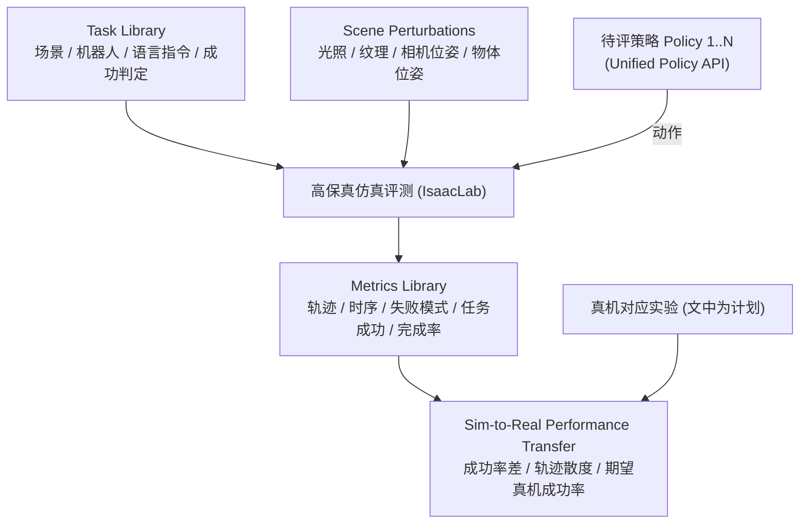

# Robot Policy Evaluation for Sim-to-Real Transfer

**Robot Policy Evaluation for Sim-to-Real Transfer: A Benchmarking Perspective** 收录于 [Awesome-Real2Sim2Real](https://github.com/sun254667/Awesome-Real2Sim2Real) **第 059/063** 篇，分组 **Benchmarks Simulators & Datasets**。本页是 **清单索引**：给出它在清单中的位置与原文入口，方法细节和量化结果请看原文。

## 一句话定义

A benchmarking perspective on robot policy evaluation for sim-to-real transfer

## 英文缩写速查

| 缩写 | 英文全称 | 简要说明 |
|------|----------|----------|
| Sim2Real | Simulation to Real | 仿真策略迁移到真机 |
| Real2Sim | Real to Simulation | 真机数据重建/校准仿真 |
| R2S2R | Real2Sim2Real | 真机→仿真→真机闭环 |
| DR | Domain Randomization | 域随机化 |

## 为什么重要

- A benchmarking perspective on robot policy evaluation for sim-to-real transfer
- 想横向对照同一分组的其他工作，可以从 [Awesome-Real2Sim2Real 技术地图](../overview/sun-awesome-r2s2r-technology-map.md) 逐条展开。
- 顺着列表实体 [Awesome-Real2Sim2Real](../entities/awesome-real2sim2real.md) 与下方关联的方法 / 任务页，可以接回对应的学习主线。

## 流程总览

图依据：论文 §IV Proposed Benchmarking Framework、§III-A/C / Fig.1（这是立场/基准设想论文，图为其提出的评测框架，真机实验在文中为计划而非已完成）

## 核心信息

| 字段 | 内容 |
|------|------|
| 编号 | 059/063 |
| 分组 | Benchmarks Simulators & Datasets |
| 出处 | arXiv 2025 |
| 论文 | <https://arxiv.org/abs/2508.11117> |

## 核心机制（归纳）

论文 `arXiv:2508.11117v1` 围绕“高保真闭环仿真能否可信预测真机部署表现”重构 Sim-to-Real 评测闭环：

- **Task Complexity T1–T4（任务复杂度分级）**：从单步稳定原语（T1）延伸到多步组合、柔性/可变形体及动态干扰任务（T4），识别策略在长时序与复杂接触下的崩溃阈值。
- **Visual & Scene Perturbations V1–V5（五维视觉/环境扰动）**：在 `IsaacLab` 高保真场景库中正交施加光照、纹理、相机视角偏移、背景干扰物及遮挡（V1–V5），剥离模型对静态场景纹理或初始摆放先验的记忆。
- **Unified Policy API（统一策略接口）**：标准化观测解码、控制频率与动作空间映射，使扩散策略、VLA 与 RL 基线在同一仿真场景库下零脚手架差异复测。

## 评测与指标

- **过程与结果指标（M1–M5）**：除最终二值任务成功率外，同步记录轨迹平滑度、耗时、安全边界及中间里程碑完成率（M1–M5），诊断“虽偶发成功但过程危险或低效”的伪鲁棒策略。
- **Sim-to-Real 迁移度量（S1–S3）**：引入包括 **MMRV**（Mean Maximum Rank Violation）与排序相关性在内的跨环境一致性指标，并形式化**贝叶斯后验达标概率 $p(S_{\text{real}} > \theta \mid S_{\text{sim}}, T, l)$**——用于定量估计“在仿真中达到得分 $S_{\text{sim}}$ 的策略，在真机达成阈值 $\theta$ 的统计置信度”。

## 与其他工作对比

- 与 [Real-to-Sim 3DGS Soft-Body Evaluation](./paper-sa-2511-04665-real-to-sim-robot-policy-evaluation-with-gaussia.md)（重点解决软体实景重建与真机相关验证 `Pearson r / MMRV`）及 [LIBERO-VPro](./paper-libero-vpro.md)（执行期视觉扰动基准）互补：本文着重确立跨任务（T1–T4）与跨扰动（V1–V5）的统一接口与贝叶斯真机置信框架。
- 横向专题见 [Awesome-Real2Sim2Real 技术地图](../overview/sun-awesome-r2s2r-technology-map.md)（**Benchmarks Simulators & Datasets** 分组）与 [具身大模型评测基准选型闭环](../queries/embodied-eval-benchmark-selection-loop.md)。

## 结论

**可信的 Sim-to-Real 评测不应只看干净仿真成功率，而须用正交扰动矩阵（T1–T4 × V1–V5）、排名一致性（MMRV）与贝叶斯后验置信估计 $p(S_{\text{real}} > \theta \mid S_{\text{sim}}, T, l)$ 共同校准“仿真排名能多大程度推论真机部署”。**

1. **先分层再打分**：把任务复杂度（T1–T4）与视觉域隙扰动（V1–V5）正交拆解，避免用单一总成功率掩盖具体失效维度。
2. **用 Unified Policy API 排除脚手架偏差**：统一频率与观测—动作协议后，高保真 `IsaacLab` 场景库才能产出横向可比的 M1–M5 诊断。
3. **当前阶段定位为设计蓝图**：`arXiv:2508.11117v1` 为方法论与框架论文，真机配对校验在文中属于规划蓝图，尚未附带开源基准代码或实机定量对比表。

## 局限与常见误区

1. 不要把纯仿真高分或单一点估计成功率当作真机达标保证——需结合 S1–S3（MMRV 与后验达标概率）评估域隙放大风险。
2. 本文未发布可执行开源仓库与标准排行榜数值，具体实验落地需搭配实体/实景配对基准（如 `Real2Sim-Eval` 或 `Uranus`）共同实施。

## 工程实践

- **按 T1–T4 与 V1–V5 二维矩阵设计消融评测**：先划分任务复杂度（T1 单步原语 → T4 长程多阶段可变形/动态交互），再正交叠加视觉与场景扰动（V1–V5：光照/纹理、遮挡、干扰物、视角偏移等），避免仅报告干净场景总分。
- **使用 Unified Policy API 统一解耦策略与 IsaacLab 场景库**：将观测解码、控制频率与动作空间缩放隔离在统一接口外，确保多基线复用同一高保真物理/光照测试集。

## 源码运行时序图

**不适用** — `arXiv:2508.11117v1` 属于领域综述与评估方法论定位论文（Benchmarking Perspective），提出了 `T1–T4` / `V1–V5` / `M1–M5` / `S1–S3` 指标框架及接口设计蓝图，未随论文发布独立官方代码仓库或实验结果表。

## 关联页面

- 评测闭环：[具身大模型评测基准选型闭环](../queries/embodied-eval-benchmark-selection-loop.md) — 本文提出的 `T1–T4` / `V1–V5` / `S1–S3` 指标对应闭环中的真机一致性外推与分级压测视角
- 列表实体：[Awesome-Real2Sim2Real](../entities/awesome-real2sim2real.md)
- 技术地图：[Awesome-Real2Sim2Real 技术地图](../overview/sun-awesome-r2s2r-technology-map.md)
- 方法/任务：[reinforcement-learning.md](../methods/reinforcement-learning.md)、[locomotion.md](../tasks/locomotion.md)

## 参考来源

- [`sources/papers/sun_awesome_r2s2r_2508_11117_robot-policy-evaluation-for-sim-to-real.md`](../../sources/papers/sun_awesome_r2s2r_2508_11117_robot-policy-evaluation-for-sim-to-real.md) — 本条目策展摘录
- [`sources/papers/sun_awesome_r2s2r_catalog.md`](../../sources/papers/sun_awesome_r2s2r_catalog.md) — 列表总表
- [`sources/repos/awesome-real2sim2real.md`](../../sources/repos/awesome-real2sim2real.md)
- 论文：<https://arxiv.org/abs/2508.11117>
- [arXiv PDF](https://arxiv.org/pdf/2508.11117)：已全文通读 `arXiv:2508.11117v1`（涵盖 `T1–T4`、`V1–V5`、`M1–M5`、`S1–S3` 指标规范与 Unified Policy API / IsaacLab 场景库构想）。

## 推荐继续阅读

- [Awesome-Real2Sim2Real 仓库](https://github.com/sun254667/Awesome-Real2Sim2Real)
- [原文](https://arxiv.org/abs/2508.11117)
