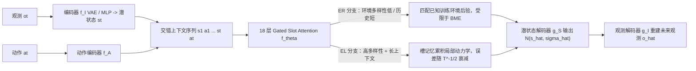
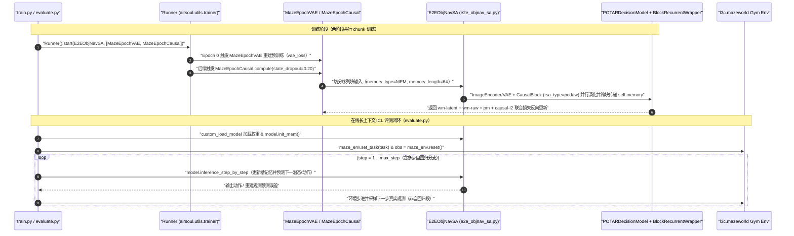

# ICL Emergence: Context and Diversity Matter (L2World)

**Context and Diversity Matter: The Emergence of In-Context Learning in World Models**（[arXiv:2509.22353](https://arxiv.org/abs/2509.22353)，ICLR 2026）由深圳市人工智能与机器人研究院（AIRS-CUHK）、中国科学技术大学（USTC）与星尘智能（Astribot）联合发表（Fan Wang、Zhiyuan Chen、Yuxuan Zhong、Shaoshan Liu 等），官方代码集成于 [`airs-cuhk/airsoul/tree/main/projects/MazeWorld`](https://github.com/airs-cuhk/airsoul/tree/main/projects/MazeWorld)。

## 一句话定义

**世界模型从有限训练集泛化到陌生环境的关键不是把单步零样本做大，而是用「足够高的训练环境多样性 + 足够长的交互上下文」把内在机制从静态环境识别（ER）推向非参数环境学习（EL），使预测误差随交互历史增长渐近趋零。**

## 英文缩写速查

| 缩写 | 英文全称 | 简要说明 |
|------|----------|----------|
| WM | World Model | 基于历史观测与动作预测环境未来转移的模型 |
| ICL | In-Context Learning | 部署期不更新权重，仅凭不断累积的交互历史提升新环境预测精度 |
| ER | Environment Recognition | 依赖权重记忆有限训练环境、靠上下文挑出最相似环境的识别机制 |
| EL | Environment Learning | 把新环境动力学直接编码进上下文工作记忆的非参数学习机制 |
| BME | Best Matching Error | 训练集内最优匹配环境与未知测试环境之间的最小总变差下界，ER 无法跨越 |
| GSA | Gated Slot Attention | L2World 采用的线性能耗序列架构，支持训练分块并行与推理递归保持固定槽状态 |
| L2World | Learn-to-WorldModel | 本文提出的高效世界模型架构（VAE + 18 层 GSA + 高斯潜转移解码器） |

## 为什么重要

- **澄清「为什么扩长上下文有时没用」：** 当训练环境数量 `|E|` 过小或上下文 `T` 太短时，模型只会学到 **环境识别（ER）**，误差卡死在 **最优匹配误差（BME）** 上；只有跨过理论相变门槛后 **环境学习（EL）** 才会涌现，打破零样本静态世界模型的泛化天花板。
- **把具身 ICL 理论延伸到世界模型侧：** 相对操作域的 [StellaVLA](./paper-stellavla-structured-icl-vla.md) 与 [Zero-WAM](./paper-zero-wam.md)，本文以严格信息论/学习论证明了 **Context length 与 Environment diversity** 共同触发动态世界表征涌现的必要条件，构成 [ICL 纵深路线](../../roadmap/depth-icl.md) Stage 5 的核心理论锚点。
- **开源长序列世界模型基座：** 在 `airsoul/projects/MazeWorld` 中开源 `E2EObjNavSA`（VAE + `POTARDecisionModel` / GSA）训练、验证、生成与交互式迷宫评测代码。

## 核心信息

| 字段 | 内容 |
|------|------|
| **机构** | 深圳市人工智能与机器人研究院（AIRS-CUHK）；中国科学技术大学（USTC）；星尘智能（Astribot） |
| **出处** | ICLR 2026（arXiv:2509.22353v2，2026-02-27） |
| **理论对象** | 世界模型 ICL 形式化定义、ER vs EL 二分机制与 Theorem 1 总变差上界 |
| **模型架构** | **L2World**：ResNet VAE（Cart-Pole 为 MLP）+ 18 层 Gated Slot Attention（GSA）+ 高斯潜状态转移解码头 `g_S` |
| **开源状态** | **已开源代码**：[`airs-cuhk/airsoul/tree/main/projects/MazeWorld`](https://github.com/airs-cuhk/airsoul/tree/main/projects/MazeWorld)（含 `train.py`、`validate.py`、`evaluate.py`、`generate.py`，依赖外部 `l3c.mazeworld` / Xenoverse 环境） |

## 核心原理

### 1. 世界模型 ICL 的形式化与双机制分离（§3.1–3.3）

设交互历史上下文 `C_T = (o_1, a_1, ..., o_T, a_T)`，World-Model ICL 严格定义为 **跨新环境的预测误差随 `T_1 > T_2` 单调下降**。作者将其内部推理过程解构为两类机制：

1. **环境识别（ER）：** 参数权重内化训练环境分布集合 `E` 对应的专家条件预测 `{p̂_{θ,e}}`，上下文仅充当分类器计算环境后验 `p(e | C_T)`。由 Theorem 1 给出其总变差误差上界：
   `TV(p̂_ER, p_{e0}) ≤ min[ (α/3)(|E|-1) T^{-1/2}, max TV(p_{e1}, p_{e2}) ] + min_{e∈E} TV(p̂_{θ,e}, p_{e0})`
   第一项匹配不确定性随 `T` 快速衰减，但第二项 **BME** 只取决于测试环境 `e0` 离训练集最近邻的固有距离——**即使 `T → ∞`，陌生环境上的误差也不会消失**。
2. **环境学习（EL）：** 不再把特征绑定到预设离散环境索引，而是利用长上下文直接估计状态转移计数/密度 `p(q_t, o_{t+1} | C_T) / p(q_t | C_T)`。Theorem 1 证明当上下文满足长度阈值 `T > 4|S|^2|A|^2 log(4|S||A|/δ)` 时：
   `TV(p̂_EL, p_{e0}) ≤ sqrt(2|O||S||A| log(4|O|/δ)) · T^{-1/2}`
   误差以 `T^{-1/2}` 稳定趋零，且与训练集覆盖密度解耦。因此，**低环境多样性（`|E|` 小）诱发 ER 捷径；唯有高多样性（`|E|` 大到参数无法逐一记忆）配合超长上下文（跨过 `T` 门槛）才能逼迫模型学会 EL**。

### 2. L2World 模型结构（§3.4）

- **空间压缩与交互拼接：** 图像观测经编码器 `f_I`（ResNet VAE，离散动作经 `f_A`）编码为紧凑潜向量序列 `(s_1, a_1, ..., s_t, a_t)`。
- **Gated Slot Attention（GSA）时序主干：** 18 层 GSA 在训练期支持按 chunk 并行计算长序列梯度（10K 步级别），而在推理/部署期切换为复杂度 O(1) 的固定槽记忆（代码 `memory_type: MEM`, `memory_length: 64`）递归更新。
- **高斯潜转移与两阶段监督：** 隐状态经 `g_S` 输出高斯预测 `N(ŝ_t, σ̂_{s,t})`，再用 `g_I` 重建可视化图像；训练期采用潜空间过渡损失 + 原始像素重建与策略预测联合约束。

### 流程总览

## 实验与评测

| 实验基准 | 核心实验设定 | 关键观测与结论 |
|----------|--------------|----------------|
| **Cart-Pole 动力学控制（§4.1）** | 改变物体质量/重力构造 `|E| ∈ {1, 4, 16, 8K}` 个环境（128K 轨迹 × 200 步） | `1-Env` / `4-Envs` 曲线迅速收敛并停留在 **`error = BME`** 线上（典型 ER）；`8K-Envs` 在约 `T > 10` 后反超 `4-Envs` 且持续越过 `BME` 线（EL 涌现）；过长训练小训练集会损坏 OOD EL |
| **Procedural Mazes 3D 导航（320M 帧，§4.2）** | `15×15` 程序生成迷宫、128×128 RGB、17 离散动作；正交对比环境数 × 长度（`32K-L[10K]` / `32K-S[100]` / `128-L` / `128-S`） | 未见迷宫 1 步预测 PSNR 随 `T=1→10K` 变化：L2World(`32K-L`) 从 **16.37 → 24.65**，大幅领先 L2World(`128-L` **21.52**)、`32K-S`（**20.31**）、Dreamer-v3（**22.12**，在 `T>100` / `k=8` 停滞）与 NWM（**17.85**） |
| **ProcTHOR 真实感室内迁移（§4.2 Table 3）** | 336 栋训练 / 256 栋未见房屋；对比从头训 `ProcTHOR-5K/40K`（2K 步）与 `Maze-32K-L` 预训练后微调 | `Maze-32K-L` 预训练 + `ProcTHOR-40K` 微调在未见房屋 `T=1000` 达 **25.40 PSNR**（Dreamer **21.02**，NWM **20.08**）；因微调轨迹仅 2K 步，推至 `T=10K` 时回落至 `23.94` |
| **机理与可解释性探针（§4.3–4.4）** | 随机打乱上下文观测顺序（20% / 50%）、GSA 隐记忆 t-SNE 聚类、潜预测编码替换 | 乱序对 EL 模型（`32K-L`）造成大幅精度崩塌，而 ER（`128-L`）几乎免疫；GSA 第 12/18 层槽记忆对新迷宫空间结构 Silhouette 达 **0.53 / 0.54**；将真实 `s_t` 替换为预测 `ŝ_t` 显示显著正相关 `ΔPSNR` |

## 与其他工作对比

| 对比对象 | 架构与上下文机制 | 与本文结论差异 |
|----------|------------------|----------------|
| **Dreamer-v3（RSSM）** | 固定维度 GRU 潜状态（k 步局部上下文截断） | 上下文有效记忆受限于短时窗口（在 `T>100` / `k=8` 后不再随历史增长获益），迷宫未见最高 22.12 PSNR |
| **NWM（Navigation World Model）** | 条件扩散 Transformer，依赖相对有限历史帧窗口 | 未见迷宫随上下文基本平坦（`16.20 → 17.85`），ProcTHOR 在 `T=1000` 为 20.08 |
| [Zero-WAM](./paper-zero-wam.md) / [Robot ICL 概念](../concepts/robot-in-context-learning.md) | 聚焦单条人类视频任务规格或操作策略的动作-上下文绑定 | 本文从纯动力学世界模型角度定量论证「环境多样性 + 窗口长度」决定 ER→EL 相变边界，二者在机制层高度互补 |

## 结论

**世界模型的上下文学习能力不是只要把模型训大就能白捡的性质，而是「高环境多样性迫使放弃记忆」与「超长序列窗口容纳局部动力学建模」双重压力下的相变产物。**

1. 评估任意具身世界模型是否真具备自适应学习（EL）而非套壳记忆（ER），必须绘制 **OOD 环境预测误差随上下文步数 `T=1 → 10K` 的渐近曲线**，并核查是否跌破训练集最优匹配误差（BME）下限。
2. **数据多样性与序列长度缺一不可**：Maze-`128-L`（长上下文但仅 128 个迷宫）卡在 ER 瓶颈（21.52）；Maze-`32K-S`（3.2 万个迷宫但仅 100 步）无法支撑长程推断（20.31）；唯有 `32K-L` 达到 24.65 PSNR。
3. 微调阶段的序列长度截断会直接限制部署期有效工作记忆上限（ProcTHOR 在 2K 步截断微调后，`T=10K` 性能较 `T=1000` 出现回撤），长程预训练后的下游微调也应尽量保长窗口。
4. 工程落地可直接复用 `airs-cuhk/airsoul` 中经过 GSA（`BlockRecurrentWrapper`）封装的 `E2EObjNavSA` 两阶段训练框架与分段策略 dropout（`state_dropout=0.20`），兼顾 10K 步训练吞吐与低内存推理。

## 源码运行时序图

以下时序严格依据 [`airs-cuhk/airsoul/tree/main/projects/MazeWorld`](https://github.com/airs-cuhk/airsoul/tree/main/projects/MazeWorld) 与核心模型文件（`train.py`、`maze_epoch.py`、`evaluate.py`、`e2e_objnav_sa.py`、`blockrec_wrapper.py`）：

## 工程实践

| 项 | 内容 |
|----|------|
| **两阶段训练配方** | `train.py` 先通过 `MazeEpochVAE` 收敛视觉编码重建，再进入 `MazeEpochCausal` 分块联合优化（`config.yaml` 默认 `rsa_type: podaw`、`memory_type: MEM`、`memory_length: 64`、分支正则 `state_dropout=0.20`） |
| **多卡与长度配置** | 通过 `python train.py config.yaml --configs key=value` 热覆写分块步长与损失权重；支持 `validate.py` 静态评测及 `generate.py`（`GeneratorRunner`）离线生成轨迹 |
| **跨任务迁移提示** | 当从高多样性长上下文预训练域迁移到窄长度下游域（如 ProcTHOR 2K 步）时，避免在过短序列上过度微调，防止破坏原本已激活的 EL 长上下文工作记忆 |
| **外部环境准备** | 运行 `evaluate.py` 与迷宫交互测试需预先安装配套的 `FutureAGI/Xenoverse`（含 `l3c.mazeworld` / `mazeworld-discrete-3D-v1`）环境与数据生成脚本 |

## 局限与风险

- **纯动力学预测而无闭环策略-奖励训练：** 论文实验集中于观测与未来帧预测（`1-step PSNR`、多步预测 MSE 及 Cart-Pole 控制动力学辨识），L2World 本身不直接输出面向复杂高维机械臂的闭环奖励最大化策略，需与 MBRL 或动作解码头耦合落地。
- **高斯潜态与随机环境瓶颈：** 解码头 `g_S` 假设下一潜状态服从单峰高斯分布，当环境存在高度多模态随机转移时可能发生均值模糊；ProcTHOR 长程 10K 步出现轻微过拟合/长度外推衰退也提示长微调配方仍待完善。
- **工程仓依赖外部迷宫套件：** 仓库 `projects/MazeWorld/README.md` 仍带建设中提示，320M 帧训练语料需通过 Xenoverse 本地生成脚本重制，不能一键下载完整预训练数据与权重。

## 与其他页面的关联

- [生成式世界模型（Generative World Models）](../methods/generative-world-models.md) — 序列世界模型主线定位
- [Model-Based RL](../methods/model-based-rl.md) — 与 Dreamer-v3 等有模型强化学习框架对比
- [机器人 In-Context Learning](../concepts/robot-in-context-learning.md) — 与操作域纯 ICL、快权重 TTT 共用上下文学习边界定义
- [ICL 纵深路线](../../roadmap/depth-icl.md) — Stage 5「规模涌现与严格 ICL 评测」核心理论依据
- [In-Context Learning for Robots 综述](./paper-in-context-learning-robots-survey.md) — 第三类世界模型接口的理论补充
- [Embodied ICL 四路线对比](../comparisons/wam-ttt-robottt-stellavla-zero-wam-embodied-icl.md) — 与 Zero-WAM、WAM-TTT 等操作世界模型的机理映射
- [Autonomous Exploration](../tasks/autonomous-exploration.md) — 未知迷宫与室内主动探索获取上下文的场景背景
- [视觉语言导航（VLN）](../tasks/vision-language-navigation.md) — 3D 迷宫与 ProcTHOR 室内导航评估协议
- [Manipulation](../tasks/manipulation.md) / [Locomotion](../tasks/locomotion.md) — 动力学辨识在机械臂载荷与运动地形适应上的迁移语境
- [Awesome World Models](../entities/awesome-world-models.md) / [技术地图](../overview/sun-awesome-wm-technology-map.md) — 清单 #555 原属条目入口

## 参考来源

- [ICL Emergence 论文全文精读归档（arXiv:2509.22353 / ICLR 2026）](../../sources/papers/sun_awesome_wm_2509_22353_icl-emergence-context-and-diversity-matt.md)
- [AIRS-CUHK AIRSoul / MazeWorld 官方代码仓归档](../../sources/repos/airs-cuhk-airsoul.md)
- [Awesome World Models 总目录归档](../../sources/papers/sun_awesome_wm_catalog.md)
- [awesome-world-models 仓库归档](../../sources/repos/awesome-world-models.md)

## 推荐继续阅读

- 论文原文（arXiv / ICLR 2026）：<https://arxiv.org/abs/2509.22353>
- 官方源码（MazeWorld）：<https://github.com/airs-cuhk/airsoul/tree/main/projects/MazeWorld>
- 配套迷宫环境（Xenoverse）：<https://github.com/FutureAGI/Xenoverse>
