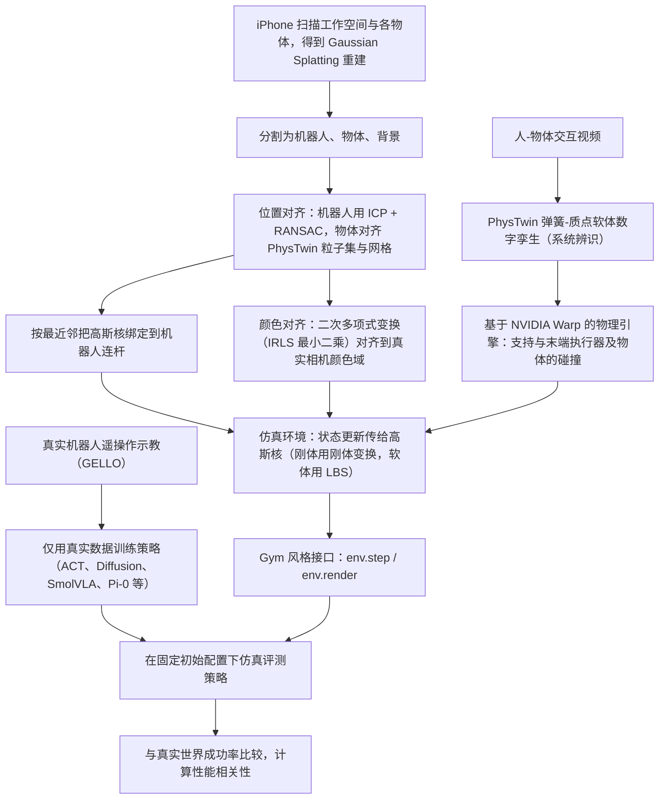
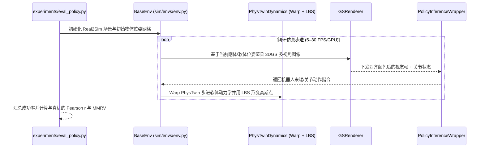

# Real-to-Sim Robot Policy Evaluation with Gaussian Splatting Simulation of Sof...

**Real-to-Sim Robot Policy Evaluation with Gaussian Splatting Simulation of Soft-Body Interactions** 收录于 [Awesome-Real2Sim2Real](https://github.com/sun254667/Awesome-Real2Sim2Real) **第 028/063** 篇，分组 **31 Real2Sim from Video**。本页是 **清单索引**：给出它在清单中的位置与原文入口，方法细节和量化结果请看原文。

## 一句话定义

Real-to-sim robot policy evaluation with Gaussian splatting simulation of soft-body interactions

## 英文缩写速查

| 缩写 | 英文全称 | 简要说明 |
|------|----------|----------|
| Sim2Real | Simulation to Real | 仿真策略迁移到真机 |
| Real2Sim | Real to Simulation | 真机数据重建/校准仿真 |
| R2S2R | Real2Sim2Real | 真机→仿真→真机闭环 |
| DR | Domain Randomization | 域随机化 |

## 为什么重要

- Real-to-sim robot policy evaluation with Gaussian splatting simulation of soft-body interactions
- 想横向对照同一分组的其他工作，可以从 [Awesome-Real2Sim2Real 技术地图](../overview/sun-awesome-r2s2r-technology-map.md) 逐条展开。
- 顺着列表实体 [Awesome-Real2Sim2Real](../entities/awesome-real2sim2real.md) 与下方关联的方法 / 任务页，可以接回对应的学习主线。

## 流程总览

图依据：论文 §III Method（Fig. 2、§III-B/C/D）。

## 核心信息

| 字段 | 内容 |
|------|------|
| 编号 | 028/063 |
| 分组 | 31 Real2Sim from Video |
| 出处 | arXiv 2025 |
| 论文 | <https://arxiv.org/abs/2511.04665> |

## 核心机制（归纳）

论文与官方仓库 [kywind/real2sim-eval](https://github.com/kywind/real2sim-eval) 打通了从真机场景采集到可变形软体闭环评测的 Real-to-Sim 管线：

- **真机采集与 3DGS 多软件配准**：依托 `xArm 7 + RealSense D405/D455 + GELLO` 采集示范与网格评测基准（`Toy packing 39 demos / 20 grid eval`、`Rope 56 / 27`、`Push-T 60 / 16`），以 `Scaniverse` 和 `SuperSplat` 重建 3D 高斯资产后，执行 `ICP/RANSAC` 刚体配准并采用**二次 IRLS 颜色对齐**修正相机曝光与白平衡域隙。
- **Warp PhysTwin 动力学 + LBS 驱动渲染**：采用 NVIDIA Warp 弹簧-质点模型 `PhysTwin` 求解柔性体接触碰撞和大形变，并通过线性混合蒙皮（`LBS`）实时变形 3D 高斯椭球传入 `GSRenderer`，单 GPU 达到 **5–30 FPS** 闭环推理。

## 评测与指标

- **Table I 真机—仿真排位一致性（Pearson `r` / `MMRV`）**：
  - 软体与重排三项任务在 Real2Sim-Eval 中取得 **`0.944 / 0.076`**、**`0.901 / 0.174`**（同任务传统物理仿真 `IsaacLab` 为 `0.237`）以及 **`0.915 / 0.108`**（`IsaacLab` 为 `0.649`）。
- **大规模扩展稳定性**：在 **200-episode** 大规模评测扩展实验中，与真机表现仍维持 **`r ≥ 0.897`** 的强相关性，显著优于纯刚体几何建模方案。

## 与其他工作对比

- 与纯网格/刚体物理仿真（如 `IsaacLab` 默认场景）相比，引入 `PhysTwin + 3DGS` 显著抬升了绳索/玩具等柔性交互任务的真机相关性（`0.901` vs `0.237`）；与基于纯视频生成的世界模型（如 [Uranus](./paper-uranus.md)）相比，保留了基于显式物理弹簧-质点的碰撞与形变求解。
- 横向专题见 [Awesome-Real2Sim2Real 技术地图](../overview/sun-awesome-r2s2r-technology-map.md)（**31 Real2Sim from Video** 分组）与 [具身大模型评测基准选型闭环](../queries/embodied-eval-benchmark-selection-loop.md)。

## 结论

**面向柔性物体与复杂桌面材质的 Real2Sim 策略评测，把“3DGS 实景外观 + IRLS 颜色校准 + Warp PhysTwin 软体动力学”耦合进闭环后，能稳定跑出 `r = 0.901–0.944`、低违序率（`MMRV = 0.076–0.174`）的真机排序保真度。**

1. **开源工具链已具备端到端入口**：官方仓 `kywind/real2sim-eval` 公开 `experiments/eval_policy.py`、`sim/envs/env.py:BaseEnv`、`GSRenderer` 与 `PhysTwinDynamics`，并附 HuggingFace `gs-scans`/`phystwin-*` 资产。
2. **颜色对齐与软体建模缺一不可**：仅建 3DGS 外观而不做二次 IRLS 颜色校准会让视觉策略过早失效，而不引入 PhysTwin 弹簧-质点则会像纯刚体基准一样拉垮相关性。
3. **适用于高成本真机前筛与大样本统计**：单 GPU 5–30 FPS 足以支撑 200-episode 级扩展评估（`r ≥ 0.897`），显著压低实体机械臂耗损。

## 局限与常见误区

1. 不要将其视作零样本全自动跨场景通用模拟器——每换新实体桌面与软体材质仍需通过 Scaniverse/SuperSplat 重建并标定物性参数。
2. 不可忽视照明漂移：真机光源大幅变化时仍需重新拟合 IRLS 颜色对齐参数。

## 工程实践

- **传感器采集与多软件标定对齐**：论文基准在 `xArm 7 + RealSense D405/D455 + GELLO` 平台上构建；利用 `Scaniverse` 与 `SuperSplat` 获取静态 Gaussian Splat 资产后，须经 `ICP/RANSAC` 刚体配准及**二次 IRLS 颜色对齐（quadratic IRLS color align）**消除真实相机曝光与白平衡偏移。
- **Warp PhysTwin + LBS 软体动力学耦合**：在 NVIDIA Warp 中以弹簧-质点网格（PhysTwin）物理演化软体几何，并通过线性混合蒙皮（LBS）驱动 3D 高斯椭球同步形变，兼顾 `5–30 FPS/GPU` 的闭环渲染与软体交互。
- **按任务特性对齐评测网格规模**：复现标准评测需分别准备对应规模初始状态网格（论文 Toy packing `39 demos / 20 grid eval`、Rope routing `56 / 27`、Push-T `60 / 16`），并可直接调用 HuggingFace `gs-scans` 与 `phystwin-*` 资产。

## 源码运行时序图

以下时序基于官方仓库 [kywind/real2sim-eval](https://github.com/kywind/real2sim-eval)（`master` 分支）：

## 关联页面

- 评测闭环：[具身大模型评测基准选型闭环](../queries/embodied-eval-benchmark-selection-loop.md) — 提供含软体交互的 3DGS Real2Sim 保真闭环与真机相关性验证
- 列表实体：[Awesome-Real2Sim2Real](../entities/awesome-real2sim2real.md)
- 技术地图：[Awesome-Real2Sim2Real 技术地图](../overview/sun-awesome-r2s2r-technology-map.md)
- 方法/任务：[reinforcement-learning.md](../methods/reinforcement-learning.md)、[locomotion.md](../tasks/locomotion.md)

## 参考来源

- [`sources/papers/sun_awesome_r2s2r_2511_04665_real-to-sim-robot-policy-evaluation-with.md`](../../sources/papers/sun_awesome_r2s2r_2511_04665_real-to-sim-robot-policy-evaluation-with.md) — 本条目策展摘录
- [`sources/papers/sun_awesome_r2s2r_catalog.md`](../../sources/papers/sun_awesome_r2s2r_catalog.md) — 列表总表
- [`sources/repos/awesome-real2sim2real.md`](../../sources/repos/awesome-real2sim2real.md)
- 论文：<https://arxiv.org/abs/2511.04665>
- [arXiv PDF](https://arxiv.org/pdf/2511.04665)：已全文通读 `arXiv:2511.04665v2`（涵盖 §III 方法、PhysTwin + IRLS + LBS 流程、Table I、200-episode 扩展实验，并核对 `kywind/real2sim-eval` 仓库）。

## 推荐继续阅读

- [Awesome-Real2Sim2Real 仓库](https://github.com/sun254667/Awesome-Real2Sim2Real)
- [原文](https://arxiv.org/abs/2511.04665)
