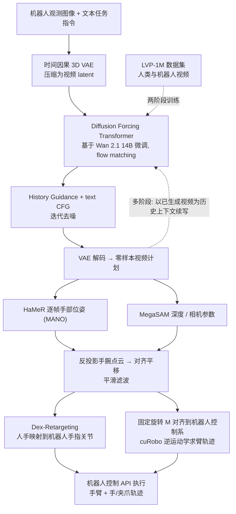

# LVP：Large Video Planner

**LVP**（*Large Video Planner Enables Generalizable Robot Control*，[arXiv:2512.15840](https://arxiv.org/abs/2512.15840)，MIT / UC Berkeley / Harvard）是一个 14B 参数的视频生成模型：给一张机器人观测图和一句指令，生成一段「人手完成任务」的视频计划，再用手部重建与重定向把它变成机器人动作。收录于 [Awesome World Models](https://github.com/sun254667/awesome-world-models) 第 382/571 篇（分组 815 World Models x Policy Learning），同时位于 CoRL 2026 阅读清单 P0 档（World Models & World Action Models 组）。

## 一句话定义

以视频生成模型（Wan 2.1 14B 继续预训练）作为零样本「视觉规划器」，输出视频计划，再由**独立的**动作提取流水线（HaMeR、MegaSaM、Dex-Retargeting、cuRobo）开环执行（摘要、§3、§5）。它不是端到端的「视频到动作」策略。

## 英文缩写速查

| 缩写 | 英文全称 | 简要说明 |
|------|----------|----------|
| LVP | Large Video Planner | 本文模型 |
| LVP-1M | LVP 1M-clip dataset | 作者策展的 140 万条人类与机器人片段（§3.2） |
| VLA | Vision-Language-Action | 在 MLLM 上加动作输出的策略，本文的对照范式 |
| MLLM | Multimodal Large Language Model | 多模态大语言模型 |
| VAE | Variational Autoencoder | 本文用时间因果 3D VAE 压缩视频（§3.1） |
| DiT | Diffusion Transformer | 扩散 Transformer 骨干 |
| CFG | Classifier-Free Guidance | 无分类器引导；History Guidance 是其历史帧变体 |
| I2V / V2V | Image-to-Video / Video-to-Video | 首帧条件 / 多帧历史条件生成 |
| MANO | Hand Model with Articulated and Non-rigid defOrmations | 参数化人手模型 |
| HaMeR | Hand Mesh Recovery | 逐帧人手网格估计（第三方模型） |
| IK | Inverse Kinematics | 逆运动学，用 cuRobo 求解 |

## 为什么重要

- 论文的论点（作者自述，§1）：VLA 把 MLLM 的知识迁移到稀缺的机器人动作数据上，是「不对称迁移」，遇到新任务泛化差；视频天然包含状态与动作的时空序列，且网络上数据丰富。
- 它把「任务级泛化」（新动词、新场景）作为评测目标，并用第三方众包任务来测（§4），而不是只测同一任务族内的物体或位置变化。
- 开放了模型、数据与训练代码的声明（§6），可作为视频规划路线的开源基线；同分组横向对照见 [Awesome World Models 技术地图](../overview/sun-awesome-wm-technology-map.md)。

## 核心原理与流程总览

图依据：论文 §3.1 / Fig.2、§3.2、§3.3 与附录 D。

### 视频模型（§3.1）

- 时间因果 3D VAE 把视频压成 16 通道潜变量并冻结；DiT 在潜空间用 flow matching 训练，权重来自 Wan 2.1 I2V 14B，去掉其遮罩与图像引导通道，保留首帧 CLIP 特征与 UMT5 文本交叉注意力。
- Diffusion Forcing：每次随机取 0–6 个潜帧作历史，历史与未来各自加独立噪声，历史有 50% 概率零噪声（Fig.2）。采样时把历史噪声设为 0 即得 I2V 或 V2V 条件，无需额外交叉注意力。
- 采样同时用 History Guidance 与文本 CFG（式 1–4）；上下文最多 24 帧，迭代续写得到多阶段计划（Fig.7）。
- 训练两阶段：200B token 的继续预训练（60k 步、batch 128），再用低光流（低相机运动）子集微调 10k 步；约 14 天、128 张 H100（§3.1、附录 B）。

### 数据 LVP-1M（§3.2、附录 A）

- 4 个机器人数据集（Bridge、DROID、Language Table、AgiBot-World）加 4 个人类数据集（Ego4D、Epic-Kitchens、Something-Something、过滤后的 Panda-70M），共 1.4M 片段（Table 1）；采样权重在附录 B 给出。
- 机器人片段按人类速度重采样到 3 秒、16 fps；要求第一帧可见手或夹爪；剔除失败轨迹；用 Gemini 重写动作中心字幕，每条 2–5 种。作者称时间对齐对跨形态迁移「至关重要」，但正文没有给出对应消融（见下文局限）。

### 视频到动作（§3.3、附录 D）

- HaMeR 给出 MANO 与手腕朝向；MegaSaM 给出深度与相机参数，反投影手腕点得到平移；缺失帧插值，因果 Savitzky-Golay 平滑。
- Dex-Retargeting 求手指关节；固定旋转 M 把相机系对齐机器人控制系；cuRobo 求臂 IK；平行夹爪则用 GraspNet 候选加启发式触发抓取（附录 D.6）。

## 工程实践

- 训练规模大：128 张 H100 约 14 天（§3.1）；推理单段视频计划在单张 A100 上需数分钟（§5），因此只能离线生成再开环执行。
- 机器人侧：Franka Panda + 平行夹爪控制频率 15 Hz，Unitree G1 + Inspire 灵巧手 5 Hz（附录 F）。
- 动作提取依赖三个第三方模型（HaMeR、MegaSaM、Dex-Retargeting），任一出错都可能导致任务失败（§5）。
- 评测协议：第三方众包 200 条、筛到 100 条；每方法每提示生成 4 段，四级打分（正确接触、正确终态、任务完成、完美完成），报告平均与 Best@4（§4.1–4.2）。
- 开源：论文声称开源模型、数据与训练代码，但正文只给项目页 <https://www.boyuan.space/large-video-planner/>，未给仓库地址，本页不填 `code:`。

### 关键结果（论文数字）

| 评测 | 内容 | 数字 | 出处 |
|------|------|------|------|
| 视频计划，Level 3 任务完成（平均） | Ours / Wan 2.1 / Hunyuan / Cosmos-Predict 2 | 59.3% / 39.3% / 13.5% / 7.5% | Table 2 |
| 视频计划，Level 4 完美完成（平均） | 同上 | 44.0% / 20.5% / 7.2% / 2.5% | Table 2 |
| 视频计划，Level 1 正确接触（平均） | 同上 | 87.3% / 83.9% / 68.7% / 45.3% | Table 2 |
| 真机，夹爪组 A（4 项，各 10 次） | Ours / π0 / OpenVLA | 5、3、2、4 / 3、1、1、0 / 全 0 | Fig.8 |
| 真机，OOD 组 C（4 项，各 10 次） | 同上 | 4、2、6、1 / 0、0、1、0 / 全 0 | Fig.8 |
| 真机，灵巧手组 B（8 项，每项 5 或 10 次） | 仅 Ours | 如 Open Door 6/10、Wipe Table 8/10、Tear off Clear Tape 2/5 | Fig.8 |

## 评测证据与清单说法的对比核对

清单原句：「Robot foundation model built on internet-scale video pretraining rather than a VLM, planning in video and generalizing to new tasks.」（作者说明是 LLM 据摘要起草）。

| 清单片段 | 核对结论 |
|----------|----------|
| 机器人基础模型 | 部分成立。论文自称在探索「用视频作为机器人基础模型的主模态」（摘要、§6），但模型本身只输出视频；动作来自另一条由第三方模型组成的提取流水线，且执行是开环的（§3、§5）。它不直接输出动作。 |
| 基于互联网规模视频预训练而非 VLM | 大体成立但需限定。起点是已有的 Wan 2.1 14B 视频模型，再在 LVP-1M（1.4M 片段，其中约 196k 来自过滤的 Panda-70M，其余多为人类第一人称与机器人数据集，Table 1）上继续预训练；并非从零开始，数据也不全是网络视频，机器人遥操作数据占大头（AgiBot-World 863k）。文本侧仍用 UMT5 编码器；论文中没有「不用任何语言模型」的说法。 |
| 在视频中规划 | 成立（§3.1）。 |
| 泛化到新任务 | 有证据但需限定：视频计划层面，在 100 条第三方任务上 Level 3 为 59.3%（Table 2）；机器人层面，每项仅 5 或 10 次真机试验，成功率从 2/10 到 8/10 不等，夹爪组 A 与 OOD 组 C 多数项低于 5/10（Fig.8）。论文的措辞是「show evidence of task-level generalization」（§6）。 |
| 未提及的限定 | 清单未提：只测了 π0 与 OpenVLA 的公开 checkpoint、无微调；灵巧手任务没有 VLA 基线；开环执行；视频生成需数分钟（§4.3、§5）。 |

## 结论

LVP 展示了生成视频计划经重建和重定向驱动机器人，但分钟级生成与开环执行限制了在线用途。

- 分别评测视频任务完成、四维重建和机器人执行，第三方视频评分不能直接代表部署成功。
- 对目标末端核验重定向可行性，平行夹爪与灵巧手的适配难度不同。
- 需要实时或精细交互时增加闭环与失败恢复，并对齐基线数据和微调条件后再比较。

## 局限

论文自述（§5）：

- 单段视频计划在单张 A100 上需数分钟，无法实时部署；
- 4D 重建与手部位姿估计模型会出错，导致任务失败；
- 重定向对某些灵巧手不充分，对平行夹爪因自由度低而更难；
- 整体开环执行，对灵巧任务不够。

笔者看到的未验证之处（非论文自述）：

- 真机每项仅 5 或 10 次试验，无置信区间；基线只测公开 checkpoint 且未微调，与 LVP 的数据和部署方式并不对等，论文也未做公平微调的对照。
- Table 2 的 Level 1–4 由第三方标注者打分，评分者是否盲评、评分者间一致性在正文中没有说明。
- 论文称时间对齐与失败轨迹过滤很关键（§3.2），但正文与附录没有对应消融。
- §4.3 正文列出的任务（如 in-hand rotation、pen writing）与 Fig.8 实际任务不一致，且把 Fig.8 误称 Table 8。
- 灵巧手结果没有基线，无法判断相对优势；未做闭环或失败后重试的评测。

## 关联页面

- 列表实体：[Awesome World Models](../entities/awesome-world-models.md)
- 技术地图：[Awesome World Models 技术地图](../overview/sun-awesome-wm-technology-map.md)
- 方法：[生成式世界模型](../methods/generative-world-models.md)、[基于模型的强化学习](../methods/model-based-rl.md)、[VLA](../methods/vla.md)、[Diffusion Policy](../methods/diffusion-policy.md)
- 概念：[扩散模型](../concepts/diffusion-model.md)、[Diffusion Transformer](../concepts/diffusion-transformer.md)、[运动重定向](../concepts/motion-retargeting.md)、[视频即仿真](../concepts/video-as-simulation.md)
- 相邻论文：[Diffusion Forcing](../entities/paper-sa-2407-01392-diffusion-forcing-next-token-prediction-meets-fu.md)、[OpenVLA](../entities/paper-openvla.md)、[π0](../entities/paper-pi0.md)
- 任务：[Manipulation](../tasks/manipulation.md)

## 参考来源

- [`sources/papers/lvp-large-video-planner_arxiv_2512_15840.md`](../../sources/papers/lvp-large-video-planner_arxiv_2512_15840.md) — 全文通读归档
- [`sources/papers/sun_awesome_wm_2512_15840_lvp-large-video-planner-enables-generali.md`](../../sources/papers/sun_awesome_wm_2512_15840_lvp-large-video-planner-enables-generali.md) — 清单策展摘录
- [`sources/papers/sun_awesome_wm_catalog.md`](../../sources/papers/sun_awesome_wm_catalog.md) — 列表总表
- [`sources/repos/awesome-world-models.md`](../../sources/repos/awesome-world-models.md)
- 论文：<https://arxiv.org/abs/2512.15840>；[arXiv PDF](https://arxiv.org/pdf/2512.15840)

## 继续阅读

- [项目页](https://www.boyuan.space/large-video-planner/)
- [Awesome World Models 仓库](https://github.com/sun254667/awesome-world-models)
- [原文](https://arxiv.org/abs/2512.15840)
