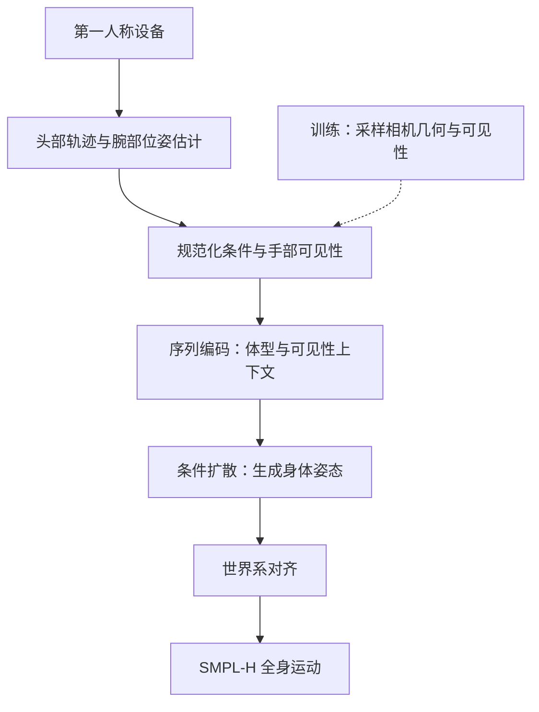
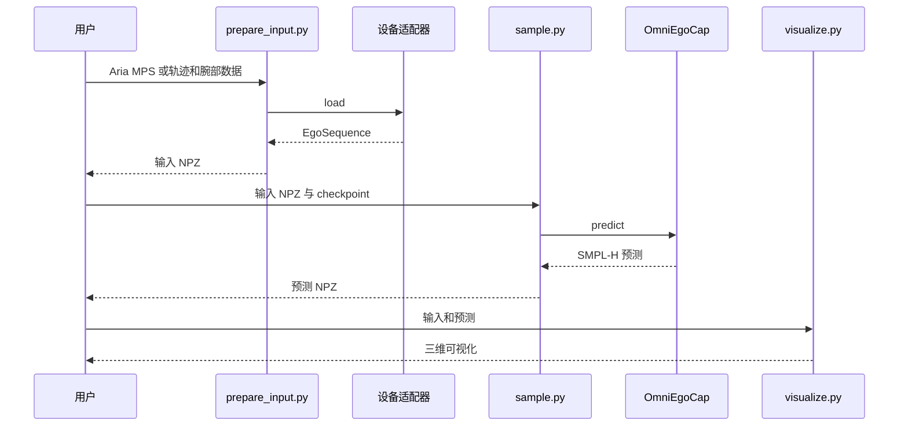

# OmniEgoCap：设备无关的序列级第一人称全身运动重建

## 一句话定义

首尔大学的 OmniEgoCap 利用头部轨迹及间歇可见的手腕追踪，通过序列级扩散重建全身运动，并通过几何感知增强适应不同设备。

## 英文缩写速查

| 缩写 | 英文全称 | 简要说明 |
|------|----------|----------|
| FoV | Field of View | 相机视场 |
| SLAM | Simultaneous Localization and Mapping | 同时定位与建图 |
| MPJPE | Mean Per Joint Position Error | 平均关节位置误差 |
| MPS | Machine Perception Services | Aria 机器感知服务 |

## 核心信息

| 字段 | 内容 |
|------|------|
| 机构 | 首尔大学 |
| 作者 | Kyungwon Cho、Jeonghyeon Na、Hanbyul Joo |
| 论文 | [arXiv:2512.19283v3](https://arxiv.org/html/2512.19283v3)，NeurIPS 2026 |
| 开源 | [官方代码](https://github.com/KyungWonCho/OmniEgoCap)和 checkpoint 已发布；权重 CC BY-NC 4.0 |

## 流程总览

输入依赖头部位姿和手腕观测；单目视频需 SLAM / 手部估计及相机到头部标定。Aria 可使用 MPS；Quest 可使用设备自带追踪。不可将其等同于原始视频直接端到端输出。

## 源码运行时序图

依据官方三个脚本：`sample.py` 默认启用 guidance optimization，可用 `--no_optimization` 关闭；可视化依赖 SMPL-H。

## 评测与指标

论文 OmniEgoDB 使用 4 人、50 段、177 分钟，Xsens 为参考；Aria stereo / RGB、GoPro、Quest 分别是不同评测轨道，序列数不同。表 3 无优化版本 MPJPE 分别为 **106.61、118.11、111.68、110.49 mm**；不同设备数值不可视为同一序列严格配对比较。iPhone 仅列为野外演示。

## 结论

**序列上下文和训练时视场变化使同一模型可用于论文评估的多种设备配置。**

1. 头部轨迹质量、相机到头部标定与手部追踪影响实际结果。
2. 论文提出序列级体型与可见性上下文，以利用长期观测。
3. 公开代码及权重便于复现；权重非商用，人体模型和数据另有许可。
4. 此页目前基于部分原文与官方入口；全文、全部附录和模型内部实现仍待核对。

## 关联页面

- [ReViV](./paper-reviv4d.md) — 直接从第一人称 RGB 重建多模态信息
- [遥操作](../tasks/teleoperation.md) — 第一人称示教采集
- [Awesome Egocentric Vision](./awesome-egocentric-vision.md) — 原策展索引

## 参考来源

- [论文归档](../../sources/papers/omniegocap-2512-19283.md)
- [项目页归档](../../sources/sites/omniegocap.md)
- [代码归档](../../sources/repos/omniegocap.md)
- [原策展摘录](../../sources/papers/sun_awesome_ego_2512_19283_omniegocap-camera-agnostic-sequence-leve.md)

## 推荐继续阅读

- [论文全文 v3](https://arxiv.org/html/2512.19283v3)
- [官方项目页](https://kyungwoncho.github.io/OmniEgoCap/)
