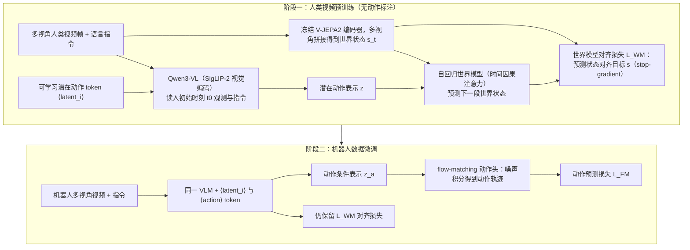
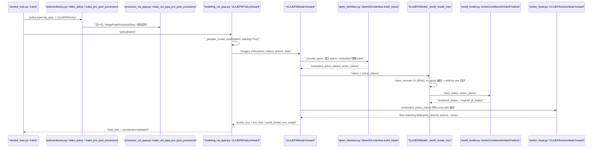
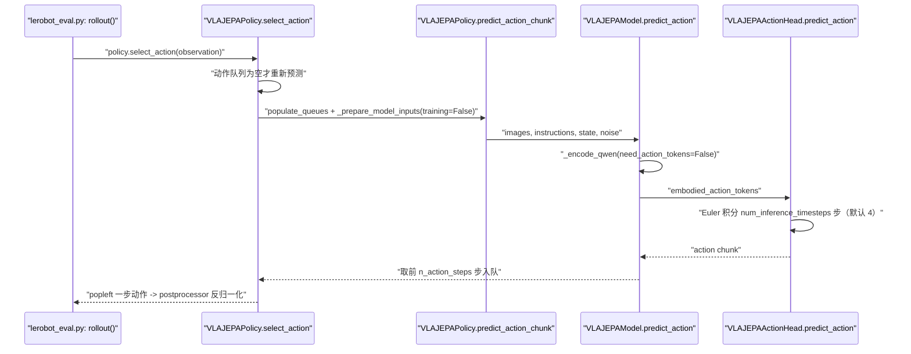

# VLA-JEPA

**VLA-JEPA: Enhancing Vision-Language-Action Model with Latent World Model** 收录于 [Awesome World Models](https://github.com/sun254667/awesome-world-models) **第 210/571** 篇，分组 **62 Joint WAM & Unified VLA-World Models**。本页是 **清单索引**：给出它在清单中的位置与原文入口，方法细节和量化结果请看原文。

## 一句话定义

Enhances VLA with a latent world model.

## 英文缩写速查

| 缩写 | 英文全称 | 简要说明 |
|------|----------|----------|
| WM | World Model | 环境前向预测模型 |
| WAM | World Action Model | 世界预测与动作联合建模 |
| VLA | Vision-Language-Action | 视觉–语言–动作策略 |
| MBRL | Model-Based RL | 基于模型的强化学习 |

## 为什么重要

- Enhances VLA with a latent world model.
- 想横向对照同一分组的其他工作，可以从 [Awesome World Models 技术地图](../overview/sun-awesome-wm-technology-map.md) 逐条展开。
- 顺着列表实体 [Awesome World Models](../entities/awesome-world-models.md) 与下方关联的方法 / 任务页，可以接回对应的学习主线。

## 流程总览

图依据：论文 §3.1–3.3 / Fig.2

## 核心信息

| 字段 | 内容 |
|------|------|
| 编号 | 210/571 |
| 分组 | 62 Joint WAM & Unified VLA-World Models |
| 出处 | arXiv 2026 |
| 论文 | <https://arxiv.org/abs/2602.10098> |
| 代码/项目 | <https://github.com/ginwind/VLA-JEPA> |

## 核心机制（归纳）

### 策展导读要点

Enhances VLA with a latent world model.

本页不复述论文公式与完整实验表；若需工程落地，请回到原文并对照站内相关方法页（见关联页面）。

## 评测与指标

- 本页 **没有搬运** 原文的量化 benchmark 与实机指标。
- 评测口径与具体数值以 [原文 / 项目页](https://arxiv.org/abs/2602.10098) 为准。
- 横向对照请回到 [技术地图](../overview/sun-awesome-wm-technology-map.md) 同分组条目。

## 与其他工作对比

- 本页 **不做** 与具体基线的逐项数值对比；同分组的横向对照请回到 [技术地图](../overview/sun-awesome-wm-technology-map.md) 的 **62 Joint WAM & Unified VLA-World Models** 分组逐条展开。
- 如果站内已经有这篇的深读页（含机构、实验表与源码运行时序图），请以那一页为准；本页只保留清单要点。
- 与清单内相邻条目孰优孰劣，本页不下结论：Awesome Highlights 可能滞后于论文最新版本，差异应以各自原文的问题设定与评测口径为准。

## 源码运行时序图

> 来源：LeRobot 固定提交 `9e5ee9859480e425a97a6836bb3fee479539beb5` 的 `src/lerobot/policies/vla_jepa/`（官方原仓库为 [ginwind/VLA-JEPA](https://github.com/ginwind/VLA-JEPA)，LeRobot 文档称其移植自 starVLA 的 `VLA_JEPA.py`；本页未逐行对照原仓库，未核实二者一致性）。

训练（世界模型损失仅训练期使用）：

推理（不加载世界模型分支的计算，只走 Qwen + 动作头）：

## LeRobot 实现

- **身份核对**：arXiv 2602.10098 标题 *VLA-JEPA: Enhancing Vision-Language-Action Model with Latent World Model*（arXiv API 核对，发布日期 2026-02-10），即本页；LeRobot 文档页 `docs/source/vla_jepa.mdx` 描述的是同一模型的移植。全库该 arXiv ID 仅此一个 canonical 节点。
- **组成**（读自文档与源码）：Qwen3-VL 骨干（`Qwen3VLInterface`）、DiT-B 流匹配动作头（`VLAJEPAActionHead`）、V-JEPA2 世界模型（`ActionConditionedVideoPredictor`，仅训练）。
- **损失**：`VLAJEPAModel.forward` 返回 `action_loss` 与 `wm_loss * world_model_loss_weight`（默认 0.1）；世界模型损失为预测帧嵌入与目标嵌入间的 L1，动作损失为流匹配速度的 MSE。
- **默认配置**：`chunk_size=7`、`n_action_steps=7`、`num_video_frames=8`、`num_inference_timesteps=4`、骨干 `Qwen/Qwen3-VL-2B-Instruct`（文档）。
- **权重**：LeRobot 组织下 `lerobot/VLA-JEPA-LIBERO`、`lerobot/VLA-JEPA-Pretrain`（DROID 1.0.1）、`lerobot/VLA-JEPA-SimplerEnv`，转换自 `ginwind/VLA-JEPA`（文档）。
- **限制**：`pre_snap_gripper_action` / `binarize_gripper_action` 是 starVLA LIBERO 评测环的移植，仅对 LIBERO 的夹爪约定成立，默认关闭（文档警告）；跨本体微调需 `reinit_modules` 重新初始化 `action_encoder` / `action_decoder` / `state_encoder`；`causal_world_model_context` 默认 `False`，开启会增加编码器调用。
- 文档称原论文在 ssv2 + DROID 上联合预训练 50k 步、LIBERO 再 30k 步（文档转述，未对照论文核实）。

## 结论

**这一页能给你的是「VLA-JEPA」在策展清单里的坐标与要点：够你判断要不要去读原文，但不能替代原文。**

- 可确证的只有清单坐标：分组 **62 Joint WAM & Unified VLA-World Models**，以及 Highlights 点出的问题设定；本页不自行推导新结论。
- 适用边界：本页不能替代原文 PDF；开源状态以项目页实际链接为准（清单可能滞后）。
- 要深读这篇，建议直接从原文入手，再回到下方关联的方法 / 任务页对照。

## 常见误区

1. 不要把 Awesome 条目的 Highlights 当成完整方法证明——它只是策展导读。
2. 若站内已有这篇的深读页，以那一页为准——本页只是清单入口，不含实验数据。

## 关联页面

- 列表实体：[Awesome World Models](../entities/awesome-world-models.md)
- 技术地图：[Awesome World Models 技术地图](../overview/sun-awesome-wm-technology-map.md)
- 方法/任务：[generative-world-models.md](../methods/generative-world-models.md)、[manipulation.md](../tasks/manipulation.md)

## 参考来源

- [`sources/papers/sun_awesome_wm_2602_10098_vla-jepa-enhancing-vision-language-actio.md`](../../sources/papers/sun_awesome_wm_2602_10098_vla-jepa-enhancing-vision-language-actio.md) — 本条目策展摘录
- [`sources/papers/sun_awesome_wm_catalog.md`](../../sources/papers/sun_awesome_wm_catalog.md) — 列表总表
- [`sources/repos/awesome-world-models.md`](../../sources/repos/awesome-world-models.md)
- [`sources/repos/lerobot.md`](../../sources/repos/lerobot.md) — LeRobot 固定提交上的 `vla_jepa` 移植与文档
- 论文：<https://arxiv.org/abs/2602.10098>
- [arXiv PDF](https://arxiv.org/pdf/2602.10098)：已通读方法部分（实验与附录以略读为准）：Abstract、§1–2、§3.1–3.3（模型骨干、人类视频学习、联合优化目标）、§4 实验概述

## 推荐继续阅读

- [Awesome World Models 仓库](https://github.com/sun254667/awesome-world-models)
- [原文](https://arxiv.org/abs/2602.10098)
