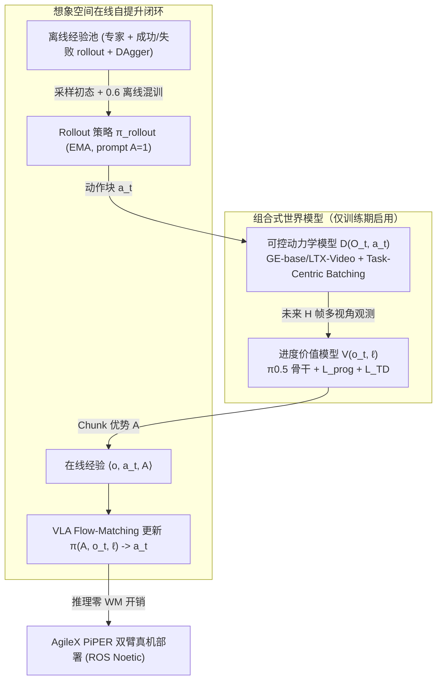
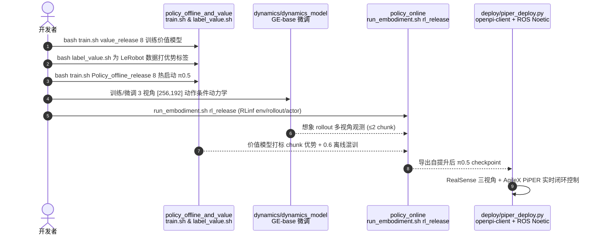

# RISE：组合式世界模型里的自提升策略

**RISE**（*Self-Improving Robot Policy with Compositional World Model*，[arXiv:2602.11075](https://arxiv.org/abs/2602.11075)，[项目页](https://opendrivelab.com/RISE/)，[代码](https://github.com/OpenDriveLab/RISE)）由 **OpenDriveLab** 提出（RSS 2026）：把真实世界 RL 换成在 **组合式世界模型** 中的想象强化学习，再经 PiPER 一类路径落到真机。Awesome **第 224/571**（63 World Models for VLA Training & Evaluation）在此升格。

> **同名警告：** 不是酷哇 / 上交 / 河海的驾驶论文 [RISE：自适应想象调度](./paper-rise-adaptive-imagination-wam.md)（arXiv:2608.20430，`COOWAI/RISE`）。本页是操作域想象 RL。

## 一句话定义

**动力学与价值拆开建 WM，在想象里做 RL，少烧真机小时。**

## 英文缩写速查

| 缩写 | 英文全称 | 简要说明 |
|------|----------|----------|
| WM | World Model | 可滚动的环境模型 |
| MBRL | Model-Based RL | 在想象中更新策略 |
| VLA | Vision-Language-Action | 可被本闭环后训练的策略族（骨干为 $\pi_{0.5}$） |
| TD | Temporal-Difference Learning | 与进度回归联合训练价值模型以识别细微失败 |
| PiPER | AgileX PiPER Dual-Arm Robot | 松灵双 7-DoF 真机评测平台（并非算法模块名） |

## 为什么重要

- 纳入 [VLA/WM 阅读路线](../../sources/blogs/wechat_embodied_ai_lab_vla_wm_reading_roadmap_2026-09-02.md) 的 WM+RL 工程篇。
- 提供 **offline policy → online RL → real robot** 可复现代码链。
- 组合式拆分比端到端「又预测又打分」更稳。
- **已开源** `OpenDriveLab/RISE`。清单旧项目页 `kai0-rl` **不是** 本仓库入口。

## 核心信息

| 项 | 内容 |
|----|------|
| **机构** | OpenDriveLab |
| **模块** | Dynamics + Progress/Value + Imagination RL |
| **部署** | 想象训练后上真机 |
| **开源** | **已开源** [OpenDriveLab/RISE](https://github.com/OpenDriveLab/RISE) |
| **项目页** | [opendrivelab.com/RISE](https://opendrivelab.com/RISE/) |

### 流程总览

## 核心原理

1. **组合式世界模型解耦（Compositional World Model）：** 将仿真拆为两套最适配架构与目标函数的独立模块：
   - **可控动力学模型 $D(O_t,\mathbf{a}_t)$：** 初始化自 Genie Envisioner `GE-base`（基于 LTX-Video，生成 25 帧多视角仅需 `<2 s`，相对 Cosmos 快 ~300×），加入轻量动作编码器与上下文加噪，并在 Agibot World / Galaxea 上以 **Task-Centric Batching**（同批偏向少任务多动作样本，提升动作可控性而非场景多样性）预训练后按任务微调。
   - **进度价值模型 $V(\hat{o}_t,\ell)$：** 基于预训练 VLA $\pi_{0.5}$ 骨干原生支持多视角图像；先用单调进度回归 $L_{\text{prog}}$ 预热，再叠加成功/失败终局稀疏奖励（$+1/-1$）的时序差分损失 $L_{\text{TD}}$，兼顾长程稠密性与接触失败敏感度。
2. **优势条件策略热启动（Warm-up）：** 借鉴 RECAP 概率推断框架对 $\pi_{0.5}$ 做离线热启动——仅对历史 rollout 轨迹使用 $V$ 标注 chunk 优势，而专家与人工纠偏数据直接赋予最优优势 $1$。
3. **想象中在线 RL 闭环（Self-Improving Loop）：** 用最优优势 $1$ 提示 EMA 更新的 `π_rollout` 提出动作块，$D$ 滚动生成未来 $H$ 帧（连续滚出最多 `2` 步以防视频误差累积），$V$ 按式 (2) 计算 chunk 均值优势并离散化，再按 **0.6 离线混训比例** 以 Flow Matching 目标更新策略；部署时完全不加载世界模型。

## 工程实践

| 环节 | 官方设计 / 配置要点 |
|------|--------------------|
| **开源许可与数据格式** | 代码 Apache 2.0、数据与权重 CC BY-NC-SA 4.0；LeRobot 数据集统一缩放到三视角 `[256, 192]`（1 头部 + 2 腕部 RealSense） |
| **算力配比（论文 §III-D）** | 动力学预训练 16×H100 ~7 天、任务微调 8×H100 ~3 天；价值模型 8×H100 ~1 天（前 10k 仅 $L_{\text{prog}}$，后 40k 叠 $L_{\text{TD}}$）；在线自提升 10k steps |
| **混训稳态比例（Table II）** | 离线数据混合比例设为 `0.6` 最优；过低（`0.1`）会因分布偏移崩溃至 `5%` 成功率，过高（`0.9`）则会过正则抑制探索 |
| **部署端硬件入口** | `deploy/piper_deploy.py` + `deploy/packages/openpi-client`（WebSocket 策略客户端 + ROS Noetic 驱动松灵双 7-DoF PiPER） |

## 实验与评测

论文在 **AgileX 双 7-DoF PiPER** 上评测三项高难度长程/动态真机任务（Table I）：

| 方法 | Dynamic Brick Sorting (Succ / Score) | Backpack Packing (Succ / Score) | Box Closing (Succ / Score) |
|------|--------------------------------------|---------------------------------|----------------------------|
| **$\pi_{0.5}$** | 35.00% / 8.28 | 30.00% / 4.25 | 35.00% / 7.50 |
| **$\pi_{0.5}$ + DAgger** | 15.00% / 6.10 | 50.00% / 7.00 | 40.00% / 7.50 |
| **$\pi_{0.5}$ + PPO** | 10.00% / 7.68 | 35.00% / 5.88 | 10.00% / 4.75 |
| **$\pi_{0.5}$ + DSRL** | 10.00% / 6.65 | 10.00% / 3.50 | 10.00% / 7.63 |
| **RECAP** | 50.00% / 9.00 | 40.00% / 6.13 | 60.00% / 8.13 |
| **RISE (Ours)** | **85.00% / 9.78** | **85.00% / 9.50** | **95.00% / 9.88** |

- **关键消融（Dynamic Brick Sorting, Table III–V）：** 去掉在线想象状态仅保留在线动作时成功率从 `70%` 降至 `40%`；去掉 Task-Centric Batching 从 `70%` 降至 `40%`；价值模型去掉 $L_{\text{TD}}$ 从 `70%` 降至 `35%`；动力学光流端点误差（EPE）`0.54` 优于 `GE`（`1.05`）与 `Cosmos`（`1.21`）。

## 结论

**要「策略自己变强」，必须把可控多视角动力学与「进度+TD」价值估计拆开建模并限制想象滚动步数（≤2 步），再用 0.6 离线锚定数据稳住在线 Flow-Matching 更新。**

- 组合式世界模型让状态生成（视频扩散）与状态打分（VLA 骨干进度+TD）各自用最合适的架构与损失，避免单一模型兼顾像素与稀失败信号
- 仅在训练期启用世界模型做 chunk 级优势标注，部署端 zero inference overhead
- 真机 3 项接触/动态任务相对强基线 RECAP 分别提升 `+35% / +45% / +35%`，并消融验证了在线状态与离线回放混训的必要性
- 复现入口直接遵循 `OpenDriveLab/RISE` 文档（`docs/*.md`），勿将早期清单误标的 `kai0-rl` 链接当作官方仓库

## 源码运行时序图

图依据：基于 `OpenDriveLab/RISE` `main` 分支 `docs/offline_learning.md`、`docs/dynamics_model.md`、`docs/online_training.md`、`docs/deploy.md`、`deploy/piper_deploy.py` 核实。

## 常见误区或局限

- **想象误差累积与覆盖边界（论文 §VII）：** 连续自回归超过 2 个 chunk 易出现视频失真，罕见未覆盖状态仍可能产生非物理转移。
- **物理成本转为高算力成本：** 减少真机交互的同时，动力学预训练（16×H100 × 7 天）与任务微调/在线训练（8×H100）算力门槛仍高。
- **依然依赖一定比例真机离线数据：** 离线混训比例需调优（`0.1` 崩溃、`0.9` 保守、`0.6` 最优），不能完全零离线数据启动。
- **命名与平台误读：** 仓库中的 `PiPER` 指 **AgileX 松灵双臂硬件平台**而非管线名；且勿与自动驾驶工作 [酷哇 RISE](./paper-rise-adaptive-imagination-wam.md)（`arXiv:2608.20430`）混淆。

## 与其他工作对比

| 工作 | 相对本页 |
|------|----------|
| [LaDi-WM](./paper-sa-2505-11528-ladi-wm-a-latent-diffusion-based-world-model-for.md) | 预测引导，非完整想象 RL 圈 |
| [DreamDojo](./paper-hrl-stack-35-dreamdojo.md) | 人视频预训练 WM |
| [Model-based RL](../methods/model-based-rl.md) | 方法总览 |

## 关联页面

- [自我改进智能体与具身终身学习对比](../comparisons/self-improving-agents-embodied-lifelong-learning.md) — RISE 在其中代表「想象空间自我改进」：动力学模型预测 + 进度价值模型评估后更新策略
- [VLA/WM 14 篇路线](../overview/vla-wm-reading-roadmap-14-papers-technology-map.md)
- [Awesome World Models](../entities/awesome-world-models.md)
- [Model-based RL](../methods/model-based-rl.md)
- [Manipulation](../tasks/manipulation.md)
- [酷哇 RISE（驾驶 WAM 自适应想象）](./paper-rise-adaptive-imagination-wam.md) — **同名不同文**（arXiv:2608.20430）

## 推荐继续阅读

- [项目页](https://opendrivelab.com/RISE/)
- [arXiv:2602.11075](https://arxiv.org/abs/2602.11075)

## 参考来源

- [sun_awesome_wm_2602_11075](../../sources/papers/sun_awesome_wm_2602_11075_rise-self-improving-robot-policy-with-co.md)
- [具身智能研究室 VLA/WM 阅读路线](../../sources/blogs/wechat_embodied_ai_lab_vla_wm_reading_roadmap_2026-09-02.md)
- [opendrivelab-rise](../../sources/repos/opendrivelab-rise.md)
- [sun_awesome_wm_catalog](../../sources/papers/sun_awesome_wm_catalog.md)
