# UniVTAC

**UniVTAC: A Unified Simulation Platform for Visuo-Tactile Manipulation Data Generation, Learning, and Benchmarking** 收录于 [Awesome Touch](https://github.com/sun254667/awesome-touch) **第 054/065** 篇，分组 **Tactile Simulation & Sim2Real**。本页是 **清单索引**：给出它在清单中的位置与原文入口，方法细节和量化结果请看原文。

## 一句话定义

Unified simulation platform with eight representative visuo-tactile manipulation tasks; UniVTAC Encoder improves average success rates by 17.1%.

## 英文缩写速查

| 缩写 | 英文全称 | 简要说明 |
|------|----------|----------|
| VTLA | Vision-Tactile-Language-Action | 视–触–语言–动作策略 |
| WM | World Model | 视触觉前向预测 |
| WAM | World Action Model | 世界–动作联合建模 |
| Sim2Real | Simulation to Real | 仿真到真机迁移 |

## 为什么重要

- Unified simulation platform with eight representative visuo-tactile manipulation tasks; UniVTAC Encoder improves average success rates by 17.1%.
- 想横向对照同一分组的其他工作，可以从 [Awesome Touch 技术地图](../overview/sun-awesome-touch-technology-map.md) 逐条展开。
- 顺着列表实体 [Awesome Touch](../entities/awesome-touch.md) 与下方关联的方法 / 任务页，可以接回对应的学习主线。

## 流程总览

```mermaid
flowchart TB
    subgraph SIM["UniVTAC Platform（基于 TacEx / Isaac Sim）"]
        SN["三种视触觉传感器<br/>GelSight Mini / ViTai GF225 / Xense WS"]
        API["原子操作 API：Grasp / Move / Place / Probe / Rotate<br/>Grasp、Probe 带触觉反馈的自适应闭环速度控制"]
        SN --> DG
        API --> DG["接触丰富数据生成：14 种几何体压头<br/>随机抓握深度阈值 + 随机小幅旋转"]
    end
    DG --> DS["同步记录：带标记触觉图 I_marked、无标记图 I_pure、<br/>深度图 D、标记点 M、物体位姿 p（共 205,826 样本）"]
    DS --> ENC["UniVTAC Encoder 预训练<br/>共享 ResNet-18 编码器 → 触觉表征"]
    ENC --> H1["形状通路：重建 I_marked 与 I_pure"]
    ENC --> H2["接触通路：预测深度图 D 与标记点 M"]
    ENC --> H3["位姿通路：回归位姿 p（平移+四元数）"]
    H1 --> L["L_total = λs·L_shape + λc·L_contact + λp·L_pose<br/>均为 MSE"]
    H2 --> L
    H3 --> L
    ENC -.->|"部署时丢弃解码头，仅保留编码器"| POL["下游 Transformer / Diffusion 策略"]
    subgraph BM["UniVTAC Benchmark（8 个任务）"]
        EX["专家程序数据合成<br/>加入随机失败与基于接触反馈的纠正"] --> EV["训练策略并评测<br/>含穿透深度、相对滑移的物理成功判据"]
    end
    SIM --> EX
    POL --> EV
```

图依据：论文 §III-A / §III-B / §III-C 与 Fig.1、Fig.3。

## 核心信息

| 字段 | 内容 |
|------|------|
| 编号 | 054/065 |
| 分组 | Tactile Simulation & Sim2Real |
| 出处 | arXiv 2026 |
| 论文 | <https://arxiv.org/abs/2602.10093> |

## 核心机制（归纳）

### 策展导读要点

Unified simulation platform with eight representative visuo-tactile manipulation tasks; UniVTAC Encoder improves average success rates by 17.1%.

本页不复述论文公式与完整实验表；若需工程落地，请回到原文并对照站内相关方法页（见关联页面）。

## 评测与指标

- 本页 **没有搬运** 原文的量化 benchmark 与实机指标。
- 评测口径与具体数值以 [原文 / 项目页](https://arxiv.org/abs/2602.10093) 为准。
- 横向对照请回到 [技术地图](../overview/sun-awesome-touch-technology-map.md) 同分组条目。

## 与其他工作对比

- 本页 **不做** 与具体基线的逐项数值对比；同分组的横向对照请回到 [技术地图](../overview/sun-awesome-touch-technology-map.md) 的 **Tactile Simulation & Sim2Real** 分组逐条展开。
- 如果站内已经有这篇的深读页（含机构、实验表与源码运行时序图），请以那一页为准；本页只保留清单要点。
- 与清单内相邻条目孰优孰劣，本页不下结论：Awesome Highlights 可能滞后于论文最新版本，差异应以各自原文的问题设定与评测口径为准。

## 结论

**这一页能给你的是「UniVTAC」在策展清单里的坐标与要点：够你判断要不要去读原文，但不能替代原文。**

- 可确证的只有清单坐标：分组 **Tactile Simulation & Sim2Real**，以及 Highlights 点出的问题设定；本页不自行推导新结论。
- 适用边界：本页不能替代原文 PDF；开源状态以项目页实际链接为准（清单可能滞后）。
- 要深读这篇，建议直接从原文入手，再回到下方关联的方法 / 任务页对照。

## 常见误区

1. 不要把 Awesome 条目的 Highlights 当成完整方法证明——它只是策展导读。
2. 若站内已有这篇的深读页，以那一页为准——本页只是清单入口，不含实验数据。

## 关联页面

- 列表实体：[Awesome Touch](../entities/awesome-touch.md)
- 技术地图：[Awesome Touch 技术地图](../overview/sun-awesome-touch-technology-map.md)
- 方法/任务：[vla.md](../methods/vla.md)、[manipulation.md](../tasks/manipulation.md)

## 参考来源

- [`sources/papers/sun_awesome_touch_2602_14433_univtac-a-unified-simulation-platform-fo.md`](../../sources/papers/sun_awesome_touch_2602_14433_univtac-a-unified-simulation-platform-fo.md) — 本条目策展摘录
- [`sources/papers/sun_awesome_touch_catalog.md`](../../sources/papers/sun_awesome_touch_catalog.md) — 列表总表
- [`sources/repos/awesome-touch.md`](../../sources/repos/awesome-touch.md)
- 论文：<https://arxiv.org/abs/2602.10093>
- 编号核对（2026-11-02）：上游清单登记的 2602.14433 经 arXiv 官方记录核对为《Synthetic Reader Panels: Tournament-Based Ideation with LLM Personas for Autonomous Publishing》，与本页论文不符；已更正为 2602.10093《UniVTAC: A Unified Simulation Platform for Visuo-Tactile Manipulation Data Generation, Learning, and Benchmarking》。
- [arXiv PDF](https://arxiv.org/pdf/2602.10093)：已通读方法部分（实验与附录以略读为准）：§III-A UniVTAC Platform、§III-B UniVTAC Encoder、§III-C UniVTAC Benchmark

## 推荐继续阅读

- [Awesome Touch 仓库](https://github.com/sun254667/awesome-touch)
- [原文](https://arxiv.org/abs/2602.10093)
