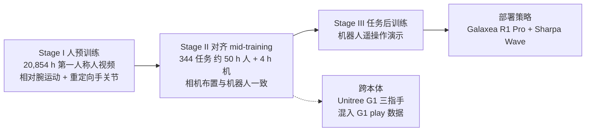

# EgoScale：用两万小时第一人称人视频缩放灵巧操作

**EgoScale**（*EgoScale: Scaling Dexterous Manipulation with Diverse Egocentric Human Data*，[arXiv:2602.16710](https://arxiv.org/abs/2602.16710)，[项目页](https://research.nvidia.com/labs/gear/egoscale/)）由 **英伟达（NVIDIA）**、**加州大学伯克利分校（UC Berkeley）**、**马里兰大学学院公园分校（University of Maryland）** 的作者合作完成（机构以 arXiv HTML 页首为准）。它回答的问题是：能否把 **大规模第一人称人操作视频** 当作 **高自由度灵巧手** 的主监督来源，并且在数据继续变大时 **可预测地** 提升真机表现。方法层面的更多站内对照见 [EgoScale 方法页](../methods/egoscale.md)；本页以论文层面的内容、数字口径与复现边界为主。

## 一句话定义

**EgoScale = 在 2 万小时以上带「相对腕运动 + 重定向手关节」标签的第一人称人视频上预训练流匹配 VLA，再用小规模人–机对齐 mid-training 与任务后训练，把「人数据小时数」变成可预测、可迁移到 22-DoF 灵巧手的监督杠杆。**

## 英文缩写速查

| 缩写 | 英文全称 | 简要说明 |
|------|----------|----------|
| EgoScale | EgoScale: Scaling Dexterous Manipulation with Diverse Egocentric Human Data | 本文框架：人视频预训练 + 对齐 mid-training 的人到灵巧手迁移配方 |
| VLA | Vision-Language-Action | 视觉–语言–动作策略；本文为 flow-based 结构，架构自述类似 GR00T N1 |
| VLM | Vision-Language Model | 视觉–语言模型，作为 VLA 的主干编码语言与图像 |
| DiT | Diffusion Transformer | 本文动作专家的骨干，配合 flow matching 生成动作块 |
| DoF | Degrees of Freedom | 自由度；Sharpa Wave 手为 22-DoF，Unitree G1 三指手为 7-DoF |
| SLAM | Simultaneous Localization and Mapping | 同步定位与建图；用于从人视频估计相机运动 |
| SE(3) | Special Euclidean group in 3D | 三维刚体位姿；本文用相对腕部 SE(3) 增量作为臂级动作 |

## 为什么重要

- **把「人视频小时」接到可检验的指标上：** 论文自报在 1k–20k 小时的扫描中，人侧动作预测的验证损失随数据量近似 log-linear 下降，并且该离线指标与后训练后的真机表现同向变化，便于用同一标尺规划数据采集预算（数字见「实验与评测」）。
- **面向高 DoF 手而非夹爪：** 论文指出既有人–机迁移工作多停留在数十到数百小时人数据，或集中在夹爪、低 DoF 手；EgoScale 把监督直接落在 22-DoF 手关节空间，保留手指级运动结构。
- **规模与对齐解耦：** Stage I 提供多样性与语义覆盖（噪声大、规模大），Stage II 只需要少量严格对齐的人–机数据来锚定到机器人感知与控制，避免把一切押在昂贵的大规模配对演示上。
- **在 Sharpa 研究线中的位置（文章转述）：** 机器之心对 Sharpa 学术负责人的采访把 EgoScale 归入「跨本体不变表征」一类思路：不显式处理人手与机器手的差距，而是直接使用第一视角人类数据，再用成对人–机数据做中期训练，让模型自己「消化」差异；选择 Sharpa Wave 的重要原因之一是它与人手 1:1 的尺寸和 22 自由度结构，使人类动作更易重定向为机器人动作。后续 T-Rex 在同一硬件平台上引入触觉，并以 EgoScale 为基线（文章转述，详见 [Sharpa 实体页](./sharpa-robotics.md)）。注意 EgoScale 论文本身的观测只有图像、语言与本体状态，未使用触觉。

## 核心信息

| 项 | 内容 |
|----|------|
| **论文** | EgoScale: Scaling Dexterous Manipulation with Diverse Egocentric Human Data，arXiv:2602.16710（cs.RO） |
| **版本** | v1，2026-02-18；arXiv 摘要页仅列 v1（2026-10-16 复核）。NVIDIA 项目页标注日期 2026-02-19 |
| **机构** | 英伟达（NVIDIA）、加州大学伯克利分校（UC Berkeley）、马里兰大学学院公园分校（University of Maryland） |
| **作者（15 人）** | Ruijie Zheng, Dantong Niu, Yuqi Xie, Jing Wang, Mengda Xu, Yunfan Jiang, Fernando Castañeda, Fengyuan Hu, You Liang Tan, Letian Fu, Trevor Darrell, Furong Huang, Yuke Zhu, Danfei Xu, Linxi Fan |
| **出处** | arXiv 预印本；是否已被会议或期刊录用未核实 |
| **真机平台** | Galaxea R1 Pro 人形上半身 + 22-DoF Sharpa Wave 双手（固定底盘与躯干，双 7-DoF 臂）；跨本体验证用 Unitree G1 + 7-DoF 三指手 |
| **开源** | 官方代码、权重、数据均未核实到公开链接（见「复现边界」） |

## 核心机制（方法栈）

### 流程总览

### 人侧动作表示（论文 §2.1）

- **臂：** 用 SLAM 与手部估计得到相机位姿和 21 个手部关键点，取 **相对腕位姿增量** ΔW（动作块内相对首帧）作为臂级动作，去除对绝对相机位姿的依赖；同一表示在人与机器人之间共享，机器人侧对应相对末端控制。
- **手：** 将 21 个关键点用带关节限位与运动学约束的优化式重定向，映射到默认的 **Sharpa 22-DoF 手关节空间**，使预训练监督直接落在可操作的手指结构上。
- **本页读法：** 这一接口选择是全文的设计枢纽——论文 §3.6 对比了 wrist-only 与 fingertip 两种替代表示，结论是重定向关节空间最稳（见下文）。

### 数据两阶段（论文 §2.2）

| 阶段 | 数据 | 说明（论文自报） |
|------|------|------------------|
| Stage I | 合计 20,854 h 第一人称视频 | 多数为野外录制，覆盖 9,869 个场景、6,015 项任务、43,237 种物体；另并入 829 h EgoDex（Apple Vision Pro 采集，腕/手追踪更精确，194 项桌面任务）作精度锚点；标签来自现成 SLAM 与手部估计，噪声较大 |
| Stage II | 344 项桌面任务，每任务约 30 条人轨迹与 5 条机器人轨迹 | 约 50 h 人 + 4 h 机；人用与机器人相同的相机配置（头戴 + 双腕），Vive 追踪腕位姿、Manus 手套记录手部姿态，并与视频同步 |

### 模型与三阶段训练（论文 §2.3–§2.4）

- **架构：** VLM 编码语言与图像，共享 DiT 动作专家 + flow matching 预测动作块；人数据没有本体状态时，用 **可学习占位 token** 替换 proprio；多本体通过轻量 embodiment-conditioned MLP adapter 处理输入本体与输出手部动作，腕运动预测、VLM 主干和 DiT 动作专家完全共享。

| 阶段 | 设定（论文自报） |
|------|------------------|
| Stage I 人预训练 | 约 2 万小时人数据，100K 步，256 张 GB200，global batch 8,192，学习率 5e-5，全参数解冻 |
| Stage II 对齐 mid-training | 人–机 play 数据，50K 步，batch 2,048，学习率 3e-5；冻结 VLM 主干，只更新视觉编码器与 DiT 动作专家 |
| Stage III 任务后训练 | 10K 步，batch 512，学习率 3e-5；有 mid-training 时冻结视觉编码器，否则解冻 |

### 机器人系统（论文 §2.5）

主实验在 Galaxea R1 Pro 上进行：固定底盘与躯干，只做双臂操作；双 7-DoF 臂用相对末端空间控制，Sharpa Wave 22-DoF 手用关节空间控制；三路 RGB 相机（头戴 1 路 + 双腕 2 路，腕相机装在手掌内侧）。

## 实验与评测

**设置（论文 §3.1，自报）：** 五项高灵巧真机任务——Shirt Rolling、Card Sorting、Tongs（夹具取物）、Bottle（拧瓶盖）、Syringe（注射器转移液体，最难）。每项任务提供 100 条遥操作演示（Shirt Rolling 为 20 条）；每种方法用 2 个随机种子训练，每个检查点评测 10 次（有一项任务按 4 个物体各 4 次共 16 次）；同时记录绝对成功率与 [0,1] 的任务完成度。

| 结果 | 数字 | 口径与出处 |
|------|------|------------|
| 预训练规模 | 20,854 h，论文称比此前人–机迁移研究的数据量大 20 倍以上 | 自报，摘要与 §1 |
| 相对从零训练 | 平均成功率提升 54%；§3.2 另述平均任务完成度提升超过 55% | 自报，摘要与 §3.2；摘要未说明 54% 是绝对百分点还是相对提升；文章转述同为 54%（机器之心） |
| 数据缩放 | 1k 到 20k 小时，平均任务完成度由 0.30 单调升至 0.71，未见饱和 | 自报，§3.3 / Figure 5 右 |
| 验证损失拟合 | L = 0.024 − 0.003·ln(D)，R² = 0.9983（D 为人预训练小时数） | 自报，§3.3；在 2,000 条留出人视频 episode 上评估，论文明确不外推到测量范围之外 |
| 一跳迁移 | 仅 1 条机器人演示 + 100 条对齐人演示：Fold Shirt 成功率 0.88，Unscrewing Water Bottles 0.55 | 自报，§3.4；缺大规模人预训练或缺对齐 mid-training 的变体在该设定下失败 |
| 跨本体（Unitree G1） | 两项任务（Pen in Bin、Dish in Rack）相对无人预训练的基线，成功率绝对提升超过 30% | 自报，§1 与 §3.5；需在 mid-training 中混入 G1 play 数据 |
| 手部动作空间 | wrist-only 最差（指尖接触时机与握力不稳）；fingertip 表示不稳定；重定向关节空间最一致 | 自报，§3.6 / Figure 8；本页未转录逐项数值 |
| 对照后续工作 | T-Rex 在 12 个接触丰富任务上平均成功率 65%，比最强基线 EgoScale 高约 30 个百分点 | 文章转述（机器之心）；该数字属于 T-Rex 论文，不是 EgoScale 的自身结果 |

## 与其他工作对比

- **与 EgoMimic、DexWild 一类共训方法（论文 §4 自述）：** 它们通过显式对齐把人与机器人演示共训为统一模仿策略；EgoScale 强调 **纯大规模人预训练 + 最小机器人监督**，并保留手指级运动信息。
- **与 EgoVLA（论文 §4 自述）：** EgoVLA 在人手运动上预训练 VLA，再经逆运动学与重定向迁移到机器人；EgoScale 的差别是人数据规模大得多（论文称 20 倍以上），并显式引入对齐 mid-training。
- **与 [T-Rex](./paper-trex-tactile-reactive-dexterous-manipulation.md)：** 同一 Sharpa Wave 研究线的后续工作；骨架同为「人 egocentric 预训练 + 机端 mid-training」，T-Rex 把 mid-training 换成触觉同步数据并加高频触觉专家，以 EgoScale 为最强基线（文章转述）。
- **与同批 Sharpa 论文 [MoDE-VLA](./paper-sa-2603-08122-mode-vla-mixture-of-dexterous-experts-vla.md)：** 数据路线不同——MoDE-VLA 走真机遥操作 + 原子技能（IMCopilot）与力/触觉输入，EgoScale 走人视频规模；两者对「灵巧手需要什么信号」给出互补答案。
- **更多站内对照**（[HumanNet](./humannet.md)、[EgoVerse](./paper-egoverse.md)、[Dyna-2](./dyna-2.md) 等）见 [EgoScale 方法页](../methods/egoscale.md)。

## 结论

**在论文测量范围内，EgoScale 把「人视频规模」变成了可用验证损失预测的监督杠杆，但落地靠的是「大规模预训练 + 小规模严格对齐 mid-training」两件事缺一不可，且依赖估计标签与特定硬件，目前没有可核实的公开复现入口。**

1. **规模是主变量** — 自报 1k 到 20k 小时完成度 0.30 升至 0.71，验证损失近似 log-linear；可把离线验证损失当作数据配比的早期指标，但论文只在 1k–20k 区间内成立，且明确不外推。
2. **对齐不能省** — 一跳设定下，只做人预训练或只做 mid-training 都失败，两者叠加才得到 0.88 / 0.55；对齐数据量很小（约 50 h 人 + 4 h 机），成本主要在采集协议（与机器人相同的相机布置、Vive + Manus 同步），不在小时数。
3. **动作接口是关键设计点** — 相对腕 SE(3) + 重定向关节空间优于 wrist-only 与 fingertip 表示；换手型时需重做重定向与 adapter。
4. **向低 DoF 手迁移有证据，但有条件** — G1 三指手上的增益依赖 mid-training 混入目标本体 play 数据，不是零样本。
5. **数字要看口径** — 54% 出自摘要且未标明绝对或相对；任务只有 5 项、每检查点 10 次评测，统计功效有限。
6. **接触后的毫米级控制不在本文范围** — 观测中没有触觉与力；这部分由 T-Rex、MoDE-VLA 等后续或同批工作补充。
7. **复现门槛高** — 预训练用 256 张 GB200 跑 100K 步，且代码、权重、数据均未核实到公开链接；选型时更适合作为数据策略的参考而非可直接复用的栈。

## 常见误区或局限

1. **误区：「只靠人视频就能直接上机」。** 论文的配方包含对齐 mid-training 与任务后训练，且后训练仍需要机器人演示（每项任务 20 到 100 条）；一跳实验也要 1 条机器人演示 + 100 条对齐人演示。
2. **误区：「log-linear 可以无限外推」。** 论文自己说明不外推到测量范围之外，只说在已探索区间内没有观察到饱和。
3. **误区：「文章把它归入触觉主线，所以 EgoScale 用了触觉」。** 机器之心文章把它放在「跨本体不变表征」思路下讨论；论文本身没有触觉输入。
4. **局限：标签来自现成估计栈。** Stage I 的相机运动与手部姿态由现成 SLAM 与手部估计得到，论文承认噪声较大，主张靠规模与多样性仍能学到可迁移表示。
5. **局限：评测范围窄。** 主结果集中在 1 个高 DoF 平台与 1 个低 DoF 平台，5 项主任务 + 2 项一跳任务 + 2 项 G1 任务，且每检查点仅 10 次评测。
6. **局限：一跳泛化依赖共享运动结构。** 论文 §3.4 自述，mid-training 数据以折叠类行为为主，新任务能迁移是因为共享运动基元，不应读作任意新任务的零样本能力。
7. **局限：无触觉与力。** 接触发生后的力控与滑移处理不在方法内。

## 复现边界

| 项 | 状态 |
|----|------|
| 官方代码 | **未核实到公开链接。** 2026-10-16 复核：arXiv 摘要页与 NVIDIA 项目页均只列出论文入口，没有代码仓库链接；站内归档记录显示项目页在 2026-05-17 入库时标注 GitHub「Coming Soon」（见 [项目页归档](../../sources/sites/nvidia-research-egoscale.md)） |
| 权重 | 未核实 |
| 训练数据 | Stage I 野外数据与 Stage II 对齐数据是否公开：未核实；EgoDex（829 h）的公开状态也未在本页核对 |
| 硬件 | Galaxea R1 Pro + Sharpa Wave 22-DoF 手；商用获取方式未核实 |
| 算力 | Stage I 约 256 张 GB200（论文自报） |
| 源码运行时序图 | **不适用**（未核实到官方可运行代码，无法对齐仓库入口） |

## 关联页面

- [EgoScale 方法页](../methods/egoscale.md) — 站内方法视角与横向对照
- [夏帕机器人（Sharpa Robotics）](./sharpa-robotics.md) — 硬件平台与 Sharpa 学术线全景
- [MoDE-VLA](./paper-sa-2603-08122-mode-vla-mixture-of-dexterous-experts-vla.md) — 同批 Sharpa 论文，走力/触觉与原子技能路线
- [T-Rex](./paper-trex-tactile-reactive-dexterous-manipulation.md) — 以 EgoScale 为基线并加入触觉
- [NVIDIA GEAR Lab](./nvidia-gear-lab.md)
- [VLA（Vision-Language-Action）](../methods/vla.md)
- [Imitation Learning](../methods/imitation-learning.md)
- [Manipulation（操作任务）](../tasks/manipulation.md)
- [Teleoperation（遥操作）](../tasks/teleoperation.md)
- [Motion Retargeting](../concepts/motion-retargeting.md)
- [Embodied Scaling Laws](../concepts/embodied-scaling-laws.md)
- 所属策展技术地图：[Awesome Egocentric Vision 技术地图](../overview/sun-awesome-ego-technology-map.md)、[Awesome Egocentric Vision](./awesome-egocentric-vision.md)

## 参考来源

- 论文摘要页：<https://arxiv.org/abs/2602.16710>（v1，2026-02-18）；论文 HTML：<https://arxiv.org/html/2602.16710v1>
- [`sources/papers/egoscale_arxiv_2602_16710.md`](../../sources/papers/egoscale_arxiv_2602_16710.md) — 论文摘录（方法与实验锚点）
- [`sources/sites/nvidia-research-egoscale.md`](../../sources/sites/nvidia-research-egoscale.md) — NVIDIA 项目页归档
- [`sources/blogs/wechat_sharpa_dexterous_manipulation_2026-10-16.md`](../../sources/blogs/wechat_sharpa_dexterous_manipulation_2026-10-16.md) — 机器之心采访 Sharpa 的文章归档（EgoScale 在 Sharpa 研究线中的位置；文章转述数字出处）
- [`sources/papers/sun_awesome_ego_2602_16710_egoscale-scaling-dexterous-manipulation.md`](../../sources/papers/sun_awesome_ego_2602_16710_egoscale-scaling-dexterous-manipulation.md) — 策展清单摘录（Awesome Egocentric Vision 第 083/249 篇，分组 27 Ego-VLA；仅作来源记录，论文内容以 arXiv 为准）
- [`sources/papers/sun_awesome_ego_catalog.md`](../../sources/papers/sun_awesome_ego_catalog.md) — 列表总表
- [`sources/repos/awesome-egocentric-vision.md`](../../sources/repos/awesome-egocentric-vision.md)

## 推荐继续阅读

- [EgoScale 项目页（NVIDIA GEAR）](https://research.nvidia.com/labs/gear/egoscale/) — 演示视频、作者与 BibTeX
- [arXiv PDF](https://arxiv.org/pdf/2602.16710)
- [硬件、数据到模型：Sharpa 如何系统性推进灵巧操作（机器之心）](https://mp.weixin.qq.com/s/wDRJgJArppWbAWm1QmzwNQ)
