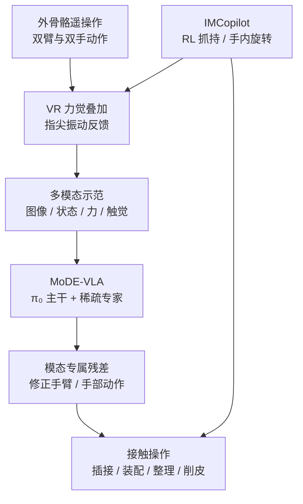

# MoDE-VLA 与 IMCopilot

**MoDE-VLA**（Mixture-of-Dexterous-Experts VLA）扩展预训练 π₀，使力觉和触觉经专属专家路径修正手臂与手部动作；配套的 **IMCopilot**（In-hand Manipulation Copilot）将强化学习训练的手内技能用于遥操作辅助和 VLA 的低层技能调用。

## 一句话定义

**用可组合的 RL 手内操作原语弥补遥操作与 VLA 的高自由度灵巧控制缺口，再以模态专属专家把力觉 / 触觉残差注入预训练 VLA。**

## 英文缩写速查

| 缩写 | 英文全称 | 简要说明 |
|------|----------|----------|
| VLA | Vision-Language-Action | 根据视觉、语言和状态生成机器人动作的策略 |
| IMCopilot | In-hand Manipulation Copilot | 稳定抓持、手内旋转等 RL 低层技能 |
| MoDE-VLA | Mixture-of-Dexterous-Experts VLA | 融合力觉和触觉的稀疏专家路径 |
| PPO | Proximal Policy Optimization | 训练 IMCopilot 原子技能的强化学习算法 |
| PCR | Peel Completion Ratio | 苹果削皮任务上已完成目标表面的比例 |
| DoF | Degrees of Freedom | 自由度；Sharpa 双臂双手实验平台共 63 个活动自由度 |

## 为什么重要

VLA 在低自由度夹爪抓放之外，还需要处理双手协调、手内物体重定位和接触反馈。论文把这些问题拆成不同层级：操作员或 VLA 负责选择任务阶段，IMCopilot 处理精细手指协调；MoDE-VLA 再使用手臂扭矩和指尖触觉修正接触阶段动作。这让高层任务能力与低层接触技能可以分工，而不要求一个策略从头覆盖所有动作尺度。

## 核心信息

| 项 | 内容 |
|----|------|
| 论文 | [arXiv:2603.08122](https://arxiv.org/abs/2603.08122)，v1 于 2026-03-09 提交 |
| 作者 | Tutian Tang、Xingyu Ji、Wanli Xing、Ce Hao、Wenqiang Xu、Lin Shao、Cewu Lu、Qiaojun Yu、Jiangmiao Pang、Kaifeng Zhang |
| 机构 | 北京中关村学院、上海交通大学、上海人工智能实验室、上海创智学院、新加坡国立大学、Sharpa |
| 机器人 | SharpaNorth：双 7 DoF 手臂、双 22 DoF SharpaWave 灵巧手；固定下肢时共 63 个活动 DoF |
| 感知 | 头部 RGB 与腕部鱼眼相机、双臂 14 维关节扭矩、十指 60 维 6 DoF 指尖触觉 |
| 开源 | 官方项目页含论文介绍与演示视频；未列代码、权重或数据链接，截至 2026-10-16 未确认开源 |

## 流程总览

IMCopilot 有两个入口：示范采集时由脚踏板触发以辅助操作员；自主运行时由 VLA 选择并调用。MoDE-VLA 的残差路径则单独处理接触信号。

## 核心原理

### IMCopilot：同一组技能服务于采集与执行

IMCopilot 包含稳定抓持、绕指定轴旋转物体等可组合原子技能，在 IsaacLab 中用 PPO 训练，采用非对称 actor-critic 和 teacher–student 蒸馏。遥操作时，操作者通过上身外骨骼和外骨骼手套控制大动作；VR 呈现机器人头部立体图像与扭矩、指尖触觉叠加信息，手套提供接触振动。当手内操作难以稳定完成时，操作者踩脚踏板切换到 IMCopilot。自主执行时，VLA 也能输出触发信号调用低层技能。

### MoDE-VLA：按物理语义融合力觉与触觉

论文以 π₀ 为主干（SigLIP 视觉 tokenizer、PaliGemma 视觉语言模型和 action expert），把两种接触模态分开编码：

- **力觉流：** 双臂关节扭矩共 14 维，反映手臂与物体接触阻力。
- **触觉流：** 十个指尖传感器各有 6 DoF 力 / 力矩，共 60 维，用于感知局部接触和滑移。
- **时间对齐：** 当前模态嵌入扩展到动作预测 horizon 并加入步位置编码，使不同预测时刻可路由给不同专家。
- **专家与残差：** 主干上下文、动作去噪状态和两路传感 token 经自注意力与稀疏 MoE 路由（8 个专家、top-1）；力觉路径修正手臂动作，触觉路径修正手部动作。自由空间时残差可变小，以保留主干预训练行为。
- **动作生成：** action horizon 为 50 步，训练使用 flow matching，推理用 10 步 Euler 积分；VLA 触发 IMCopilot 时，手部动作由该低层技能接管。

## 工程实践

| 场景 | 论文设定或可借鉴点 |
|------|--------------------|
| 示范采集 | 把高难度手内动作封装成可复用技能，降低操作负担并提高演示一致性 |
| 模态融合 | 扭矩与触觉有不同物理意义和时间尺度；分别编码并将修正送至对应动作支路 |
| 策略层级 | VLA 管理任务阶段，RL 原子技能负责快速、反应式手内控制 |
| 复现边界 | 项目页未给出代码、数据或权重入口；目前可核对论文方法与指标，无法据此直接复现 |

**源码运行时序图：不适用。** 截至 2026-10-16，官方项目页未列可运行代码仓库，因此没有可对齐的训练、推理或部署入口。

## 实验与评测

四项任务为齿轮装配、充电器插接、试管整理和苹果削皮；每种方法每项 20 次试验。成功率（SR）统计完整任务成功；苹果削皮另用完成比例（PCR）衡量部分进度。

| 结果 | 论文报告 |
|------|----------|
| 平均 SR | MoDE-VLA 34%，π₀ 基线 15%，高 19 个百分点 |
| 苹果削皮 | SR 30%，PCR 73%；去掉 IMCopilot 后 PCR 降至 25% |
| 去除力觉 | 平均 SR 23%（完整模型 34%） |
| 去除触觉 | 平均 SR 26%（完整模型 34%） |
| 手内旋转采集 | 纯遥操作 34%（31/90），IMCopilot 89%（80/90） |
| 示范采集效率 | 齿轮装配 100 次试验：反馈前 75 分钟、85 次成功；反馈后 65 分钟、93 次成功 |

消融结果显示力觉有助于接触检测和插入力调节，触觉提供指尖接触与防滑线索。苹果削皮还依赖稳定旋转技能：单纯让 VLA 模仿高维手部动作不足以稳定完成整圈削皮。

## 结论

**这项工作的核心是分开建模高层任务策略与高接触手指技能，并让力觉、触觉通过专属残差路径进入 VLA；收益来自技能和模态分工的组合。**

1. **IMCopilot 同时服务示范采集和自主执行**，使两个阶段共享低层技能接口。
2. **力觉和触觉不应视为同一种状态输入**；分别编码并路由给手臂、手部动作支路，符合其不同物理作用。
3. **成功率要按任务读。** 平均 SR 为 34% 对 15%，但绝对成功率仍有限；苹果任务 30% SR 与 73% PCR 表达的是完整成功与部分进度。
4. **稳定手内旋转是关键瓶颈。** 苹果任务去掉 IMCopilot 后 PCR 从 73% 降到 25%，显示仅靠 VLA 学动作示范不够。
5. **复现仍受开放状态限制。** 项目页未提供代码、权重和数据入口，读者目前无法完整复现训练及部署链路。

## 与其他工作对比

- 相比只用视觉、本体的预训练 VLA，MoDE-VLA 为接触状态增加力觉和触觉专属专家路径。
- 相比让单一策略从示范学习全部手指动作，IMCopilot 将稳定抓持、手内旋转封装为可调用技能；这与[模仿学习](../methods/imitation-learning.md)中分层执行的思路相关。
- 本页原为 [Awesome Touch](../entities/awesome-touch.md) 策展索引；同组工作可在 [Awesome Touch 技术地图](../overview/sun-awesome-touch-technology-map.md) 中横向查看。

## 局限与风险

- 实验基于 SharpaNorth 双手平台，结果尚不能说明可直接迁移至其他手部结构或传感器。
- 每项任务每种方法 20 次试验，不足以覆盖长期可靠性和更广泛的对象分布。
- 平均成功率提升建立在这组任务和论文设置上，不能外推成通用 VLA 的普遍增益。
- 官方项目页未给出训练 / 部署实现、数据和 checkpoint，关键实现细节难以独立复现。

## 关联页面

- [视觉–语言–动作模型（VLA）](../methods/vla.md)
- [模仿学习](../methods/imitation-learning.md)
- [双臂操作](../tasks/bimanual-manipulation.md)
- [灵巧操作](../tasks/manipulation.md)
- [Awesome Touch](../entities/awesome-touch.md) 与 [技术地图](../overview/sun-awesome-touch-technology-map.md)

## 参考来源

- [论文摘录：MoDE-VLA / IMCopilot](../../sources/papers/mode-vla-2603-08122.md)
- [官方项目页归档](../../sources/sites/mode-vla.md)
- [Awesome Touch 原策展条目](../../sources/papers/sun_awesome_touch_2603_08122_mode-vla-mixture-of-dexterous-experts-vl.md)
- [arXiv:2603.08122](https://arxiv.org/abs/2603.08122)
- [MoDE-VLA 项目页](https://sites.google.com/view/mode-vla/home)

## 推荐继续阅读

- [MoDE-VLA 官方项目页与演示](https://sites.google.com/view/mode-vla/home)
- [论文原文（HTML）](https://arxiv.org/html/2603.08122v1)
- [论文 PDF](https://arxiv.org/pdf/2603.08122)
- [π₀：通用机器人控制的 VLA flow model](https://arxiv.org/abs/2410.24164)
