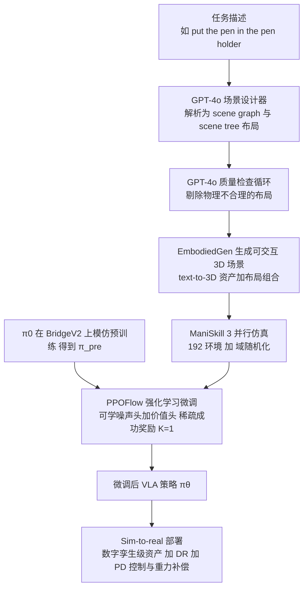

# Scaling Sim-to-Real RL for Robot VLAs with Generative 3D Worlds（arXiv:2603.18532）

**Scaling Sim-to-Real Reinforcement Learning for Robot VLAs with Generative 3D Worlds**（Choi, Wang, Su, Xu；Horizon Robotics；[arXiv:2603.18532](https://arxiv.org/abs/2603.18532)）收录于 [Awesome-Real2Sim2Real](https://github.com/sun254667/Awesome-Real2Sim2Real) 第 021/063 篇（分组 24 Foundation Model-enhanced Sim2Real）。本页依据 v1 全文通读（归档见 [来源归档](../../sources/papers/scaling-sim-to-real-generative-3d-worlds_arxiv_2603_18532.md)）。

## 一句话定义

用语言驱动的场景设计器加 3D 世界生成模型（EmbodiedGen）自动生成大量可交互仿真场景，在 ManiSkill 3 里用 PPOFlow 对流匹配 VLA（π0）做稀疏奖励的 RL 微调，再靠数字孪生级资产、域随机化与带重力补偿的 PD 控制直接迁移到真机（摘要、§1、§3）。

## 英文缩写速查

| 缩写 | 英文全称 | 简要说明 |
|------|----------|----------|
| VLA | Vision-Language-Action | 视觉-语言-动作策略，本文用 π0 |
| RL | Reinforcement Learning | 强化学习 |
| PPO | Proximal Policy Optimization | 近端策略优化，裁剪式策略梯度 |
| PPOFlow | PPO for Flow matching | 本文对 ReinFlow 的 PPO 变体：给流匹配积分注入可学噪声 |
| EG | EmbodiedGen | 文本到可交互 3D 场景 / 资产的生成引擎（论文引用 [42]） |
| SE | SimplerEnv | 三个手工 Bridge 桌面场景，作基线与 OOD 评测 |
| ID / OOD | In / Out-of-Distribution | 训练场景 / 未见场景 |
| SR / PSR | Success Rate / Partial Success Rate | 任务成功率 / 抓起目标物的部分成功率 |
| DFR / SFR | Dynamics / Semantics Failure Rate | 执行错误（抓空、掉落）/ 理解错误（碰错物体）失败率 |
| TF | Time to Finish | 完成时间（秒） |
| GAE | Generalized Advantage Estimation | 广义优势估计 |
| DR | Domain Randomization | 域随机化 |

## 为什么重要

- 作者的出发点（摘要、§1）：直接在真机上给 VLA 做 RL 能绕开 sim-to-real 差距，但真实世界里很难扩大场景与物体多样性，会把广泛预训练的模型变成过拟合单一场景的策略；仿真能给多样性，但手工设计场景成本高。这是作者的论断，论文没有跑真机 RL 基线来直接对比（见「与清单说法的核对」）。
- 作者给出的证据：在 100 个生成场景上微调，仿真成功率 9.7%→79.8%，真机 21.7%→75%（Table 1、Table 2）；训练场景数 N 从 1 增到 50，对未见场景的成功率持续上升（Table 1）。
- 对本库：可与 [SimpleVLA-RL](../entities/paper-simplevla-rl.md)、[RLinf-VLA](../entities/paper-rlinf-vla.md) 对照「VLA 加 RL」的训练栈，与 [域随机化](../concepts/domain-randomization.md)、[Sim2Real](../concepts/sim2real.md) 对照迁移手段。

## 核心原理与流程总览

图依据：论文 Fig.1–3、§3、附录 A。

### 场景生成（§3 Generative simulation，附录 C）

- GPT-4o 场景设计器把指令解析为含背景、上下文、干扰物、操作目标与机器人及其空间关系（ON、IN）的 scene graph，可调场景复杂度与干扰物密度；再经 GPT-4o 质检循环。
- 100 个场景共 516 个唯一物体资产，平均每场景 5.16 个交互物体；资产生成另有三类 GPT-4o 检查（语义外观、网格几何、文本到 3D 对齐），单次通过率 83.3% / 75.2% / 91.9%，每个有效资产平均 1.37 次尝试（Table C.1）。
- 因 WidowX 夹爪最宽 74 mm，过大物体被自动缩小并降网格分辨率（附录 C）。

### PPOFlow（§3，附录 A、B）

- 流匹配策略是确定性的，无法直接算 PPO 的重要性比；做法是每个积分步注入可学噪声 σ_ϕ，变成高斯转移，从而得到联合对数概率（Eq.3–5），并加价值头 V_ψ。
- 重要性比用指数 s∈(0,1] 缩放（Eq.6，实际取 s=0.2），附录 A 称没有它训练会立即崩溃。
- 实际 RL 时积分步数 K=1，即把多步流匹配策略变成单步高斯策略；附录 B 的单次运行消融里 K=1 成功率最高（79.75% 对 77.2%），作者据此认为多模态在该设置下无明显益处（作者自述，且为单次运行）。

## 工程实践

| 项 | 论文设置（出处） |
|----|------------------|
| 基础模型 | π0（约 3B），第三方 open-pi-zero 的 BridgeV2 检查点；弃用 OpenVLA（real-to-sim 差距大）与 SpatialVLA（延迟高）（附录 D） |
| 机器人 / 相机 | Interbotix WidowX 250S，单个 Logitech C922（§4） |
| 仿真 | ManiSkill 3，192 环境，episode 长度 25，控制频率 5 Hz，动作块 C=4（Table A.1） |
| 训练 | batch 19200，mini-batch 1920，γ=0.99，学习率 2e-5，裁剪 ε=0.2，LoRA rank 32；8 张 RTX 6000 Ada 训练 5 天（§4、Table A.1） |
| 微调范围 | LoRA 微调 VLM，动作专家全量微调；冻结 VLM 会降低上限并可能塌缩（附录 A） |
| 奖励 | 稀疏成功奖励：A 与 B 接触，且 A 不接触桌面与机器人（Eq.8） |
| 域随机化 | 物体位置 / 朝向、光照、相机位姿、机器人 z 高度与关节扰动（Table A.2）；未做控制延迟随机化，作者称动作块已使其不必要 |
| 迁移三要素 | 数字孪生级生成资产、简单 DR、带重力补偿的 PD 控制；作者称有重力补偿时显式系统辨识基本不需要（§4） |
| 推理 | K=10 到 K=1 推理延迟加速 2.72×（常规）/ 2.36×（torch.compile）（附录 B） |
| 生成成本 | 单卡 RTX 4090 完全在线约 46.8 ± 5.0 分钟/场景；用现成资产库约 2 分钟（附录 C） |

## 实验结果速览

- **场景数 N 的作用（Table 1，仿真，每场景 100 回合，3 个子集 Hi 取均值）：** N=1 训练场景成功率 94.3%、EG 未见场景 53.2%；N=50 分别为 78.9% 与 77.9%；ID 与 OOD 差距从 41.1 点缩到 1.0 点。SE 场景成功率 36.1%→68.4%。作者解释训练成功率下降是因 batch 固定、每个场景样本数按 1/N 减少，并假设放大 batch 可缓解（未验证）。
- **与手工场景对比：** 只在 3 个 SE 场景训练的策略在 SE 上 96.7%，但在 EG 未见场景仅 36.5%；N=100 策略在从未训练过的 SE 上 74.3%（§4）。
- **全量：** π_pre 在 EG 全部 100 场景 9.7%，N=100 为 79.8%，TF 约 10 s 到 8 s；此处 100 场景即训练场景（Table 1，§4）。
- **真机（Table 2）：** 12 场景 × 每策略 10 次 = 240 次；SR 21.7%→75%，PSR 45%→88.3%，DFR 66.7%→18.3%，SFR 18.3%→6.7%，TF 11.5→10.2 s。场景 10（训练分布外的螺丝刀）0%→50%，场景 11（叠茶杯）20%→50%。

## 与清单说法的核对

清单（CoRL 2026 Reading List #004，P0）一句话摘要：「RL fine-tuning of VLAs in diverse generated 3D simulation scenes, avoiding the scene overfitting of real-world RL, with sim-to-real transfer.」（据摘要由 LLM 起草，排序是作者按自己研究兴趣打分，不是论文质量评价。）

| 清单说法 | 论文核对 |
|----------|----------|
| RL 微调 VLA | 属实：π0 加 PPOFlow，稀疏成功奖励（§3，Eq.8） |
| 多样的生成 3D 仿真场景 | 属实：100 个 EmbodiedGen 场景；但任务仅限拾取放置（§4、§5 局限） |
| 避免真机 RL 的场景过拟合 | 这是论文的动机论断（摘要、§1）。论文做的是场景数 N 的仿真消融（Table 1），显示 N 小时对未见场景差、N 大时差距缩小；没有真机 RL 对照实验，真机 RL 过拟合只是引用文献层面的说法。「避免」是作者的主张，非直接对比出的结论 |
| 带 sim-to-real 迁移 | 属实但有边界：真机 12 场景 240 次，SR 21.7%→75%（Table 2）；单一机器人 WidowX 250S，且迁移靠数字孪生级资产、DR 与 PD 加重力补偿三项共同作用，论文未逐项消融它们 |

清单未提及但摘要有的：训练 5 天 8 卡；仿真 79.8% 是在训练所用 100 场景上测得（泛化结论来自 N 消融，不是这个数）。

## 局限

论文自述（§5、§4、附录）：
- 只做拾取放置，受限于 EmbodiedGen 可可靠生成的物体与交互；铰接物体、工具使用、多阶段任务留作未来工作。
- 训练成功率随 N 增大而下降，原因归于 batch 固定，补救办法只是假设。
- K 消融为单次运行，差距仅约 2–2.5%。
- 约 15% 的生成环境需人工微调。

我的观察（未验证之处，非论文所述）：
- 论文没有与真机 RL 或其他仿真 RL 方法做直接对比，「不牺牲泛化」的证据来自仿真内的 ID/OOD 与 SE 评测；真机 OOD 只有少量物体（如螺丝刀）。
- 真机每场景仅 10 次，场景级数字噪声大（推测），整体 120 次对 120 次的比较更可靠。
- 仿真 OOD 的 EG 未见场景与训练场景出自同一生成流水线，分布相近；SE 是更独立的检验。
- 仅一种机械臂与一个基础模型 π0，结论能否推广到其他 VLA 或本体未验证。
- 论文未给出本工作的代码仓库，复现需自行拼接 open-pi-zero、EmbodiedGen 与 ManiSkill 3。

## 关联页面

- 列表实体：[Awesome-Real2Sim2Real](../entities/awesome-real2sim2real.md)、[技术地图](../overview/sun-awesome-r2s2r-technology-map.md)
- 方法：[强化学习](../methods/reinforcement-learning.md)、[PPO](../methods/ppo.md)、[VLA](../methods/vla.md)、[流匹配具身策略](../concepts/flow-matching-embodied-policy.md)
- 同类 VLA+RL：[π0](../entities/paper-pi0.md)、[SimpleVLA-RL](../entities/paper-simplevla-rl.md)、[RLinf-VLA](../entities/paper-rlinf-vla.md)、[What can RL bring to VLA generalization](../entities/paper-rl-vla-generalization-empirical-study.md)
- 迁移与评测：[Sim2Real](../concepts/sim2real.md)、[域随机化](../concepts/domain-randomization.md)、[SimplerEnv](../entities/paper-simplerenv-real2sim-eval.md)、[ManiSkill3](../entities/paper-notebook-maniskill3-gpu-parallelized-robotics-simulation.md)、[Sim2Real 与 Real2Sim 微调对比](../comparisons/sim2real-vs-real2sim-fine-tuning.md)、[奖励设计](../concepts/reward-design.md)

## 参考来源

- [`sources/papers/scaling-sim-to-real-generative-3d-worlds_arxiv_2603_18532.md`](../../sources/papers/scaling-sim-to-real-generative-3d-worlds_arxiv_2603_18532.md) — 全文通读归档
- [`sources/papers/sun_awesome_r2s2r_2603_18532_scaling-sim-to-real-reinforcement-learni.md`](../../sources/papers/sun_awesome_r2s2r_2603_18532_scaling-sim-to-real-reinforcement-learni.md) — 清单策展摘录
- [`sources/papers/sun_awesome_r2s2r_catalog.md`](../../sources/papers/sun_awesome_r2s2r_catalog.md) — 列表总表
- [`sources/repos/awesome-real2sim2real.md`](../../sources/repos/awesome-real2sim2real.md)
- 论文：<https://arxiv.org/abs/2603.18532>

## 继续阅读

- [arXiv PDF](https://arxiv.org/pdf/2603.18532)
- [Awesome-Real2Sim2Real 仓库](https://github.com/sun254667/Awesome-Real2Sim2Real)
- [ReinFlow（NeurIPS 2025）](https://openreview.net/forum?id=ACagRwCCqu)（论文参考文献 [7]）；EmbodiedGen 见论文参考文献 [42]
