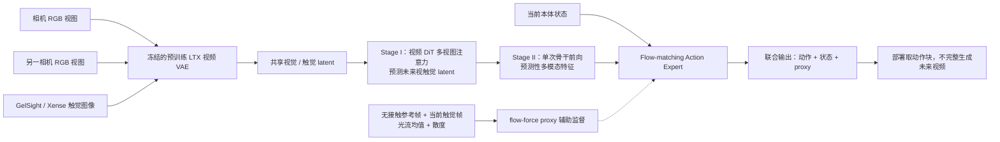

# VTAM：无需触觉预训练的高效视触觉世界—动作模型
*VTAM: Efficient Visuo-Tactile World-Action Models for Contact-Rich Manipulation without Tactile Pretraining*

> **版本核对：** arXiv:2603.23481v2（2026-11-05）标题如上；早期 v1 及 [Awesome Touch](https://github.com/sun254667/awesome-touch) 清单使用 *Video-Tactile-Action Models for Complex Physical Interaction Beyond VLAs*。本页为 **同一论文的升级详情节点**，不是重复建页。

## 一句话定义

VTAM 用**共享的预训练视频编码器和世界模型**同时理解 RGB 与触觉图像，通过未来视触觉潜变量预测学习接触变化，再用生成式动作专家预测动作、状态与触觉形变代理，完成接触丰富的操作任务。

## 英文缩写速查

| 缩写 | 英文全称 | 简要说明 |
|---|---|---|
| VTAM | Visuo-Tactile World-Action Model | 视触觉世界—动作模型 |
| WAM | World-Action Model | 联合世界预测表征与动作生成 |
| VAE | Variational Autoencoder | 重用预训练视频 VAE 编码 RGB 和触觉 |
| DiT | Diffusion Transformer | 视频世界骨干与动作专家的生成架构 |
| RGB | Red Green Blue | 视觉相机图像输入 |
| VLA | Vision-Language-Action | 视觉–语言–动作策略族 |

## 为什么重要

摄像机能看到机械臂移动，却不一定能看到夹爪是否**真正接触**薯片、削皮刀是否持续贴合黄瓜、擦板器是否失去接触。VTAM 让触觉进入**未来世界状态预测**，而非只把一帧触觉拼接到视觉策略输入；同时避免在部署时完整去噪生成视频。其关键代价仍是任务专用示范和显卡推理资源。

## 核心信息

| 字段 | 核对结果 |
|---|---|
| 论文及版本 | [arXiv:2603.23481v2](https://arxiv.org/abs/2603.23481v2)，2026-11-05；[HTML 全文](https://arxiv.org/html/2603.23481v2) |
| 主要作者 | Haoran Yuan、Weigang Yi、Zhenyu Zhang、Wendi Chen 等，完整名单见 [原文归档](../../sources/papers/vtam_arxiv_2603_23481.md) |
| 机构 | 伊利诺伊大学厄巴纳-香槟分校（UIUC）、斯坦福大学、上海交通大学 |
| 真机平台 | xArm6 + GelSight Mini；Flexiv Rizon 4 + Xense Photon |
| 官方资源 | [项目页](https://plan-lab.github.io/projects/vtam/) · [代码](https://github.com/PLAN-Lab/VTAM) · [公开实机数据](https://huggingface.co/datasets/JensenYuan/VTAM_xArm_GelSight) |
| 阅读与复现 | 已核对 v2 全文方法、实验、图表与结论及源码入口；未运行训练、仿真或真机 |

## 流程总览

根据 v2 §3、Figure 2 与作者公开训练代码区分 **Stage I 世界模型训练** 和 **Stage II 动作学习与部署**：



## 核心原理

1. **共享视觉先验学习触觉。** Stage I 从 Genie Envisioner / LTX-Video 预训练权重启动；同一个冻结的 VAE 编码两路 RGB 和一路 GelSight，Hanoi 则改为单路 RGB + Xense Photon。28 层骨干在视图内和跨视图交换 latent 信息，通过未来多模态 flow-matching 损失进行任务内微调。**并非另训一个独立触觉编码器**（§3.1）。
2. **动作专家联合去噪。** Stage II 复用 Stage I 骨干并端到端更新，由并行 28 层专家通过 cross-attention 读取世界骨干隐特征，学习未来动作、16D 本体状态与 3D flow-force proxy；xArm 任务的动作本身是 7D（§3.3）。
3. **虚拟力不是真实力。** 对无接触参考与当前触觉图计算光流，其 x/y 均值和散度平均构成 3D 辅助目标，不需附加力传感器；它帮助抑制动作专家对触觉模态的忽略，但**不能直接解释为 N 单位接触力**（§3.2、Table 5）。
4. **部署阶段跳过全视频去噪。** 世界骨干一次前向提供预测性 latent，动作专家用少数 Euler 积分步生成动作块；不能把训练时的未来视频去噪误认为真机推理必做（§3.3、5.6）。

## 实验与评测

| 评测及协议 | VTAM | 重要对照 |
|---|---:|---|
| 薯片抓放（xArm6，20 次） | 90% | 视觉 π₀.₅：10% |
| 黄瓜削皮（xArm6，20 次） | 85% | Tactile-VLA：20% |
| 白板擦拭（xArm6，平板/斜板共 40 次） | 95% | RDP：50% |
| 汉诺塔圆盘插入（Flexiv + Xense，20 次） | 75% | FTP-1：55% |
| UniVTAC 八任务仿真均值（每任务 100 seeds） | 83.4% | 无大规模触觉预训练的最高基线：48.0%；N₀-TWAM：84.5% |

- 原文 Table 2 的 **90% 平均**为前三项任务成功率的**不加权平均**，不包括 Hanoi；四项真机任务没有报告这一口径的均值。
- **消融（Table 5）：** 直接将冻结 VAE 的触觉特征输入专家，Chip/Wipe/Hanoi 成功率为 0/0/0%；移除 flow-force proxy 为 10/10/55%；完整 VTAM 为 90/95/75%。这分别检验触觉世界预测和接触辅助监督是否有效。
- **Stage I 消融（Table 6）：** UniVTAC 平均 83.4%→65.8%（跳过 Stage I）；但 Insert Hole 任务逆向变化为 67%→95%，不能笼统声称每个任务都受益。
- **延迟（Table 8）：** 单 L40S、BF16、batch=1、UniVTAC 上 588 ms/动作块（eager），145 ms/动作块（compiled）；真机五步 Euler 的每块推理约 141 ms，作者真机策略更新 **1 Hz**、底层动作执行 **30 Hz**，不等于高频触觉力闭环。

## 与其他工作对比

- **普通视觉 WAM / GE-Act：** 共享视频世界先验，但未把触觉接触变化作为学习目标；比较时应保持训练演示和平台口径一致。
- **仅拼接触觉的 VLA / 策略：** 可能忽略触觉。VTAM 的 frozen-VAE → expert 消融说明**在这些任务和配置中**仅提供触觉特征不够。
- **[DexTacWAM](./paper-dextacwam.md)：** 同为“视觉先验扩展到触觉”的预测式 WAM；VTAM 以单个/少数触觉流共享视频 VAE/DiT，强调**免独立触觉预训练与 flow-force proxy**；DexTacWAM 面向**十指双手触觉**，先适配指尖编码器并做手级压缩，强调**预测跨指接触演化**。两者平台、任务、动作表示与评分协议不同，不能直接用 90% 和 70.6 分数排名。

## 结论

**VTAM 说明预训练视频模型可以通过少量任务示范学习接触敏感的视触觉世界预测，但不能据此推断它已具备无需适配的通用灵巧操作能力。**

1. 构建触觉策略先核对“当前触觉作为输入”与“未来触觉被预测”的差别。
2. 用真实接触/失接触任务及消融验证触觉是否被策略有效使用；flow-force proxy 是训练代理，不是标定力信号。
3. 复现时正确区分 xArm 的三任务平均、Hanoi 跨传感器实验以及 UniVTAC 八任务平均。
4. 与 N₀-TWAM 比较要标注不同预训练规模和仿真协议；相近成功率不能推成同等泛化能力。
5. 真机上线前测量端到端延迟、动作块闭环频率、异常接触恢复并设置急停。

## 源码运行时序图

经核对官方 `README.md`、`main.py`、`runner/ge_trainer.py`、`experiments/eval_xarm.py`；以下是 **Stage I/II 训练调用链**，不把真机驱动虚构成世界模型训练代码：

```mermaid
sequenceDiagram
  autonumber
  participant CLI as "torchrun main.py"
  participant Main as "main.py"
  participant Tr as "runner/ge_trainer.py Trainer"
  participant Data as "CustomLeRobotDataset / DataLoader"
  participant Models as "LTX VAE / Video DiT / Action Expert"
  participant Opt as "Accelerate / optimizer"
  CLI->>Main: --config_file stage1_world_model.yaml
  Main->>Tr: import_custom_class("Trainer", runner/ge_trainer.py)
  Main->>Tr: Trainer(config)
  Tr->>Data: prepare_dataset()
  Data-->>Tr: 训练 batch
  Tr->>Models: prepare_models()
  Tr->>Opt: prepare_trainable_parameters()
  Tr->>Opt: prepare_optimizer()
  Tr->>Opt: prepare_for_training()
  Tr->>Opt: prepare_trackers()
  Tr->>Models: train() / Stage I 未来视触觉 latent flow matching
  Models-->>CLI: Stage I checkpoint
  CLI->>Main: --config_file stage2_vtam.yaml (model_path 指向 Stage I)
  Main->>Tr: 初始化并重复 dataset/models/optimizer/train
  Tr->>Models: Stage II 动作-状态-proxy 联合训练
  Models-->>CLI: Stage II checkpoint
```

真机评测独立入口为 `experiments/eval_xarm.py:main` → `InferenceXArm` 加载 Stage II checkpoint → `XArmAPI` 连接控制器与 `cv2.VideoCapture` 读取 RGB/GelSight → 推理动作块 → 30 Hz 发送机械臂关节命令并写 CSV 日志。源码详情见[官方实现核对](../../sources/repos/vtam-official.md)。

## 工程实践

- 参考官方 `configs/real_world/chip_pick_and_place/`：先用 `stage1_world_model.yaml` 训练任务特定视触觉世界模型，再把其 checkpoint 写入 `stage2_vtam.yaml` 的 `model_path`，执行两阶段 `torchrun ... main.py --config_file ...`。
- 准备 LeRobot 格式示范，核对 `<DATA_ROOT>`、`<OUTPUT_ROOT>`、`<PRETRAINED_ROOT>`、GE-base/LTX 权重路径、动作空间及归一化统计；参考环境为 4 GPU，并非轻量单卡即开即跑。
- 项目页 Code 标签仍显示 coming soon，**实际作者仓库已经发布**训练/推理代码、xArm6+GelSight 实机示范与任务配置；**checkpoint 与 UniVTAC 仿真配置未发布**。不能只克隆代码就声称已复现 83.4%。
- 仓库存在 CC BY-NC-SA 4.0 的 Genie Envisioner 派生代码及 Apache-2.0 部分；权重另受上游许可，尤其商用部署须逐项核查。

## 局限与风险

实验为**任务专用训练**，部分仿真基线来自原论文、评测次数可能不同；不同触觉传感器的零样本 VAE 表征不等于整个动作专家零样本跨平台泛化。发布源码不足以复现作者真机权重，真实部署还需工位标定、安全围栏、相机与触觉同步、异常接触保护。本文未证明在高频闭环力控、未见任务或任意多指触觉硬件上的可靠性。

## 关联页面

- [DexTacWAM：十指接触世界预测](./paper-dextacwam.md)
- [触觉感知](../concepts/tactile-sensing.md) 与 [视触觉融合](../concepts/visuo-tactile-fusion.md)
- [接触丰富操作](../concepts/contact-rich-manipulation.md)
- [世界—动作模型](../concepts/world-action-models.md)
- [模仿学习](../methods/imitation-learning.md) 与 [Manipulation](../tasks/manipulation.md)
- [Awesome Touch 技术地图](../overview/sun-awesome-touch-technology-map.md)
- [WAM 纵深路线](../../roadmap/depth-wam.md) 与 [接触操作纵深](../../roadmap/depth-contact-manipulation.md)

## 参考来源

- [arXiv v2 原文核对归档](../../sources/papers/vtam_arxiv_2603_23481.md)
- [作者项目主页与发布状态](../../sources/sites/vtam-project.md)
- [官方代码与运行入口核对](../../sources/repos/vtam-official.md)
- [Awesome Touch 旧版策展记录](../../sources/papers/sun_awesome_touch_2603_23481_vtam-video-tactile-action-models-for-com.md)

## 推荐继续阅读

- [VTAM v2 arXiv HTML 正文](https://arxiv.org/html/2603.23481v2)
- [VTAM 官方 GitHub README 与配置](https://github.com/PLAN-Lab/VTAM)
- [VTAM 作者项目页（部分描述仍为 v1）](https://plan-lab.github.io/projects/vtam/)
