# SCOPE

**SCOPE: Simulating Cross-game Operations in Playable Environments for FPS World Models** 收录于 [Awesome World Models](https://github.com/sun254667/awesome-world-models) **第 182/571** 篇，分组 **52 Game & Open-World Exploration Application**。本页是 **清单索引**：给出它在清单中的位置与原文入口，方法细节和量化结果请看原文。

## 一句话定义

Simulates cross-game operations in playable environments for FPS world models.

## 英文缩写速查

| 缩写 | 英文全称 | 简要说明 |
|------|----------|----------|
| WM | World Model | 环境前向预测模型 |
| WAM | World Action Model | 世界预测与动作联合建模 |
| VLA | Vision-Language-Action | 视觉–语言–动作策略 |
| MBRL | Model-Based RL | 基于模型的强化学习 |

## 为什么重要

- Simulates cross-game operations in playable environments for FPS world models.
- 想横向对照同一分组的其他工作，可以从 [Awesome World Models 技术地图](../overview/sun-awesome-wm-technology-map.md) 逐条展开。
- 顺着列表实体 [Awesome World Models](../entities/awesome-world-models.md) 与下方关联的方法 / 任务页，可以接回对应的学习主线。

## 流程总览

```mermaid
flowchart TD
    IN["初始帧 I_1 + 文本条件 + 玩家动作序列 a_1:T"] --> VAE["3D VAE 编码为潜变量, patchify 为 token 序列 x"]
    VAE --> BLK["预训练视频 DiT 块 (约 5B 参数, L=30)<br/>AdaLN -> 自注意力(3D RoPE) -> 文本交叉注意力"]
    BLK --> RS["SCOPE 模块 (插在文本交叉注意力与 FFN 之间)<br/>Spatial Reshape: 重排为逐像素时间序列"]
    AC["连续控制 a_c (4 维: 移动 2 轴 + 相机 2 轴)"] --> CP
    AD["离散事件 a_d (6 维: fire / ADS / reload / jump / melee / switch)"] --> DP
    RS --> DP["离散通路: MLP 嵌入动作 -> 交叉注意力<br/>(像素特征作 Query, 动作作 K/V), 约束在 in-scope 区域"]
    RS --> CP["连续通路: 取时间窗拼接像素特征 -> 融合 MLP -> 时间自注意力(RoPE)<br/>负责 out-of-scope 自运动"]
    DP --> ADD["残差相加: x + dx_c + dx_d, 重排回标准 token 布局"]
    CP --> ADD
    ADD --> FFN["FFN, 进入下一 DiT 块"]
    FFN --> OUT["流匹配去噪, 解码得视频续写 V_2:T"]
    OUT -. "推理: Action-CFG 在无条件与有条件速度间插值" .-> OUT
```

图依据：论文 §3.1–§3.4 / Fig.2（SCOPE 输出投影零初始化、整体端到端训练；Fig.3 为 CrossFPS 数据集概览，未入图）

## 核心信息

| 字段 | 内容 |
|------|------|
| 编号 | 182/571 |
| 分组 | 52 Game & Open-World Exploration Application |
| 出处 | arXiv 2025 |
| 论文 | <https://arxiv.org/abs/2605.23345> |
| 代码/项目 | <https://github.com/z2tong/SCOPE> |

## 核心机制（归纳）

### 策展导读要点

Simulates cross-game operations in playable environments for FPS world models.

本页不复述论文公式与完整实验表；若需工程落地，请回到原文并对照站内相关方法页（见关联页面）。

## 评测与指标

- 本页 **没有搬运** 原文的量化 benchmark 与实机指标。
- 评测口径与具体数值以 [原文 / 项目页](https://arxiv.org/abs/2605.23345) 为准。
- 横向对照请回到 [技术地图](../overview/sun-awesome-wm-technology-map.md) 同分组条目。

## 与其他工作对比

- 本页 **不做** 与具体基线的逐项数值对比；同分组的横向对照请回到 [技术地图](../overview/sun-awesome-wm-technology-map.md) 的 **52 Game & Open-World Exploration Application** 分组逐条展开。
- 如果站内已经有这篇的深读页（含机构、实验表与源码运行时序图），请以那一页为准；本页只保留清单要点。
- 与清单内相邻条目孰优孰劣，本页不下结论：Awesome Highlights 可能滞后于论文最新版本，差异应以各自原文的问题设定与评测口径为准。

## 结论

**这一页能给你的是「SCOPE」在策展清单里的坐标与要点：够你判断要不要去读原文，但不能替代原文。**

- 可确证的只有清单坐标：分组 **52 Game & Open-World Exploration Application**，以及 Highlights 点出的问题设定；本页不自行推导新结论。
- 适用边界：本页不能替代原文 PDF；开源状态以项目页实际链接为准（清单可能滞后）。
- 要深读这篇，建议直接从原文入手，再回到下方关联的方法 / 任务页对照。

## 常见误区

1. 不要把 Awesome 条目的 Highlights 当成完整方法证明——它只是策展导读。
2. 若站内已有这篇的深读页，以那一页为准——本页只是清单入口，不含实验数据。

## 关联页面

- 列表实体：[Awesome World Models](../entities/awesome-world-models.md)
- 技术地图：[Awesome World Models 技术地图](../overview/sun-awesome-wm-technology-map.md)
- 方法/任务：[generative-world-models.md](../methods/generative-world-models.md)、[manipulation.md](../tasks/manipulation.md)

## 参考来源

- [`sources/papers/sun_awesome_wm_2605_23345_scope-simulating-cross-game-operations-i.md`](../../sources/papers/sun_awesome_wm_2605_23345_scope-simulating-cross-game-operations-i.md) — 本条目策展摘录
- [`sources/papers/sun_awesome_wm_catalog.md`](../../sources/papers/sun_awesome_wm_catalog.md) — 列表总表
- [`sources/repos/awesome-world-models.md`](../../sources/repos/awesome-world-models.md)
- 论文：<https://arxiv.org/abs/2605.23345>
- [arXiv PDF](https://arxiv.org/pdf/2605.23345)：已通读方法部分（实验与附录以略读为准）：Abstract、§1 Introduction、§3 Method（3.1–3.4）、§4.1 Setup；其余实验略读

## 推荐继续阅读

- [Awesome World Models 仓库](https://github.com/sun254667/awesome-world-models)
- [原文](https://arxiv.org/abs/2605.23345)
