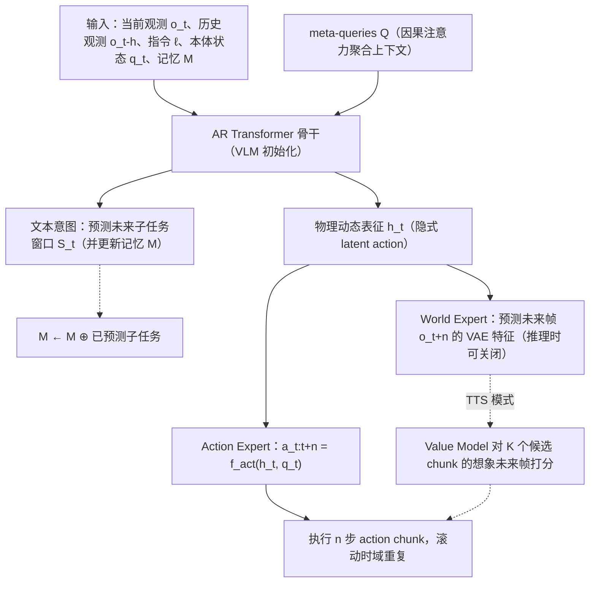

# World-Language-Action Model（WLA-0，arXiv:2606.05979）

**World-Language-Action Model for Unified World Modeling, Language Reasoning, and Action Synthesis**（[arXiv:2606.05979](https://arxiv.org/abs/2606.05979)，SJTU / SII 等）收录于 [Awesome Egocentric Vision](https://github.com/sun254667/awesome-egocentric-vision) 第 117/249 篇（分组 28 Egocentric World Models），也被 CoRL 2026 Glen Berseth 阅读清单收录。本页依据论文 v1 全文通读（归档见 [来源归档](../../sources/papers/world-language-action-model-wla_arxiv_2606_05979.md)）。

## 一句话定义

WLA 用一个由 VLM 初始化的**自回归 Transformer** 同时预测「文本子任务」（高层意图）和「物理动态隐变量」（由 World Expert 用未来帧监督），再由 Action Expert 出动作块；World Expert 推理时可整体关闭（摘要、§3.1）。论文的原型 WLA-0 总参数 3.4B、推理时激活约 2B（§4.1）。

## 英文缩写速查

| 缩写 | 英文全称 | 简要说明 |
|------|----------|----------|
| WLA | World-Language-Action model | 本文提出的模型族：世界建模 + 语言推理 + 动作合成 |
| WAM | World-Action Model | 把世界模型接口接入控制的策略，多用双向 DiT（§1） |
| VLA | Vision-Language-Action | 视觉–语言–动作策略 |
| VLM | Vision-Language Model | 视觉–语言模型，WLA 骨干由它初始化 |
| AR | Autoregressive | 自回归，逐 token 生成 |
| DiT | Diffusion Transformer | 扩散 Transformer，WAM 常用骨干 |
| TTS | Test-Time Scaling | 测试时扩展：采样多候选，用想象未来帧 + 价值模型选最优（§3.2） |
| RMBench | Memory-dependent manipulation benchmark | 依赖记忆的双臂长程基准（引用 [14]） |
| Ego | Egocentric Vision | 第一人称视角 |

## 为什么重要

- 作者主张现有 WAM 几乎只预测下一视觉状态，负担低层细节、语义推理受限；WLA 把「文本子任务 + 物理动态」作为下一状态（§1，作者自述）。
- 推理时不必生成图像（World Expert 关闭），延迟约 40 ms（RTX 5090，摘要、附录 A），对比「先想象图像再行动」的 WAM 更适合动态场景（§4.3，Dispose Trash）。
- 在 RMBench 记忆依赖任务上平均 56.5%，高于 Mem-0 的 28.5%（表 2）；去掉语言子任务损失后降到 17.3%，说明语言子任务在该基准上起主要作用（作者的消融，§4.2）。

## 核心原理与流程总览

图依据：论文 §3.1 / Fig.2、§3.2（TTS 模式）。要点：

- **文本意图（§3.1）：** 训练时把指令切成带时间段的子任务序列，模型预测覆盖未来动作区间的连续子任务窗口 S_t；记忆 M 递归追加已预测子任务。
- **物理动态（§3.1）：** 64 个 meta-queries（§4.1）的输出 h_t 作为 World Expert 的条件，预测目标是未来帧 o_{t+n} 的 VAE 特征，只预测目标帧而非整段视频（附录 B.2 表 4：单帧平均 98.2，多帧 94.2）。
- **隐式影响动作（§3.1）：** World Expert 通过共享参数的训练影响动作，推理时不需要它。作者称 h_t 可视为端到端训练的 latent action。
- **损失（式 3.5）：** L = L_act + α L_wm + β L_lang，α=0.1，β=0.005（§4.1）。
- **TTS（§3.2）：** 采样 K 个候选，World Expert 想象未来帧，价值模型（标签 v_t = y·γ^(T-t)）选最高分执行；LIBERO 上用 6 个候选、想象步长 2。

## 工程实践

- **组成（§4.1）：** RynnBrain-2B（2.1B）骨干 + SANA-600M（含 VAE 共 900M）World Expert + 390M flow-matching Action Expert，各 28 层；动作块 LIBERO 为 8，其余为 32；AdamW，余弦学习率 5e-5 到 5e-6，1000 步预热。
- **训练规模（§4.2）：** RoboTwin 2.0 为 2500 条干净 + 25000 条强随机化轨迹、100k 步、批量 256；LIBERO 单模型四套件、100k 步（作者称 30k 步后已表现很强）；RMBench 每任务单独训练 30k 步、批量 448。
- **推理加速（附录 A）：** CUDA Graph、Triton 算子融合、预计算与缓存，延迟从约 116 ms 降到 40 ms 以内；RoboTwin 用 32 步 flow-matching，更少步数会让机械臂抖动（附录 B.1）。
- **真机（§4.3、附录 C）：** AgileX Piper 双臂，每任务 60 条示教，关节角动作，10 步 flow-matching；WLA-0 从头训练，对比的 π0.5、Motus 为预训练模型。
- **主要结果表：** RoboTwin 2.0 Clean / Rand.：WLA-0 92.94 / 90.02，Lingbot-VA 92.90 / 91.50，Fast-WAM 91.88 / 91.78，π0.5 82.74 / 76.76；去掉 L_wm 为 90.98 / 89.34（表 1）。LIBERO 平均：WLA-0 98.6，+TTS 98.9，Lingbot-VA 98.5，Fast-WAM 97.6（表 1）。
- **从无动作视频学新任务（§4.4，表 3）：** 5 个未见任务，仅动作监督的基线 13.0 / 11.6；加入未见任务同本体视频 34.4 / 30.0；跨本体视频 28.8 / 27.4；加入真人第一视角视频反而 7.8 / 7.8（表 6）。

## 评测证据与清单说法的对比核对

清单（Glen Berseth 的 CoRL 2026 阅读清单，P2，序号 079/101；每条摘要为 LLM 据摘要起草）写：「Autoregressive world-language-action model jointly predicting text subtasks, subgoal images and actions.」逐项核对：

| 清单说法 | 论文实际 | 判断 |
|----------|----------|------|
| Autoregressive | 骨干是 AR Transformer（摘要、§3.1）；但 World Expert 是扩散 Transformer（SANA），Action Expert 是 flow-matching 头（§4.1），不是整个模型自回归 | 基本对，限定词「骨干」应补上 |
| predicting text subtasks | 是（式 3.1、RMBench 上起关键作用）；但 RoboTwin 2.0 上关闭了子任务预测（§4.2），LIBERO 是否启用论文未明说 | 对，但并非所有基准都用 |
| subgoal images | 摘要用词为「subgoal images」；实际是预测 n 步后单帧的 VAE 特征，且推理默认关闭，仅 TTS 模式与可视化（图 10）用到 | 部分对：训练目标与可选推理，不是默认输出 |
| jointly predicting | 训练时联合优化三项损失（式 3.5）；默认部署只输出文本子任务与动作（§3.2） | 训练期成立，推理期不成立 |
| 未提及 | 2B 激活参数、40 ms、RoboTwin 92.94、RMBench 56.5、无具身预训练；真机只有单一平台 | 清单未含结果与局限 |

另：清单只给了一句话，没有说明这些结果主要来自仿真（RoboTwin 2.0、LIBERO、RMBench），真机仅一个双臂平台、四个任务、每设定 10 次试验（§4.3、§6）。

## 结论

WLA 把语言子任务与动态表征联合学习，并在默认推理时去掉 World Expert，但收益需按协议和任务分别判断。

- 区分常规推理与 TTS 的组件和延迟，不能把训练时世界专家算进默认部署路径。
- 按 Clean、Rand. 和具体任务比较，不把微小均分差距当全面领先。
- 把仿真机器人视频与人类第一视角视频迁移分开验收，现有证据不支持二者等效。

## 局限

论文自述（§6）：

- 真机实验仅少量双臂任务、单一机器人平台，需更多本体与任务验证。
- 视频学新任务的实验用的是仿真机器人视频；真人第一视角视频没有帮助，作者推测是与仿真的域差（附录 D，作者自称为推测）。

阅读时看到的未验证之处（本页判断，非论文原话）：

- 表 1 的 Rand. 栏 WLA-0（90.02）低于 Fast-WAM（91.78）与 Lingbot-VA（91.50）；且 Lingbot-VA 用 seen instructions 设定，其余为 unseen（附录 B.1），比较口径不完全一致。摘要的「state-of-the-art」主要体现在 Clean 栏的微小差距（92.94 对 92.90）。
- RMBench 只用 M(n) 的 4 个任务，且每任务单独训练；未报告多次随机种子的方差。
- 真机每设定仅 10 次试验，多个差异在 1 到 2 次之内（表 5），例如 Unscrew Cap 标准设定 WLA-0 为 7、π0.5 为 9。
- 40 倍延迟优势是对比 Motus 且 Motus 每次只生成一帧（§4.3）；与 π0.5 的差距论文只说「更低」，未给倍数。
- 摘要所说「从跨本体机器人视频学新任务」的证据是 5 个仿真任务上的表 3，且 Move Playingcard Away 跨本体几乎无效（1 / 0）。
- 未做消融：骨干换成非 VLM、meta-queries 数量、价值模型质量等（论文未见相关表，推测为未做）。

## 关联页面

- [World Action Models](../concepts/world-action-models.md)：WAM 范式总览，本文是其「加语言推理」的变体。
- [Fast-WAM](../entities/paper-fast-wam.md)：推理期跳过未来视频去噪，本文的主要 WAM 对比基线。
- [X-VLA](../entities/paper-x-vla.md)、[π0](../entities/paper-pi0.md)：RMBench / RoboTwin 对比的 VLA 基线（π0.5 另见 [π0.5 开放世界 VLA](../entities/paper-pi05-open-world-vla.md)）。
- [RoboTwin](../entities/robotwin.md)：RoboTwin 2.0 基准页。
- [Diffusion Transformer](../concepts/diffusion-transformer.md)、[Flow Matching 具身策略](../concepts/flow-matching-embodied-policy.md)：World Expert 与 Action Expert 的技术背景。
- [VLM / VLN / VLA / VLX / 世界模型分类](../comparisons/vlm-vln-vla-vlx-world-model-taxonomy.md)
- 列表与上下文：[Awesome Egocentric Vision](../entities/awesome-egocentric-vision.md)、[技术地图](../overview/sun-awesome-ego-technology-map.md)、[VLA](../methods/vla.md)、[模仿学习](../methods/imitation-learning.md)、[操作任务](../tasks/manipulation.md)

## 参考来源

- [`sources/papers/world-language-action-model-wla_arxiv_2606_05979.md`](../../sources/papers/world-language-action-model-wla_arxiv_2606_05979.md) — 全文通读归档（核对范围见其中）
- [`sources/papers/sun_awesome_ego_2606_05979_world-language-action-model-for-unified.md`](../../sources/papers/sun_awesome_ego_2606_05979_world-language-action-model-for-unified.md) — 清单策展摘录
- [`sources/papers/sun_awesome_ego_catalog.md`](../../sources/papers/sun_awesome_ego_catalog.md) — 列表总表
- [`sources/repos/awesome-egocentric-vision.md`](../../sources/repos/awesome-egocentric-vision.md)
- 论文：<https://arxiv.org/abs/2606.05979>；代码（论文首页给出，未核查内容）：<https://github.com/SJTU-DENG-Lab/WLA>

## 继续阅读

- [论文 PDF](https://arxiv.org/pdf/2606.05979v1)
- [Awesome Egocentric Vision 仓库](https://github.com/sun254667/awesome-egocentric-vision)
- 论文引用的相邻工作：Fast-WAM（arXiv:2603.16666）、Motus（arXiv:2512.13030）、RMBench（arXiv:2603.01229）、RoboTwin 2.0（arXiv:2506.18088）
