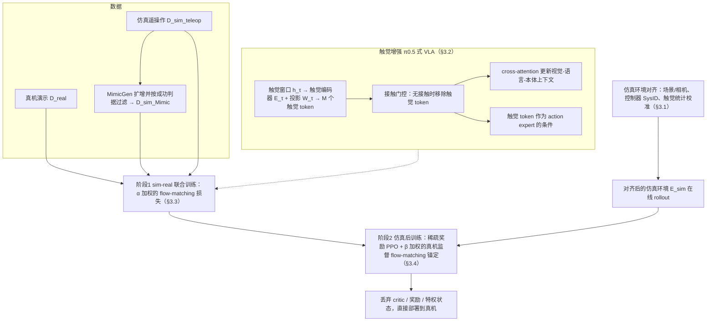

# TacCoRL

**TacCoRL: Integrating Tactile Feedback into VLA via Simulation**（[arXiv:2606.11743](https://arxiv.org/abs/2606.11743)，UCLA 等，Ma / Liang / Yu 等）收录于 [Awesome Touch](https://github.com/sun254667/awesome-touch) 第 009/065 篇（分组 21 Unified Vision-Tactile-Language-Action Frameworks），也出现在 CoRL 2026 阅读清单的 P1 档。本页依据论文 v1 全文（含补充材料）整理，原文归档见 [taccorl_arxiv_2606_11743](../../sources/papers/taccorl_arxiv_2606_11743.md)。

## 一句话定义

在现成的 π0.5 式 VLA 上接入触觉 token（带接触门控），先用仿真与真机数据联合训练得到「触觉条件动作先验」，再在与真机对齐的仿真里用稀疏奖励 PPO 精修，并以真机监督损失作锚，最后不带特权信息直接部署到真机（Abstract、§3）。

## 英文缩写速查

| 缩写 | 英文全称 | 简要说明 |
|------|----------|----------|
| VLA | Vision-Language-Action | 视觉-语言-动作模型，本文骨干为 π0.5 式（§3.2） |
| RL | Reinforcement Learning | 本文用 PPO，稀疏任务奖励（§3.4） |
| PPO | Proximal Policy Optimization | 带裁剪的策略梯度，裁剪比 0.2（Table 4） |
| SFT | Supervised Fine-Tuning | 监督微调；Fig.2 中联合训练阶段的损失记作 L_SFT |
| SysID | System Identification | 用真机扫频数据辨识仿真控制器 Kp、Kd、Tref（§4.1，附录 B.1） |
| SPSA | Simultaneous Perturbation Stochastic Approximation | SysID 所用的无梯度优化器（附录 B.1） |
| GAE | Generalized Advantage Estimation | PPO 的优势估计，λ=0.95（Table 4） |
| taxel | tactile pixel | 触觉阵列单元，每块 FlexiTac-V2 为 32×12（附录 A） |

## 为什么重要

- 触觉 VLA 的常见路线是大规模触觉预训练或专门的触觉-语言-动作模型；本文问的是能否不做这些，把触觉接进现有 VLA（§1）。这是作者提出的问题设定，不是已被普遍验证的结论。
- 论文主张的核心是「接触读数如何调制近失败状态下的动作」：这类状态在演示里少、真机采集又有损坏传感器与复位成本（§1）。仿真提供可复位、可验证的环境。
- 对读者的用处：它给出一条可复用的流程（对齐 → 联合训练 → 带锚 RL），并在附录 D 公开了全部超参，方便与 [VT-Refine](../entities/paper-sa-2510-14930-vt-refine-learning-bimanual-assembly-with-visuo.md) 等相邻工作对照。

## 核心原理与流程总览

要点（均出自 §3）：

1. **触觉接入（§3.2）**：最近 L 帧触觉经编码器与投影得到 M 个 token；二值门控在窗口内没有足够 taxel 超过阈值时把触觉 token 从注意力中移除，作者称这样「在接触之外保持预训练 VLA 的行为」。触觉通过两条路径进入：对视觉-语言-本体上下文的 cross-attention，以及作为 action expert 每个去噪步的条件 token。实际取值（Table 3）：L=10，4×32×12=1536 个 policy-facing taxel，前缀与后缀各 8 个触觉 token，λf=0.4，m=1，动作块 H=10，动作维 14。
2. **联合训练（§3.3，式 7）**：损失是 α 加权的仿真 flow-matching 与 (1−α) 加权的真机 flow-matching；仿真数据由遥操作加 [MimicGen](../entities/mimicgen.md) 扩增，并按评测同款成功判据过滤。主设置 α=0.5（Table 3）。作者强调联合训练仍是固定数据集模仿，没有在线接触反馈。
3. **后训练（§3.4，式 8）**：clipped PPO 加 β 加权的真机 flow-matching 锚；主设置 β=1.0，锚数据 200 条、batch 32（Table 4）。flow-policy RL 采用 Flow-SDE（噪声 0.5、4 步去噪、chunk 级奖励与 log-prob），critic 为 mean-token value head（Table 4，实现沿用 [RLinf](../entities/paper-rlinf-vla.md) 与 πRL）。

## 工程实践

- **硬件（附录 A）**：两只 AgileX PiPER 6-DoF 臂；前置 RealSense D415，两个腕部 D405；两爪各一块 FlexiTac-V2 触觉垫（32×12 taxel）。
- **数据量（§4.2）**：每任务 50 条真机演示、20 条仿真遥操作（MimicGen 扩到 200）；联合训练步数 Assembly 两任务 1000、Do Puzzle 与 Test Tube Insertion 3000，全局 batch 192，峰值学习率 2.5e-5（Table 3）。
- **RL 设置（Table 4）**：128 个并行仿真环境，rollout chunk 36 步，γ=0.99，actor 学习率 5e-6，value head 1e-4，每次 1 个 PPO epoch。
- **仿真对齐（§3.1、§4.1、附录 B）**：(1) 控制器：逐关节 10 秒扫频，用 SPSA 在 Kp∈[10,1e5]、Kd∈[1,1e3]、Tref∈[−8,8] 内拟合（Fig.9 给出六个关节的辨识值）；(2) 触觉：弹簧阻尼法向读数 f=[kn·δ+kd·δ̇]+（式 10），按无接触真机读数估噪声阈值，再调 kn、kd 对齐活跃 taxel 掩码、数量、质心、直方图与时间差分；只对齐法向通道，不重建剪切力；(3) 相机：离线优化外参偏移。
- **域随机化（附录 E，Table 5）**：图像裁剪 / 旋转 / 亮度对比度饱和度抖动、物体摩擦 U(0.3,0.7)，以及各任务物体位姿、质量等的重置随机化。
- **部署**：丢弃 critic、奖励、特权状态，直接用同一策略（§3.4）。

## 实验结果（论文自报）

四个双臂任务：Test Tube Insertion、Do Puzzle（需放三块）、Assembly #1（螺丝-螺母）、Assembly #2（插头-插座）（Fig.3、5，附录 C）。

| 指标（来源） | 视觉-only | 视觉-触觉 |
|---|---|---|
| 仿真，联合训练后均值（Table 1，由四任务值平均） | 33.0% | 40.5% |
| 仿真，加探索噪声起点均值（§4.3） | 22.5% | 29.3% |
| 仿真，RL 后均值（§4.3，Table 1） | 60.5% | 78.5% |
| 真机，RL 后均值（§4.4，Table 2） | 50.0% | 72.5% |

- 直接从基座 VLA 做 RL：四任务全为 0.00（Table 1），作者据此认为稀疏奖励无法自举（§4.3）。
- 真机分任务（Table 2，RL 后，视觉 vs 视觉-触觉）：Test Tube 0.35 vs 0.70；Do Puzzle 0.25 vs 0.45；Assembly #1 0.80 vs 0.95；Assembly #2 0.60 vs 0.80。
- 消融（§4.5，Fig.7，仅 Assembly #2）：α=0.5 优于 0.95 与 0；β=0.1 与 1.0 把真机从 45% 提到 80%，β=5.0 反而下降。
- 作者的失败分析（附录 C）：模仿-only 触觉基线检测到接触却继续插入或原地重复按压；视觉-only 基线在接触区被遮挡后无法判断偏差。这是对代表性失败的描述，不是失败分布统计（原文自己说完整分布更宽）。

## 与清单说法的对比核对

清单（CoRL 2026 阅读清单 P1，由 LLM 据摘要起草）对这篇的一句话：「Adds touch to VLAs through sim-real co-training and simulation RL focused on near-failure contact states.」

| 清单措辞 | 论文核对 |
|---|---|
| adds touch to VLAs | 属实：在 π0.5 式 VLA 上加触觉 token 与接触门控（§3.2）。 |
| sim-real co-training | 属实：§3.3 式 7，仿真与真机 flow-matching 损失混合，α=0.5。 |
| simulation RL | 属实但需补限定：PPO 在仿真中进行，并带 β 加权的真机监督锚（§3.4）；纯仿真 RL 不是论文的方案，β=0 时论文指出可能过拟合仿真特有的接触策略（§4.5）。 |
| focused on near-failure contact states | 摘要有此动机表述（Abstract、§1），但这是动机而非机制：RL 并没有显式的近失败采样或课程，奖励只是任务级成功/失败判据（§3.4）；论文也没有按「近失败状态」单独统计的实验。支持它的只有附录 C 的四个代表性失败例子和 §4.3 对 Test Tube、Assembly #2 中遮挡偏差的叙述。读作「作者认为的收益来源」更稳妥。 |
| （清单未提）真机验证 | 论文是真机评测：四任务、每任务 20 次，均值 72.5% 对 50.0%（Table 2），清单没有写这个结果量级，也没说仿真数字与真机数字的区别。 |

## 结论

TacCoRL 支持用触觉与真机监督锚定仿真 RL，但任务级数字孪生和真实触觉数据仍不可省略。

- 先检查法向触觉通道的标定与仿真对齐，再进行接触门控训练。
- 对照视觉基线时对齐结构、训练步数及数据，并按任务记录完整成功率。
- 扩展到软体、流体或新硬件前重新辨识接触模型，四任务均值不构成规模化证明。

## 局限

作者自述（§6）：

- 仍需少量真机触觉演示做锚，没有彻底摆脱真机触觉数据。
- 任务级数字孪生仍需人工（资产重建、相机对齐、触觉系统辨识）。
- 只覆盖刚体或近刚体接触，可变形物体与流体需要额外建模。

我在阅读中看到的未验证之处（个人判断，非作者自述）：

- 统计力度：真机每任务只有 20 次试验（成功率最小步长 5%），表中未给置信区间或种子数；Fig.6 为单条曲线。如 Test Tube 的视觉-only 在 RL 后真机仍为 0.35，与联合训练相同（Table 2）。
- 对比的公平性：「视觉-only」与「视觉-触觉」的差异按论文叙述来自触觉输入，但视觉-only 基线的具体结构（是否同样 α、β、训练步数）在正文里没有逐项说明；也没有与其它触觉 VLA（如 VT-Refine 或触觉 VLA 基线）的数值对比，因此「比其它触觉方法好」无从判断。
- 标题与摘要里的「scalable」没有对应的缩放实验：只展示了四个任务、同一平台。
- 触觉对齐只对法向通道，且质量以定性图、一个直方图和均值（0.616 与 0.658，Fig.4B）展示，没有统一定量指标；对齐误差对 RL 收益的敏感性未做消融。
- 锚数据规模：§4.2 写每任务 50 条真机演示，Table 4 的真机锚数据为 200 episodes，正文未解释二者关系（推测是重采样或含额外数据，未核实）。
- 代码：论文给出项目页但未给代码仓库，本次也未找到公开仓库；复现依赖需自行实现的仿真对齐与触觉模型。

## 关联页面

- 列表实体：[Awesome Touch](../entities/awesome-touch.md)、[Awesome Touch 技术地图](../overview/sun-awesome-touch-technology-map.md)
- 方法：[VLA](../methods/vla.md)、[PPO](../methods/ppo.md)、[模仿学习](../methods/imitation-learning.md)、[flow matching 具身策略](../concepts/flow-matching-embodied-policy.md)
- 概念：[Sim2Real](../concepts/sim2real.md)、[触觉感知](../concepts/tactile-sensing.md)、[视触觉融合](../concepts/visuo-tactile-fusion.md)、[接触密集操作](../concepts/contact-rich-manipulation.md)
- 相邻论文与工具：[VT-Refine](../entities/paper-sa-2510-14930-vt-refine-learning-bimanual-assembly-with-visuo.md)（同为仿真微调的视触觉双臂装配）、[RLinf-VLA](../entities/paper-rlinf-vla.md)、[π0.5](../entities/paper-pi05-open-world-vla.md)、[MimicGen](../entities/mimicgen.md)
- 任务：[操作](../tasks/manipulation.md)、[双臂操作](../tasks/bimanual-manipulation.md)

## 参考来源

- [`sources/papers/taccorl_arxiv_2606_11743.md`](../../sources/papers/taccorl_arxiv_2606_11743.md) — 论文全文通读归档（含核对范围）
- [`sources/papers/sun_awesome_touch_2606_11743_taccorl-integrating-tactile-feedback-int.md`](../../sources/papers/sun_awesome_touch_2606_11743_taccorl-integrating-tactile-feedback-int.md) — 清单策展摘录
- [`sources/papers/sun_awesome_touch_catalog.md`](../../sources/papers/sun_awesome_touch_catalog.md) — 列表总表
- [`sources/repos/awesome-touch.md`](../../sources/repos/awesome-touch.md)
- 论文：<https://arxiv.org/abs/2606.11743>；[PDF](https://arxiv.org/pdf/2606.11743v1)；项目页 <https://tac-corl.github.io/>

## 继续阅读

- [论文项目页](https://tac-corl.github.io/)（结果视频）
- [Awesome Touch 仓库](https://github.com/sun254667/awesome-touch)
- 想看相邻的「仿真里微调视触觉策略」，读 [VT-Refine](../entities/paper-sa-2510-14930-vt-refine-learning-bimanual-assembly-with-visuo.md)
