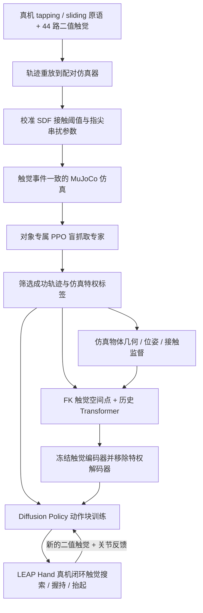

# Blind Dexterous Grasping：Real2Sim2Real 触觉盲抓取

**论文：** [Blind Dexterous Grasping via Real2Sim2Real Tactile Policy Learning](https://arxiv.org/html/2606.11767)（arXiv:2606.11767v2，2026-06-11，项目页标注 CoRL 2026）。作者 Shengcheng Luo 等，机构为**上海科技大学（ShanghaiTech University）**与**北京通用人工智能研究院（BIGAI）**。此前收录在 Awesome-Real2Sim2Real 的第 041/063 条，现按论文全文升级为独立的研究节点。

## 一句话定义

通过真机触觉事件校准仿真、特权几何监督预训练触觉表示，再把仿真 PPO 抓取专家蒸馏成 Diffusion Policy，机器人可在**不使用视觉、但使用稀疏二值触觉和关节状态**的条件下搜寻并抓起物体。

## 英文缩写速查

| 缩写 | 英文全称 | 简要说明 |
|------|----------|----------|
| R2S2R | Real2Sim2Real | 真机触觉标定仿真后，把训练策略转回真机 |
| PPO | Proximal Policy Optimization | 仿真中的对象专属强化学习专家 |
| DP | Diffusion Policy | 使用触觉历史作为条件生成动作块的部署策略 |
| FK | Forward Kinematics | 将每个触觉点投影到手部一致的三维坐标系 |
| FSR | Force-Sensing Resistor | 手掌和指骨上补充的 12 个触觉通道 |
| SDF | Signed Distance Field | 标定仿真中判断传感区域接近/接触的几何表示 |
| F1 | F1 Score | 仿真与真机二值接触事件的一致性指标 |

## 为什么重要

- **“盲”不等于无触觉：** 本文只取消视觉，保留关节本体与 44 路触觉；不能与 [Blind Dexterity](./paper-blind-dexterity.md) 的纯本体感知混淆。
- **二值信号仍有域差：** 即使接触只取 0/1，仿真与传感器的起始时刻及串扰仍会不同，直接影响策略反应。
- **训练与部署信息隔离：** 物体位姿、点云和密集接触标签仅参与仿真监督；真机不依赖这些特权信息或抓取示范。

## 核心信息

| 项目 | 原文设定 |
|------|----------|
| 机构 | 上海科技大学；北京通用人工智能研究院 |
| 真机 | 6 DoF xArm6 + 16 DoF LEAP Hand |
| 触觉 | 4 个指尖 TwinTac（4×8=32）+ 12 个 FSR，共 44 路二值事件 |
| 策略输入 | 关节本体信号 + 触觉事件及其手部 FK 位置；无 RGB 图像/物体位姿 |
| 专家训练 | MuJoCo、PPO、非对称 Actor–Critic；附录 E 记载 2048 并行环境 |
| 触觉预训练 | 16 帧历史；6 层 Transformer；仅训练时用几何、位姿、接触标签 |
| 真机结果 | 20 类物体、各 5 次；已见 16/50、未见 11/50，合计 27/100 |
| 开源 | 项目页 Code / Hardware 仍为待发布占位（2026-11-23） |

## 流程总览

*图依据：原文 §3.1–3.3、Fig. 2 与附录 E–G。仿真专家只生成数据，部署的是统一 Diffusion Policy。*

## 核心原理

### 1. Real2Sim 触觉事件标定（§3.1）

真机做 tapping 与 sliding，记录同步的关节轨迹及二值触觉事件 `y_real`；仿真重放对应轨迹，在参数 `theta=(lambda_con, alpha, lambda_pre)` 上网格搜索，最小化实测与仿真事件序列的 L1 失配。FSR 用空间阈值近似，TwinTac 用接触压力随距离衰减的串扰模型。**标定目标是二值事件的时序与激活一致性，不是重建完整弹性材料。**

### 2. 特权触觉表示学习（§3.2、附录 F）

44 个二值触觉点本身缺少空间意义。将每个传感器的 FK 三维坐标与激活位组合成 `[x, y, z, b]`，堆叠 16 帧历史输入时序 Transformer。仅在仿真预训练中借助物体点云、位姿、机器人状态与接触标签监督触觉特征；部署前丢弃解码器并冻结编码器，不向真机暴露特权标签。

### 3. PPO 专家到 Diffusion Policy（§3.3、附录 E/G）

对象专属 PPO 专家在标定仿真中探索并收集成功抓取轨迹；专家 Actor 的观测限于硬件可用本体/触觉，Critic 允许使用特权仿真状态。统一 DP 以触觉编码器输出和本体状态作为条件，从轨迹学习动作块；真机每次只执行动作块前几步，再基于新接触重新规划。

## 源码运行时序图

**不适用（截至 2026-11-23）：** 项目页的 Code 和 Hardware 入口尚未指向可检查的官方实现仓库。原文附录提供模型结构与训练设定，但不能将论文算法流程冒充经过源码核对的 CLI、训练或真机部署调用时序。

## 工程实践

| 环节 | 可落地检查项 |
|------|--------------|
| 传感器布局 | 记录 32 个 TwinTac + 12 个 FSR 的安装、通道映射与同步关节时间戳 |
| 标定 | 先以 `tapping/sliding` 标定接触起始误差、taxel F1 与误报率，再考虑策略迁移 |
| 触觉编码 | 先检查 FK 坐标系、关节角到传感器位姿映射及 16 帧历史的时序一致性 |
| 训练 | 区分对象专属 PPO **数据生成** 与统一 DP **部署策略**；不要把特权 Critic 输入接到部署端 |
| 评测 | 分开报告已见/未见、仿真/真机；安全急停、滑落与空抓分别计数 |
| 复现边界 | 官方可运行代码尚未公开，附录参数只能用于设计参考，不能称作代码验证复现 |

## 实验与评测

**真机（论文 Table 1）：** 20 个物体（10 已见、10 未见），每种 5 次，共 100 次尝试；已见 **16/50**，未见 **11/50**，总计 **27/100（27%）**。这是整个方法的真机抓取结果。

**触觉标定（Table 2）：** 对照标称仿真与标定仿真，首次接触时间误差 **426 → 96 ms**、F1 **64.2% → 70.5%**、误报率 **4.2% → 2.2%**；这几个值衡量触觉事件一致性，**不是**抓取成功率。

**触觉预训练（Table 3）：** 这是**仿真**消融：已见物体 **36.2% → 60.4%**、未见物体 **20.0% → 43.2%**。附录 C 的真机预训练消融另有 **6/100 → 27/100**（该消融中两组都禁用触觉标定），不得与全系统消融混为一谈。

**真机失败（附录 D）：** 73 次失败可分为 **空抓 15**、**抬升滑落 35**、**安全急停 23**。滑落最大，不能只提高仿真里的触觉定位精度而忽视稳定握持与安全约束。

## 结论

**总判：触觉事件校准 + 带空间几何先验的触觉编码器 + 多专家动作蒸馏，使视觉缺失时的真机灵巧抓取成为可能，但 27% 的实机成功率仍属于早期可行性水平。**

1. **输入边界：** 盲抓指无视觉而非无触觉；部署离不开 44 路触觉及关节状态。
2. **校准优先：** 只做二值化并不能抹平事件发生时间的 Sim2Real 差异。
3. **表征优先：** 触觉点的 FK 空间位置和特权预训练显著影响仿真泛化，标签不可进入真机策略。
4. **部署架构：** 对象 PPO 专家只是演示生成器；真正闭环执行的是触觉条件 DP。
5. **报告口径：** 27% 是真机，51.8% 是仿真均值；指标不可混用。
6. **失效主因：** 35/73 次失败发生在抬升滑落，优先排查摩擦、触觉盲区、握持稳定性及恢复策略。

## 与其他工作对比

| 工作 | 传感输入 | 操作范围与关键区别 |
|------|----------|--------------------|
| [Blind Dexterity](./paper-blind-dexterity.md) | 本体关节信号（操作可用 IMU），**不使用专用触觉阵列** | Unitree G1 全身接触搜索与移动操作；传感成本较低 |
| [Blind Precise Assembly](./paper-blind-proprioceptive-assembly.md) | 关节位置、速度、动作历史，无触觉输入 | 精密装配末端动作，重视精确碰撞几何 |
| **本文** | 本体 + **44 路二值触觉**，无视觉 | LEAP Hand 灵巧盲抓，主攻触觉域差和部分可观测下的接触策略 |

这些工作任务、硬件与成功率分母不同，不能按百分比直接排名。

## 局限与风险

- **成功率与失效：** 总成功 27/100，抬升滑落、安全急停占大头；暂不满足稳定工业抓取要求。
- **触觉覆盖缺口：** 部分指节/手掌接触区未装传感器，接触不一定触发观测。
- **接触动力学与滑移：** 二值接触不显式表示切向力/滑移，接触位置、摩擦和顺应性的残余域差仍可致失败。
- **对象与协议：** 训练主要仿真对象专属专家，评价仅包含论文给定的 20 类刚性物体，不能泛化为任意未知材质。
- **代码开放：** 截至 2026-11-23 项目页 Code / Hardware 为待发布入口，尚无经过核验的策略/驱动仓库可供复现。

## 关联页面

- [Blind Dexterity](./paper-blind-dexterity.md) — 纯本体全身接触探索
- [Blind Precise Assembly](./paper-blind-proprioceptive-assembly.md) — 精密无视觉、无触觉装配
- [Reinforcement learning](../methods/reinforcement-learning.md) — PPO 专家生成数据
- [Manipulation](../tasks/manipulation.md) — 灵巧操作及评测
- [CRISP Real2Sim](../methods/crisp-real2sim.md) — 另一类 Real2Sim 选型参考
- [Awesome-Real2Sim2Real 技术地图](../overview/sun-awesome-r2s2r-technology-map.md) — 原始策展位置

## 参考来源

- [论文一手归档（arXiv:2606.11767v2）](../../sources/papers/sun_awesome_r2s2r_2606_11767_blind-dexterous-grasping-via-real2sim2re.md)
- [官方项目页与开源状态归档](../../sources/sites/dex-blind-grasp.md)
- [Awesome-Real2Sim2Real 原始索引](../../sources/papers/sun_awesome_r2s2r_catalog.md)
- [论文全文 HTML](https://arxiv.org/html/2606.11767) — §1–6、附录 A–G

## 推荐继续阅读

- [项目主页：Blind Dexterous Grasping](https://dex-blind-grasp.github.io/) — 硬件、演示、实验
- [原论文 PDF](https://arxiv.org/pdf/2606.11767) — 方法、消融与失败模式
