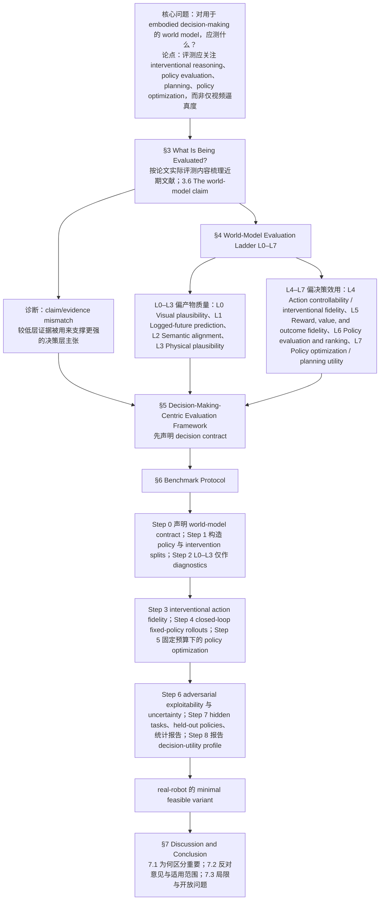

# How Should World Models Be Evaluated for Embodied Decision-Making? A Decision...

**How Should World Models Be Evaluated for Embodied Decision-Making? A Decision-Making-Centric Position** 收录于 [Awesome World Models](https://github.com/sun254667/awesome-world-models) **第 537/571** 篇，分组 **Surveys & Overviews**。本页是 **清单索引**：给出它在清单中的位置与原文入口，方法细节和量化结果请看原文。

## 一句话定义

Proposes an L0-L7 evaluation ladder spanning from visual plausibility to policy optimization utility, emphasizing intervention action fidelity and closed-loop rollout effectiveness.

## 英文缩写速查

| 缩写 | 英文全称 | 简要说明 |
|------|----------|----------|
| WM | World Model | 环境前向预测模型 |
| WAM | World Action Model | 世界预测与动作联合建模 |
| VLA | Vision-Language-Action | 视觉–语言–动作策略 |
| MBRL | Model-Based RL | 基于模型的强化学习 |

## 为什么重要

- Proposes an L0-L7 evaluation ladder spanning from visual plausibility to policy optimization utility, emphasizing intervention action fidelity and closed-loop rollout effectiveness.
- 想横向对照同一分组的其他工作，可以从 [Awesome World Models 技术地图](../overview/sun-awesome-wm-technology-map.md) 逐条展开。
- 顺着列表实体 [Awesome World Models](../entities/awesome-world-models.md) 与下方关联的方法 / 任务页，可以接回对应的学习主线。

## 流程总览

图依据：立场论证与评测框架图，论文摘要与 §1 贡献列表、§3.6、§4（Table 7 的 L0–L7 阶梯）、§5、§6（Step 0–8）、§7 小节标题；本图只给论证结构与协议步骤，不含论文的统计结论。

## 核心信息

| 字段 | 内容 |
|------|------|
| 编号 | 537/571 |
| 分组 | Surveys & Overviews |
| 出处 | arXiv 2026 |
| 论文 | <https://arxiv.org/abs/2606.15032> |

## 核心机制（归纳）

论文 `arXiv:2606.15032v2`（南京大学 & Cirquar Tech）针对具身世界模型普遍“视频生成很逼真、闭环决策却掉链子”的现象，系统梳理了 6 大世界模型传统（Table 1），并将症结归因于 **Objective Mismatch（目标错位）** 与 **Model Exploitation（模型利用漏洞 / 幻想捷径）**：

- **形式化推理环境差距（`XGap`）**：定义 $\text{XGap} = \hat{J}_{\hat{E}}(\hat{\pi}_{\hat{E}}) - J_E(\hat{\pi}_{\hat{E}})$，度量策略在世界模型 $\hat{E}$ 中刷出的虚假高回报与真实环境 $E$ 下实测回报之差。
- **L0–L7 四维正交评测阶梯（Table 7）**：从物理与干预动作保真度、长期一致性、闭环控制可行性到“用世界模型实际优化/筛选策略的有效性”划分 8 个层级，切断“外观清晰 ≈ 决策可用”的混淆。

## 评测与指标

- **约 40 项工作横向诊断（Tables 3–4）**：综述对代表性世界模型基准盘点显示，社区绝大多数研究集中于 `L1`（视觉合理性）与 `L7`，仅约 **12 项**推进至 `L6`（闭环控制效用），而**几乎没有工作正面量化报告 `XGap`**。
- **Decision Contract 与门控得分（Table 8）**：提出形式化评测契约与门控综合指标 $S_{DC} = G_4 G_5 G_6 \sum w_i S_i$——当分布外安全性、干预动作因果性或长程稳定性门控项（$G_4, G_5, G_6$）任意一项失效时，整体评分直接被门控归零，杜绝靠表面画面分拉高总榜。
- **真机最小可行变体与 Reporting Card（Table 9）**：为高成本实体研究设计最低可复现真机对照协议及标准评测报告卡模板。

## 与其他工作对比

- 与偏重多视角视觉渲染/闭环视频生成的 [Uranus](./paper-uranus.md) 及 3DGS 软体仿真 [Real2Sim 3DGS Soft-Body Evaluation](./paper-sa-2511-04665-real-to-sim-robot-policy-evaluation-with-gaussia.md) 相比，本文站在评测哲学与契约设计上游：直接指出“高 L1 视频拟真度”不等于“低 XGap 策略迁移”。
- 横向专题见 [Awesome World Models 技术地图](../overview/sun-awesome-wm-technology-map.md)（**Surveys & Overviews** 分组）与 [具身大模型评测基准选型闭环](../queries/embodied-eval-benchmark-selection-loop.md)。

## 结论

**世界模型评测必须从“开环视觉拟真（L1）”转向“面向决策优化效用与推理环境失配 XGap（L4–L6）的门控契约（Decision Contract）”。**

1. **核心诊断清晰**：对约 40 项已有研究调研（Tables 3–4）表明，社区集中停留在 L1/L7，仅约 12 项触及 L6 闭环控制，且几乎无论文主动报告策略刷高模型内部指标却在实际环境失效的 `XGap`。
2. **推荐落地框架**：先按 L0–L7 四维正交标尺确定能力需求，再用门控综合分 $S_{DC} = G_4 G_5 G_6 \sum w_i S_i$ 筛除干预因果或安全性不合格的模型。
3. **实用真机对齐**：建议高成本团队至少执行 Table 9 的 **Reporting Card** 与 **Real-Robot Minimal Feasible Variant**，披露世界模型筛选策略后上真机的真实性能回落。

## 常见误区

1. 不要拿 PSNR/FVD 等像素重建指标替代 L4–L6 的闭环干预保真与 `XGap` 校验。
2. 本文为方法论与综述提案，不包含单一开源模拟器仓库或现成排行榜软件。

## 工程实践

- **用 Decision Contract（Table 8）落地评测选型**：开测世界模型前须显式锁定物理范围、时间尺度、策略评估边界与可接受失配容限，再按门控得分 $S_{DC} = G_4 G_5 G_6 \sum w_i S_i$ 计算加权表现，防止视觉高分掩盖控制失效。
- **先测真机最小可行变体（Real-Robot Minimal Feasible Variant）与报告卡（Table 9）**：强制报告推理环境差距 `XGap`（$\hat{J}_{\hat{E}}(\hat{\pi}_{\hat{E}}) - J_E(\hat{\pi}_{\hat{E}})$），区分“开环视频看着像（L1/L7）”与“策略真能借此优化并迁移上机（L4–L6）”。

## 源码运行时序图

**不适用** — `arXiv:2606.15032v2` 为立场综述与评测方法论论文，聚焦世界模型评测的认知错位分析、`L0–L7` 四维阶梯与 `Decision Contract / Reporting Card` 规范，未发布独立可执行代码仓库。

## 局限与风险

- **综述调研揭示当前社区严重偏科**：作者统计 Tables 3–4 中约 40 篇代表性工作，绝大多数集中在 `L1`（视觉合理性）与 `L7`，仅约 12 篇触及 `L6` 闭环控制，且**几乎没有论文正面报告 `XGap`**，导致跨工作真实决策价值难以直接对比。
- **Decision Contract 权重 $w_i$ 与门控阈值依赖任务定义**：论文主要给出结构化评测协议、门控代数形式与真机最小可行方案，尚未建成覆盖所有操作/移动域的统一自动打分平台。

## 关联页面

- 评测闭环：[具身大模型评测基准选型闭环](../queries/embodied-eval-benchmark-selection-loop.md) — 本页提出的 `L0–L7`、`XGap` 与 `Decision Contract` 是其中“世界模型评测失配”诊断层核心依据
- 列表实体：[Awesome World Models](../entities/awesome-world-models.md)
- 技术地图：[Awesome World Models 技术地图](../overview/sun-awesome-wm-technology-map.md)
- 方法/任务：[generative-world-models.md](../methods/generative-world-models.md)、[manipulation.md](../tasks/manipulation.md)

## 参考来源

- [`sources/papers/sun_awesome_wm_2606_15032_how-should-world-models-be-evaluated-for.md`](../../sources/papers/sun_awesome_wm_2606_15032_how-should-world-models-be-evaluated-for.md) — 本条目策展摘录
- [`sources/papers/sun_awesome_wm_catalog.md`](../../sources/papers/sun_awesome_wm_catalog.md) — 列表总表
- [`sources/repos/awesome-world-models.md`](../../sources/repos/awesome-world-models.md)
- 论文：<https://arxiv.org/abs/2606.15032>
- [arXiv PDF](https://arxiv.org/pdf/2606.15032)：已全文通读 `arXiv:2606.15032v2`（§1–§7 与 Tables 1–9，含 6 大世界模型传统、Objective Mismatch / XGap、`L0–L7` 四维阶梯、约 40 项工作调研、`Decision Contract` 与 `Reporting Card`）。

## 推荐继续阅读

- [Awesome World Models 仓库](https://github.com/sun254667/awesome-world-models)
- [原文](https://arxiv.org/abs/2606.15032)
