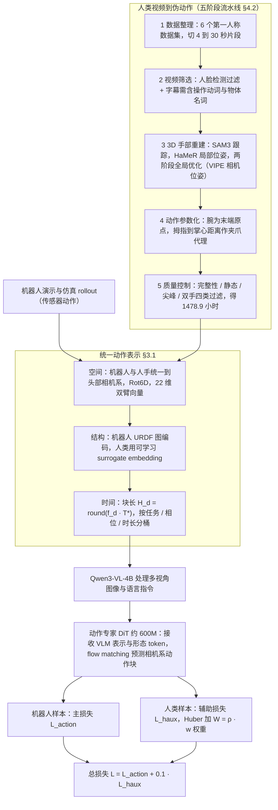

# ACE-Ego-0

**ACE-Ego-0: Unifying Egocentric Human and Robotic Data for VLA Pretraining**（[arXiv:2606.17200](https://arxiv.org/abs/2606.17200)，ACE Robotics 与 CUHK MMLab 等，2026-06）。同时收录于 [Awesome Egocentric Vision](https://github.com/sun254667/awesome-egocentric-vision) 第 067/249 篇（分组 27 Embodied AI & VLA Ego-VLA）。本页依据论文全文通读（见 [来源归档](../../sources/papers/ace-ego-0_arxiv_2606_17200.md)）改写。

## 一句话定义

一个 VLA 预训练框架：把第一人称人类视频经五阶段流水线转成机器人格式的伪动作（1,478.9 小时），与 4,534.8+ 小时机器人和仿真数据放进同一个相机坐标系动作空间联合训练，并让伪动作只以位置通道为主、按可靠性加权地充当辅助监督（论文 摘要、§1、§3、表 1）。

## 英文缩写速查

| 缩写 | 英文全称 | 简要说明 |
|------|----------|----------|
| VLA | Vision-Language-Action | 视觉–语言–动作策略 |
| VLM | Vision-Language Model | 视觉–语言模型，此处为 Qwen3-VL-4B |
| Ego | Egocentric | 第一人称（头戴相机）视角 |
| EEF | End-Effector | 末端执行器，人手以腕关节为等价原点 |
| URDF | Unified Robot Description Format | 机器人结构描述，用来生成形态 token |
| MANO / HaMeR | 参数化手模型 / 基于 Transformer 的手部网格重建 | 人手 3D 重建所用工具（§4.2 Stage 3） |
| Rot6D | 6D continuous rotation | 取旋转矩阵前两列的连续旋转表示 |
| SFT | Supervised Fine-Tuning | 下游任务微调 |

## 为什么重要

- 论文要解决的两个矛盾（§1、§3）：不同数据源的坐标系 / 形态 / 控制频率不一致（表示异质），以及人类伪动作比传感器记录的机器人动作噪声大（监督质量失配）。
- 作者自述的结果：RoboCasa GR1 TableTop 平均 72.8%，RoboTwin 2.0 Easy / Hard 91.12% / 90.62%，真机 ARX 双臂六任务平均 78.3%（§5）。
- 对站内的价值：这是「人类视频当辅助监督、机器人数据当主监督」的一个具体配方，可与 [EgoMimic](../entities/paper-ego-03-egomimic.md) 等把人类数据直接并入策略训练的路线对照，也补充了 [跨本体迁移策略](../queries/cross-embodiment-transfer-strategy.md) 里的数据侧做法。

## 核心原理与流程总览

三个对齐轴加一个损失设计（§3）：

1. **空间：相机系动作（§3.1.1）。** 机器人末端位姿用标定外参转到头部相机系（式 1），人手以腕为原点、掌面构造朝向、拇指到掌心距离映射夹爪行程；旋转统一为 Rot6D；双臂动作 22 维（附录 A.1，式 14、15）。部署时只需乘外参逆变换（§5.1，式 11）。
2. **结构：形态 token（§3.1.2）。** 机器人 URDF 建关节图，经图消息传递得到 body 与 chain 摘要（附录 A.2–A.3）；人类视频每个数据源一个可学习 surrogate embedding（附录 A.4）。token 只喂动作专家，不进 VLM。
3. **时间：时间对齐分块（§3.1.3）。** 块长 H_d = round(f_d · T*)，表 8 给 T* = 2 s，并按任务簇 / 相位 / 时长分桶组 batch。
4. **损失（§3.2）。** 机器人样本走 flow-matching 主损失；人类样本走带可靠性权重的 Huber 辅助损失，总损失 L = L_action + λ·L_haux，λ = 0.1（表 6）。可靠性 W = ρ_j · w_data · w_step，位置通道 ρ = 1.0，旋转与夹爪 ρ = 0.001（表 6）。

图依据：论文 §3.1–3.2、§4.2、图 2、图 4。

## 工程实践

- **模型与算力（附录 B、表 7、8）：** Qwen3-VL-4B-Instruct + 约 600M flow-matching DiT（36 层，隐藏 1024，16 头），输入头 + 腕相机 256×256，推理 4 步；预训练 128×A800、200K 步，微调 16×A800；VLM 学习率 2e-5，动作专家 1e-4。
- **数据（表 1）：** 人类视频 Ego4D 216.6 h、EgoExo4D 10.3 h、EPIC-KITCHENS-100 32.3 h、HOI4D 7.2 h、EgoDex 776.8 h、Xperience-10M 435.7 h；机器人侧含自采 Galbot 1,800+ h。图 3 标注人类视频原始池 5,929 h，过滤后保留 1,478 h。
- **流水线阈值（表 2）：** 片段 4–30 s，人脸阈值 0.5，关键点置信度 0.4，最短轨迹 15 帧，夹爪行程 [0.04, 0.10] m，尖峰过滤 3σ / 5% 帧。
- **部署（§5.1）：** 新本体只需注册 URDF 得到形态 token，并换一个相机外参；6D 输出先 Gram–Schmidt 正交化再做逆变换。
- **复现边界：** 论文首页给出代码仓库地址，本页未核对仓库内容与权重发布状态；各数据集阈值部分写「按数据源」，论文称记录在发布的数据清单里（§4.2 Stage 5）。

## 与清单说法的核对

Glen Berseth 的 CoRL 2026 阅读清单（P1，Learning from Human Video 组，第 056/101 篇）对该论文的一句话摘要为：「VLA pretraining on robot data plus pseudo-labeled egocentric human video, unified through camera-space actions and morphology tokens.」（作者说明该摘要由 LLM 据摘要起草，排序是其个人兴趣打分，不是质量评价。）逐项核对：

| 清单说法 | 论文中的情况 |
|----------|--------------|
| VLA 预训练，机器人数据 + 伪标注第一人称人类视频 | 属实：4,534.8+ h 机器人 / 仿真 + 1,478.9 h 伪动作人类视频（表 1）。注意机器人侧包含仿真 rollout，并非全是真机。 |
| 通过相机系动作统一 | 属实（§3.1.1）。 |
| 通过形态 token 统一 | 属实，但 token 只注入动作专家，人类数据用每源可学习 surrogate embedding 而非真实结构（§3.1.2、附录 A.4）。 |
| （清单未提到）时间对齐分块、可靠性加权损失 | 论文把这两项也列为核心贡献（§1），且消融中「去掉人类辅助损失」掉点最大（−3.6，图 5b）。一句话摘要里没有体现。 |
| （清单未提到）评测口径 | 消融与数据来源对照只在 RoboCasa GR1 仿真做（表 5）；真机只比 π0.5 与 GR00T-N1.7（图 5a）。 |

另：标题与正文的名称是「ACE-Ego-0」，清单写作「ACE-Ego」；清单的 arXiv 编号未给，站内一篇公众号文章记为 2606.11241，与论文首页的 2606.17200 不一致（未查证 2606.11241 指向什么）。

## 局限

**论文自己承认的（§7）：**
- 只评测桌面操作，未覆盖移动操作、全身人形控制、可变形物体。
- 预训练池没有灵巧手数据与力 / 力矩感知。
- 伪动作的旋转与细粒度手指保真度不足，因此目前只有位置通道被有效监督。
- 真机上 Pack Shoes（最长序列）所有模型都明显退化，作者归因为长程轨迹漂移累积（§5.3）。

**阅读时看到的未验证之处（我的判断）：**
- 未报告多种子方差或置信区间；RoboTwin 对 Hy-VLA 仅领先 0.22 / 0.52 个百分点（表 4），RoboCasa 对 DIAL 领先 2.6 个百分点（表 3）。
- 人类数据收益的消融只有 RoboCasa 仿真上的单次数字（表 5：65.4 → 68.3 → 72.8）；真机上唯一的人类数据对照是 Sweep Cubes 10 次试验（10% → 40%，§5.5），样本量很小。
- 真机基线 π0.5 与 GR00T-N1.7 的预训练数据不同于 ACE-Ego-0，论文没有控制数据量，78.3% 对 71.7% 难以单独归因。
- ρ_j 为经验指定（§3.2），旋转 / 夹爪权重 0.001，等于人类视频基本只提供位置监督；不同取值的敏感性正文引用了附录，但附录中未见对应的敏感性表（推测为未提供）。
- 代码与权重是否已公开、与论文描述是否一致，未核实。

## 关联页面

- 列表实体：[Awesome Egocentric Vision](../entities/awesome-egocentric-vision.md)、[技术地图](../overview/sun-awesome-ego-technology-map.md)
- 方法与任务：[VLA](../methods/vla.md)、[模仿学习](../methods/imitation-learning.md)、[操作任务](../tasks/manipulation.md)、[遥操作](../tasks/teleoperation.md)、[Flow Matching 具身策略](../concepts/flow-matching-embodied-policy.md)
- 评测与基线：[RoboCasa](../entities/robocasa.md)、[RoboTwin](../entities/robotwin.md)、[π0](../entities/paper-pi0.md)
- 人类视频数据与相邻工作：[EgoMimic](../entities/paper-ego-03-egomimic.md)、[Ego4D](../entities/paper-ego4d.md)、[Ego-Exo4D](../entities/dataset-ego-exo4d.md)、[EgoDex](../entities/paper-notebook-egodex-learning-dexterous-manipulation-from-larg.md)
- 跨本体：[跨本体迁移策略](../queries/cross-embodiment-transfer-strategy.md)

## 参考来源

- [`sources/papers/ace-ego-0_arxiv_2606_17200.md`](../../sources/papers/ace-ego-0_arxiv_2606_17200.md) — 全文通读归档
- [`sources/papers/sun_awesome_ego_2606_17200_ace-ego-0-unifying-egocentric-human-and.md`](../../sources/papers/sun_awesome_ego_2606_17200_ace-ego-0-unifying-egocentric-human-and.md) — 清单策展摘录
- [`sources/papers/sun_awesome_ego_catalog.md`](../../sources/papers/sun_awesome_ego_catalog.md) — 列表总表
- [`sources/repos/awesome-egocentric-vision.md`](../../sources/repos/awesome-egocentric-vision.md)
- 论文：<https://arxiv.org/abs/2606.17200>；项目页 <https://acerobotics-vla.github.io/ACE-Ego/>

## 继续阅读

- [论文 PDF](https://arxiv.org/pdf/2606.17200)
- [Awesome Egocentric Vision 仓库](https://github.com/sun254667/awesome-egocentric-vision)
- [ACE-Ego 代码仓库](https://github.com/ACERobotics-VLA/ACE-Ego)
