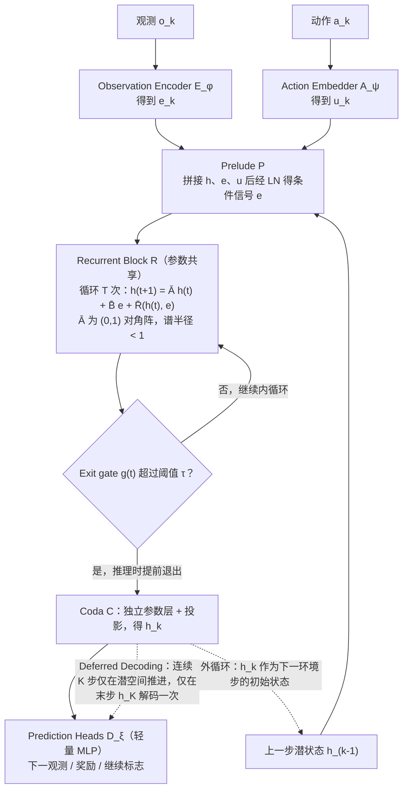

# Looped World Models（循环世界模型 / LoopWM）

**Looped World Models（LoopWM）** 由 FaceMind Research Asia 署名、2026-06-16 发布（arXiv:2606.18208v1）。本文将「模型对同一步潜在转移反复思考」引入动作条件世界预测。它已收录在 [Awesome World Models](https://github.com/sun254667/awesome-world-models) 第 118/571 条，分组为 **44 Latent Space World Models**；这里已从清单占位升级为经原文核对的论文详情页。

## 一句话定义

**LoopWM** 将观测、动作及历史潜状态映射到共享 Transformer 的**内循环**，在单一环境步中迭代细化下一潜状态；再以外循环沿动作序列推进，结合谱约束、动态早退与延迟解码，减少参数规模和中间输出计算。内循环次数不代表真实物理时间步。

## 英文缩写速查

| 缩写 | 英文全称 | 简要说明 |
|------|----------|----------|
| LoopWM | Looped World Models | 共享参数循环深度的动作条件世界模型 |
| WM | World Model | 对动作作用下的未来状态进行预测 |
| MBRL | Model-Based Reinforcement Learning | 使用学习到的世界模型辅助规划或策略改进 |
| ACT | Adaptive Computation Time | 根据输入难度决定迭代步数/早退 |
| DD | Deferred Decoding | K 步潜状态推进后仅在末端解码 |
| EM | Exact Match | 文本预测与参考答案完全匹配的比例 |

## 为什么重要

- **额外计算不必额外增参**：同一个 Recurrent Block 反复调用 T 次，提供不同于增加网络宽度、独立层数的数据扩容轴。
- **双层循环有明确分工**：内循环是单次转移的潜在状态细化；外循环是动作序列跨环境时间步的状态传播。
- **按需预测、按需解码**：早退门控允许简单转移少算几轮；对一串候选动作只评终态时，DD 省掉中间完整解码。
- **注意证据边界**：摘要宣称最高 100× 参数效率，正文评测的直接数字主要是文本交互环境预测，不是实机控制效率。

## 流程总览

图依据：已对照 arXiv v1 论文 Fig. 1 及 §3.1–3.5；内循环为同一环境步的 latent refinement，外循环为动作条件的跨步 rollout。

## 源码运行时序图

**不适用**：截至 2026-11-16，arXiv v1 与原文未列可核验的作者官方训练/推理/部署源码仓库；不以第三方独立复现冒充官方源码，也不虚构 runtime 时序。

## 核心信息

| 字段 | 内容 |
|------|------|
| 英文标题 / 中文标题 | Looped World Models / 循环世界模型 |
| 作者 | Hongyuan Adam Lu、Z.L. Victor Wei 等（完整作者表见论文） |
| 机构 | FaceMind Research Asia（论文首页署名） |
| 日期 / 版本 | 2026-06-16 / arXiv:2606.18208v1 |
| 核心领域 | Latent Dynamics / World Models / Variable Computation |
| 策展坐标 | Awesome World Models 第 118/571，44 Latent Space World Models |
| 原始 PDF | <https://arxiv.org/pdf/2606.18208> |
| 作者官方代码 | 未确认可用入口；不做可复现声明 |

## 核心机制（依据原文 §3）

### 1. 编码、Prelude–Recurrent–Coda

对环境步 k，观测 o_k 进入 Observation Encoder E，动作 a_k 进入 Action Embedder A；Prelude P 将 e_k、u_k 与 h_(k-1) 合并为条件信号 e。参数共享的 Recurrent Block R 在**同一环境步**重复 T 次，Coda C 把终态投影为 h_k；预测头 D 解码下一观测或 latent target、奖励与 continuation（§3.1–3.2）。

- 内循环（t）：反复优化单步转移估计，而**不是**重复让机器人执行 T 个动作。
- 外循环（k）：将 h_k 传给下一环境步，并输入下一动作。用于想象 rollout 时可以跳过真实观测编码而沿潜空间自回归。

### 2. 谱稳定的保留支路

论文 Eq. (5) 的单次内循环更新可写为：

\[h^{(t+1)} = \bar A h^{(t)} + \bar B e + \bar R(h^{(t)}, e).\]

其中 \(A=\operatorname{diag}(-\exp(a))\) 且 \(\bar A=\exp(\Delta A)\)，\(\Delta>0\)；由此 \(\bar A\) 对角元素在 (0,1)，**线性保留项**的谱半径小于 1。论文将其用于限制迭代状态幅值；但有非线性残差、长期误差和真实控制闭环，不能将该矩阵性质直接等同于全部系统的稳定性证明。

### 3. 随机循环深度与自适应早退

训练按序列从 Poisson 分布采样 T，并对观测、奖励、continuation 的预测误差优化；推理可使用 sigmoid exit gate，在门控超过阈值时停止当前内循环，复杂转移则分配更多迭代（§3.3–3.4）。实际 FLOPs 收益与循环深度、门控开销和转移难度分布有关。

### 4. 延迟解码（DD）与规划

对候选 K 步动作，每步注入动作 embedding，在潜空间连续执行 K 次环境转移，却只在终点 h_K 调用一次完整解码器；中间仅按需用轻量投影监测（§3.5）。训练对末端预测加监督，并用潜状态一致性、累计状态步幅约束及 K 从 1 逐渐增大的课程稳定训练。

**规划接口**：论文给出 CEM/MPPI 生成候选序列、LoopWM 预测末态并评分的设计用法；本文未报告真实机械臂/人形机器人闭环规划成功率，不能将提议接口写成实测部署。

## 工程实践

| 关注点 | 阅读/复现实务 |
|------|--------------|
| 内循环 T vs 规划步长 K | T 是每步潜在细化次数；K 是跨动作的真实环境步数，两者不可混用 |
| 计算节省 | 参数共享降低参数量；延迟解码降低调用次数，**均不保证端到端延迟下降 100×** |
| 数值稳定 | 确认保留矩阵谱约束、非线性支路与长 rollout 误差分别评估 |
| 源码边界 | 未确认作者提供可运行代码、训练配置或权重，暂无可信官方运行时序图 |

## 评测与指标（论文自报；不是机器人控制成功率）

论文 §4 主要评估 **ScienceWorld** 与 **ALFWorld** 的**世界状态文本预测**：给定连续五个动作，比较末端预测文本与参考答案；指标为 Exact Match、Token F1、BLEU-4、Entity。模型约 **1B 参数**。

| 数据集（表号） | 模型 | EM | Token F1 | BLEU-4 | Entity |
|------|------|---:|---:|---:|---:|
| ScienceWorld（Table 2） | **LoopWM** | **68.4%** | **85.3%** | **80.7%** | **83.9%** |
| ScienceWorld（Table 2） | Claude Opus 4.6 Max | 47.2% | 72.8% | 64.4% | 72.3% |
| ALFWorld（Table 4） | **LoopWM** | 51.6% | 80.4% | 71.6% | 81.1% |
| ALFWorld（Table 4） | Claude Opus 4.6 Max | **53.0%** | 72.6% | 66.8% | 77.0% |

- ScienceWorld 上 LoopWM 的 EM 相对该基线高 **21.2 个百分点**（并非仅相对提升 21.2%）。
- ALFWorld 的 **EM 低于** Claude 53.0%，其余表列三项更高；**Entity** 也低于 Gemini 3 Flash Thinking 的 90.2%（Table 4），不能称全面领先。
- 论文还列出 1–5 步预测的相对改善（Tables 5 及后续），但主要与其他模型比较；不宜单独当作去除 DD / 早退 / 谱约束的消融证据。
- 摘要的“up to 100× parameter efficiency”属于论文作者主张；不能偷换为“真实环境采样减少 100×”或“100× 运行提速”。

## 与其他工作对比

| 范式 | 关键差异 | 评测/部署判读 |
|------|----------|--------------|
| [Model-Based RL](../methods/model-based-rl.md) 中的 Dreamer / RSSM | 传统 RSSM 以环境时间递归推进；LoopWM 额外引入**每步内部重复的共享深度** | LoopWM 的论文未给出与 DreamerV3 在真实机器人控制上的同协议对比 |
| [Generative World Models](../methods/generative-world-models.md) 中的视频世界模型 | 视频扩散/自回归关心视觉生成；LoopWM 重点是潜动力学及中间解码计算 | 文本环境指标不能代替像素保真、接触物理与控制指标 |
| [WAM](../concepts/world-action-models.md)（世界–动作联合模型） | LoopWM 本身是**动作条件前向模型**，不等于已训练一个直接输出机器人动作的联合策略 | 属于 WAM 的上游世界侧技术，不宜直接归为 Joint WAM |

## 结论

**LoopWM 的可学习之处是“同一步反复细化、跨步继续推演、只在需要时解码”，而非已完成低成本真机控制闭环。**

1. 对参数预算敏感的世界模型，可探索共享 Transformer + 可变内循环深度，但须同时比较 **FLOPs、延迟、稳定性**。
2. 面向长动作候选序列，可尝试 DD 仅解码末态；若需要每步奖励/安全检查，要保留对应监测接口。
3. 谱约束为状态保留路径提供结构性限制，完整非线性模型仍需 rollout 误差与干预鲁棒性实测。
4. 文中可量化的领先主要基于 ScienceWorld / ALFWorld **文本世界预测**，并未验证真实机器人的样本效率或闭环可靠性。
5. 暂未核实官方代码/权重，复现应标注自行实现与原论文之间的证据边界。

## 局限与风险

- 论文 v1 的主要公开实验在**文本交互世界模型**，无真机人形/机械臂闭环成功率、运动控制误差或训练环境交互数对照。
- 作者 §6 明言更广泛连续视觉环境实验结果未在此版本完整披露，缺跨模型族系统性归因与全面 scaling law。
- 训练长延迟解码 K 会不稳定，需课程学习；参数压缩不意味着延迟、显存、误差累积自然更优。
- 无官方可运行源码入口；第三方 GitHub 同名复现不能等同官方结果。

## 常见误区

1. **把内循环当时间推进**：T 次迭代只是在**同一**环境动作步细化转移估计；K 才是连续动作步数。
2. **把想象规划接口当真机演示**：CEM/MPPI 在 §3.5.5 属模型可配合的用途，并非已报告的实物机器人试验。
3. **把 100× 参数效率当样本效率或计算加速**：它们是不同量纲，原文没有证明这些数字可以互换。
4. **把线性矩阵谱收缩当作全部系统无条件稳定**：非线性残差、估计误差和现实控制接口仍需独立验证。

## 关联页面

- 纵深路线：[WAM Stage 1 世界模型基座](../../roadmap/depth-wam.md)
- 列表实体：[Awesome World Models](../entities/awesome-world-models.md)
- 技术地图：[Awesome World Models 技术地图](../overview/sun-awesome-wm-technology-map.md)
- 方法/任务：[generative-world-models.md](../methods/generative-world-models.md)、[manipulation.md](../tasks/manipulation.md)

## 参考来源

- [LoopWM 原论文阅读归档（arXiv v1）](../../sources/papers/looped_world_models_2606_18208.md) — 方法、实验、公开边界已核对

- [`sources/papers/sun_awesome_wm_2606_18208_looped-world-models.md`](../../sources/papers/sun_awesome_wm_2606_18208_looped-world-models.md) — 本条目策展摘录
- [`sources/papers/sun_awesome_wm_catalog.md`](../../sources/papers/sun_awesome_wm_catalog.md) — 列表总表
- [`sources/repos/awesome-world-models.md`](../../sources/repos/awesome-world-models.md)
- 论文：<https://arxiv.org/abs/2606.18208>
- [arXiv PDF（v1）](https://arxiv.org/pdf/2606.18208) — 原文机制、Fig.1、ScienceWorld/ALFWorld 表格及 §6 公开范围

## 推荐继续阅读

- [Awesome World Models 仓库](https://github.com/sun254667/awesome-world-models)
- [原文](https://arxiv.org/abs/2606.18208)
