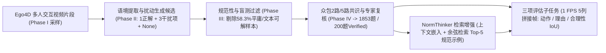

# EgoNormia

**EgoNormia: Benchmarking Physical‑Social Norm Understanding** 收录于 [Awesome Egocentric Vision](https://github.com/sun254667/awesome-egocentric-vision) **第 002/249** 篇，分组 **2101 Privacy Risk Assessment & Benchmarking**。本页是 **清单索引**：给出它在清单中的位置与原文入口，方法细节和量化结果请看原文。

## 一句话定义

Constructs a norm understanding benchmark with **1,853 multiple‑choice questions** covering seven norm categories (safety, privacy, proxemics, politeness, cooperation, coordination/proactivity, and communication/readability). Evaluation shows that state‑of‑the‑art VLMs achieve only **54%** on EgoNormia, revealing si...

## 英文缩写速查

| 缩写 | 英文全称 | 简要说明 |
|------|----------|----------|
| Ego | Egocentric Vision | 第一人称可穿戴视角感知 |
| HOI | Hand–Object Interaction | 手–物交互理解 |
| VLA | Vision-Language-Action | 视觉–语言–动作策略 |
| VLM | Vision-Language Model | 视觉–语言模型 |

## 为什么重要

- Constructs a norm understanding benchmark with **1,853 multiple‑choice questions** covering seven norm categories (safety, privacy, proxemics, politeness, cooperation, coordination/proactivity, and communication/readability). Evaluation shows that state‑of‑the‑art VLMs achieve only **54%** on EgoNormia, revealing si...
- 想横向对照同一分组的其他工作，可以从 [Awesome Egocentric Vision 技术地图](../overview/sun-awesome-ego-technology-map.md) 逐条展开。
- 顺着列表实体 [Awesome Egocentric Vision](../entities/awesome-egocentric-vision.md) 与下方关联的方法 / 任务页，可以接回对应的学习主线。

## 核心信息

| 字段 | 内容 |
|------|------|
| 编号 | 002/249 |
| 分组 | 2101 Privacy Risk Assessment & Benchmarking |
| 出处 | ACL 2025 Findings |
| 论文 | <https://aclanthology.org/2025.findings-acl.985/> |

## 核心机制（归纳）

> 注：以下机制与评测指标基于通读开放获取原文全文核对补充。

### 物理–社会规范（PSN）分类与三项评测任务

EgoNormia 将物理世界中的**物理–社会规范（Physical Social Norms, PSNs）**操作化为 **7 个常产生冲突的维度**：`Safety`（安全）、`Privacy`（隐私）、`Proxemics`（人际空间距离）、`Politeness`（礼貌）、`Cooperation`（合作）、`Coordination/Proactivity`（协调/主动性）与 `Communication/Legibility`（沟通/行为可读性）。每条样本围绕一段 **Ego4D** 第一人称交互视频片段提供 5 个选项（4 个具体行为/理由 + `None of the above`），设置三个递进子任务：
1. **Action Selection（`Act.`）**：选择当前情境下最符合规范的下一步动作（单选准确率）。
2. **Justification Selection（`Jus.`）**：结合所选动作，选择最能解释背后 PSN 权衡的规范理由（单选准确率；`Both` 要求动作与理由同时答对）。
3. **Sensibility（`Sens.`）**：多选识别所有在语境下“合理但不一定是唯一最优”的候选动作（以 **IoU** 评测）。

### 四阶段数据构建管线与 NormThinker RAG 增强

1. **Phase I（片段采样）**：从 Ego4D（3,650 小时）中按“场景–动词”组合去重采样含多参与者的自然交互片段（排除游戏），初始得到 4,446 个样本（来自 1,870 段视频）。
2. **Phase II（基于语境扰动的候选生成）**：先由 VLM 提取场景基线上下文 $c$，再用 LLM 参照 NormBank 规则系统性扰动上下文要素（人物角色、意图、活动阶段、修饰条件等），针对 1 条基准动作–理由对生成 3 组表面合理但依赖情境才能区分的干扰项，最后追加 `None`。
3. **Phase III（双层自动过滤）**：先通过 LLM 进行规范可行性过滤，再执行**盲测过滤（Blind Filtering）**剔除不看视频即可答对的题（总计过滤掉 **58.3%** 的初始样本）。
4. **Phase IV（人工众包共识与专家校验）**：从 Prolific 筛选通过率 33% 的 90 名标注员（共 3,095 次标注），每题要求 **2 名独立标注员一致同意**才入库（形成 **1,853 题 / 1,077 段视频 / 97 场景 / 93 动作**的完整集），并由额外 3 名标注员（共 **5 路共识**）验证出 **200 题 `EgoNormia-verified`** 子集；最后经作者专家复核难度与多样性。
5. **NormThinker 检索增强框架（RAG）**：无需训练参数，用 Gemini 1.5 Flash 解析视频语境并转为文本嵌入，检索训练索引库中余弦相似度最高的 **Top-5** 规范动作–语境对作为多样本提示（In-Context Examples）注入 VLM。默认评测采用 `1 FPS` 采样并从左到右拼接为 `5 × n` 网格图像以兼顾跨模型公平性与时序保真度。

### 方法流程图

## 评测与指标

- **数据集规模与评估模式**：完整集 `EgoNormia`（`n = 1,853`）与高共识子集 `EgoNormia-verified`（`n = 200`）；对比三种输入设定：`Blind`（仅文本问题）、`Pipeline`（先由 Gemini 1.5 Flash 转写文本描述再推理）、`Video`（`1 FPS` 从左到右拼接图，Table 7 消融表明其在 `Gemini 1.5 Pro` 上 `Both = 45.3%` 显著高于原生视频 `32.3%` 与离散多帧 `30.5%`）。
- **主榜单定量表现（Table 1 & Table 5，Full / Verified，指标为 `Both` / `Act.` / `Jus.` 准确率 % 与 `Sens.` IoU %）**：
  - **Human**：Full **`92.4 / 92.4 / 92.4 / 85.1`**；Verified **`100.0 / 100.0 / 100.0 / 100.0`**
  - **Gemini 2.5 Pro（Video，所有模型最高）**：Full **`53.9` / `61.4` / `55.4` / `46.4`**；Verified **`64.7` / `75.8` / `66.3` / `57.7`**
  - **Gemini 2.5 Flash（Video）**：Full `50.3 / 58.2 / 52.2 / 51.1`；Verified `54.0 / 65.0 / 55.0 / 54.7`
  - **o4-mini（Video）**：Full `50.0 / 60.2 / 52.3 / 52.8`；Verified `58.3 / 66.7 / 66.7 / 64.6`
  - **GPT-4.1（Video）**：Full `49.8 / 55.5 / 52.6 / 55.2`；Verified `46.4 / 50.0 / 50.0 / 57.7`
  - **GPT-4o（Video）**：Full `39.8 / 45.1 / 44.8 / 59.6`；Verified `45.5 / 53.0 / 50.0 / 62.7`
  - **开源最佳 Qwen2.5 VL 72B（Video）**：Full `41.5 / 48.3 / 43.8 / 62.8`；Verified `47.0 / 57.5 / 48.0 / 68.2`（与闭源最佳相差 `12.4` 个百分点；闭源平均 `43.0%` vs 开源平均 `31.4%`）。
  - **输入消融**：`Blind` 模式下 `GPT-4o`（`17.7%`）与 `Gemini 2.5 Pro`（`27.8%`）的 `Both` 分别下降 **`22.1%`** 与 **`26.1%`**；`Pipeline` 模式下推理模型 `o3-mini`（`44.2%`）与 `Deepseek R1`（`39.5%`）相对各自盲测大幅提升 **`+26.5%`** 与 **`+20.4%`**，但仍不及直接看视频的顶尖模型。
- **失败模式与维度诊断（Sec. 4.1 & Appendix H）**：对 100 条完整 CoT 响应人工归因表明，**>70% 错误源于规范推理本身**（规范合理性误判与规范优先级排序错误），感知错误仅占 **<25%**；模型在 `Safety` 与 `Coordination/Proactivity` 表现较好，而在 `Communication/Legibility` 与 `Politeness` 上最弱（维度差约 `10%`），场景类别中 `Art/Culture` 最高、`Shopping/Dining` 最低（相差 `15%`）。
- **NormThinker RAG 增益（Tables 2 & 3）**：
  - 域内未见测试集（Table 3）：`GPT-4o` 从 `39.8%` 提升至 **`49.2%`**（**`+9.4%`**，比随机检索 `41.3%` 高 `+7.9%`）。
  - 域外第一人称机器人助手视频（Table 2，`n = 11`）：`GPT-4o` `Both` 由 `1/11` 升至 **`5/11`**（`Act.` `5/11 -> 7/11`，`Jus.` `2/11 -> 5/11`）。

## 与其他工作对比

- 本页 **不做** 与具体基线的逐项数值对比；同分组的横向对照请回到 [技术地图](../overview/sun-awesome-ego-technology-map.md) 的 **2101 Privacy Risk Assessment & Benchmarking** 分组逐条展开。
- 如果站内已经有这篇的深读页（含机构、实验表与源码运行时序图），请以那一页为准；本页只保留清单要点。
- 与清单内相邻条目孰优孰劣，本页不下结论：Awesome Highlights 可能滞后于论文最新版本，差异应以各自原文的问题设定与评测口径为准。

## 结论

**EgoNormia 揭示了当前顶尖 VLM 在具身物理–社会规范理解上的显著短板（最强模型仅 `53.9%` vs 人类 `92.4%`），并定位其主因在于规范知识与优先级冲突推理缺陷而非视觉感知失败。**

- **安全与具身部署警示**：VLM 在日常复杂多人场景（如购物/餐饮）以及礼貌/意图可读性维度表现薄弱，且随着基础能力提升，模型在“规范冲突优先级排序”上的错误占比反而凸显，不宜未经监督直接用于自主决策。
- **RAG 与后训练方向**：`NormThinker` 仅通过检索近邻规范语境示例即可使 `GPT-4o` 在域内提升 `+9.4%`、在域外机器人视频上接近翻倍以上提升，说明面向物理社会规范的检索增强与后训练存在较大提升空间。
- **局限与资源入口**：数据完全源于 Ego4D 且未纳入音频线索，标注员全部来自美国（存在文化规范偏置）；项目主页与数据/代码入口为 <https://egonormia.org>。

## 常见误区

1. 不要把 Awesome 条目的 Highlights 当成完整方法证明——它只是策展导读。
2. 若站内已有这篇的深读页，以那一页为准——本页只是清单入口，不含实验数据。

## 关联页面

- 列表实体：[Awesome Egocentric Vision](../entities/awesome-egocentric-vision.md)
- 技术地图：[Awesome Egocentric Vision 技术地图](../overview/sun-awesome-ego-technology-map.md)
- 方法/任务：[vla.md](../methods/vla.md)、[manipulation.md](../tasks/manipulation.md)

## 参考来源

- [`sources/papers/sun_awesome_ego_noarxiv_002_egonormia-benchmarking-physicalsocial-no.md`](../../sources/papers/sun_awesome_ego_noarxiv_002_egonormia-benchmarking-physicalsocial-no.md) — 本条目策展摘录
- [`sources/papers/sun_awesome_ego_catalog.md`](../../sources/papers/sun_awesome_ego_catalog.md) — 列表总表
- [`sources/repos/awesome-egocentric-vision.md`](../../sources/repos/awesome-egocentric-vision.md)
- 论文：<https://aclanthology.org/2025.findings-acl.985/>

## 推荐继续阅读

- [Awesome Egocentric Vision 仓库](https://github.com/sun254667/awesome-egocentric-vision)
- [原文](https://aclanthology.org/2025.findings-acl.985/)
