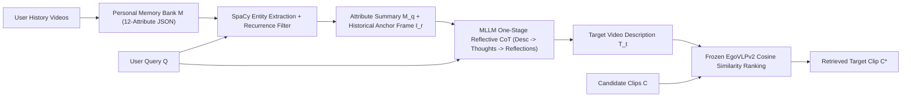

# EgoMemory

**EgoMemory: Memory-Augmented Personalized Retrieval for Long-Context Egocentric Video**（ACL 2026）由中国科学院信息工程研究所、微软与阿德莱德大学等机构（Yuanmin Tang、Jue Zhang、Xiaoting Qin 等）提出，收录于 [Awesome Egocentric Vision](https://github.com/sun254667/awesome-egocentric-vision) **第 037/249** 篇，分组 **24 Long-form Video Understanding & Structured Reasoning**。本文构建了面向长上下文个性化第一视角检索的 **EgoMemory** 基准，并提出免训练单阶段检索框架 **EgoRetriever**。

## 一句话定义

**EgoMemory / EgoRetriever** 形式化了长上下文个性化第一视角情景记忆检索任务，通过从用户历史视频构建结构化以物体为中心的个人记忆库，并结合 MLLM 单阶段反思式思维链（Reflective CoT）推理实现免训练精准视频检索。

## 英文缩写速查

| 缩写 | 英文全称 | 简要说明 |
|------|----------|----------|
| Ego | Egocentric Vision | 第一人称可穿戴视角感知 |
| MLLM | Multimodal Large Language Model | 多模态大语言模型（主实验用于构建记忆与执行推理，如 GPT-4o） |
| CoT | Chain-of-Thought | 思维链推理，本文采用单阶段“描述–意图–反思–目标描述”提示架构 |
| RAG | Retrieval-Augmented Generation | 检索增强生成，从结构化个人记忆库抽取高频用户物体属性 |
| CVR | Composed Video Retrieval | 组合视频检索，给定参考帧与文本条件检索目标视频片段 |
| NLQ | Natural Language Queries | Ego4D 自然语言查询基准，EgoMemory 的原始视频与查询来源 |

## 为什么重要

- **弥补长程个性化缺口**：论文统计 Ego4D 中 **88.4%** 的查询显式指向物理物体，且同一物体类别在不同用户间的属性与场景差异显著（交叉场景控制后，68.3% 的高频物体跨用户 Jaccard 相似度低于 0.4），传统单视频或无用户身份检索难以区分个人专属物品。
- **单阶段免训练高效范式**：相比先生成摘要再改写的两阶段管线（如 TFR-CVR），EgoRetriever 避免视觉细节丢失，同时把每次查询延迟降至约 0.7 s（GPT-4o-mini 约 0.5 s）。
- 可顺着 [Awesome Egocentric Vision 技术地图](../overview/sun-awesome-ego-technology-map.md) 与 [Awesome Egocentric Vision](../entities/awesome-egocentric-vision.md) 横向对照长时程视频理解，并关联 [VLA](../methods/vla.md) 与 [遥操作](../tasks/teleoperation.md) 中的长程记忆需求。

## 核心信息

| 字段 | 内容 |
|------|------|
| 作者与单位 | Yuanmin Tang, Jue Zhang, Xiaoting Qin, Jing Yu, Meikang Qiu, Gaopeng Gou, Gang Xiong, Qingwei Lin, Saravan Rajmohan, Dongmei Zhang, Qi Wu（IIE CAS / UCAS / Microsoft / Minzu Univ. of China / Univ. of Augusta / Univ. of Adelaide） |
| 编号与分组 | 037/249 · 24 Long-form Video Understanding & Structured Reasoning |
| 出处 | ACL 2026 |
| 论文入口 | <https://www.microsoft.com/en-us/research/publication/egomemory-memory-augmented-personalized-retrieval-for-long-context-egocentric-video/> |
| 开源状态 | 论文结论声明将在发表后公开 EgoMemory 标注、提示词、评测脚本与 EgoRetriever 代码（PDF 未附 GitHub 链接） |

## 核心机制（归纳）

1. **EgoMemory 基准构建（3 阶段筛选）**：
   - 从 Ego4D NLQ 的 137 名参与者中筛选拥有足够时序跨度（每人 $\ge 10$ 段视频且累计 $\ge 1$ 小时）的 **45 名用户**，经 GPT-4o CoT 预筛个人指向查询 + 人工复核（每人抽查 20 段含同类物体的 3 s 片段，$\ge 90\%$ 匹配标为 personal），最终得到 **245 段视频**、**639 条查询**（约 91.6% 为 personal）、**2,228 个候选片段**（每用户 9–61 段，平均 33 段；单段 4–300 s，均值 103.82 s；总计 **64.25 小时**）。
   - 为每位用户构建含 **165,795 条物体级标注** 的结构化记忆库，每条记录包含 **12 个属性维度**（`major_category`, `subcategory`, `color`, `texture`, `shape`, `material`, `brand`, `style`, `pattern`, `feature`, `usage`, `status`）。
2. **EgoRetriever 免训练检索框架**：
   - **视觉检索增强（Visual RAG）**：利用 SpaCy 解析查询 $Q$ 的目标物体实体，从个人记忆库 $M$ 检索高频复现条目并聚合成频率加权属性摘要 $M_q$；同时从检索到的历史参考片段（非目标真值片段 $C^*$，避免泄露）选取中间帧作为轻量视觉锚点 $I_r$。
   - **单阶段反思式思维链（Reflective CoT）**：在单一提示模板 $T_t = \Psi_M(p_c \oplus Q \oplus M_q \oplus I_r)$ 中配合纯文本“视觉–语言”上下文示例（ICL）依次完成四步推理：① **Reference Image Description**（提取关键物体与环境线索）→ ② **Thoughts**（关联 $I_r$ 与 $M_q$ 推断隐含意图）→ ③ **Reflections**（对照硬约束自我核查，过滤幻觉与不合理假设）→ ④ **Target Video Description**（输出单句面向检索的目标视频描述 $T_t$）。
   - **余弦相似度排序**：使用冻结视频–语言编码器（EgoVLPv2）分别编码 $T_t$ 与候选片段 $C_i$，按归一化余弦相似度检索最匹配片段 $C^*$。

### 方法流程图

## 评测与指标

实验在 **EgoMemory**（Mean Recall@K，按用户分别计算后宏平均）、**EgoCVR**（Global & Local 组合视频检索）与 **EgoLifeQA**（6,000 题、266 小时周尺度日常问答）三个基准上进行，主检索编码器为 EgoVLPv2（ViT-L/14）：

| 基准 | 方法 | 关键指标 1 | 关键指标 2 | 关键指标 3 | 备注 |
|---|---|---|---|---|---|
| EgoMemory | Random / EgoVLPv2 | mR@1 3.62% / 16.67% | mR@2 9.74% / 21.71% | mR@3 15.23% / 25.09% | 均值基线 |
| EgoMemory | TFR-CVR / VideoAgent | mR@1 18.21% / 17.49% | mR@2 27.12% / 26.40% | mR@3 32.05% / 35.62% | GPT-4o 统一骨干 |
| EgoMemory | VideoRAG | mR@1 19.70% | mR@2 30.83% | mR@3 39.82% | 最强既有基线 |
| EgoMemory | **EgoRetriever (Ours)** | **mR@1 23.19%** | **mR@2 38.48%** | **mR@3 47.83%** | 全维度第一 |
| EgoCVR | TFR-CVR* / **EgoRetriever** | Global R@1: 14.7 / **17.4** | Global R@5: 41.2 / **49.2** | Local R@1/2/3: **50.3 / 68.2 / 76.4** | Local 对比 46.1/62.4/73.9 |
| EgoLifeQA | EgoGPT / **EgoRetriever** | Avg: 36.0% / **41.5%** | EventRecall: 36.5% / **45.1%** | TaskMaster: 39.7% / **46.2%** | 5 类均超越基线（+5.5 pp） |

- **关键消融与置换验证（表 3–4）**：移除文本记忆库（`w/o Textual Memory`）使 mR@1/2/3 跌至 18.04% / 30.73% / 36.91%（平均下降 7.94%）；移除参考帧跌至 20.79% / 32.94% / 40.23%。若将用户记忆替换为随机其他用户（Random-user swap: 16.24% / 27.83% / 35.09%）或最不相似用户（Far-user swap: 14.11% / 23.38% / 30.77%），性能显著**低于**无记忆基线，直接证实增益来自用户专属历史而非通用场景先验。
- **自动化标注与不同 MLLM 替换（表 3）**：用 EgoGPT 或 GPT-4o 自动生成参考字幕替代人工旁白，mR@3 仍可达 46.02% 与 45.39%（接近人工 47.83%）；采用 **GPT-4o-mini** 时 mR@1/2/3 为 22.31% / 37.19% / 46.43%，开源 **Qwen2.5-VL** 为 22.03% / 35.24% / 45.27%。
- **效率与扩展性（表 5–6）**：离线构建全库 165,795 条物体属性标注一次性 API 成本约 \$670；在线检索时，EgoRetriever（GPT-4o）延迟约 **0.70±0.08 s/次**、峰值显存 **16 GB**、API 约 **\$0.004/次**（GPT-4o-mini 降至 **0.50±0.05 s**、**\$0.002/次**），在 10 至 245 段视频规模增长下保持恒定低延迟。

## 与其他工作对比

- **对比两阶段与代理式长视频方法（TFR-CVR、VideoAgent、VideoRAG）**：TFR-CVR 先描述参考帧再文本改写，容易在改写阶段丢失视觉细节（mR@3 32.05% vs 47.83%）；VideoAgent 与 VideoRAG 虽引入外部记忆或检索增强，但缺乏面向个人的 12 维属性频次统计与反思核查（EgoRetriever 平均高出 VideoRAG 6.38 个百分点）。
- **对比通用组合检索（CIReVL、OSrCIR）**：零样本组合检索方法面向瞬时视觉修改，在需跨小时/跨视频历史关联的 EgoMemory 上 mR@1 仅 16.95%–17.28%。
- 同分组其他工作请参考 [Awesome Egocentric Vision 技术地图](../overview/sun-awesome-ego-technology-map.md)。

## 结论

**EgoMemory 与 EgoRetriever 验证了“以用户复现物体为索引的 12 维结构化个人记忆 + 单阶段反思 CoT”是解决长时程第一视角个性化检索的高性价比路径。**

1. **错误记忆比没有记忆更有害** — 跨用户交换记忆使准确率明显跌破无记忆基线，实际部署时必须严格按用户隔离记忆库并控制噪声写入。
2. **结构化频次记忆显著优于纯字幕记忆** — 把原始字幕提炼为 12 维属性与历史复现频次后，EgoRetriever 的平均召回率比 GPT-4o 字幕记忆提升 18.62%。
3. **短时记忆远不够用** — 仅保留 1–8 条历史样本时 mR@3 低于 30%，随记忆累积（20%→100% 视频前缀）平均检索性能单调提升 9.04%。
4. **GPT-4o-mini 是更具性价比的在线骨干** — 仅损失约 1.27 个百分点均值性能（Avg 46.92 vs 48.19），却将延迟与 API 成本分别降至 0.50 s 与 \$0.002/次。
5. **主要瓶颈在细粒度同类物体消歧** — 100 例错题归因显示 74% 源于杂乱场景中视觉相似物体混淆，仅靠全局文本描述仍不够。

## 常见误区或局限

1. **主要失败原因（74% + 21%）**：论文第 4.3 节对 100 个失败样本分析表明，**74%** 源于物体消歧失败（如车间中混淆多把外观相近的扳手），**21%** 源于上下文误判（如将“白布”错误接地到室内卧室而非室外场景）。
2. **离线固定候选池设定**：当前评测均在离线固定历史库与候选池下进行，真实穿戴设备所需的**在线增量记忆更新、遗忘/淘汰策略与端侧资源约束**尚未在实机流中验证。
3. **数据源单一与隐私风险**：EgoMemory 全部源自 Ego4D 数据分布；同时连续第一视角 lifelog 记录涉及本人与旁观者隐私，工程落地需配套加密、访问控制与数据最小化机制。

## 关联页面

- 列表实体：[Awesome Egocentric Vision](../entities/awesome-egocentric-vision.md)
- 技术地图：[Awesome Egocentric Vision 技术地图](../overview/sun-awesome-ego-technology-map.md)
- 方法/任务：[vla.md](../methods/vla.md)、[imitation-learning.md](../methods/imitation-learning.md)、[manipulation.md](../tasks/manipulation.md)、[teleoperation.md](../tasks/teleoperation.md)

## 参考来源

- [`sources/papers/sun_awesome_ego_noarxiv_037_egomemory-memory-augmented-personalized.md`](../../sources/papers/sun_awesome_ego_noarxiv_037_egomemory-memory-augmented-personalized.md) — 本条目策展摘录
- [`sources/papers/sun_awesome_ego_catalog.md`](../../sources/papers/sun_awesome_ego_catalog.md) — 列表总表
- [`sources/repos/awesome-egocentric-vision.md`](../../sources/repos/awesome-egocentric-vision.md)
- 论文：<https://www.microsoft.com/en-us/research/publication/egomemory-memory-augmented-personalized-retrieval-for-long-context-egocentric-video/>

## 推荐继续阅读

- [Awesome Egocentric Vision 仓库](https://github.com/sun254667/awesome-egocentric-vision)
- [原文](https://www.microsoft.com/en-us/research/publication/egomemory-memory-augmented-personalized-retrieval-for-long-context-egocentric-video/)
