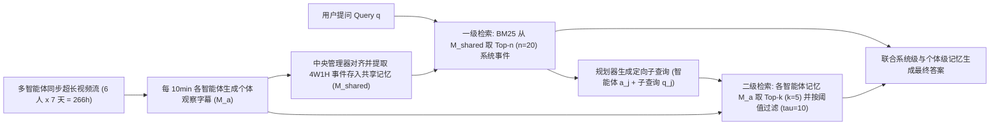

# MA-EgoQA

**MA-EgoQA: Question Answering over Egocentric Videos from Multiple Embodied Agents**（arXiv:2603.09827v2，KAIST & NYU 等）收录于 [Awesome Egocentric Vision](https://github.com/sun254667/awesome-egocentric-vision) **第 045/249** 篇，分组 **24 Long-form Video Understanding & Structured Reasoning**。本页基于论文全文完成结构化精读与核实。

## 一句话定义

**MA-EgoQA** 首次形式化定义并构建了面向多具身智能体同步超长时程（6 智能体×7 天共 266 小时）第一视角视频流的多跨度问答基准（1,741 题 / 5 大维度），并提出基于“4W1H 事件级共享记忆 + 智能体动态检索”的免训练基线框架 **EgoMAS**。

## 英文缩写速查

| 缩写 | 英文全称 | 简要说明 |
|------|----------|----------|
| MAS | Multi-Agent System | 多智能体系统，多具身主体并行感知并协同执行任务 |
| ToM | Theory of Mind | 心理理论，推理他人的信念、意图、误解与感知盲区 |
| 4W1H | When, What, Where, Who, How | EgoMAS 将多智能体 10 分钟字幕融合为结构化事件记忆的五个核心字段 |
| BM25 | Best Matching 25 | 轻量级词汇匹配检索算法，EgoMAS 用于共享记忆与个体记忆的两级检索 |
| RAG | Retrieval-Augmented Generation | 检索增强生成，避免超长全量拼接导致的上下文干扰与高延迟 |

## 为什么重要

- **突破单智能体与短时程假设**：Ego4D、EgoSchema、EgoThink 等基准通常小于 1 小时且面向单一视角；EgoLifeQA 虽达 44 小时单视角，仍可用单人记忆回答。现实多机器人/人机协作监管场景（如多台家用机器人或多名执勤人员视角回溯）必须跨时间对齐并融合多路超长视频证据。
- **暴露长上下文 LLM 与视频大模型在系统级理解上的瓶颈**：即便输入上下文达 1M tokens 的 Gemini-2.5-Flash 全量字幕拼接在 MA-EgoQA 上也仅达 **36.93%**，而 8B 开源模型配合 **EgoMAS** 的系统级记忆与动态检索仅用 **5.4k** tokens 即达到 **40.26%**。

## 核心信息

| 字段 | 内容 |
|------|------|
| 编号 | 045/249（Awesome Egocentric Vision） |
| 分组 | 24 Long-form Video Understanding & Structured Reasoning |
| 出处 | arXiv:2603.09827v2（2026-03-11） |
| 作者与机构 | Kangsan Kim, Yanlai Yang, Suji Kim, Woongyeong Yeo, Youngwan Lee, Mengye Ren, Sung Ju Hwang（KAIST, NYU, Samsung Electronics, ETRI, DeepAuto.ai） |
| 数据规模 | 基于 EgoLife（6 人×7 天，共 266 小时同步视频）；终选 **1,741** 道 5 选 1 题目（由 4 名人工标注员从 3,436 条候选复核筛选） |
| 论文与代码/项目页 | <https://arxiv.org/abs/2603.09827> · <https://ma-egoqa.github.io/> |

## 核心机制

1. **五类多智能体第一视角问答体系（1,741 题分布）**
   - **Social Interaction（SI，376 题）**：非任务导向的日常闲聊与群体互动（Single-span 324 + Multi-span 52）。
   - **Task Coordination（TC，484 题）**：围绕共同目标的角色分工、决策与步骤协作（Single-span 379 + Multi-span 105）。
   - **Theory of Mind（ToM，235 题）**：推测不同视角下的信念差异、误解、未知信息与行动意图。
   - **Temporal Reasoning（TR，287 题）**：跨智能体时间线对齐，含并发事件（Concurrency 125）与先后排序（Comparison 162）。
   - **Environmental Interaction（EI，359 题）**：共享环境物体交互计数、首次使用时间与高频使用者定位。
2. **三阶段严格基准构建与防单人作弊过滤**
   - **Stage I（生成）**：SI/TC/ToM 先切分 5 分钟窗口由 GPT-4o 生成单跨度问答（共生成 33.4k / 31.6k / 34.1k 条），再基于句子嵌入余弦相似度连通分量由 GPT-5 合并为跨时段多跨度问答（SI 15.9k / TC 16.3k 条）；TR/EI 基于多尺度（30s/10m/1h）与 6h/1d 物体字幕模板由 GPT-5 实例化。
   - **Stage II（三层 LLM 过滤，GPT-5 主导）**：① 零样本无上下文过滤（3 次试答对 >2 次即剔除）；② **单智能体记忆过滤**（仅给涉及或随机单一成员记忆仍能答对者剔除，确保必须跨智能体证据）；③ **跨模型交叉验证**（Gemini-2.5-Flash 与 Claude-Sonnet-4 任一判为无效即淘汰）。
   - **Stage III（人工终审）**：4 名标注员调看全套字幕、转录与视频对 3,436 条候选复核，保留 1,741 条高质量样本。
3. **EgoMAS：免训练共享记忆与动态检索框架**
   - **事件级 4W1H 共享记忆（$M_{\text{shared}}$）**：每 10 分钟收集各智能体自身摘要，由中央管理器融合提取结构化 `When / What / Where / Who / How` 事件条目（JSON 含 `name, action, location, detail`），对齐多视角碎片。
   - **两级智能体动态检索**：先用 BM25 从 $M_{\text{shared}}$ 检索 Top-$n$（$n=20$）系统事件 $R_{\text{sys}}(q)$；再由规划器生成面向特定智能体的子查询集合 $Q_{\text{agent}} = \{(a_j, q_j)\}$，分别在各智能体独立记忆 $M_{a_j}$ 中检索 Top-$k$（$k=5$）并过滤分数低于阈值 $\tau$（$\tau=10$）的条目；最后联合 $R_{\text{sys}}(q)$ 与聚合个体记忆 $\tilde{R}$ 生成答案。

### 方法流程图

## 评测与指标

### 1. 主基准准确率对比（原文 Table 2，五选一准确率 %，随机基线 20.00%）

| 模型 / 方法 | 类别 | 输入上下文 | SI ↑ | TC ↑ | ToM ↑ | TR ↑ | EI ↑ | Avg. ↑ |
|-------------|------|------------|------|------|-------|------|------|--------|
| `Gemini-2.5-Flash` | 全量字幕拼接 | 1M | 41.22 | 36.36 | 24.26 | 46.59 | 33.98 | 36.93 |
| `GPT-5` | 全量字幕拼接 | 272k | 36.17 | 33.88 | 22.55 | 39.71 | 38.72 | 34.81 |
| `Qwen2.5-7B-Instruct-1M` | 全量字幕拼接 | 500k | 27.13 | 28.93 | 20.85 | 24.04 | 26.18 | 26.08 |
| `Qwen2.5-VL-7B` | 全量视频帧采样拼接 | 128k | 26.33 | 26.45 | 21.28 | 22.22 | 25.07 | 25.22 |
| `VideoChat-Flash` | 全量视频帧采样拼接 | 32k | 23.67 | 25.00 | 20.00 | 24.39 | 20.73 | 23.06 |
| `BM25`（+ Qwen3-VL-8B-Inst） | RAG 基线 | 8.1k | **44.68** | 37.60 | 30.21 | 33.45 | 30.64 | 36.01 |
| `WorldMM-8B` | RAG 基线 | 4.1k | 29.26 | 34.50 | 21.70 | 25.09 | 22.56 | 27.63 |
| `VideoRAG` | RAG 基线 | 8.0k | 27.13 | 26.03 | 20.85 | 25.09 | 25.63 | 25.33 |
| **EgoMAS (`Gemini-2.5-Flash`)** | **本文** | **4.6k** | 41.49 | **41.32** | **33.62** | 39.37 | **48.19** | **41.41** |
| **EgoMAS (`Qwen3VL-8B-Thinking`)** | **本文** | **5.4k** | 38.03 | 39.88 | 28.94 | **47.39** | 44.85 | 40.26 |
| **EgoMAS (`Qwen3VL-8B-Instruct`)** | **本文** | **7.4k** | 43.09 | 39.05 | 24.26 | 35.54 | 40.67 | 37.68 |
| **EgoMAS (`Qwen2.5VL-7B-Instruct`)** | **本文** | **5.4k** | 37.77 | 38.64 | 25.96 | 34.15 | 36.49 | 35.55 |
| `Oracle (Gemini-2.5-Flash)` | 真值上下文上界 | - | 86.44 | 97.60 | 70.21 | 88.15 | 81.34 | 83.80 |

### 2. 消融实验与推理延迟（原文 §7.2，Table 4 & Table 5，骨干 `Qwen2.5VL-7B-Instruct`）

- **结构消融（Table 4）**：无共享记忆且无动态检索（27.80%）→ 仅动态检索（28.20%）→ 仅共享记忆（30.04%）→ **共享记忆 + 动态检索（35.55%）**；在 100 条抽样上平均延迟仅 **1.3 s/query**。
- **共享记忆形式对比（Table 5a）**：Chunk（25.96%）< Triplet（30.44%）< Summary（30.67%）< Graph（31.99%）< **4W1H 结构化事件（35.55%）**。
- **检索器对比（Table 5b）**：DPR（28.67%）< Qwen3-Embed-0.6B（33.03%）< **BM25（35.55%）** < NV-Embed-v2 7B（**37.91%**，但 7B 嵌入器计算开销显著更大）。

## 与其他工作对比

- **对比单智能体长视频记忆检索（EgoRAG、Ego-R1-Agent-3B、WorldMM-8B）**：单智能体记忆系统缺少跨个体事件时间对齐（如 EgoMAS 的 4W1H 共享记忆），在多智能体协同问答中性能明显退化（WorldMM-8B 为 27.63%，EgoRAG 仅 19.57%）。
- **对比百万上下文端到端拼接**：EgoMAS（Gemini-2.5-Flash）以 4.6k tokens 达到 41.41%，超越百万上下文全量字幕拼接的 Gemini-2.5-Flash（36.93%）+4.48%，避免无关事件稀释注意力。相关工作见 [Awesome Egocentric Vision 技术地图](../overview/sun-awesome-ego-technology-map.md)。

## 常见误区或局限

1. **数据源单一性局限（附录 C）**：目前 MA-EgoQA 全部构建在 **EgoLife** 单一共享住宅环境（6 名人类佩戴智能眼镜）之上，尚缺少工厂、医院、室外搜救或真实异构机器人的多视角长时程数据检验泛化性。
2. **引入视频帧并非在所有推理类别上都有益（附录 H Table S11）**：实验显示给 EgoMAS 额外传入视频帧可提升 SI / TR / EI，但在 **TC（-0.62%）和 ToM（-1.28% / -0.85%）** 上反而因冗余视觉帧干扰导致掉点，说明当前模型缺乏自适应模态与关键帧选择能力。
3. **ToM 与多跨度/多智能体聚合仍存在巨大上界差距**：即便最佳系统 EgoMAS（41.41%）距离 Oracle（83.80%）仍有 **42.39%** 差距；其中 **ToM（最高 33.62%）**、Multi-span 问题以及需要融合 4–6 名智能体信息的查询表现最弱（Fig. 8）。

## 结论

**MA-EgoQA 确立了首个面向多具身智能体超长时程（266 小时）第一视角视频理解的系统级问答基准，并证实“结构化 4W1H 共享记忆 + 定向动态检索”远比盲目堆叠百万级上下文更高效准确。**

- 构建多机器人/多佩戴者视频问答系统时，按固定窗口（如 10 分钟）归并出含 `When/What/Where/Who/How` 的跨主体事件索引，是解决视角割裂与时间对齐的关键一步。
- 在检索阶段，轻量级 **BM25**（35.55% / 1.3s 延迟）已是极具性价比的强基线；若算力充裕，可进一步替换为强稠密嵌入器（如 NV-Embed-v2 可达 37.91%）或混合检索。
- 面向需要心理理论（ToM）和精细分工（TC）的任务，切忌无差别喂入大量原始视频帧，需优先做好事件摘要路由再按需回查关键视觉片段。

## 关联页面

- 列表实体：[Awesome Egocentric Vision](../entities/awesome-egocentric-vision.md)
- 技术地图：[Awesome Egocentric Vision 技术地图](../overview/sun-awesome-ego-technology-map.md)
- 方法/任务：[vla.md](../methods/vla.md)、[imitation-learning.md](../methods/imitation-learning.md)、[manipulation.md](../tasks/manipulation.md)、[teleoperation.md](../tasks/teleoperation.md)

## 参考来源

- [`sources/papers/sun_awesome_ego_noarxiv_045_ma-egoqa-question-answering-over-egocent.md`](../../sources/papers/sun_awesome_ego_noarxiv_045_ma-egoqa-question-answering-over-egocent.md) — 本条目策展摘录
- [`sources/papers/sun_awesome_ego_catalog.md`](../../sources/papers/sun_awesome_ego_catalog.md) — 列表总表
- [`sources/repos/awesome-egocentric-vision.md`](../../sources/repos/awesome-egocentric-vision.md)
- 论文：<https://ma-egoqa.github.io/>

## 推荐继续阅读

- [Awesome Egocentric Vision 仓库](https://github.com/sun254667/awesome-egocentric-vision)
- [MA-EgoQA 项目主页与代码入口](https://ma-egoqa.github.io/)
- [arXiv:2603.09827 原文 PDF](https://arxiv.org/pdf/2603.09827)
