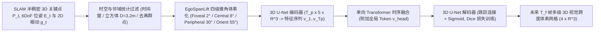

# Gaze Beyond the Frame

**Gaze Beyond the Frame: Forecasting Egocentric 3D Visual Span** 收录于 [Awesome Egocentric Vision](https://github.com/sun254667/awesome-egocentric-vision) **第 059/249** 篇，分组 **25 Gaze Attention & Intention Prediction**。本页是 **清单索引**：给出它在清单中的位置与原文入口，方法细节和量化结果请看原文。

## 一句话定义

Proposes the novel 3D visual span forecasting task, EgoSpanLift lifts 2D gaze predictions into full 3D scene space

## 英文缩写速查

| 缩写 | 英文全称 | 简要说明 |
|------|----------|----------|
| Ego | Egocentric Vision | 第一人称可穿戴视角感知 |
| HOI | Hand–Object Interaction | 手–物交互理解 |
| VLA | Vision-Language-Action | 视觉–语言–动作策略 |
| VLM | Vision-Language Model | 视觉–语言模型 |

## 为什么重要

- Proposes the novel 3D visual span forecasting task, EgoSpanLift lifts 2D gaze predictions into full 3D scene space
- 想横向对照同一分组的其他工作，可以从 [Awesome Egocentric Vision 技术地图](../overview/sun-awesome-ego-technology-map.md) 逐条展开。
- 顺着列表实体 [Awesome Egocentric Vision](../entities/awesome-egocentric-vision.md) 与下方关联的方法 / 任务页，可以接回对应的学习主线。

## 核心信息

| 字段 | 内容 |
|------|------|
| 编号 | 059/249 |
| 分组 | 25 Gaze Attention & Intention Prediction |
| 出处 | NeurIPS 2025 |
| 论文 | <https://proceedings.neurips.cc/paper_files/paper/2025/hash/bf649dbcf4eaaba4fc68ccaee25a7f9e-Abstract-Conference.html> |

## 核心机制（归纳）

> 注：以下机制与评测指标基于通读开放获取原文全文核对补充。

### 任务定义：第一人称 3D 视觉跨度预测

传统 2D 第一人称注视点预测把自车头部运动与真实 3D 注意力目标混杂在图像平面中，难以预测视野之外（Beyond the Frame）的未来注意区域。本文提出 **3D Visual Span Forecasting**：给定过去 $T_p$ 秒的多传感观测，联合预测未来 $T_f$ 秒内用户视觉注意力在以用户为中心的 3D 空间中的**多层级体素占用并集**。

### 核心模块与网络流水线

1. **EgoSpanLift（2D 眼动与 SLAM 关键点升维模块）**：
   - **观测过滤**：以视觉 SLAM 输出的半稠密 3D 关键点 $P = \{(p_i, \sigma_i, t_i)\}$ 与 `SE(3)` 头部/瞳孔位姿 $E_t$ 为输入，仅保留满足三个条件的点 $P_t$：(a) 当前局部时间窗内可见（避免纳入遮挡点）、(b) 位于以用户为中心的立方体边界内（$\|p_i - t_t\|_1 < D/2$，默认 $D = 3.2\text{m}$）、(c) 通过**基于邻域的统计离群点剔除**（而非传统静态 SLAM 的逆距离方差过滤，从而保留人手、交互物体等动态元素）。
   - **3D 锥角分类**：通过 $E_t^{-1} p_i$ 将点云变换至局部瞳孔坐标系，依据与本地注视方向 $g_t$ 的夹角偏心率阈值 $\theta$ 进行归类。
   - **四级体素化**：在分辨率为 $R \times R \times R$（默认 $R = 16$，单格精度 $D/R = 20\text{cm}$）的 3D 笛卡尔网格上，依据视觉科学分类构造 **4 个层级的视觉跨度**：**Foveal**（中心凹注视 $\theta_f = 2^\circ$）、**Central**（中心视野 $\theta_c = 8^\circ$）、**Peripheral**（近外周 $\theta_p = 30^\circ$）以及以头部朝向 $z$ 为中心的 **Orientation** 视锥（$\theta_o = 55^\circ$），再拼接 1 个全局部场景通道，形成每步 `5 × R × R × R` 体素输入。
2. **自回归时空预测网络**：
   - **空间编码（3D U-Net Encoder）**：将过去 $T_p$ 步的 `(4 + 1) × 16^3` 网格按 `5-128-256-512-1024` 通道递进压缩为 $T_p \times C$（$C = 1024$）时序 token $v_1, \dots, v_{T_p}$。
   - **时序聚合（Unidirectional Transformer）**：拼接编码全局历史跨度的预测头 token $v_{\text{head}}$ 组成 `(T_p + 1) × C` 序列，经单向注意力掩码的 Transformer 融合时序演化特征得到 $\tilde{v}_{\text{head}}$。
   - **空间解码与 Dice 损失**：经带残差跳跃连接的 **3D U-Net Decoder** 与 Sigmoid 上采样回 `4 × R × R × R` 软占用预测 $\tilde{Y}_{ijk}$。鉴于 Foveal 区域在网格中占比常 `< 1%`，采用 **Dice Loss** $L = 1 - \frac{2\sum \tilde{Y}_{ijk} Y_{ijk}}{\sum \tilde{Y}_{ijk} + \sum Y_{ijk} + 1}$ 克服前景极度稀疏问题（Adam, `lr = 1e-4`, batch 16, 50 epochs）。
3. **跨模态逆投影与低延时**：将预测 Foveal 网格最大值格点通过当前头部姿态投影回 2D 平面并插值即可零额外 2D 训练完成 2D 眼动预测；在 8 核 CPU + 12GB GPU 上平均总推理延时 **71.241 ms**（体素化 45.406 ms + 模型推理 19.483 ms + 点预处理 4.541 ms + 定位 1.811 ms，实时因子 `0.036`）。

### 方法流程图

## 评测与指标

- **新建双基准数据集（共 364.6K 样本，以 10Hz 眼动为时间锚点同步多传感流）**：
  1. **FoVS-Aria**（源自 Aria Everyday Activities，143 段录制共 7.3 小时，剔除低方差校准异常及看手机/电视等静态场景）：由过去 2 s 预测未来 2 s（1 s 滑窗），共 **23.2k** 样本（train 19.3k / val 1.9k / test 2.1k，按 Location 4 划分验证未见场景）。
  2. **FoVS-EgoExo**（源自 Ego-Exo4D 烹饪、音乐、健康、维修、攀岩 5 类技能活动）：预测未来 4 s，共 **341.4k** 样本（train 274.7k / val 29.6k / test 37.0k）。
- **FoVS-Aria 3D 跨度预测主结果（Table 2，3D IoU / F1 ↑）**：
  - **`Ours (full)`**：Orientation **`0.5838 / 0.7247`**、Peripheral30° **`0.4886 / 0.6350`**、Central8° **`0.3513 / 0.4762`**、Foveal2° **`0.2836 / 0.3709`**（表 6 补充 Foveal CC `0.399`、AUC `0.624`）。
  - 对比 3D 交互热点与体素占用基线：`EgoChoir`（最强基线）Orientation `0.4959 / 0.6579`、Peripheral `0.4302 / 0.5581`、Central `0.2612 / 0.3608`、Foveal `0.1987 / 0.2311`（本文在中心与注视点 Foveal IoU 上领先超 **50%** 相对提升）；`IAG` Foveal `0.0747 / 0.1050`；`VoxFormer` `0.0453 / 0.0704`；`OccFormer` `0.0158 / 0.0289`。
  - 对比 2D 眼动外推基线（借助 `EgoSpanLift` + 高斯过程头部姿态外推）：`CSTS + EgoSpanLift + GP` Foveal `0.1388 / 0.1948`，`GLC + EgoSpanLift + GP` Foveal `0.1321 / 0.1873`。
  - **Foveal 3D 度量距离误差（Table 3）**：`Ours` 平均误差 **`34.85 cm`**（min `19.04`, max `51.23`），显著优于 `GLC`（`73.47 cm`）、`CSTS`（`73.79 cm`）、`Single-task`（`52.90 cm`）与 `w/o prev. span`（`83.07 cm`）。
  - **关键消融（Table 2）**：移除历史跨度（`w/o prev. span`）Foveal IoU 跌至 `0.0594`；改用 BCE 损失（`L_BCE`）降至 `0.2059`；单任务训练（`Single-task`）降至 `0.2494`；移除全局嵌入（`w/o global embedding`）降至 `0.2624`。
- **FoVS-EgoExo 大规模技能场景结果（Table 4，3D IoU / F1 ↑）**：
  - **`Ours (full)`**：Orientation **`0.5230 / 0.6743`**、Peripheral30° **`0.5108 / 0.6569`**、Central8° **`0.4212 / 0.5541`**、Foveal2° **`0.3692 / 0.4702`**，全面超过 `EgoChoir`（Foveal `0.1266 / 0.2247`）与 `CSTS`（Foveal `0.1556 / 0.2107`）。
  - 分辨率与跨类别：保持 20 cm 精度将范围扩至 `D=6.4, R=32` 仍维持 Foveal `0.3640 / 0.4689`；加密至 10 cm（`D=3.2, R=32`）为 `0.2493 / 0.3497`；统一模型跨活动表现基本持平单类专训模型。
- **反投影 2D 眼动预测与 SLAM 鲁棒性（Tables 5 & 7）**：
  - 在 `FoVS-Aria` 2D 眼动预测上，零 2D 专项训练的 `Ours` 反投影取得 **F1 = 0.515**（Pr `0.440`, Re `0.619`），持平专训 2D 模型 `CSTS`（F1 `0.515`）并超越 `GLC`（F1 `0.505`）。
  - 在时间偏移（10%）、平移漂移（10 cm）、旋转漂移（5°）、高斯噪声（5 cm）与 20% 掉点等 SLAM 退化扰动下，Foveal IoU 仍维持在 `0.2174–0.2806`，高于无扰动基线 `EgoChoir`（`0.1987`）。

## 与其他工作对比

- 本页 **不做** 与具体基线的逐项数值对比；同分组的横向对照请回到 [技术地图](../overview/sun-awesome-ego-technology-map.md) 的 **25 Gaze Attention & Intention Prediction** 分组逐条展开。
- 如果站内已经有这篇的深读页（含机构、实验表与源码运行时序图），请以那一页为准；本页只保留清单要点。
- 与清单内相邻条目孰优孰劣，本页不下结论：Awesome Highlights 可能滞后于论文最新版本，差异应以各自原文的问题设定与评测口径为准。

## 结论

**本文通过 `EgoSpanLift` 与“3D U-Net + 单向 Transformer”架构，首次将第一人称未来注视预测从脆弱的 2D 平面升维至多层级 3D 体积空间，在日常与技能两大百万级规模测试集上显著领先现有 3D 热点与 2D 眼动外推方法。**

- **多层级协同增益**：同时预测头向（55°）、外周（30°）、中心（8°）与注视点（2°）四级跨度并配合 Dice 损失，能利用宽视野历史线索引导精细 Foveal 预测，同时回避显式 6DoF 轨迹外推带来的级联误差。
- **实时与向后兼容能力**：全流程推理延时 `71.2 ms`（瓶颈主要在体素化），且 3D 预测反投影即可达到与 2D 专训模型相当的 `0.515` F1。
- **局限与开源状态**：当前仅建模视觉注意力而未融合音频/本体感觉等意图线索，且对历史帧未覆盖的新出现交互物体表面较难精确定位；项目主页 <https://hs-yn.github.io/GazeBeyondFrame/> 提供对应资料与代码补充说明。

## 常见误区

1. 不要把 Awesome 条目的 Highlights 当成完整方法证明——它只是策展导读。
2. 若站内已有这篇的深读页，以那一页为准——本页只是清单入口，不含实验数据。

## 关联页面

- 列表实体：[Awesome Egocentric Vision](../entities/awesome-egocentric-vision.md)
- 技术地图：[Awesome Egocentric Vision 技术地图](../overview/sun-awesome-ego-technology-map.md)
- 方法/任务：[vla.md](../methods/vla.md)、[manipulation.md](../tasks/manipulation.md)

## 参考来源

- [`sources/papers/sun_awesome_ego_noarxiv_059_gaze-beyond-the-frame-forecasting-egocen.md`](../../sources/papers/sun_awesome_ego_noarxiv_059_gaze-beyond-the-frame-forecasting-egocen.md) — 本条目策展摘录
- [`sources/papers/sun_awesome_ego_catalog.md`](../../sources/papers/sun_awesome_ego_catalog.md) — 列表总表
- [`sources/repos/awesome-egocentric-vision.md`](../../sources/repos/awesome-egocentric-vision.md)
- 论文：<https://proceedings.neurips.cc/paper_files/paper/2025/hash/bf649dbcf4eaaba4fc68ccaee25a7f9e-Abstract-Conference.html>

## 推荐继续阅读

- [Awesome Egocentric Vision 仓库](https://github.com/sun254667/awesome-egocentric-vision)
- [原文](https://proceedings.neurips.cc/paper_files/paper/2025/hash/bf649dbcf4eaaba4fc68ccaee25a7f9e-Abstract-Conference.html)
