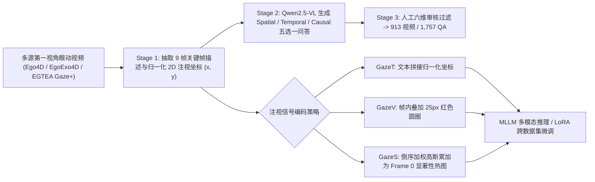

# In the Eye of MLLM

**In the Eye of MLLM: Benchmarking Egocentric Video Intent Understanding with Gaze-Guided Prompting**（arXiv:2509.07447v2，北京航空航天大学 VR 技术与系统全国重点实验室 & 清华大学人工智能学院）收录于 [Awesome Egocentric Vision](https://github.com/sun254667/awesome-egocentric-vision) **第 062/249** 篇，分组 **25 Gaze Attention & Intention Prediction**。本页基于论文全文完成结构化精读与核实。

## 一句话定义

**EgoGazeVQA** 是首个引入第一视角眼动注视（Gaze）轨迹的多模态大模型意图理解基准（913 段视频、1,757 道五选一问答），覆盖空间、时序与因果三类意图推理，并系统验证了注视引导提示（GazeT/GazeV/GazeS）与 LoRA 微调对 MLLM 意图解析的增益。

## 英文缩写速查

| 缩写 | 英文全称 | 简要说明 |
|------|----------|----------|
| MLLM | Multimodal Large Language Model | 多模态大语言模型，本工作评测其在第一视角下解析眼动与意图的能力 |
| GazeT | Gaze as Textual Prompt | 将逐帧归一化二维注视点 `(x, y)` 拼接为文本提示的引导策略 |
| GazeV | Gaze as Visual Prompt | 在每帧注视点位置绘制 25 像素半径红色圆圈的视觉提示策略 |
| GazeS | Sequential Gaze Salience Map as Prompt | 将全片段注视轨迹按时间倒序加权合成为单张显著性热图（Frame 0）的提示策略 |
| LoRA | Low-Rank Adaptation | 低秩适配微调，用于在有限第一视角样本上对齐模型对注视线索的注意力 |
| Ego | Egocentric Vision | 第一人称可穿戴视角感知 |
| HOI | Hand–Object Interaction | 手–物交互理解 |
| VLA | Vision-Language-Action | 视觉–语言–动作策略 |
| VLM | Vision-Language Model | 视觉–语言模型 |

## 为什么重要

- **弥补第一视角基准忽视眼动线索的空白**：QaEgo4D、EgoSchema、EgoTextVQA 等基准主要输入全局视频帧，缺少佩戴者的显式注视信号；而真实第一视角 AI 助手的大多数提问天然依赖于用户当下“正在看什么”。
- **揭示全局视觉 token 对细粒度时空意图的不足**：实验表明现有闭源与开源 MLLM 在无注视引导时普遍在空间与时序意图上大幅落后人类（如 Qwen2.5-VL-72B 在空间/时序仅 57.1% / 45.2%，对比人类 80.7% / 75.6%），且单纯用注视裁剪（GazeMap）在 CLIP/EgoVLP/BLIP-2 上几乎无效（21.79%–27.21%）。

## 核心信息

| 字段 | 内容 |
|------|------|
| 编号 | 062/249（Awesome Egocentric Vision） |
| 分组 | 25 Gaze Attention & Intention Prediction |
| 出处 | NeurIPS 2025 Datasets and Benchmarks Track（arXiv:2509.07447v2） |
| 作者与机构 | Taiying Peng¹, Jiacheng Hua², Miao Liu²†, Feng Lu¹†（¹北京航空航天大学，²清华大学） |
| 数据规模 | **913** 段视频、**1,757** 道五选一试题（随机基线 20%）；覆盖 5 类场景（厨房 1,024 / 客厅 371 / 车库 108 / 医疗区 72 / 其他 182）与 6 类活动（烹饪 1,019 / 桌游 314 / 机械维修 108 / 创意 69 / 医疗健康 59 / 其他 188） |
| 开源状态 | 已开源：代码仓库 <https://github.com/taiyi98/EgoGazeVQA>（Apache-2.0）、数据集 <https://huggingface.co/datasets/taiyi09/EgoGazeVQA>（CC BY 4.0） |
| 论文与项目页 | <https://proceedings.neurips.cc/paper_files/paper/2025/hash/9df42a5f6d1397e46e2cdca80a1a7903-Abstract-Datasets_and_Benchmarks.html> · <https://taiyi98.github.io/projects/EgoGazeVQA> |

## 核心机制

1. **三阶段基准构建流水线（Ego4D / EgoExo4D / EGTEA Gaze+）**
   - **Stage 1（视频切分与轨迹对齐）**：从 Ego4D（采样 31 小时带眼动视频，切为 168 段 30s–1min 片段）、EgoExo4D KeyStep（263 段片段）与 EGTEA Gaze+（28 小时 86 场次、30Hz 眼动，生成 300+ 视频–文本–注视标注文件）提取关键帧描述与归一化 `[0, 1]` 眼动坐标 `(gaze_x, gaze_y)`，每 9 帧组成一个片段。
   - **Stage 2（MLLM 生成与四类强干扰项）**：将 9 帧图像及对应注视坐标送入 `Qwen2.5-VL` 生成五选一问答（Ego4D/EgoExo4D 每段至多 3 组，EGTEA Gaze+ 每段 1 组），覆盖 **Spatial（空间相对位置）**、**Temporal（注视转移时序）** 与 **Causal（动作–注视因果）** 三维意图；干扰项系统构造反向因果、空间邻近陷阱、高显著性无关物及社交影响陷阱。
   - **Stage 3（六维人工审核）**：标注员依据相关性、可回答性、流畅度、准确性、简洁度与难度剔除不合格样本（Table 6 显示原始生成在空间/时序题中不准确错误率分别为 17.89% 和 21.03%）。
2. **三种注视引导提示策略（Gaze-Guided Intent Prompting）**
   - **GazeT（文本坐标提示）**：将 9 帧归一化 `(gaze_x, gaze_y)` 按帧序号直接拼接到文本提示中，天然屏蔽不同视频分辨率差异。
   - **GazeV（视觉红圈提示）**：在每帧注视坐标位置叠加半径 25 像素的红色圆圈，提示模型关注圆圈标记区域并按时序分析。
   - **GazeS（时序注视显著性图提示）**：按时间倒序权重（越靠后的帧权重越高，贴合人类作答时的近因视觉偏好）将 9 帧注视点高斯累加并归一化为 `[0, 255]` 单张热图 `Frame 0`，与视频帧 `Frame 1–9` 一同输入（Algorithm 1）。
3. **跨数据集 LoRA 微调与提示式注视估计验证**
   - 使用 `LLaMA-Factory` 对 `Qwen2.5-VL-7B-Instruct` 全层注入 `rank=16` LoRA 适配器（在单卡 A100-80GB 上微调 3 epoch），验证少样本注视条件问答能否迁移提升无注视提示测试集表现；同时测试让 `Qwen2.5-VL-72B` 先自估计注视坐标再构造 GazeS 热图的闭环效果。

### 方法流程图

## 评测与指标

### 1. 主基准多维度准确率对比（原文 Table 3，统一输入 9 帧，Accuracy %，随机基线 20.0%）

| 模型 | 提示策略 | Spatial ↑ | Temporal ↑ | Causal ↑ | Avg. ↑ |
|------|----------|-----------|------------|----------|--------|
| **Human** | / | 80.7 | 75.6 | 95.2 | **83.8** |
| `Qwen2.5-VL-72B` | w/o Gaze | 57.1 | 45.2 | 79.3 | 60.5 |
| `Qwen2.5-VL-72B` | GazeT (T) | 60.0 | **50.7** | 84.2 | 65.0 |
| `Qwen2.5-VL-72B` | GazeV (V) | 59.7 | 48.1 | 84.1 | 63.9 |
| `Qwen2.5-VL-72B` | **GazeS (S)** | **64.3** | 50.3 | **84.3** | **66.3** |
| `InternVL2.5-8B` | w/o Gaze / **GazeV (V)** | 50.4 / **55.0** | 51.1 / 50.6 | 73.3 / **76.2** | 58.3 / **60.6** |
| `GPT-4o mini` | w/o Gaze / **GazeT (T)** | 48.4 / 48.0 | 47.1 / **50.6** | 75.6 / 77.7 | 57.0 / **58.8** |
| `LLaVA-NeXT-Video-7B` | w/o Gaze / **GazeS (S)** | 44.9 / **49.4** | 45.3 / 46.0 | 74.5 / 79.5 | 54.9 / **58.3** |
| `Gemini 2.0 Flash-Lite` | w/o Gaze / **GazeS (S)** | 43.9 / **45.7** | 38.8 / **45.6** | 70.4 / **80.3** | 51.0 / **57.2** |
| `MiniCPM-o 2.6-8B` | w/o Gaze / **GazeS (S)** | 40.8 / 43.2 | 34.5 / **43.5** | 32.5 / **74.4** | 35.9 / **53.7** |
| `Qwen2.5-VL-7B` | w/o Gaze / **GazeS (S)** | 36.1 / **41.9** | 38.5 / **40.4** | 74.5 / **77.9** | 49.7 / **53.4** |

### 2. 传统表征基线与消融分析（原文 Table 4, 5, 7, 8, 9, 10）

- **对比弱推理视觉编码器（Table 4）**：`CLIP ViT-H-14`（21.63% / GazeMap 21.79%）、`EgoVLP`（22.95% / GazeMap 22.65%）与 `BLIP-2`（27.60% / GazeMap 27.21%）仅略高于随机猜测（20%），且直接按注视裁剪 20% 区域（GazeMap）无法带来有效提升。
- **跨数据集 LoRA 微调（Table 8，`Qwen2.5-VL-7B`，评测时不提供注视提示）**：在 EGTEA（500 条）上微调后测试 Ego4D+EgoExo（1,200 条），平均准确率由 Zero-shot **54.0% → 69.5%**（其中 Spatial 从 40.4% 跃升至 67.7%）；反向在 Ego4D+EgoExo 微调后测试 EGTEA，平均准确率由 **52.0% → 65.4%**。
- **提示式自估计注视的影响（Table 9，`Qwen2.5-VL-72B` + GazeS）**：使用真值眼动（GT）平均提升 **+5.8%**（60.5% → 66.3%），而使用模型自估计注视（GE）平均仅提升 **+1.0%**（61.5%，平均 MSE = 0.099）。在估计较准的 EgoExo（MSE = 0.038）上可提升 +2.8%，而在误差较大的 EGTEA（MSE = 0.119）上反而掉点 **-0.6%**。
- **采样帧数消融（Table 10，`Qwen2.5-VL-72B`）**：4 / 6 / 9 / 14 / 18 帧对应的无注视平均准确率分别为 57.0% / 57.1% / **57.2%** / 57.1% / 56.3%，**9 帧**在精度与算力开销间达到最佳平衡。

## 与其他工作对比

- **对比现有第一视角 VQA 基准（Table 2）**：QaEgo4D（166 视频 / 1,854 QA）、EgoThink（700 / 700）、EgoTextVQA（1,507 / 7,064）、EgoSchema（5,063 / 5,063）、AMEGO（100 / 20,500）与 VideoMindPalace（200 / 1,800）均未纳入眼动追踪信号；EgoGazeVQA 是唯一将真实时序注视坐标与三类意图推理绑定的评测基准。
- **对比三类注视提示策略**：整体而言 **GazeS（显著性热图）对空间意图增益最大**（Qwen2.5-VL-72B 达 64.3%，+7.2%），而 **GazeT（文本坐标）在时序意图上更稳健**（GPT-4o mini、InternVL2.5-8B 与 Qwen2.5-VL-72B 均在 GazeT 取得各自最高 Temporal 分数），说明现阶段 MLLM 更擅长通过文本坐标追踪跨帧时序变化。更多横向条目见 [Awesome Egocentric Vision 技术地图](../overview/sun-awesome-ego-technology-map.md)。

## 常见误区或局限

1. **厨房等室内场景占比偏高（Appendix D）**：受限于现有带眼动追踪的第一视角数据集分布，Kitchen 场景占 1,024 / 1,757 题，对室外开放场景与复杂户外任务的代表性有限。
2. **未包含音频模态且片段偏中短时长（Appendix D）**：因 EGTEA Gaze+ 等源数据缺少音频，基准未利用声音线索（在多人社交 Gaming 场景中表现尤为受限）；同时片段集中在 30s–1min、采样 9 帧，未覆盖超长视频的时序连贯性挑战。
3. **剧烈头部运动与快速扫视会误导注视引导（§4.7 & Table 5/7）**：在剧烈相机抖动或医疗/创意等快速眼跳（saccades）频繁的场景中，注视点可能落于无关背景物，甚至在个别模型上引发轻微掉点（如 GPT-4o mini 在 Garage -1.8%、InternVL2.5-8B 在 Medical Area -1.5%）。
4. **“无真值眼动时靠 MLLM 零样本自估计代替”存在精度门槛**：Table 9 证明仅当注视估计 MSE 足够低（如 EgoExo 的 0.038）时才能带来正向增益，否则错误注视坐标会直接干扰推理。

## 结论

**EgoGazeVQA 证明了“第一视角全局视频帧”不足以支撑细粒度空间与时序意图理解，而显式引入眼动注视信号（尤其是显著性热图 GazeS 与文本坐标 GazeT）能够低成本激活大参数 MLLM 的意图推理能力。**

1. **空间定位优先用 GazeS，时序推理优先试 GazeT** — 在缺乏微调条件时，单张倒序加权显著性热图（`GazeS`）最利于空间相对关系判断，而归一化坐标文本（`GazeT`）更利于跨帧注视转移追踪。
2. **模型容量显著影响注视提示利用率** — 72B 级模型从 GazeS 获得 +5.8% 平均增益，显著高于多数 7B–8B 开源模型，小模型需配合少量领域微调才能读懂注视约束。
3. **500 条级别 LoRA 微调即可实现强跨数据集迁移** — 仅在 EGTEA 的 500 条问答上做 rank-16 LoRA 微调，就能让 7B 模型在未见过的 Ego4D+EgoExo 无注视测试集上提升 +15.5%（54.0% → 69.5%）。
4. **若部署在无眼动仪硬件上，先校准注视估计精度** — 自估计注视仅在低误差（如 MSE ≤ 0.04）下有效，高噪声场景应结合头部运动滤波或改用更保守的注意力先验。

## 关联页面

- 列表实体：[Awesome Egocentric Vision](../entities/awesome-egocentric-vision.md)
- 技术地图：[Awesome Egocentric Vision 技术地图](../overview/sun-awesome-ego-technology-map.md)
- 方法/任务：[vla.md](../methods/vla.md)、[imitation-learning.md](../methods/imitation-learning.md)、[manipulation.md](../tasks/manipulation.md)、[teleoperation.md](../tasks/teleoperation.md)

## 参考来源

- [`sources/papers/sun_awesome_ego_noarxiv_062_in-the-eye-of-mllm-benchmarking-egocentr.md`](../../sources/papers/sun_awesome_ego_noarxiv_062_in-the-eye-of-mllm-benchmarking-egocentr.md) — 本条目策展摘录
- [`sources/papers/sun_awesome_ego_catalog.md`](../../sources/papers/sun_awesome_ego_catalog.md) — 列表总表
- [`sources/repos/awesome-egocentric-vision.md`](../../sources/repos/awesome-egocentric-vision.md)
- 论文：<https://proceedings.neurips.cc/paper_files/paper/2025/hash/9df42a5f6d1397e46e2cdca80a1a7903-Abstract-Datasets_and_Benchmarks.html>

## 推荐继续阅读

- [Awesome Egocentric Vision 仓库](https://github.com/sun254667/awesome-egocentric-vision)
- [EgoGazeVQA 项目主页](https://taiyi98.github.io/projects/EgoGazeVQA) · [官方代码仓库](https://github.com/taiyi98/EgoGazeVQA) · [HuggingFace 数据集](https://huggingface.co/datasets/taiyi09/EgoGazeVQA)
- [arXiv:2509.07447 原文 PDF](https://arxiv.org/pdf/2509.07447)
