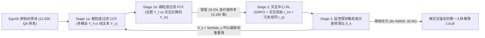

# Ego3S

**Ego3S: Select, Strengthen, and Synchronize for Efficient Egocentric Reasoning** 收录于 [Awesome Egocentric Vision](https://github.com/sun254667/awesome-egocentric-vision) **第 074/249** 篇，分组 **27 Embodied AI & Vision-Language-Action Ego-VLA**。本页基于 ICML 2026（PMLR 306）原文全文完成结构化精读升级。

## 一句话定义

**Ego3S** 是一套针对第一人称大视觉语言模型（LVLM）推理「惯性思维（inertial thinking）」的三阶段高效强化学习训练框架——通过**反事实选择（Select / CSM）**剔除语言与背景捷径样本、**交互中心强化学习（Strengthen / IRL）**显式奖励对局部手–物交互区域的视觉锚定，以及**演化课程重选（Synchronize / ECR）**动态刷新高价值训练语料。

## 英文缩写速查

| 缩写 | 英文全称 | 简要说明 |
|------|----------|----------|
| Ego3S | Select, Strengthen, and Synchronize | 本文三阶段高效第一人称推理训练框架 |
| CSM | Counterfactual-based Selection Mechanism | 粗/细粒度反事实双层数据筛选机制（CCF + FCF） |
| IRL | Interaction-centric Reinforcement Learning | 在 GRPO 中加入交互区域对象奖励与冗余惩罚的 RL |
| ECR | Evolving Curriculum Recuration | 基于探索集奖励方差停滞比动态重选课程的机制 |
| HOI | Hand–Object Interaction | 手–物交互（第一人称推理的决定性视觉证据） |
| VLA | Vision-Language-Action | 视觉–语言–动作策略 |

## 为什么重要

- **揭示并解决第一人称“参与者认知”下的惯性思维**：第三人称视频视角稳定、全局背景统计先验可靠（旁观者认知）；而第一人称（Egocentric）场景高度动态，决定性线索往往是瞬时、局部、非典型的手–物交互。现有 LVLM 在微调或二元对错 RL 下易陷入「伪上下文捷径」与「奖励–现实错配」，仅靠语言先验或背景房间布局胡乱猜对答案。
- **证明高质量因果筛选“少即是多”**：仅从 12,000 条 Ego4D 样本中保留 **3,180 条（26.5%）**高因果价值样本，将 Qwen2.5-VL-7B 的训练时间从 **60.5 h** 压缩至 **32.6 h（节省 >46%）**，并在 5 个 OpenQA / CloseQA 第一人称基准上全面超越全量训练与最新数据筛选/RL 方法（LIMR、DAPO 等）。
- **面向具身智能与 Ego-VLA 的方法接入**：与 [VLA](../methods/vla.md) 及 [操作任务](../tasks/manipulation.md) 高度契合，相关纵览见 [Awesome Egocentric Vision 技术地图](../overview/sun-awesome-ego-technology-map.md) 与 [Awesome Egocentric Vision](../entities/awesome-egocentric-vision.md)。

## 核心信息

| 字段 | 内容 |
|------|------|
| 编号 | 074/249 |
| 分组 | 27 Embodied AI & Vision-Language-Action Ego-VLA |
| 作者与机构 | Shenshen Li, Kaiyuan Deng, Ruohuai Xie, Fumin Shen（UESTC）；Xing Xu, Heng Tao Shen（Tongji）；Yazhou Yao（NUST） |
| 出处 | ICML 2026（Proceedings of the 43rd ICML, PMLR 306） |
| 论文 | <https://icml.cc/virtual/2026/poster/63931> |
| 官方代码 | <https://github.com/Mrshenshen/Ego3S> |

## 核心机制（归纳）

> 注：以下机制与评测指标基于通读 ICML 2026 原文全文核对补充。

### 1. Stage 1 — 反事实数据选择机制 CSM（Select，§3.1 & Appendix A.2–A.3）

基于条件互信息下界与个体因果效应（ITE）理论，从全量训练池剔除无需交互证据即可作答的捷径样本：
- **粗粒度反事实过滤（CCF）**：对比事实多模态输出 $Y_f(t_i, v_i)$ 与仅文本反事实输出 $Y_c(t_i)$ 在 $M$ 次采样中的准确率差 $D_c(x_i)$，若 $D_c(x_i) < \mu_c + \lambda_c \sigma_c$（最优 $\lambda_c = 0.1$）则判定依赖语言先验并剔除。
- **细粒度反事实过滤（FCF）**：通过滑动窗口选取与查询 $t_i$ 的 CLIP 相似度最高区域作为交互区域 $v_i^{\text{int}}$，将其掩码得到 $\hat{v}_i$ 与反事实输出 $Y_m(t_i, \hat{v}_i)$，若准确率差 $D_f(x_i) < \mu_f + \lambda_f \sigma_f$（最优 $\lambda_f = 0.5$）则判定依赖全局背景捷径并剔除。

### 2. Stage 2 — 交互中心强化学习 IRL（Strengthen，§3.2 & Appendix C）

在 **GRPO** 组内相对优势优化基础上，将总奖励扩展为 $r_i' = r_i + r_i^{\text{int}} + \alpha r_i^p$（对应策略对事实输入与交互掩码输入的 KL 散度正则，Appendix A.4）：
- **交互证据奖励 $r_i^{\text{int}}$**：从每次 rollout 推理文本中提取提及的对象集 $B_i$，计算其与真实交互区域 $v_i^{\text{int}}$ 的 CLIP 相似度 $S_{o_i}$，对存在满足 $S_{o_i} > \lambda_o$（最优 $\lambda_o \in [0.1, 0.3]$）且未过饱和（上限 $H = 1.1$）的样本给予正向奖励。
- **冗余对象惩罚 $r_i^p$**：引入 $r_i^p = \min(N - n_{\text{obj}}(B_i), 0)$（权重最优 $\alpha \in [0.01, 0.05]$），抑制模型靠穷举无关背景物体刷奖励。

### 3. Stage 3 — 演化课程重选 ECR（Synchronize，§3.3 & Appendix A.5, C.5）

随着训练推进，早期筛选的样本逐渐被模型掌握、rollout 奖励方差趋零导致梯度能量衰减（Lemma 4）：
- 在固定探测集 $D_{\text{probe}}$ 上定期比较第 $k$ 步与第 $k+n$ 步的样本奖励方差 $v_k(x) = \text{Var}(\{r_i\}_{i=1}^M)$，计算方差不变的停滞比例 $S_k(D_{\text{probe}})$。
- 当 $S_k(D_{\text{probe}}) > \lambda_s$（最优 $\lambda_s \in [0.5, 0.7]$）时触发课程刷新：丢弃已掌握训练集，使用当前最新模型参数在更大样本池重新运行 CSM 筛选更难的高因果价值子集，打破 400 步附近的性能平台期。

### 方法流程图

## 评测与指标

- **训练配置与数据效率（Table 4, §4.1）**：基于 **Qwen2.5-VL-7B**（及 3B、InternVL3-2B），从 12,000 条 Ego4D（OpenQA + CloseQA）中选出 **3,180 条（26.5%）**，少于 LIMO（3,604 / 30.0%）、s1（3,765 / 31.4%）与 LIMR（5,015 / 41.8%）；8× A6000 训练总耗时从 **60.5 h** 降至 **32.6 h**（降幅 **46.1%**）。
- **5 大第一人称基准零样本 Pass@1（Qwen2.5-VL-7B，Table 1）**：
  - `Egoplan2`（CloseQA）：Full/GRPO **30.43%**、LIMR **31.46%**、DAPO **30.87%**、CSM-only **33.76%**、IRL-only **35.42%** → **Ego3S 36.83%**（+6.40%）。
  - `QAEgo4D`（OpenQA）：Full/GRPO **63.80%**、LIMR **65.20%**、DAPO **64.60%** → **Ego3S 66.80%**。
  - `EgoTextVQA`（OpenQA）：Full/GRPO **20.30%**、LIMR **20.60%**、DAPO **20.60%** → **Ego3S 22.40%**。
  - `EgoSchema`（OpenQA）：Full/GRPO **47.60%**、LIMR **48.20%** → **Ego3S 49.20%**。
  - `Egothink`（CloseQA）：Full/GRPO **56.57%**、DAPO **57.24%** → **Ego3S 58.71%**。
- **跨规模与跨架构泛化（Table 3 & Figs. 4–5）**：
  - `Qwen2.5-VL-3B`（Table 3）：训练耗时由 **46.5 h** 降至 **25.6 h（-44.9%）**，Egoplan2 由 18.43% 升至 **25.50%**、QAEgo4D 53.76% → **60.00%**、EgoTextVQA 11.28% → **13.80%**、Egothink 49.58% → **55.43%**。
  - 跨模型迁移（Fig. 5）：用 Qwen2.5-VL-7B 筛选的高价值子集训练 InternVL3-2B（及反向迁移）均持续超越 LIMR，说明所选样本反映通用认知与因果交互难点而非特定模型偏置。
- **逐模块消融与第一/三人称对比（Tables 2 & 5）**：
  - 消融（Table 2，QAEgo4D / EgoTextVQA / EgoSchema）：Baseline（63.80 / 20.30 / 47.60）→ +CCF（64.80 / 20.80 / 48.20）→ +CCF+FCF（65.80 / 21.40 / 48.60）→ +$r^{\text{int}}$（66.20 / 21.60 / 48.60）→ +$r^p$（66.20 / 22.00 / 48.80）→ +ECR（**66.80 / 22.40 / 49.20**）。
  - 第一人称 vs 第三人称（Table 5）：Ego3S 在第一人称 `QAEgo4D` 提升 **+3.0%**（63.80% → 66.80%），在第三人称 `NExT-QA` 仅提升 **+0.8%**（71.1% → 71.9%），印证其专为破解第一人称动态场景的惯性思维设计。

## 与其他工作对比

- 本页 **不做** 与具体基线的逐项数值对比；同分组的横向对照请回到 [技术地图](../overview/sun-awesome-ego-technology-map.md) 的 **27 Embodied AI & Vision-Language-Action Ego-VLA** 分组逐条展开。
- 如果站内已经有这篇的深读页（含机构、实验表与源码运行时序图），请以那一页为准；本页基于原文补全核心机制与评测数字。
- 与清单内相邻条目孰优孰劣，本页不下结论：Awesome Highlights 可能滞后于论文最新版本，差异应以各自原文的问题设定与评测口径为准。

## 结论

**Ego3S 通过「反事实双层筛数据 + 交互证据 RL 奖励 + 方差感知动态重选课程」闭环，证明仅用约四分之一（26.5%）的高因果价值第一人称样本与半数算力，即可有效破除 LVLM 的语言/背景惯性思维并显著抬升推理上限。**

- **数据筛选须针对认知机制而非单纯难度**：Fig. 10 表明单纯筛选“困难样本”仍明显劣于 CSM 所选高因果样本，关键在于剔除可用文本或全局场景捷径蒙对的数据。
- **二元正确奖励不足以约束视觉推理过程**：IRL 通过将推理提及对象与局部交互区做 CLIP 对齐奖励，迫使策略关注“眼前正在交互什么”（如区分冰箱里的牛奶与酱油标签），而非依赖常识猜测。
- **动态课程刷新是持续突破上界的关键**：固定高质量子集会在约 400 步陷入停滞，利用探测集方差变化触发 ECR 重采样（$\lambda_s \in [0.5, 0.7], H=1.1$）可避免无效梯度消耗。
- **开源与工程落地边界**：官方代码开源于 <https://github.com/Mrshenshen/Ego3S>；对于具身 Ego-VLA 场景可直接复用 CSM+IRL 思路筛选操作演示帧与关键交互区，但需注意规则化奖励的奖励劫持风险及第三方视角收益有限（NExT-QA 仅 +0.8%）。

## 常见误区或局限

1. **存在“奖励劫持（Reward Hacking）”隐患（§4.4）**：作者坦承当前 IRL 奖励仍是启发式二元/阈值 CLIP-IoU 信号（Goodhart 定律），模型可能学会在思维链中“点名”正确交互物体却在后续推理中继续出错；论文在 Fig. 9(b) 初步探索用生成式 LVLM 评判推理链置信度作为替代奖励。
2. **交互区域定位依赖滑动窗口 CLIP 代理**：FCF 与 IRL 均通过查询文本与局部滑窗的 CLIP 最高相似度定义 $v_i^{\text{int}}$，面对多步时序交互或隐晦指代问题时定位代理可能存在噪声。
3. **并非面向静态第三人称视频通用加速**：Table 5 对比证明在场景全局先验本身高度预测性的第三人称 NExT-QA 上增益微弱（+0.8%），其核心适用域是动态、局部线索主导的 egocentric 场景。
4. **隐私与伦理边界（Impact Statement）**：高效第一人称视频分析在助老与可穿戴助手中有益，但在私人空间部署须重视视频隐私保护与透明度。

## 关联页面

- 列表实体：[Awesome Egocentric Vision](../entities/awesome-egocentric-vision.md)
- 技术地图：[Awesome Egocentric Vision 技术地图](../overview/sun-awesome-ego-technology-map.md)
- 方法/任务：[vla.md](../methods/vla.md)、[manipulation.md](../tasks/manipulation.md)

## 参考来源

- [`sources/papers/sun_awesome_ego_noarxiv_074_ego3s-select-strengthen-and-synchronize.md`](../../sources/papers/sun_awesome_ego_noarxiv_074_ego3s-select-strengthen-and-synchronize.md) — 本条目策展摘录
- [`sources/papers/sun_awesome_ego_catalog.md`](../../sources/papers/sun_awesome_ego_catalog.md) — 列表总表
- [`sources/repos/awesome-egocentric-vision.md`](../../sources/repos/awesome-egocentric-vision.md)
- 论文：<https://icml.cc/virtual/2026/poster/63931>

## 推荐继续阅读

- [Awesome Egocentric Vision 仓库](https://github.com/sun254667/awesome-egocentric-vision)
- [原文](https://icml.cc/virtual/2026/poster/63931)
