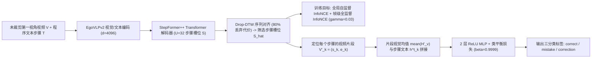

# EgoOops

**EgoOops: A Dataset for Mistake Action Detection from Egocentric Videos Referring to Procedural Texts**（arXiv:2410.05343v3，京都大学 & 索尼互动娱乐）收录于 [Awesome Egocentric Vision](https://github.com/sun254667/awesome-egocentric-vision) **第 118/249** 篇，分组 **291 Procedural Error Detection**。本页基于论文全文完成结构化精读与核实。

## 一句话定义

**EgoOops** 是首个围绕“参照程序说明书执行操作”构建的跨领域第一视角错误动作检测数据集（50 段 4K 视频、6.8 小时、5 大实验/装配/手工任务），提供视频–文本对齐时间戳、6 类细粒度执行错误标签与自然语言错误解释，并配套提出两阶段文本感知检测框架 **StepFormer++ + 类平衡分类器**。

## 英文缩写速查

| 缩写 | 英文全称 | 简要说明 |
|------|----------|----------|
| Drop-DTW | Dropping Dynamic Time Warping | 允许丢弃离群帧/未匹配槽位的序列对齐算法，用于将步骤槽位与步骤文本/视频帧对齐 |
| tIoU | Temporal Intersection over Union | 时序交并比，用于衡量步骤片段定位精度与标注员一致性（本文一致性达 88.8） |
| mAP | Mean Average Precision | 平均精度均值，本文在 tIoU=0.1/0.2/0.3 上评测 `mistake` 与 `correction` 两类的检出性能 |
| MoF | Mean over Frames | 逐帧准确率，用于评估无裁剪长视频中步骤对齐的帧级准确率 |
| TAL | Temporal Action Localization | 时序动作定位，本文以纯视频模型 `ActionFormer` 作为端到端检测对比基线 |
| Ego | Egocentric Vision | 第一人称可穿戴视角感知 |
| VLM / MLLM | (Multimodal) Large Language Model | 多模态大语言模型，本文测试其零样本识别错误与自我纠正的能力 |

## 为什么重要

- **揭示“纯视觉错误检测”在遵从文本任务中的根本盲区**：诸如“说明要求用胶水，操作者却使用胶带”或“用错特定液体颜色”的错误，在视觉上完全合理且没有物体掉落或损坏，只有结合程序文本（Procedural Texts）才能判定偏离（消融实验移除文本后，全流程 Avg. mAP 从 2.5 暴跌至 0.3，Oracle 段内 mAP 从 34.7 暴跌至 4.7）。
- **填补非烹饪领域的细粒度错误基准空白**：此前多数错误数据集聚焦自由发挥装配（Assembly101、HoloAssist）或烹饪（EgoPER、CaptainCook4D）；EgoOops 拓展至电路连接、荧光混合实验、离子反应实验、积木拼搭与纸板手工五大新领域，且每段均附带解释“为何出错”的模板化描述。

## 核心信息

| 字段 | 内容 |
|------|------|
| 编号 | 118/249（Awesome Egocentric Vision） |
| 分组 | 291 Procedural Error Detection |
| 出处 | arXiv:2410.05343v3（2025-07-31）；清单登记 ICCV 2024 |
| 作者与机构 | Yuto Haneji¹, Taichi Nishimura², Hirotaka Kameko¹, Keisuke Shirai¹, Tomoya Yoshida¹, Keiya Kajimura¹, Koki Yamamoto¹, Taiyu Cui¹, Tomohiro Nishimoto¹, Shinsuke Mori¹（¹京都大学，²Sony Interactive Entertainment） |
| 数据规模 | **50** 段 30fps 4K RGB 视频（总计 **6.8 小时**，单段均值 8.2 分钟），**538** 个动作片段；**95** 个 6 类执行错误（另有 138 个隐含顺序错误） |
| 开源状态 | 已开源（CC BY-SA 4.0）：项目页 <https://y-haneji.github.io/EgoOops-project-page/> · 标注仓库 <https://github.com/Y-Haneji/EgoOops-annotations/> · 视频下载 <https://www.lsta.media.kyoto-u.ac.jp/resource/data/EgoOops/> |

## 核心机制

1. **五类非烹饪程序任务与双层错误体系**
   - **任务覆盖（每任务 10 段视频：5 段故意犯错 + 5 段尽力正确执行，仍含无意失误）**：电路连接（EC，平均 3.2 min）、荧光混合实验（CM，4.4 min）、离子反应实验（IR，5.4 min）、积木拼搭（BB，1.9 min）、折纸盒手工（CB，26.1 min）。
   - **三类高质量标注**（双人复核一致率：视频–文本对齐 **tIoU = 88.8**，错误标签 **Cohen's κ = 86.8**，错误描述 **BERTScore = 96.3**）：① 起止时间戳对齐（未在文本中的额外动作标为 `UNDEFINED`）；② **6 类执行错误（共 95 例）**：用错对象 `Object`（20）、误拿后放下 `Mispick`（24）、自我纠正 `Correction`（7）、意外失误 `Accident`（11）、方式错误 `Way`（21）及其他 `Others`（12）；③ 基于模板的自然语言错误原因描述。
   - **视觉难辨物体的 Micro QR 辅助设计（Appendix 7.4）**：针对铜/锌/镁金属片、长短近似积木等纯视觉难区分物体贴附 Micro QR 码（当前基准模型尚未利用该特征，留作未来工作）。
2. **阶段一：视频–文本时序对齐（`StepFormer++`）**
   - 用第一视角预训练模型 **EgoVLPv2**（特征维 $d=4,096$）替换原 StepFormer 的 UniVL 特征以消除第三视角网络视频的域差异，先在 **Ego4D** 上做自监督预训练，再在 EgoOops 上微调（5 折按操作者分组交叉验证：30 训练 / 10 验证 / 10 测试，$U=32$ 个步骤查询，batch size = 6）。
   - Transformer 解码器令步骤查询关注视频特征 $H_v$ 得到步骤槽位 $S$，通过 **Drop-DTW**（80 分位丢弃代价）与文本步骤特征 $H_t$ 对齐并丢弃冗余槽位；在原有全局自监督 InfoNCE 损失基础上，新增 **全监督帧级 InfoNCE 损失**（$\gamma = 0.03$），直接监督槽位 $\hat{s}_k$ 匹配真值区间 $[s_k, e_k]$。
3. **阶段二：多模态错误标签分类（MLP + 类平衡损失）**
   - 由于 7 分类样本过少，实验将 `Correction` 以外的 5 类执行错误合并为 `mistake`，求解 **`correct / mistake / correction`** 三分类。
   - 对定位到的片段 $V'_k$ 抽取 EgoVLPv2 视觉均值特征，与对应步骤文本特征 $h^t_k$ 拼接后输入两层 ReLU MLP（训练 1,200 epoch，采用 **Class-Balanced Loss**，$\beta = 0.9999$，缓解正确片段远多于错误/纠正片段的类别不平衡），训练期采用 Teacher Forcing（输入真值片段），测试期使用 `StepFormer++` 预测片段。

### 方法流程图

## 评测与指标

### 1. 端到端错误动作检测与文本消融（原文 Table 4 & Table 5，5 折交叉验证 mAP@tIoU）

| 方法 | 输入模态 | mAP@0.1 | mAP@0.2 | mAP@0.3 | Avg. mAP ↑ |
|------|----------|---------|---------|---------|------------|
| `ActionFormer`（纯视频 TAL 基线） | 仅视频 | 1.8 | 0.1 | 0.1 | 0.7 |
| **StepFormer++ w/ MLP（消融：无文本）** | 对齐后仅视频 | - | - | - | 0.3 |
| **StepFormer++ w/ MLP（完整版）** | 视频 + 文本 | **2.6** | **2.5** | **2.5** | **2.5** |
| `GT steps (oracle)`（无文本消融） | 真值片段（仅视频） | - | - | - | 4.7 |
| `GT steps (oracle)` + MLP | 真值片段（视频+文本） | - | - | - | **34.7** |

### 2. 子任务独立评测：视频–文本对齐与段内错误分类（原文 Table 6 & Table 7）

- **视频–文本对齐（Table 6）**：`StepFormer++ (FS)` 全面超越在 Ego4D 预训练的零样本 `StepFormer (ZS)` 与 EgoOops 自监督微调 `StepFormer (SS)`：
  - `StepFormer (ZS)`：F1 **24.1** / Prec. 24.6 / Rec. 23.7 / MoF 24.9
  - `StepFormer (SS)`：F1 **26.1** / Prec. 26.6 / Rec. 25.7 / MoF 27.0
  - **`StepFormer++ (FS, ours)`**：F1 **28.1** / Prec. **28.4** / Rec. **27.9** / MoF **28.1**
- **真值片段上的错误标签分类（Table 7，F1 %）**：
  - `Uniform sampling`：Mistake F1 **21.9**（P 16.4 / R 33.3）｜ Correction F1 **2.5**（P 1.3 / R 33.3）
  - `Assembly101 (TempAgg, ZS)`：Mistake F1 **14.8** ｜ Correction F1 **4.5**（跨领域几乎失效）
  - `CaptainCook4D (3D-ResNet+MLP, ZS)`：Mistake F1 **27.1**（P 16.5 / R 76.1）｜ Correction N/A（仅二分类）
  - **`MLP (ours, FS)`**：Mistake F1 **40.8**（P 35.0 / R 48.9）｜ Correction F1 **57.1**（P 57.1 / R 57.1）
  - `InternVL2.5-8B (ZS, 24 frames)`：Mistake F1 **39.7**（P 47.6 / R 34.1）｜ Correction F1 **0.0**（P 0.0 / R 0.0）
  - `Qwen2-VL-7B-Instruct (ZS, 48 frames)`：Mistake F1 **43.5**（P **75.0** / R 30.7）｜ Correction F1 **4.4**（P 2.6 / R 14.3）

## 与其他工作对比

- **对比 Assembly101 / CaptainCook4D / HoloAssist（Table 1 & Table 7）**：现有错误检测模型多面向自由操作或仅依赖视频输入，无法在无视觉异常的“遵从文本偏离”场景中奏效；同时跨数据集零样本迁移能力较弱（Assembly101 模型在 EgoOops 上甚至低于均匀随机基线）。
- **对比视频–文本时序对齐与多模态大模型**：`StepFormer++` 的全监督帧级 InfoNCE 显著提升了相似外观物体（如铜/锌/镁电极板）的步骤区分度；零样本 MLLM（如 Qwen2-VL-7B）虽然能凭借高精确率发现“错误”（Mistake F1 43.5），但在识别“自我纠正”（Correction F1 仅 4.4）上明显落后于领域有监督微调模型（57.1）。更多条目参见 [Awesome Egocentric Vision 技术地图](../overview/sun-awesome-ego-technology-map.md)。

## 常见误区或局限

1. **端到端性能受限于视频–文本对齐误差级联（Table 4 vs. Oracle）**：`StepFormer++ w/ MLP` 端到端 Avg. mAP 仅 **2.5**，远低于使用真值步骤片段的 **34.7**；一旦步骤边界定位偏斜，后续分类器就会将“步骤 A 的正确操作”误判为“步骤 B 的错误”。
2. **数据集规模偏小且采集环境受限（§3.3 & §9.3）**：仅包含 4 名研究生坐姿在固定室内桌面完成的 50 段视频，且公开发布时静音处理了音频。
3. **7 类细粒度错误与顺序错误尚未被基线模型解决（§4.1 & 注脚 1, 3）**：当前基线仅对 `correct / mistake / correction` 三分类求解，未能区分 6 种执行错误子类，也未将 138 条顺序错误（如漏步、乱序、暂停恢复）纳入端到端检测目标。
4. **Micro QR 码尚未接入模型管线（Appendix 7.4）**：尽管数据采集时在易混淆物体上贴了 Micro QR 码，但作者提出的基线模型尚未使用任何 QR 码或细粒度物体检测特征。

## 结论

**EgoOops 用实证表明：在参照说明书执行程序任务的场景中，程序文本是判定动作正误不可或缺的条件，而当前端到端错误检测的最大瓶颈在于细粒度视频–文本时序对齐。**

1. **工程上必须联合输入程序文本与当前步骤指令** — 在遵从文本的任务中舍弃文本信息会让段内错误检测 mAP 从 34.7 暴跌至 4.7（端到端从 2.5 跌至 0.3），纯视频异常检测范式无法覆盖“用错替代工具/材料”类错误。
2. **优先投资视频–文本精确分段（Alignment），再优化错误分类器** — 目前对齐上界与端到端之间存在 **32.2 mAP** 的落差（34.7 vs. 2.5），提升步骤边界定位与相似零件识别是性价比最高的突破口。
3. **混合策略适配 MLLM 与有监督轻量分类器** — 零样本 `Qwen2-VL-7B` 擅长发现显性错误（Mistake F1 43.5），但对“自我纠正（Correction）”极度迟钝（F1 4.4）；实际助手需专门构造包含前后状态回溯与纠错轨迹的训练样本。
4. **利用高混淆物体标识（如 Micro QR / 精细检测器）补足视觉分辨率短板** — 对外观几乎相同的金属片、化学试剂或零件，需引入局部高分辨识别或标识码读取模块。

## 关联页面

- 列表实体：[Awesome Egocentric Vision](../entities/awesome-egocentric-vision.md)
- 技术地图：[Awesome Egocentric Vision 技术地图](../overview/sun-awesome-ego-technology-map.md)
- 方法/任务：[vla.md](../methods/vla.md)、[imitation-learning.md](../methods/imitation-learning.md)、[manipulation.md](../tasks/manipulation.md)、[teleoperation.md](../tasks/teleoperation.md)

## 参考来源

- [`sources/papers/sun_awesome_ego_noarxiv_118_egooops-a-dataset-for-mistake-action-det.md`](../../sources/papers/sun_awesome_ego_noarxiv_118_egooops-a-dataset-for-mistake-action-det.md) — 本条目策展摘录
- [`sources/papers/sun_awesome_ego_catalog.md`](../../sources/papers/sun_awesome_ego_catalog.md) — 列表总表
- [`sources/repos/awesome-egocentric-vision.md`](../../sources/repos/awesome-egocentric-vision.md)
- 论文：<https://ego-oops.github.io/>

## 推荐继续阅读

- [Awesome Egocentric Vision 仓库](https://github.com/sun254667/awesome-egocentric-vision)
- [EgoOops 项目主页](https://y-haneji.github.io/EgoOops-project-page/) · [官方标注仓库](https://github.com/Y-Haneji/EgoOops-annotations/)
- [arXiv:2410.05343 原文 PDF](https://arxiv.org/pdf/2410.05343)
