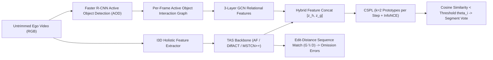

# Error Detection in Egocentric Procedural Task Videos

**Error Detection in Egocentric Procedural Task Videos**（CVPR 2024）由美国东北大学与石溪大学团队（Shih-Po Lee、Zijia Lu、Zekun Zhang、Minh Hoai、Ehsan Elhamifar）提出，收录于 [Awesome Egocentric Vision](https://github.com/sun254667/awesome-egocentric-vision) **第 119/249** 篇，分组 **291 Procedural Error Detection**。本文构建了包含 5 类程序性错误的 28 小时多模态数据集 **EgoPER**，并提出仅需正常（无错）训练视频即可同时完成动作分割与未知错误检测的框架 **EgoPED**。

## 一句话定义

**EgoPER / EgoPED** 提出了面向第一视角程序性任务的多类型错误数据集（28 小时烹饪视频）及仅用无错视频训练的动作分割–错误检测统一框架，通过主动交互物体图特征与对比步骤原型学习（CSPL）识别步骤遗漏、多余、修改、执行失误与纠错动作。

## 英文缩写速查

| 缩写 | 英文全称 | 简要说明 |
|------|----------|----------|
| EgoPER | Egocentric Procedural ERror dataset | 本文采集的 28 小时第一视角多模态程序性任务错误数据集 |
| EgoPED | Egocentric Procedural Error Detection | 本文提出的基于仅正常视频训练的动作分割与错误检测框架 |
| TAS | Temporal Action Segmentation | 时序动作分割模块（对比评估了 ActionFormer、DiffACT、MSTCN++） |
| AOD | Active Object Detection | 主动交互物体检测，输出手部与正被操控物体的边界框及接触状态 |
| CSPL | Contrastive Step Prototype Learning | 对比步骤原型学习，每步学习多原型并基于特征相似度判定异常 |
| GCN | Graph Convolutional Network | 图卷积网络，用于从每帧主动交互物体图中提取关系特征 |
| EDA | Error Detection Accuracy | 片段级错误检测准确率（正确预测片段数占总测试片段数比例） |

## 为什么重要

- **程序性错误不同于传统视频异常**：传统监控异常（如人员跌倒）与任务目标无关且多为固定视角；而可穿戴任务助手（WITA）面临的第一视角程序性错误（漏步、加步、换工具、倒错碗等）高度依赖长程上下文与细粒度手–物交互。
- **无需收集错误样本即可训练**：真实场景中的错误形式千变万化且难穷举；EgoPED 仅用正常视频与步骤级标注训练，即可在推理时零样本检出未见错误。
- 可结合 [Awesome Egocentric Vision 技术地图](../overview/sun-awesome-ego-technology-map.md)、[模仿学习](../methods/imitation-learning.md) 与 [操作任务](../tasks/manipulation.md) 对照任务执行监控与失败恢复机制。

## 核心信息

| 字段 | 内容 |
|------|------|
| 作者与单位 | Shih-Po Lee, Zijia Lu, Zekun Zhang, Minh Hoai, Ehsan Elhamifar（Northeastern University, Stony Brook University） |
| 编号与分组 | 119/249 · 291 Procedural Error Detection |
| 出处 | CVPR 2024 |
| 论文入口 | <https://openaccess.thecvf.com/content/CVPR2024/html/Li_Error_Detection_in_Egocentric_Procedural_Task_Videos_CVPR_2024_paper.html> |
| 官方源码与数据 | <https://github.com/robert80203/EgoPER_official>（论文首页脚注公开；当前页面未运行源码分析） |

## 核心机制（归纳）

1. **EgoPER 数据集与 5 类错误分类体系**：
   - 使用 **Microsoft HoloLens 2** 采集 11 名受试者在 2 个环境中的 **5 项烹饪任务**（制作 Pinwheels、Quesadilla、Oatmeal、Coffee、Tea），共 **386 段未裁剪视频**（**213 段正常 + 173 段含错**，总计 **28 小时**，1280×720、15 fps），包含 RGB、深度、音频、视线与手部追踪模态。
   - 定义基于任务图偏离的 **5 类程序性错误**：**Step Omission**（漏步）、**Step Addition**（多余步）、**Step Modification**（改步，如用刀代替勺搅拌）、**Step Slip**（执行失误，如撒漏或掉饼，导致步骤目标未达成）、**Step Correction**（纠错动作）；并提供帧级步骤/错误标注、主动/非主动物体边界框及手–物接触状态。
2. **EgoPED 混合特征动作分割与对比步骤原型学习**：
   - **混合特征构建（Holistic + Relational）**：以预提取的 I3D 帧特征输入可插拔 TAS 骨干（如 **ActionFormer (AF)**、**MSTCN++** 或 **DiffACT**）得到长程全局特征 $z_{n,t}^h$；同时用训练好的 Faster R-CNN 作为主动交互物体检测器（**AOD**）识别手部与正在被操控的物体及接触状态，为每帧构建“主动物体–手部”连接图并经 3 层 **GCN** 提取关系特征 $z_{n,t}^g$，拼接形成混合特征 $z_{n,t} = [z_{n,t}^h, z_{n,t}^g]$。
   - **对比步骤原型学习（CSPL）**：为每个步骤 $i \in \{1, \dots, S+1\}$（含背景类 $S+1$）从 50% 正常训练视频的特征中通过 K-means 学习 $k$ 个原型（默认 $k=2$）以覆盖正常执行的多种变体，并用 InfoNCE 对比损失 $\mathcal{L}_{cspl}$（默认每个正片段配 2 个负片段）联合分割损失 $\mathcal{L}_{tas}$ 端到端优化，使同步骤正常帧聚拢至对应原型、远离其他步骤。
   - **离线错误推理与漏步检测**：推理时先由 TAS 划分动作片段与帧级步骤标签；若某帧特征与预测步骤 $i$ 最近原型的余弦相似度低于验证集正常帧标定的阈值 $\theta_i = \mu_i + \gamma \sigma_i$，则判为错误帧，再对片段内帧预测多数投票得片段级错误判定。针对 **漏步（Omission）**，通过编辑距离在训练集中匹配最接近的步骤序列 $G$，并与预测步骤集合 $D$ 求差集 $D_o = G \setminus D$。

### 方法流程图

## 评测与指标

实验在 **EgoPER**（仅使用 RGB 模态，80% 正常视频训练 / 10% 验证 / 10% 正常 + 全部错误视频测试）、**HoloAssist**（2,221 段第一视角装配视频，无 AOD）与 **ATA**（1,152 段弱监督视频，无 AOD）三个基准上评测：

| 数据集与设置 | 方法 | EDA (%) ↑ | AUC (%) ↑ | 分割 / 其他指标 |
|---|---|---|---|---|
| EgoPER（全任务均值，表 3） | Random / HF²-VAD | 14.5 / 27.1 | 50.0 / 59.9 | — |
| EgoPER（全任务均值，表 3） | HF²-VAD + SSPCAB / S3R | 27.0 / 43.0 | 59.6 / 54.9 | — |
| EgoPER（全任务均值，表 3） | **EgoPED (with AF)** | **57.0** | **62.0** | Quesadilla 62.7/65.6 · Coffee 55.3/58.3 · Tea 56.0/66.0 |
| EgoPER（不同 TAS 骨干，表 5） | EgoPED (MSTCN++ / DiffACT / AF) | 48.4 / 49.2 / **57.0** | 58.5 / 61.9 / **62.0** | F1@0.5: 52.8 (MSTCN++) / 47.6 / 47.5; Acc: 74.6 / 69.5 / 68.5 |
| HoloAssist（无 AOD，表 4） | S3R (Verb / Noun) | 51.2 / 51.6 | 48.6 / 49.5 | — |
| HoloAssist（无 AOD，表 4） | **EgoPED (AF / DiffACT)** | Verb 68.0 / **68.2** · Noun 71.0 / **71.4** | Verb 47.3 / 46.4 · Noun **50.8** / 47.6 | EDA 较基线提升约 17 个百分点 |
| ATA（弱监督，无 AOD，表 7） | ATA 基线 / **EgoPED (DiffACT)** | — | — | Acc 66.1/**67.9**, Edit 68.8/**74.0**, $\text{F1}_{error}$ 59.2/**61.7** |

- **AOD+GCN 与原型数量消融（表 6，AF 骨干）**：去掉主动交互物体图分支（`w/o AOD`）时 EDA/AUC 为 52.5% / 58.7%，加入 `AOD+GCN` 后提升 **+4.5% EDA** 与 **+3.3% AUC**（57.0% / 62.0%）。每步原型数由 $k=1$ 增至 $k=2$，EDA 从 55.5% 升至 57.0%、AUC 从 58.2% 升至 62.0%；继续增至 $k=3,4$ 反而略微下降（55.4%/58.8% 与 55.7%/57.8%）。
- **分割精度与检错并非线性正相关**：如表 5 所示，MSTCN++ 的动作分割 F1@0.5（52.8%）与帧准确率（74.6%）高于 ActionFormer（47.5% / 68.5%），但检错 AUC 反而不及 AF（58.5% vs 62.0%），因为 AF 的边界检测模块更利于捕捉额外/错误片段边界。

## 与其他工作对比

- **对比视频异常检测基线（HF²-VAD、HF²-VAD+SSPCAB、S3R）**：基于光流重建与帧预测的 HF²-VAD 在第一视角剧烈头部运动下产生高频波动的帧级异常分，导致片段级 EDA 仅 27.0%–27.1%；S3R 虽达到 43.0% EDA，但难以利用步骤原型与主动交互物体关系，仍落后 EgoPED 14.0 个百分点。
- **对比已有程序数据集（Assembly101、ATA、HoloAssist）**：Assembly101 与 ATA 主要聚焦步骤顺序错误，HoloAssist 主要为执行失误且由旁观指导者即时纠偏；EgoPER 同时涵盖漏步、加步、改步、失误、纠错 5 类错误并附带主动交互物体框标注。
- 同分组其他第一视角工作见 [Awesome Egocentric Vision 技术地图](../overview/sun-awesome-ego-technology-map.md)。

## 结论

**EgoPED 表明：在仅使用正常视频训练的条件下，将时序动作分割、主动手–物交互图关系与对比多原型学习结合，能比通用视频异常检测更稳定地识别第一视角程序性错误。**

1. **手–物交互关系是区分细粒度改步与失误的关键** — 仅靠 I3D 全局特征难以分辨“用刀代替勺搅拌”等局部偏差，引入 `AOD + GCN` 直接带来 +4.5% EDA 与 +3.3% AUC 增益。
2. **边界感知骨干优于纯帧分类骨干** — 带有显式边界检测的 ActionFormer（EDA 57.0%）在错误检测上显著优于分割帧率更高的 MSTCN++（48.4%）。
3. **每步需适量多原型而非越多越好** — 默认 $k=2$ 原型足以覆盖正常执行变体，$k \ge 3$ 会因过表征导致正常与错误边界模糊。
4. **帧级阈值 + 片段多数投票抑制抖动** — 相比逐帧光流异常检测，基于步骤原型的片段级聚合更适合输出稳定的程序反馈。

## 常见误区或局限

1. **实验仅用了 RGB 模态**：尽管 EgoPER 数据集采集了深度、音频、视线和手部追踪多模态数据，但论文第 5.1 节明确指出所有实验均仅使用 RGB，其余模态尚未接入模型。
2. **离线推理而非实时在线预警**：当前 EgoPED 依赖整段完整视频进行离线动作分割与漏步匹配（Edit distance），尚不支持穿戴设备上的流式低延迟在线提醒。
3. **AOD 跨领域泛化受限**：论文在 HoloAssist 和 ATA（工业装配域）上不得不关闭 AOD 分支，因这两个数据集缺乏物体框标注，且在烹饪域训练的 AOD 无法直接迁移到装配场景。
4. **固定原型数与多错并存难点**：所有步骤固定使用 $k=2$ 个原型未能自适应不同步骤复杂度；且漏步常与其他错误并发，导致漏步检测 O-IoU 偏低。

## 关联页面

- 列表实体：[Awesome Egocentric Vision](../entities/awesome-egocentric-vision.md)
- 技术地图：[Awesome Egocentric Vision 技术地图](../overview/sun-awesome-ego-technology-map.md)
- 方法/任务：[vla.md](../methods/vla.md)、[imitation-learning.md](../methods/imitation-learning.md)、[manipulation.md](../tasks/manipulation.md)、[teleoperation.md](../tasks/teleoperation.md)

## 参考来源

- [`sources/papers/sun_awesome_ego_noarxiv_119_error-detection-in-egocentric-procedural.md`](../../sources/papers/sun_awesome_ego_noarxiv_119_error-detection-in-egocentric-procedural.md) — 本条目策展摘录
- [`sources/papers/sun_awesome_ego_catalog.md`](../../sources/papers/sun_awesome_ego_catalog.md) — 列表总表
- [`sources/repos/awesome-egocentric-vision.md`](../../sources/repos/awesome-egocentric-vision.md)
- 论文：<https://openaccess.thecvf.com/content/CVPR2024/html/Li_Error_Detection_in_Egocentric_Procedural_Task_Videos_CVPR_2024_paper.html>

## 推荐继续阅读

- [Awesome Egocentric Vision 仓库](https://github.com/sun254667/awesome-egocentric-vision)
- [原文](https://openaccess.thecvf.com/content/CVPR2024/html/Li_Error_Detection_in_Egocentric_Procedural_Task_Videos_CVPR_2024_paper.html)
