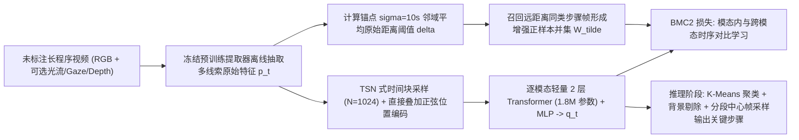

# STEPs

**STEPs: Self-Supervised Key Step Extraction and Localization from Unlabeled Procedural Videos**（arXiv:2301.00794v3，约翰斯·霍普金斯大学 & Microsoft Mixed Reality，ICCV 2023）收录于 [Awesome Egocentric Vision](https://github.com/sun254667/awesome-egocentric-vision) **第 132/249** 篇，分组 **292 Procedural Learning**。本页基于论文全文完成结构化精读与核实。

## 一句话定义

**STEPs** 是一种无需标签、也无需跨视频对齐配对的轻量自监督关键步骤提取与定位方法：在冻结多线索特征上训练 1.8M 参数的时序 Transformer，并通过自举多线索对比损失（**BMC2**）挖掘重复动作正样本与跨模态一致性，最后经聚类采样生成面向 AR 指导的关键步骤序列。

## 英文缩写速查

| 缩写 | 英文全称 | 简要说明 |
|------|----------|----------|
| BMC2 | Bootstrapped Multi-Cue Contrastive Loss | 本文核心损失：基于原始特征自举扩展正样本窗口，并强制跨线索在潜空间一致 |
| KS / KSE / KSL | Key Step / Key Step Extraction / Key Step Localization | 关键步骤及其提取与时序定位评测任务 |
| SSL | Self-Supervised Learning | 自监督学习，本文实现单视频/极少视频下的无标签长序列训练 |
| RAFT-OF | Recurrent All-Pairs Field Transforms Optical Flow | 用于从纯 RGB 流派生光流运动线索（`m2`）的预训练编码器 |
| PC / K.T | Phase Classification / Kendall's Tau | 阶段分类准确率与衡量序列单调对齐一致性的肯德尔秩相关系数 |

## 为什么重要

- **打破长时程视频自监督的显存与数据量瓶颈**：传统方法（如 TCC、LAV、CnC）需端到端微调主干网络并依赖成对视频对齐，每次前向只能采样几十帧且无法处理单条演示视频。`STEPs` 冻结主干预提取特征，使 **1.8M 参数**的时序编码器可一次摄入 **1,024 个时间块**（覆盖数十分钟长视频），在单张 A5000 上训练 17 段 Meccano 视频 300 epoch **仅需不到 6 分钟、约 3.5 GB 显存**，甚至在单条视频上也能有效收敛。
- **即插即用兼容 AR 头显多传感器信号**：除 RGB 派生的光流（RAFT）外，可零额外数据增强地接入头显自带的 **Gaze（眼动）、Depth（深度）与 Pose（姿态）** 线索，仅在训练期使用多模态即可显著提升测试期纯 RGB 推理效果。

## 核心信息

| 字段 | 内容 |
|------|------|
| 编号 | 132/249（Awesome Egocentric Vision） |
| 分组 | 292 Procedural Learning |
| 出处 | ICCV 2023（arXiv:2301.00794v3） |
| 作者与机构 | Anshul Shah¹, Benjamin Lundell², Harpreet Sawhney², Rama Chellappa¹（¹Johns Hopkins University，²Microsoft Mixed Reality） |
| 关键超参 | 2 层 2 头非因果 Transformer（$D=128$，正弦位置编码直接加于原始特征）；$N=1024$ 块（CrossTask/ProceL 512 块），$\sigma=10\text{s}$，$\zeta=2.0$，K-Means $K=7$ |
| 开源状态 | 已开源（代码仓库）：<https://github.com/anshulbshah/STEPs> · 项目页 <https://steps-procedural.github.io/> |

## 核心机制

1. **冻结多线索原始特征与长序列 TSN 式特征采样（§3.1 & Appendix D.1）**
   - 离线抽取多路空间平均池化特征 $p_t^{m_i}$：主干常用 `ResNet-50 conv5c`（外观 $m_1$）配合 `RAFT` 光流编码器（运动 $m_2$），或直接接入 AR 设备的眼动（如 Meccano 200Hz gaze 映射为 48 维向量）、深度图（ResNet-50 编码）与人体姿态（OpenPose）。
   - 训练时在时间跨度 $\beta=1.0$ 内将全视频均分为 $N=1024$ 个时间块，每块随机抽取 1 帧特征构成输入序列，无需对原始图像做耗时的像素级增强。
2. **轻量逐模态时序编码器与 `BMC2` 自举对比损失（§3.2–3.3）**
   - 对每路原始特征直接叠加正弦位置编码（Table 11 验证若先过 MLP 再加位置编码或去掉位置编码会导致坍缩或显著掉点），经 **2 层 2 头 Transformer**（无因果掩码）得到时序适配特征 $\tilde{q}_t^{m_i}$，再经 2 层 MLP 与 L2 归一化得 $q_t^{m_i} \in \mathbb{R}^{128}$。
   - **自举时间窗口生成（解决重复步骤假负样本）**：针对烹饪/装配中同一动作在不同时刻重复出现的问题，先在锚点 $\sigma$ 邻域（$10\text{s}$）内计算原始特征空间到锚点的平均距离作为阈值 $\delta$，将全视频中原始特征距离 $\le \delta$ 的远距离帧召回至集合 $W'$，取并集 $\tilde{W} = \min(W' + W, 1)$ 作为正样本集，避免把同一动作的再次执行当成负样本推开。
   - **多线索跨模态对比**：在 $\tilde{W}$ 上对同模态（$u=v$）与跨模态（$u \ne v$）特征统一施加带时间权重 $\gamma(t_a, t_j) = (t_a - t_j)^2 + 1$ 的 C-IDM 对比损失，拉近正样本、推开间隔 $\zeta=2.0$ 内的负样本。
3. **解耦的聚类–采样关键步骤提取（Algorithm 1，§3.4）**
   - 表征训练与提取解耦，推理默认仅需单路 RGB 适配特征 $\tilde{q}_t$：先用 K-Means（或自动确定簇数的 FINCH / 迭代局部搜索 ILS-SUMM）聚为 $K$ 簇，按距离簇中心的比例 $\alpha=0.1$ 剔除背景帧，若相邻帧时间间隔超过 $\gamma=2\text{s}$ 则切分为独立子片段，最后从每个子片段挑选最接近簇中心的帧并按时间排序输出关键步骤。

### 方法流程图

## 评测与指标

### 1. 第一视角关键步骤定位（KSL）主结果（原文 Table 1，$K=7$，测试期仅用 RGB 外观特征，3 次随机种子均值）

| 方法 | 跨视频对齐 | 微调主干 | CMU-MMAC (F1 / IoU) | EGTEA G. (F1 / IoU) | Meccano (F1 / IoU) | EPIC-Tents (F1 / IoU) |
|------|------------|----------|---------------------|---------------------|--------------------|-----------------------|
| `Random` | - | - | 15.7 / 5.9 | 15.3 / 4.6 | 13.4 / 5.3 | 14.1 / 6.5 |
| `Uniform` | - | - | 18.4 / 6.1 | 20.1 / 6.6 | 16.2 / 6.7 | 16.2 / 7.9 |
| `CnC`（Bansal et al., kMeans） | ✓ | ✓ | 19.2 / 9.0 | 20.8 / 7.9 | 16.6 / 8.0 | 15.4 / 7.8 |
| `CnC`（Bansal et al., PCM） | ✓ | ✓ | 22.7 / 11.1 | 21.7 / 9.5 | 18.1 / 7.8 | 17.2 / 8.3 |
| **`STEPs`（本文，kMeans）** | **✗** | **✗** | **28.3 / 11.4** | **30.8 / 12.4** | **36.4 / 18.0** | **42.2 / 21.4** |

### 2. 第三视角基准、代理任务与多模态消融（原文 Table 2, 3, 4, 5, 6, 14）

- **第三视角程序学习（Table 2，测试期仅用 RGB）**：在 **ProceL** 上达到 **F1 = 24.9**（P 23.5 / R 26.7，高于 CnC 的 21.6）；在 **CrossTask** 上达到 **F1 = 25.9**（P 26.2 / R 25.8，高于 CnC 的 22.6）。
- **阶段分类与序列对齐（Table 3）**：在 **IkeaASM（含背景）** 上 0.1 / 0.5 / 1.0 标注比例分别达 **36.25 / 37.02 / 31.92**（超越 VAVA 的 33.79 / 32.91 / 29.10）；在 **PennActions** 上达 31.52 / 85.06 / 85.5，且 **Kendall's Tau = 0.91**（对比 VAVA 0.81 / LAV 0.80）。
- **多模态与 AR 传感器增益（Table 4 & Table 14，Meccano）**：
  - 仅 RGB 训练（RGB 推理）：F1 32.1 / IoU 14.9
  - `RGB+Gaze` 训练（RGB 推理）：F1 **35.4** / IoU 17.0
  - `RGB+OF` 训练（RGB 推理）：F1 **36.4** / IoU 18.0（若推理也融合 `RGB+OF` 达 **37.6 / 18.1**）
  - `RGB+Depth` 训练（RGB 推理）：F1 **36.6** / IoU 18.1
  - 四模态联合训练 `RGB+OF+Gaze+Depth`（700 epoch，RGB 推理，Table 14）：F1 进一步升至 **40.2 / IoU 19.8**。
- **组件与上下文长度消融（Table 5, 6, 8，Meccano）**：
  - 损失消融（Table 5）：单模态无自举（32.1）→ +BMC2 自举（33.1）→ +多线索无自举（34.2）→ **+多线索+BMC2（36.4）**。
  - 采样块数 $N$（Table 6）：128（33.04）< 256（36.08）< **1024（36.43）** > 2048（34.88）。
  - 时序结构（Table 8）：TCN（32.5）< LSTM（33.6）< **Transformer（36.4）**。

## 与其他工作对比

- **对比 [My View is the Best View (CnC)](paper-sa-ego-129-my-view-is-the-best-view-procedure-learning-from.md)**：`CnC` 需跨视频对齐且端到端训练主干，每次仅看 32 帧；`STEPs` 无需跨视频配对与主干微调，凭借 1,024 块超长时序感受野、多线索训练和 `BMC2` 自举正样本窗口，在 EgoProceL 四个数据集上将 F1 大幅推高 **+5.6 至 +25.0** 个点。
- **对比视频对齐方法（TCC / LAV / VAVA）**：摆脱单调时间顺序与双视频配对假设，直接适配包含大量停顿、循环与重复动作的工业装配长视频。更多条目见 [Awesome Egocentric Vision 技术地图](../overview/sun-awesome-ego-technology-map.md)。

## 常见误区或局限

1. **空间平均池化丢失细粒度空间注意力（Appendix K）**：为节省存储与加快训练，预提取特征均做了全局空间平均池化（如 ResNet-50 `conv5c`），无法聚焦手部与微小零件的局部空间区域。
2. **强依赖上游预训练特征提取器质量（Appendix K）**：冻结特征虽然训练极快，但天花板受制于 ImageNet ResNet-50 等原始特征表达；作者指出未来引入 CLIP 等强语义上下文表征仍有较大提升空间。
3. **关键步骤定义高度主观且缺乏 KSE 真值评测集（§4.3 & Appendix K）**：不同熟练度用户（新手 vs. 专家）对需要多少个关键步骤需求不同；由于缺少大规模 KSE 标注集，论文只能以关键步骤定位（KSL）和阶段分类（PC）作为代理指标，并辅以 IKEA 手册人工定性比对。
4. **实际 AR 落地仍需真机穿戴闭环验证（Appendix K）**：尽管使用了 Meccano 的头戴 RGB/Depth/Gaze 数据，真实在岗培训仍需根据具体设备与任务调整簇数 $K$（或改用 FINCH）及过滤阈值。

## 结论

**STEPs 证明了“冻结多线索骨干 + 轻量长时序 Transformer + 自举对比窗口（BMC2）”是处理分钟级无标注第一视角长视频极具性价比的自监督范式，甚至无需跨视频配对即可大幅领先传统端到端对齐方法。**

1. **优先做长时序上下文建模而非盲目微调视觉主干** — 冻结 `ResNet-50 + RAFT` 特征后仅训练 1.8M 参数 Transformer（支持 1,024 块输入），6 分钟单卡训练即可在 Meccano 上把 F1 从 18.1 翻倍至 36.4。
2. **处理含重复动作的程序视频必须对固定时间窗做假负样本修正** — `BMC2` 利用原始特征距离自举召回远距离重复片段（Table 5：34.2 → 36.4），显著优于只依赖局部时间窗的 CIDM。
3. **训练期尽量白嫖 AR 头显的 Depth / Gaze 传感流** — 即使推理部署时只保留单路 RGB 相机，训练期加入深度、眼动或光流辅助对比对齐也能稳定提升 RGB 单模态定位精度（32.1 → 40.2）。
4. **位置编码须直接加在原始特征上，切勿先过可学习投影层** — Table 11 证实“先过 MLP 再加位置编码”会令网络学会忽略视觉特征而坍缩为纯时间戳特征（Meccano F1 36.4 → 32.8）。

## 关联页面

- 列表实体：[Awesome Egocentric Vision](../entities/awesome-egocentric-vision.md)
- 技术地图：[Awesome Egocentric Vision 技术地图](../overview/sun-awesome-ego-technology-map.md)
- 同组对比：[My View is the Best View](paper-sa-ego-129-my-view-is-the-best-view-procedure-learning-from.md)
- 方法/任务：[vla.md](../methods/vla.md)、[imitation-learning.md](../methods/imitation-learning.md)、[manipulation.md](../tasks/manipulation.md)、[teleoperation.md](../tasks/teleoperation.md)

## 参考来源

- [`sources/papers/sun_awesome_ego_noarxiv_132_steps-self-supervised-key-step-extractio.md`](../../sources/papers/sun_awesome_ego_noarxiv_132_steps-self-supervised-key-step-extractio.md) — 本条目策展摘录
- [`sources/papers/sun_awesome_ego_catalog.md`](../../sources/papers/sun_awesome_ego_catalog.md) — 列表总表
- [`sources/repos/awesome-egocentric-vision.md`](../../sources/repos/awesome-egocentric-vision.md)
- 论文：<https://steps-procedural.github.io/>

## 推荐继续阅读

- [Awesome Egocentric Vision 仓库](https://github.com/sun254667/awesome-egocentric-vision)
- [STEPs 项目主页](https://steps-procedural.github.io/) · [官方代码仓库](https://github.com/anshulbshah/STEPs)
- [arXiv:2301.00794 原文 PDF](https://arxiv.org/pdf/2301.00794)
