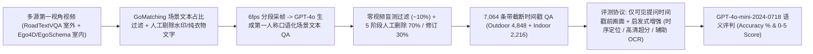

# EgoTextVQA

**EgoTextVQA: Towards Egocentric Scene-Text Aware Video Question Answering**（arXiv:2502.07411v2，合肥工业大学、新加坡国立大学 & 中国科学技术大学，CVPR 2025）收录于 [Awesome Egocentric Vision](https://github.com/sun254667/awesome-egocentric-vision) **第 140/249** 篇，分组 **293 Procedural Question Answering**。本页基于论文全文完成结构化精读与核实。

## 一句话定义

**EgoTextVQA** 是首个面向真实佩戴者实时辅助需求的第一视角场景文本（Scene-Text）视频问答基准（1,507 段视频、7,064 条带时间戳开放式问答），覆盖室外驾驶与室内家务场景，并在问题不直接指向文字位置的前提下要求 MLLM 联合时序视觉推理、意图理解与环境文字识别作答。

## 英文缩写速查

| 缩写 | 英文全称 | 简要说明 |
|------|----------|----------|
| OCR | Optical Character Recognition | 光学字符识别，本文用于数据初筛及作为模型推理时的辅助场景文本（ST）输入 |
| ST / STQ / STA | Scene Text / Scene-Text Question / Scene-Text Answer | 场景文本及其在问题（占比 52%）和答案（占比 45%）中的覆盖度 |
| SR / DiffTSR | Super Resolution / Diffusion-based Text Super-Resolution | 扩散式场景文本超分，用于将检测到的局部低清文字放大至 `380×128` 后回贴推理 |
| TS Frame / QA Frames | Timestamp Frame / Question Generation Frames | 分别指提问时刻单帧与用于生成问题的 3 个关键帧输入消融设定 |
| MLLM | Multimodal Large Language Model | 多模态大语言模型，本文全面评测了 3 个闭源与 7 个开源 MLLM |

## 为什么重要

- **摆脱传统 OCR VQA“拍清且指明文字区域”的理想化假设**：在 `TextVQA`、`ST-VQA`（主流模型已达 ~85%）与 `RoadTextVQA` 中，问题直接指向清晰聚焦的文字；而真实可穿戴辅助用户往往在动态模糊、非聚焦画面下提出意图驱动问题（如“做完饭用什么洗锅？”），且模型**仅能看到提问时间戳之前的历史视频帧**。
- **暴露顶尖 MLLM 在真实第一视角场景文本辅助上的巨大断层**：即便是 `Gemini 1.5 Pro` 在全集上准确率也仅 **33.4%（Outdoor）/ 34.4%（Indoor）**，在室外实时时间敏感子集上最高仅 **20.2%**。

## 核心信息

| 字段 | 内容 |
|------|------|
| 编号 | 140/249（Awesome Egocentric Vision） |
| 分组 | 293 Procedural Question Answering |
| 出处 | CVPR 2025（arXiv:2502.07411v2） |
| 作者与机构 | Sheng Zhou¹²*, Junbin Xiao²†, Qingyun Li², Yicong Li², Xun Yang³, Dan Guo¹, Meng Wang¹, Tat-Seng Chua², Angela Yao²（¹合肥工业大学，²新加坡国立大学，³中国科学技术大学） |
| 数据规模 | **1,507** 段视频（均值 **101.7 s**）、**7,064** 条开放式问答：**Outdoor**（源自 RoadTextVQA，694 视频 / 4,848 QA，5 类题型）+ **Indoor**（源自 EgoSchema/Ego4D，813 视频 / 2,216 QA，6 类场景） |
| 开源状态 | 已开源（数据集与评测脚本）：<https://github.com/zhousheng97/EgoTextVQA> · 项目页 <https://egotextvqa.github.io/> |

## 核心机制

1. **两阶段视频筛选与五阶段严苛人工精修（§3.1 & Appendix A.1）**
   - **原始视频过滤**：使用视频文本检测器 GoMatching 筛选含场景文本帧占比超过阈值（RoadTextVQA > 15%、Ego4D > 5%）的视频，再人工剔除单调画面、水印及仅衣物印字的样本，最终保留 694 段室外行车记录与 813 段室内第一视角长视频。
   - **MLLM 候选生成与盲答剔除**：以 6 fps 解码并均分 5 段，剔除无文字帧后每段均匀采 3 帧送入 `GPT-4o`，按“目标导向、隐含场景文本、第一人称口语化、需多帧推理”生成每视频至多 15 条 QA；先用 `GPT-4o` 零视频盲测剔除 ~10% 常识可答问题。
   - **5 阶段人工精修与实时时间戳扩展**：9 名受训标注员经 5 轮核查，删除约 **70%** 存在幻觉、文本无关、OCR 错误或非口语化的问题，并修改剩余数据的 **30%**；另对约 **10%** 时间敏感题在多个时间戳标注不同真值答案，模拟流式实时问答（推理时严格截断时间戳之后画面）。
2. **语义等价自动评测协议（§4.1 & Appendix C）**
   - 采用固定版本的 `GPT-4o-mini-2024-0718` 对比预测与真值（输出 `yes/no` Accuracy 与 `0–5` 分 Score），在 100 条抽样上与 3 名人类裁判取得高一致性（Accuracy 皮尔逊相关 $r=0.80$，Score 相关 $r=0.87$，人类间 $\kappa=0.77$）。
3. **四类启发式增强机制探索（§5）**
   - 围绕单帧 vs. 多帧（`TS Frame`）、时间定位（`QA Frames` 与 `1 fps` 后向/固定时长采样）、全局高分辨率（1080p/720p）与局部扩散超分（`Azure OCR + DiffTSR` 放大至 $1.00\times/1.25\times/1.50\times$）、以及引入辅助 OCR 文本（`V+Q+ST`）进行系统消融。

### 方法流程图

## 评测与指标

### 1. 主基准零样本评测对比（原文 Table 3 & Table 4，Accuracy % / Score 0–5）

| 模型 | 类别 | EgoTextVQA-Outdoor（帧数 / 分辨率） | Outdoor Acc / Score ↑ | EgoTextVQA-Indoor（帧数 / 分辨率） | Indoor Acc / Score ↑ |
|------|------|-------------------------------------|-----------------------|------------------------------------|----------------------|
| **Human**（30% 抽样） | 人类 | 全历史视频 | **43.1 / 2.6** | 全历史视频 | 27.7 / 1.9 |
| `Gemini 1.5 Pro` | 闭源 | 32 帧 / $768^2$ | **33.4 / 2.0** | 60 帧 / $768^2$ | **34.4 / 2.1** |
| `GPT-4o` | 闭源 | 32 帧 / $768^2$ | 30.3 / 1.7 | 60 帧 / $768^2$ | 28.3 / 1.8 |
| `Gemini 1.5 Flash` | 闭源 | 32 帧 / $768^2$ | 30.1 / 1.9 | 60 帧 / $768^2$ | 32.0 / 2.1 |
| `Qwen2-VL`（7B） | 开源 | 16 帧 / $448^2$ | **28.2 / 2.0** | 48 帧 / $448^2$ | 23.3 / 1.8 |
| `LLaVA-NeXT-Video`（7B） | 开源 | 60 帧 / $384^2$ | 19.5 / 1.4 | 128 帧 / $384^2$ | **25.4 / 1.8** |
| `InternVL2-26B` | 开源 | 16 帧 / $448^2$ | 23.5 / 1.7 | 16 帧 / $448^2$ | 21.0 / 1.7 |
| `VILA1.5`（8B） | 开源 | 32 帧 / $384^2$ | 17.4 / 1.5 | 32 帧 / $384^2$ | 18.2 / 1.6 |
| `InternVL2-8B` | 开源 | 32 帧 / $448^2$ | 16.4 / 1.3 | 32 帧 / $448^2$ | 13.6 / 1.2 |
| `CogVLM2-Video`（8B） | 开源 | 60 帧 | 12.4 / 1.4 | 128 帧 | 13.5 / 1.4 |
| `MiniCPM-V 2.6`（7B） | 开源 | 60 帧 / $448^2$ | 11.4 / 0.7 | 120 帧 / $448^2$ | 13.3 / 0.8 |
| `ShareGPT4Video`（8B） | 开源 | 60 帧 | 11.5 / 1.3 | 128 帧 | 7.0 / 1.1 |

> **说明（§4.2 & Table 11）**：在 **Indoor** 上人类全视频盲找仅 27.7%，低于 `Gemini 1.5 Pro`（34.4%），原因在于 Ego4D 视频分辨率低（480×360 / 640×360）、运动模糊且涉及书名/厨具等外部专业知识；若直接提供定位好的 3 张 `QA Frames`，人类在 100 题抽样上由 26.0% 升至 **36.0%**（GPT-4o 39.0% / Gemini 1.5 Pro 35.0%）。此外，Outdoor **实时时间敏感子集**（~623 题，Fig. 5）最高准确率仅 **20.2%**。

### 2. 四项启发式诊断实验关键数值（原文 Tables 5–7 & Fig. 7）

- **单帧 vs. 多帧推理（Table 5，`TS Frame`）**：仅看提问时刻单帧导致 Indoor 准确率暴跌 **7.1%–18.6%**（Gemini 1.5 Pro `34.4% → 15.8%`，GPT-4o `28.3% → 14.8%`），说明室内家务高度依赖历史动作序列记忆。
- **时序定位（Table 5，`QA Frames`）**：向模型直接提供 3 张生成问题的关键帧，Indoor 精度跃升显著：**GPT-4o `28.3% → 41.6%`（+13.3%）**，**Qwen2-VL `23.3% → 30.7%`（+7.4%）**，**Gemini 1.5 Pro `34.4% → 38.2%`（+3.8%）**。
- **高分辨率与文字超分（Fig. 7 & Table 6）**：将 3 帧切换为 `1920×1080 / 1280×720` 原画质可使 4 个模型在 Outdoor 提升 **18.6%–31.0%**；使用 `DiffTSR` 对检测区域放大 `1.50×`（30% 抽样）令 Outdoor Qwen2-VL 升至 **34.1%**（+5.9%）、Gemini 1.5 Pro 升至 **38.1%**（+4.7%），但 Indoor 因原始糊帧漏检文字而不稳定。
- **纯文字 vs. 视频+辅助 OCR（Table 7）**：仅输问题与场景文字（`Q+ST`）准确率仅 15.4%–24.1%（Outdoor）/ 13.3%–17.6%（Indoor）；而 **视频 + 辅助 OCR（`V+Q+ST`）** 带来全模型最大跃升：
  - **Outdoor**：`GPT-4o` **30.3% → 52.9%（+22.6%）**，`Gemini 1.5 Pro` **33.4% → 49.5%（+16.1%）**，`LLaVA-NeXT-Video` **19.5% → 37.4%（+17.9%）**，`Qwen2-VL` **28.2% → 39.9%（+11.7%）**。
  - **Indoor**：`Gemini 1.5 Pro` **34.4% → 39.5%（+5.1%）**，`GPT-4o` **28.3% → 37.9%（+9.6%）**，`LLaVA-NeXT-Video` **25.4% → 30.8%（+5.4%，vs. 同表基准 22.7% 升 +8.1%）**。

## 与其他工作对比

- **对比图像与行车场景文本基准（TextVQA、ST-VQA、RoadTextVQA，Table 2）**：首次同时支持第一视角动态视频、室内+室外双场景、隐含场景文本提问（问题本身不泄露文字坐标）与时间戳截断实时推理。
- **对比通用第一视角 VideoQA（EgoThink、QAEgo4D、EgoSchema、EgoMemoria）**：将日常标牌、说明书、价签、书脊、仪表读数纳入决策闭环；例如 `ShareGPT4Video` 虽在 Ego4D 视频上训练过，但在 EgoTextVQA-Indoor 上仅得 **7.0%**，说明常规动作字幕训练极度缺乏场景文本感知。更多条目参见 [Awesome Egocentric Vision 技术地图](../overview/sun-awesome-ego-technology-map.md)。

## 常见误区或局限

1. **低清模糊视频导致室内场景文字检测与超分失效（§5 Q3 & Table 6）**：Ego4D 室内片源以 `480×360` / `640×360` 为主且伴随剧烈晃动与遮挡，使得外部 OCR 检测器漏检严重，限制了 `DiffTSR` 超分与辅助文本管线在室内的增益。
2. **动态时空方位更新失灵（§4.2 & Appendix B.5）**：在实时提问子集（最高 20.2%）中，当佩戴者移动经过建筑（如从“正前方”走到“右侧”）后再问同一问题，绝大多数 MLLM 仍僵化沿用旧位置答案。
3. **跨帧信息聚合与计数/运算短板（Appendix B.5）**：如超市结账过程需要跨多帧观察收银屏价格变化并求和，所有评测模型均失败。
4. **开放式单真值答案的评测严格性偏差（§4.2）**：部分合理但表述角度不同的回答会被单个参考答案低估（作者列为未来扩充多参考答案的方向）。

## 结论

**EgoTextVQA 表明：现有在静态 OCR 基准上拿到 85%+ 的 MLLM，一旦进入第一视角动态、非聚焦、带时间戳截断的真实辅助场景便集体退化至 ~30% 水平，必须协同解决“关键帧时序定位 + 局部高分辨率读取 + 外部 OCR 与视频融合”三件事。**

1. **“视频帧 + 外部 OCR 文本串联（V+Q+ST）”是当前最立竿见影的工程方案** — 可在 Outdoor 上为 GPT-4o 带来 **+22.6%**（30.3% → 52.9%）提升，远胜单一分辨率或采样调优；但绝不能丢掉视频画面只传文字（`Q+ST` 仅 15%–24%）。
2. **室内长视频（Indoor）必须保留多帧上下文并先做时间检索** — 仅取单帧会导致准确率腰斩（掉点 7.1%–18.6%），而先定位关键 3 帧即可让 GPT-4o 跃升 +13.3%。
3. **室外近实时辅助可优先采用局部高分或短窗回溯采样** — 固定短窗（4 秒内采样）与高分辨率帧在 Outdoor 显著降本增效，而在 Indoor 长程任务上仍需全视频全局检索。
4. **面向可穿戴助手的模型微调应显式解耦“实时相对空间方位”与“跨帧累计状态”** — 仅靠通用视频描述预训练（如 ShareGPT4Video）无法学会阅读环境文字。

## 关联页面

- 列表实体：[Awesome Egocentric Vision](../entities/awesome-egocentric-vision.md)
- 技术地图：[Awesome Egocentric Vision 技术地图](../overview/sun-awesome-ego-technology-map.md)
- 方法/任务：[vla.md](../methods/vla.md)、[imitation-learning.md](../methods/imitation-learning.md)、[manipulation.md](../tasks/manipulation.md)、[teleoperation.md](../tasks/teleoperation.md)

## 参考来源

- [`sources/papers/sun_awesome_ego_noarxiv_140_egotextvqa-towards-egocentric-scene-text.md`](../../sources/papers/sun_awesome_ego_noarxiv_140_egotextvqa-towards-egocentric-scene-text.md) — 本条目策展摘录
- [`sources/papers/sun_awesome_ego_catalog.md`](../../sources/papers/sun_awesome_ego_catalog.md) — 列表总表
- [`sources/repos/awesome-egocentric-vision.md`](../../sources/repos/awesome-egocentric-vision.md)
- 论文：<https://egotextvqa.github.io/>

## 推荐继续阅读

- [Awesome Egocentric Vision 仓库](https://github.com/sun254667/awesome-egocentric-vision)
- [EgoTextVQA 项目主页](https://egotextvqa.github.io/) · [官方代码与数据集仓库](https://github.com/zhousheng97/EgoTextVQA)
- [arXiv:2502.07411 原文 PDF](https://arxiv.org/pdf/2502.07411)
