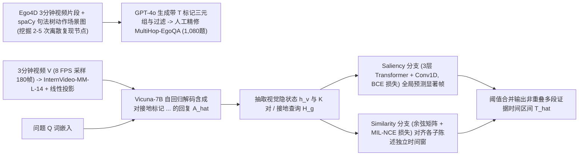

# Grounded Multi-Hop VideoQA in Long-Form Egocentric Videos

**Grounded Multi-Hop VideoQA in Long-Form Egocentric Videos**（AAAI 2025 / arXiv:2408.14469v1，上海交通大学）收录于 [Awesome Egocentric Vision](https://github.com/sun254667/awesome-egocentric-vision) **第 141/249** 篇，分组 **293 Procedural Question Answering**。本页基于论文全文完成结构化精读与核实。

## 一句话定义

该研究针对长程第一视角视频形式化提出了需要聚合多段离散证据并同步定位全部非重叠时间区间的 **Multi-Hop VideoQA（MH-VidQA）** 任务，构建了基于动作场景图自动挖掘与人工精修的 **MultiHop-EgoQA** 基准，并提出利用特殊成对接地标记 `<T></T>` 驱动双分支证据定位的基线架构 **GeLM**。

## 英文缩写速查

| 缩写 | 英文全称 | 简要说明 |
|------|----------|----------|
| MH-VidQA | Multi-Hop Video Question Answering | 多跳视频问答，要求整合分散在多个非连续时段中的视觉线索并定位全部证据区间 |
| GeLM | Grounding Scattered Evidence with Large Language Model | 本文提出的基线架构，通过 MLLM 输出成对接地标记配合双分支模块定位多段离散证据 |
| MIL-NCE | Multiple Instance Learning Noise Contrastive Estimation | 多实例学习对比损失，用于监督 GeLM 相似度分支将每个 `<T>` 查询对齐到对应帧区间 |
| mIoP / mIoG | mean Intersection over Prediction / Ground Truth | 多区间预测精度与召回率指标（类似 Precision 与 Recall，补充全局 mIoU） |
| Sent. Sim. | Sentence Similarity | 基于 `all-MiniLM-L6-v2` 计算生成长答案与参考答案之间的句向量余弦相似度 |

## 为什么重要

- **突破单跳假设，直面真实长视频的线索分散性**：传统接地问答（如 QAEgo4D、Ego4D-NLQ）刻意剔除了跨越多个非连续时间窗的问题；但现实中的家居统计与流程回溯（如“用刀切了哪些食材？”“把物体先后放在哪几处？”）往往需要跨 **2–6 个** 离散时刻汇总信息。
- **揭示现有闭源与开源大模型的多跳接地短板**：即便强如 **GPT-4o** 在 MultiHop-EgoQA 上的时序多区间 `mIoU` 也仅 **12.2%**、开源时序模型 TimeChat 仅 **3.6%**（人类达 **61.8%**）；**GeLM-7B** 将多跳 `mIoU` 提升至 **16.7%**、语义相似度达 **75.0%**，并在单跳基准 ActivityNet-RTL 上同样大幅刷新 SOTA。

## 核心信息

| 字段 | 内容 |
|------|------|
| 编号 | 141/249（Awesome Egocentric Vision） |
| 分组 | 293 Procedural Question Answering |
| 出处 | AAAI 2025（arXiv:2408.14469v1，2024-08-26） |
| 作者与机构 | Qirui Chen, Shangzhe Di, Weidi Xie（Shanghai Jiao Tong University） |
| 模型配置 | 视觉特征：`InternVideo-MM-L-14`（8 FPS，采样 180 帧）；LM 底座：`Vicuna-7B v1.3`（4096 维，grounding 投影 1024 维） |
| 数据规模 | 自动生成并过滤训练集：**4,412 clips / 14,397 triplets**（实验训练子集 3,156 clips / 10,414 样本）；人工精修测评集 **MultiHop-EgoQA**：**360 clips / 1,080 triplets** |
| 论文与项目页 | <https://ojs.aaai.org/index.php/AAAI/article/view/33925> · <https://arxiv.org/abs/2408.14469> · <https://qirui-chen.github.io/MultiHop-EgoQA> |

## 核心机制

1. **MultiHop-EgoQA 四阶段构建管线**
   - **Stage I（片段切分）**：从 Ego4D 9,611 段长视频（均长 24 分钟、385 万条旁白）裁剪出非重叠 **3 分钟（180s）** 片段，按旁白数量（30–60 条）与跨度（>150s）筛除信息过稀或过密片段。
   - **Stage II（句法树动作场景图挖掘离散复现）**：用 `spaCy` 解析旁白的动词（`verb`）、直接宾语（`dobj`）与介词宾语（`pobj`）构造时序动作场景图，专挑出现次数在 $2\text{--}5$ 次（$t_{\min}=2, t_{\max}=5$）且时间跨度 $>10\text{ s}$、但连接不同邻接对象的节点 $u$ 作为多跳问题锚点。
   - **Stage III（GPT-4o 生成与过滤）**：按六大题型模板引导 **GPT-4o** 生成带 `<T1>...</T1>` 标记的问答与时间窗三元组，再用 GPT-4o 剔除歧义问题（如泛泛的“touch/check”）。六类题型占比分别为：**重复活动 Repeated Activities（39.6%）**、**多动作 Multiple Actions（22.4%）**、**多物体 Multiple Objects（17.9%）**、**事件组合 Event Composition（10.3%）**、**多地点/人物 Multiple Locations/People（6.7%）**、**事件对比 Event Comparison（3.1%）**。
   - **Stage IV（人工精修）**：12 名 CV 研究生复核 1,208 条候选并精修起止时间戳，最终形成 **360 段视频、1,080 题**（平均每题 **2.1 跳**、最多 **6 跳**，单段证据均值 **19.5s**，问题均长 10.3 词、答案均长 14.4 词）。
2. **GeLM：成对接地标记驱动的双分支定位架构**
   - **词表扩展与查询抽取**：在 Vicuna-7B 词表中新增成对接地标记 `<T>` 与 `</T>`；模型回答时自动用 `<Tk>...</Tk>` 包裹每条关键陈述（可变数量 $K$），将每对起止标记末层隐状态拼接为接地查询向量 $H_g \in \mathbb{R}^{K\times 2D}$。
   - **Saliency 分支（全局显著性）**：将帧隐状态与 $K$ 个接地查询经 3 层 Transformer 编码器融合后，由 2 层 1D-Conv 头与 Sigmoid 预测逐帧显著性分数 $\hat{y}\in \mathbb{R}^L$，以二元交叉熵 $\mathcal{L}_{\text{BCE}}$ 监督，捕捉问题相关的全部证据帧集合。
   - **Similarity 分支（细粒度子陈述对齐）**：对投影后的视觉特征 $z_v$ 与接地查询 $z_g$ 计算余弦相似度矩阵 $\hat{S}\in \mathbb{R}^{K\times L}$，以 **MIL-NCE** 对比损失 $\mathcal{L}_{\text{NCE}}$ 监督，使第 $k$ 个子陈述准确对应视频中的特定离散片段。总损失 $\mathcal{L} = \mathcal{L}_{\text{CE}} + \lambda_{\text{BCE}}\mathcal{L}_{\text{BCE}} + \lambda_{\text{NCE}}\mathcal{L}_{\text{NCE}}$。
   - **提案后处理**：对 Saliency（系数 0.7）或经 3 步均值平滑+Softmax 后的 Similarity 行向量（系数 0.10）乘以最大激活阈值进行片段合并，输出非重叠时间区间 $\hat{T}$。

### 方法流程图

## 评测与指标

以下指标均来自原文表格：

### 1. MultiHop-EgoQA 主基准对比（原文 Table 2，z.s. 为零样本，f.t. 为微调）

| 模型 / 流水线 | 模式 | 输入帧数 | mIoP ↑ | mIoG ↑ | IoU@0.3 ↑ | mIoU ↑ | Sent. Sim. ↑ | GPT-4o Score (1–10) ↑ |
|---------------|------|----------|--------|--------|-----------|--------|--------------|-----------------------|
| `Human`（10% 抽样） | – | – | 71.8 | 81.0 | 87.0 | 61.8 | 74.3 | 7.5 |
| `GPT-4o` | z.s. | 60 帧 | 18.9 | 24.4 | 12.0 | 12.2 | 73.7 | **5.4** |
| `InternVL2-8B` | z.s. | 30 帧 | 11.8 | 24.0 | 6.3 | 6.6 | 71.9 | 4.5 |
| `LLaVA-NeXT-Video-7B` | z.s. | 32 帧 | – | – | – | – | 62.1 | 4.2 |
| `TimeChat-7B` | z.s. | 96 帧 | 10.2 | 5.6 | 3.0 | 3.6 | 58.9 | 3.3 |
| `VTimeLLM-7B` | z.s. | 100 帧 | 12.4 | 28.2 | 8.8 | 9.2 | 70.5 | 4.3 |
| `LLaVA-NeXT-7B → Llama-3.1-8B` | z.s. 字幕流水线 | 180 帧 | 21.4 | 22.3 | 10.1 | 9.7 | 63.6 | 3.5 |
| **`GeLM-7B (Ours)`** | **f.t.** | **180 帧** | **23.7** | **41.0** | **18.2** | **16.7** | **75.0** | 4.8 |

### 2. 单跳公开基准 ActivityNet-RTL 迁移结果（原文 Table 5，229 题 / 160 视频）

| 模型 | 接地策略 | mIoU ↑ | P@0.5 ↑ | GPT-4 R. Score ↑ |
|------|----------|--------|---------|------------------|
| `LITA-7B` | Time Token | 24.1 | 21.2 | 44.0 |
| `LITA-13B` | Time Token | 28.6 | 25.9 | **46.3** |
| **`GeLM-7B (Ours)`** | **Saliency 分支** | 31.8 | 28.2 | 45.3 |
| **`GeLM-7B (Ours)`** | **Similarity 分支** | **35.4** (+11.3) | **31.0** (+9.8) | 45.1 (+1.1) |

### 3. 消融实验要点（原文 Tables 3, 4 & 附录 Table 18）

- **双分支协同效应（Table 3）**：仅用 $\mathcal{L}_{\text{NCE}}$ 时 Similarity 分支 `IoU@0.3` 为 14.1、`mIoU` 为 13.4；加入 $\mathcal{L}_{\text{BCE}}$ 联合监督后，Similarity 分支 `IoU@0.3` 升至 **18.2**、`mIoU` 升至 **16.7**（Saliency 分支亦从 13.8 / 14.2 升至 **19.2** / 14.7）。
- **自动生成数据的跨模型通用性（Table 4）**：用本文自动构建的 100% 指令数据微调第三方模型 `TimeChat`，使其在 MultiHop-EgoQA 上的 `IoU@0.3` 从 3.0 提至 **8.6**、`mIoU` 从 3.6 提至 **8.1**、QA Score 从 3.3 提至 **4.4**；GeLM 随训练数据量（25% → 50% → 100%）持续涨点。
- **第一/第三视角混合训练（附录 Table 18b–c）**：将第一视角与第三视角数据混合训练会因视角与问答分布差异导致各自指标略有下降（MultiHop-EgoQA `mIoU` 16.7 → 15.1；ActivityNet-RTL `mIoU` 35.4 → 32.1），但仍优于既有基线。

## 与其他工作对比

- **对比文本时间 token 型视频大模型（TimeChat、VTimeLLM、LITA）**：这类模型将时间戳离散为普通数字/特殊文本 token 让 LLM 自回归直接生成，往往在多跳长视频中只能输出单一模糊时间窗（TimeChat `mIoU` 仅 3.6%）；GeLM 用可学习的 `<T></T>` 隐藏状态在独立特征空间与帧隐状态做连续显著性与相似度匹配，大幅提升多区间定位精度。
- **对比单跳第一视角基准（QAEgo4D / GroundVQA）**：GroundVQA 聚焦均长 8.2 分钟视频的单个连续区间定位与 QA；MultiHop-EgoQA 专注于多段非连续证据组合推理，与前者形成互补。更多同组对比见 [Awesome Egocentric Vision 技术地图](../overview/sun-awesome-ego-technology-map.md)。

## 常见误区或局限

1. **与人类表现仍存在巨大代差（Table 2）**：GeLM-7B 在多跳时间 `mIoU` 上为 **16.7%**（人类 **61.8%**），`IoU@0.3` 为 **18.2%**（人类 **87.0%**），GPT-4o QA 评分 **4.8**（人类 **7.5**），说明多跳视觉证据精确对齐仍是开放难题。
2. **仅固定 3 分钟切片且视觉分辨率受限（§4.1 & 附录 D）**：目前基准与模型将 Ego4D 视频硬切为 3 分钟 180 帧片段（1 FPS / 特征提取 8 FPS），未覆盖数小时超长连续视频流，且自动数据管线完全依赖文字旁白而未引入视觉重校验。
3. **跨视角联合训练存在轻微负迁移（附录 C.1）**：同时混合 Ego4D 第一视角与 ActivityNet-RTL 第三视角训练反而略微拉低单域最优成绩，需更大规模多视角预训练数据或视角自适应模块来弥合域差异。

## 结论

**MultiHop-EgoQA 填补了第一视角长视频“多段离散证据推理与接地”的基准空白，而 GeLM 证明“成对接地标记 `<T></T>` + 显式连续双分支定位头”显著优于让 LLM 直接自回归输出数字时间戳。**

- 构建多跳视频问答系统时，避免用逐帧字幕拼接再喂 LLM 的多阶段流水线（`LLaVA-NeXT → Llama-3.1` 存在明显错误级联，Score 仅 3.5）；应保持端到端视觉隐状态直连定位头。
- 将文本接地任务（如 `<T1>切胡萝卜</T1>`）与离散时间检索解耦为“全局 Saliency（防漏检）+ 局部 Similarity MIL-NCE（分事件对齐）”可互相增益（Table 3 提升 +2.5–+4.1）。
- 利用句法解析（verb / dobj / pobj）在时间图上检索**跨时段复现节点**，是一种可复用到任何带时间戳操作日志/旁白数据集上的低成本多跳 QA 合成模板。

## 关联页面

- 列表实体：[Awesome Egocentric Vision](../entities/awesome-egocentric-vision.md)
- 技术地图：[Awesome Egocentric Vision 技术地图](../overview/sun-awesome-ego-technology-map.md)
- 方法/任务：[vla.md](../methods/vla.md)、[imitation-learning.md](../methods/imitation-learning.md)、[manipulation.md](../tasks/manipulation.md)、[teleoperation.md](../tasks/teleoperation.md)

## 参考来源

- [`sources/papers/sun_awesome_ego_noarxiv_141_grounded-multi-hop-videoqa-in-long-form.md`](../../sources/papers/sun_awesome_ego_noarxiv_141_grounded-multi-hop-videoqa-in-long-form.md) — 本条目策展摘录
- [`sources/papers/sun_awesome_ego_catalog.md`](../../sources/papers/sun_awesome_ego_catalog.md) — 列表总表
- [`sources/repos/awesome-egocentric-vision.md`](../../sources/repos/awesome-egocentric-vision.md)
- 论文：<https://ojs.aaai.org/index.php/AAAI/article/view/33925>

## 推荐继续阅读

- [Awesome Egocentric Vision 仓库](https://github.com/sun254667/awesome-egocentric-vision)
- [MultiHop-EgoQA 项目主页与数据入口](https://qirui-chen.github.io/MultiHop-EgoQA)
- [arXiv:2408.14469 原文 PDF](https://arxiv.org/pdf/2408.14469)
- [AAAI 2025 会议页](https://ojs.aaai.org/index.php/AAAI/article/view/33925)
