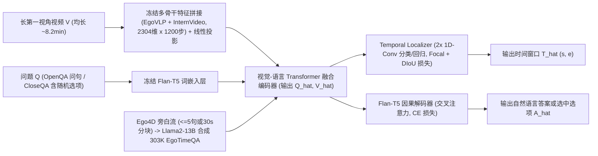

# Grounded Question-Answering in Long Egocentric Videos

**Grounded Question-Answering in Long Egocentric Videos（GroundVQA）**（CVPR 2024 / arXiv:2312.06505v4，上海交通大学 CMIC & 上海人工智能实验室）收录于 [Awesome Egocentric Vision](https://github.com/sun254667/awesome-egocentric-vision) **第 142/249** 篇，分组 **293 Procedural Question Answering**。本页基于论文全文完成结构化精读与核实（注：部分外部索引链接曾误标注姓氏，论文实际作者为 Shangzhe Di 与 Weidi Xie）。

## 一句话定义

**GroundVQA** 是一个面向长程第一视角情景记忆视频（均长 ~8.2 分钟）的统一多任务模型，将自然语言**时间窗口定位（VLG）**与**自由/多选回答（OpenQA / CloseQA）**联合训练以消除级联误差，并配套提出了 LLM 自动合成的 303K 预训练数据集 **EgoTimeQA** 与闭集评测集 **QAEgo4D_Close**。

## 英文缩写速查

| 缩写 | 英文全称 | 简要说明 |
|------|----------|----------|
| VLG | Video Language Grounding | 视频语言定位，根据自然语言提问预测对应起始与结束时间窗 $(s, e)$ |
| OpenQA | Open-ended Question Answering | 开放式问答，由语言解码器自回归生成自由文本答案 |
| CloseQA | Close-ended Question Answering | 闭集多选问答，从 1 个真值与 3 个高混淆干扰项中选择正确答案，规避词面改写评估歧义 |
| NLQ | Natural Language Query | Ego4D 中的情景记忆自然语言时间定位基准（本研究采用 NLQv2） |
| DIoU | Distance-IoU Loss | 距离交并比损失，与二分类 Focal Loss 联合用于回归精确时间区间边界 |

## 为什么重要

- **揭示“盲答”与“先定位后回答”的瓶颈**：在长达数分钟至十余分钟的第一视角视频中，忽略时序定位直接问答仅略好于纯文本盲猜（BlindVQA）；而分两阶段独立训练“定位器 + QA 模型”会导致定位偏差在下游无法修正、出现显著误差累积。统一联合训练可让时序监督反哺视觉–语言编码器聚焦关键片段，并赋予模型可解释的错误归因能力。
- **低成本突破长视频 QA 标注瓶颈**：人工标注 $(Q, A, T)$ 三元组极度昂贵（QAEgo4D 仅约 11K 训练样本导致严重过拟合）；利用开源 **Llama2-13B** 将 Ego4D 密集时间戳旁白批量转为 **303K** 样本的 **EgoTimeQA**（A100 上每小时生成 20K QA，总算力仅 16 GPU 小时），把数据规模扩大近 **30 倍**。
- **修正短答案自动指标失真**：QAEgo4D 中约 80% 答案不足 3 词，BLEU/ROUGE 极易惩罚同义改写（如 `"in the fridge"` vs `"inside the refrigerator"`）；论文引入句向量相似度（Sentence Similarity）与经盲测过滤的 **QAEgo4D_Close** 建立更可靠的评测标尺。

## 核心信息

| 字段 | 内容 |
|------|------|
| 编号 | 142/249（Awesome Egocentric Vision） |
| 分组 | 293 Procedural Question Answering |
| 出处 | CVPR 2024（arXiv:2312.06505v4，2024-04-01） |
| 作者与机构 | Shangzhe Di, Weidi Xie（CMIC, Shanghai Jiao Tong University; Shanghai AI Lab） |
| 模型规格 | 视觉特征：`EgoVLP + InternVideo-text + InternVideo-verb` 拼接（2304 维，采样 1,200 步）；LM 底座：`Flan-T5-Small / Base`（252M 总参数） |
| 数据规模 | **EgoTimeQA**：5,389 段视频、**303K** 样本；**QAEgo4D_Close**：148 段视频、**500** 题人工核验闭集测试集 |
| 论文与源码 | <https://arxiv.org/abs/2312.06505> · <https://github.com/Becomebright/GroundVQA> |

## 核心机制

1. **统一编码–双头解码多任务架构（GroundVQA）**
   - **特征编码与融合**：对长视频提取冻结的 `EgoVLP + InternVideo-text + InternVideo-verb` 2304 维特征，线性投影为 $V'$；文本查询（OpenQA 为问句，CloseQA 附加打乱顺序的 4 个候选答案）经冻结 Flan-T5 词嵌入层编码为 $Q'$；二者送入多层 Transformer 视觉–语言融合编码器 $\psi_{vl}(Q', V') \to [\hat{Q}, \hat{V}]$。
   - **时序定位头（Temporal Localizer）**：接在更新后的视频特征 $\hat{V}$ 之上，借鉴 ActionFormer（去掉多尺度金字塔），采用两层 1D Conv + LN + ReLU 构成的分类头（Focal Loss）与边界回归头（DIoU Loss）预测时间窗 $\hat{T}=(s, e)$，联合时序抖动（temporal jittering）增强。
   - **因果语言解码器（LM Decoder）**：基于 Flan-T5 解码器对 $[\hat{Q}, \hat{V}]$ 做交叉注意力自回归生成答案（交叉熵损失 $L_{\text{QA}}$）。总损失 $L = 0.5 L_{\text{VLG}} + 0.5 L_{\text{QA}}$，且可灵活冻结任一分支做单任务迁移微调。
2. **基于旁白的自动化 QA 合成管线（EgoTimeQA）**
   - **时间窗估算**：利用 Ego4Dv2 旁白密度（平均每分钟 13.2 句、每句 7.4 词），按相邻旁白间隔 $\beta_i / (2\alpha)$ 为每条旁白估算起止区间。
   - **OpenQA 合成**：将按时间排序的旁白切分为“最多 5 句或最长 30 秒”的语义块并合并时间窗，提示 **Llama2-13B-chat**（3-shot 示例）生成 $(Q, A, T)$ 三元组（约 20K 对/小时），共得 303K 样本。
   - **CloseQA 干扰项合成与盲测去偏**：继续提示 Llama2-13B 生成 3 个似是而非的干扰选项（约 40K 条/小时）；为避免模型仅靠语言先验蒙对，测试集先用无视觉输入的盲测模型以 10 个不同随机种子过滤“无需看视频即可稳定答对”的样本，再经人工审查错误答案或错位时间窗，最终保留 **500** 题 **QAEgo4D_Close**。

### 方法流程图

## 评测与指标

以下指标均来自原文表格：

### 1. QAEgo4D 与 QAEgo4D_Close 测试集对比（原文 Table 5）

| 方法 | 参数量 (M) | OpenQA Sim. ↑ | OpenQA ROUGE ↑ | OpenQA METEOR ↑ | CloseQA Accuracy (%) ↑ |
|------|------------|---------------|----------------|-----------------|------------------------|
| `BlindVQA*`（纯文本无视频下界） | 247 | 53.8 | 27.5 | 18.4 | 36.3±0.5 |
| `SimpleVQA*`（特征拼接无融合/定位） | 249 | 55.7 | 28.6 | 19.3 | 41.1±0.5 |
| `SimpleVQA+*`（交叉注意力排序监督） | 249 | 55.7 | 28.8 | 19.5 | 41.4±0.3 |
| `RM*`（Rehearsal Memory 压缩） | 368 | 54.1 | 27.3 | 18.5 | 39.9±0.8 |
| **`GroundVQA_B` (Ours, Flan-T5-Base)** | **252** | **58.2** | **30.4** | **21.5** | **50.2±0.5** |

### 2. Ego4D-NLQv2 测试集时序定位对比（原文 Table 6）

| 方法 | Recall@1 (IoU=0.3) ↑ | Recall@1 (IoU=0.5) ↑ | Mean R@1 ↑ | Recall@5 (IoU=0.3) ↑ | Recall@5 (IoU=0.5) ↑ |
|------|----------------------|----------------------|------------|----------------------|----------------------|
| `VSLNet` | 5.42 | 2.75 | 4.08 | 8.79 | 5.07 |
| `EgoVLP` | 10.46 | 6.24 | 8.35 | 16.76 | 11.29 |
| `NaQ++` | 21.70 | 13.64 | 17.67 | 25.12 | 16.33 |
| `GroundNLQ` | 24.50 | 17.31 | 20.91 | **40.46** | **29.17** |
| **`GroundVQA_B`**（三任务联合训练） | 23.65 | 14.96 | 19.31 | 36.19 | 24.58 |
| **`GroundVQA†_B`**（NLQv2+NaQ 预训练微调） | **26.67** | **17.63** | **22.15** | 39.94 | 27.70 |

### 3. 核心消融验证（原文 Tables 2–4 & 附录 Table 7）

- **统一训练 vs 两阶段分离（Table 3，`GroundVQA_S`）**：统一训练在加或不加 EgoTimeQA 时均胜过先定位再裁剪片段回答的两阶段管线（加 EgoTimeQA 后：OpenQA Sim **57.7** vs 56.0，ROUGE **30.2** vs 28.3，CloseQA **48.7±0.4%** vs 46.4±0.7%）。
- **EgoTimeQA 缩放效应（Table 2 & Table 4）**：加入 EgoTimeQA 后，`GroundVQA_S` CloseQA 准确率从 40.8% 跃升至 **48.7%**（逼近直接使用真值时间窗的 Oracle 上界 **53.5%**）；NLQv2 val 集 VLG Mean R@1 从 8.8 提至 **18.4**（叠加密集 NLQv2+NaQ 后进一步升至 **20.9**）。
- **Llama2-13B vs ChatGPT-3.5 造数据（附录 Table 7）**：同等 NLQv2 旁白下，开源 Llama2-13B 生成的数据（103K）微调效果略优于闭源 ChatGPT-3.5（107K）（Sim **57.1** vs 56.9，Mean R@1 **16.3** vs 15.7），且仅需 5 A100 GPU 小时。

## 与其他工作对比

- **对比隐式交叉注意力定位（SimpleVQA+）**：SimpleVQA+ 试图直接用 VLG 监督约束 LM 解码器的交叉注意力权重，结果反而拖累 QA 指标（Table 2：G→I 与 H→J 均下降），且无法显式输出时间戳；GroundVQA 将融合放在编码器并设置显式卷积定位头，定位与问答互促提升。
- **对比专有两阶段定位器（GroundNLQ、NaQ++）**：GroundVQA 无需多尺度特征金字塔或复杂双阶段流水线即可在 NLQv2 上取得超越 GroundNLQ 的 Mean R@1（**22.15** vs 20.91），同时原生具备问答能力。
- **对比其后续多跳扩展工作**：GroundVQA 与 QAEgo4D 均假设“每个问题仅对应**单个**连续时间窗口”，其后续工作 [Grounded Multi-Hop VideoQA (GeLM)](paper-sa-ego-141-grounded-multi-hop-videoqa-in-long-form-egocentr.md) 进一步把该范式推广至跨多个离散时间片段的多跳推理。更多对比见 [Awesome Egocentric Vision 技术地图](../overview/sun-awesome-ego-technology-map.md)。

## 常见误区或局限

1. **单时间窗假设限制（附录 E）**：QAEgo4D、Ego4D-NLQ 以及 GroundVQA 本身均默认每个问题仅关联**单一**连续时间区间；遇到需要跨多个非连续时刻收集证据的问题（例如多次打开冰箱），单窗口定位会丢失其余相关片段。
2. **离线全视频抽帧特征，不支持真流式在线推理**：输入依赖对整段 ~8.2 分钟视频预先提取冻结的 EgoVLP/InternVideo 特征并均匀采样 1,200 个时间步，计算开销较大且不具备增量流式记忆更新能力。
3. **细粒度小物体识别与跨帧计数仍薄弱（附录 C & E）**：案例分析（如 Fig. 8a/10a）表明即使定位完全正确（IoU=47%–57%），模型仍易混淆微小物体（如帐篷杆误判为黑线）并在连续帧物体计数（如从盒中拿了几个保险丝座）上出错；LLM 合成的 EgoTimeQA 亦不可避免带有部分旁白噪声与偏差。

## 结论

**GroundVQA 证实了“编码器级多模态融合 + 显式时序定位头 + LLM 旁白自动化数据合成”是解决长程第一视角情景记忆问答与防过拟合的有效基线范式。**

- 做长视频接地问答时，优先采用**编码器融合 + 独立时序定位头**联合训练，避免“先定位再裁剪送入 QA”的级联掉点，也避免把定位重担直接压在自回归解码器的交叉注意力上。
- 当人工标注长视频三元组不足（万条量级易过拟合）时，可利用时间密集旁白配合中等规模开源 LLM（如 Llama2-13B）低成本批产 10–30 倍规模的预训练问答对。
- 评估开放式短答案 QA 时，切忌只看 BLEU/ROUGE，应结合**句向量语义相似度**与**经过纯文本盲测去偏的多选闭集测试集**以获得真实视觉理解信号；若需处理多时段分散证据，请进一步衔接多跳架构 GeLM。

## 关联页面

- 列表实体：[Awesome Egocentric Vision](../entities/awesome-egocentric-vision.md)
- 技术地图：[Awesome Egocentric Vision 技术地图](../overview/sun-awesome-ego-technology-map.md)
- 方法/任务：[vla.md](../methods/vla.md)、[imitation-learning.md](../methods/imitation-learning.md)、[manipulation.md](../tasks/manipulation.md)、[teleoperation.md](../tasks/teleoperation.md)

## 参考来源

- [`sources/papers/sun_awesome_ego_noarxiv_142_grounded-question-answering-in-long-egoc.md`](../../sources/papers/sun_awesome_ego_noarxiv_142_grounded-question-answering-in-long-egoc.md) — 本条目策展摘录
- [`sources/papers/sun_awesome_ego_catalog.md`](../../sources/papers/sun_awesome_ego_catalog.md) — 列表总表
- [`sources/repos/awesome-egocentric-vision.md`](../../sources/repos/awesome-egocentric-vision.md)
- 论文：<https://openaccess.thecvf.com/content_CVPR2024/html/Wang_Grounded_Question-Answering_in_Long_Egocentric_Videos_CVPR_2024_paper.html>

## 推荐继续阅读

- [Awesome Egocentric Vision 仓库](https://github.com/sun254667/awesome-egocentric-vision)
- [arXiv:2312.06505 原文 PDF](https://arxiv.org/pdf/2312.06505)
- [GroundVQA 官方开源代码与 EgoTimeQA 数据集](https://github.com/Becomebright/GroundVQA)
