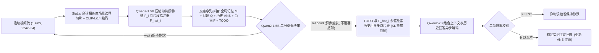

# Dispider

**Dispider: Enabling Video LLMs with Active Real-Time Interaction via Disentangled Perception, Decision, and Reaction**（CVPR 2025 / arXiv:2501.03218v1，香港中文大学 & 上海人工智能实验室）收录于 [Awesome Egocentric Vision](https://github.com/sun254667/awesome-egocentric-vision) **第 146/249** 篇，分组 **294 Real-time Streaming & Proactive Interaction**。本页基于论文全文完成结构化精读与核实。

## 一句话定义

**Dispider** 是一种将连续视觉**感知（Perception）**、主动触发**决策（Decision）**与细粒度对话**反应（Reaction）**解耦并异步执行的流式视频大模型系统，使模型在生成回复的同时不中断地监控长视频流并实现跨时段主动多跳交互。

## 英文缩写速查

| 缩写 | 英文全称 | 简要说明 |
|------|----------|----------|
| Video-LLM | Video Large Language Model | 面向视频理解与多模态对话的大语言模型 |
| PO | Proactive Output | StreamingBench 中评测模型主动把握时机输出回复的任务（无需每次显式追问） |
| TVG / TAL | Temporal Video Grounding / Temporal Action Localization | 时序视频定位 / 时序动作定位，评测精准起止时间戳预测（ETBench 核心子任务） |
| DVC / SLC | Dense Video Captioning / Step Localization and Captioning | 密集视频描述 / 步骤定位与描述，同时评测时间定位与语义生成 |
| EPM / VHD | Episodic Memory / Video Highlight Detection | 情景记忆检索 / 视频高光片段检测（ETBench 时间敏感子任务） |

## 为什么重要

- **破解单 LLM 流式交互的“阻塞悖论”**：以 VideoLLM-online 为代表的单模型方案受限于自回归逐 token 解码机制，在输出回答时必须暂停接收后续视频帧，且决策（需要高时序粒度）与反应（需要高空间细节与多跳检索）在感知尺度上存在天然冲突；Dispider 通过异步三模块解耦彻底消除了反应阶段对实时感知与决策的阻塞。
- **在主动响应与常规长视频理解间取得双赢**：在 StreamingBench 主动输出（**PO**）上拿到 **25.34**（同期在线模型 VideoLLM-online 仅 3.92，Flash-VStream 仅 1.96），同时在传统离线基准 **EgoSchema** 取得 **55.6%**、**MLVU** 取得 **61.7%**、**VideoMME (w/o subs)** 取得 **57.2%**。

## 核心信息

| 字段 | 内容 |
|------|------|
| 编号 | 146/249（Awesome Egocentric Vision） |
| 分组 | 294 Real-time Streaming & Proactive Interaction |
| 出处 | CVPR 2025（arXiv:2501.03218v1，2025-01-06） |
| 作者与机构 | Rui Qian*, Shuangrui Ding*, Xiaoyi Dong, Pan Zhang, Yuhang Zang, Yuhang Cao, Dahua Lin, Jiaqi Wang（CUHK, Shanghai AI Laboratory） |
| 核心模型配置 | 场景检测 `SigLip` + 视觉编码 `CLIP-L/14`（$224\times 224$）+ 轻量决策器 `Qwen2-1.5B` + 异步交互器 `Qwen2-7B` |
| 论文与项目/源码 | <https://dispider.github.io/> · <https://arxiv.org/abs/2501.03218> · <https://github.com/Mark12Ding/Dispider> |

## 核心机制

1. **基于场景的非均匀感知模块（Scene-based Perception）**
   - 按固定频率（如 1 FPS）采样帧，先利用预训练 **SigLip** 提取 L2 归一化帧特征并计算相邻特征余弦相似度来检测显著视觉变化，结合边界排除窗口避免切片过碎，将连续视频流动态切分为非均匀语义片段 $v_i$。
   - 视频帧缩放至 $224\times 224$ 经 **CLIP-L/14** 提取帧特征后，拼接相邻 token 并交由轻量 LLM（**Qwen2-1.5B**）压缩为时间感知的片段级表示 $F_i$ 及专用片段指示器 $\hat{F}_i$。
2. **实时非阻塞响应决策模块（Real-Time Response Decision）**
   - 复用 **Qwen2-1.5B** 构建历史全局池化记忆 $M$、用户问题 $Q$、过往决策锚点标记 $\langle\text{ANS}\rangle$、当前新片段特征 $F$ 及结尾待判标记 $\langle\text{TODO}\rangle$ 的交错输入序列：$M[0:q_{\text{pos}}] \oplus Q \oplus M[q_{\text{pos}}:a^1_{\text{pos}}] \oplus \langle\text{ANS}\rangle \oplus \dots \oplus F[a^k_{\text{pos}}:] \oplus \langle\text{TODO}\rangle$。
   - **关键非阻塞设计**：序列中**不包含**反应模块生成出来的自然语言文本 token，仅以 $\langle\text{ANS}\rangle$ 记录曾经触发回答的时间戳；在 $\langle\text{TODO}\rangle$ 最后一层特征上接入二分类头（交叉熵/BCE 损失监督），实时判定 `wait` 或 `respond`。
3. **异步精细交互与多跳线索检索（Asynchronous Reaction）**
   - 当决策触发后，**Qwen2-7B** 在异步线程启动生成，不影响前端持续切片与决策。
   - 为支持跨时段多跳推理，计算当前 $\langle\text{TODO}\rangle$ 嵌入与各历史片段指示器 $\hat{F}_i$ 的余弦相似度，经 Softmax 得到预测分布 $\hat{P}_{\text{pred}}$，并用真值相关片段集合 $R_Q$ 的均匀分布 $\hat{P}_{\text{true}}$ 计算 **KL 散度损失** $\mathcal{L}_{\text{KL}}$ 监督精准召回。
   - 训练中同时混入无需回复的负样本，使 Qwen2-7B 学会输出特殊标记 $\langle\text{SILENT}\rangle$，在决策模块误触发时充当**二次静默过滤器**。
4. **两阶段训练配方**
   - **Stage 1**：联合 **GroundVQA**、时间增强的 **ET-Instruct** 及 **50K** 条带时间标签的隐式 QA 对，训练流式视频处理器与决策模块；
   - **Stage 2**：冻结视觉编码器与 Qwen2-1.5B，使用从 ET-Instruct、VideoChatGPT 与 LLaVA-Next-Video 构造的 **122K** 流式 QA 对微调 Qwen2-7B 反应模块（支持指令置于任意时间戳以适配流式主动提问）。

### 方法流程图

## 评测与指标

以下指标均来自原文表格：

### 1. StreamingBench 流式交互基准（原文 Table 1，7B，1 fps）

| 模型 | 类型 | Real-Time Visual Avg ↑ | Omni-Source Avg ↑ | Contextual Avg ↑ | 主动输出 PO ↑ | Overall All ↑ |
|------|------|------------------------|-------------------|------------------|---------------|---------------|
| `Human` | 人类基准 | 91.46 | 90.26 | 93.55 | 100 | 91.66 |
| `Gemini 1.5 Pro` (1 fps) | 闭源离线 | 75.69 | 60.22 | 48.73 | 45.10 | 67.07 |
| `GPT-4o` (64 帧) | 闭源离线 | 73.28 | 44.50 | 38.70 | 56.86 | 60.15 |
| `Flash-VStream` (7B) | 开源流式 | 23.23 | 26.00 | 24.12 | 1.96 | 24.04 |
| `VideoLLM-online` (8B, 2 fps) | 开源流式 | 35.99 | 28.45 | 26.55 | 3.92 | 32.48 |
| **Dispider (Ours, 7B)** | **开源解耦流式** | **67.63** | **35.66** | **33.61** | **25.34** | **53.12** |

### 2. 传统长视频 QA 基准对比（原文 Table 2，准确率 %）

| 模型 | LLM 规模 | 采样帧数 | EgoSchema ↑ | MLVU ↑ | VideoMME (w/o subs) ↑ |
|------|----------|----------|-------------|--------|-----------------------|
| `TimeChat` | 7B | 96 | 33.0 | 30.9 | 30.2 |
| `MovieChat` | 7B | 2048 | 53.5 | 25.8 | 38.2 |
| `LongVA` | 7B | 128 | 51.7 | 56.3 | 52.6 |
| `Kangaroo` | 8B | 64 | – | 61.0 | 56.0 |
| `VideoXL` | 7B | 128 | 54.4 | **64.9** | 55.5 |
| **Dispider (Ours)** | **7B** | **1 FPS** | **55.6** | 61.7 | **57.2** |

### 3. ETBench 时间敏感子集对比（4,460 视频，原文 Table 3）

| 推理模式 | 模型 | 帧率/帧数 | TVG $F_1$ ↑ | EPM $F_1$ ↑ | TAL $F_1$ ↑ | VHD $F_1$ ↑ | DVC $F_1$ / Sim ↑ | SLC $F_1$ / Sim ↑ |
|----------|------|-----------|-------------|-------------|-------------|-------------|-------------------|-------------------|
| 传统离线 | `ETChat` (含时间 token) | 1 FPS | **38.6** | 10.2 | **30.8** | **62.5** | 38.4 / **19.7** | **24.4** / **14.6** |
| 传统离线 | `TimeChat` (无时间 token) | 96 | 16.6 | 12.5 | 14.1 | 11.7 | 31.6 / 17.8 | 14.1 / 11.7 |
| 传统离线 | **Dispider (Ours)** | 1 FPS | 36.1 | **15.5** | 27.3 | 54.2 | 33.8 / 18.9 | 18.8 / 12.4 |
| 流式（问题前置） | `VideoLLM-Online` | 2 FPS | 13.2 | 3.8 | 9.1 | 22.4 | 24.0 / 13.4 | 9.9 / 10.1 |
| 流式（问题前置） | **Dispider (Ours)** | 1 FPS | **36.1** | **15.5** | **27.3** | **54.2** | **33.8** / **18.9** | **18.8** / **12.4** |

### 4. 消融实验（原文 Table 4 & Table 5）

- **切片策略（Table 4）**：相比均匀 16 帧切分，**SigLip 场景非均匀切片**在 MLVU（59.8 → **61.7**）、VideoMME（55.4 → **57.2**）、流式 TVG $F_1$（34.5 → **36.1**）与 DVC $F_1$（33.1 → **33.8**）上全面领先。
- **特殊标记消融（Table 5，流式 ETBench）**：全关（无 $\langle\text{ANS}\rangle$/$\langle\text{TODO}\rangle$/$\langle\text{SILENT}\rangle$）TVG $F_1$ 仅 20.1 / DVC $F_1$ 19.7；缺 $\langle\text{ANS}\rangle$ 时模型无法感知已回答时刻导致频繁重复回复（TVG $F_1$ 28.7 / DVC $F_1$ 25.6）；缺 $\langle\text{SILENT}\rangle$ 时误触发无法抑制（DVC $F_1$ 从 33.8 降至 30.2）；三者全开取得最优 **36.1 / 33.8 / 18.9**。

## 与其他工作对比

- **对比单模型流式解码（VideoLLM-online）**：VideoLLM-online 依赖单 LLM 交替进行视觉吸收与文本解码，生成期间会丢失流式响应并难以主动把握回复时机（StreamingBench PO 仅 3.92，ETBench 流式 TVG $F_1$ 仅 13.2）；Dispider 通过 1.5B 决策器 + 7B 异步反应器的非阻塞架构将二者分别提升至 **25.34** 与 **36.1**。
- **对比记忆型流式框架（Flash-VStream、VideoStream）**：早期 Flash-VStream 仅针对长上下文压缩而未训练主动交互触发，导致 StreamingBench PO 仅 1.96、Overall 24.04；Dispider 显式优化决策触发与异步响应，实现真正的“多跳主动流式对话”。更多同组对比见 [Awesome Egocentric Vision 技术地图](../overview/sun-awesome-ego-technology-map.md)。

## 常见误区或局限

1. **视觉输入分辨率与采样率受限（§4.1）**：目前前端默认在 **1 FPS** 与 **$224\times 224$** 分辨率下经 CLIP-L/14 编码，面向极细粒度文本阅读（StreamingBench `TR` 为 59.92，低于 Gemini 1.5 Pro 的 84.74）及瞬时高速动作感知存在信息损失。
2. **全向多源理解（Omni-Source）仍有明显差距（Table 1）**：StreamingBench 中涵盖语音/环境声与多模态对齐的 Omni-Source 平均仅 **35.66**（`SCU` 25.26、`ER` 35.46），主因架构目前聚焦视觉–文本流，缺乏原生的音频流融合通道。
3. **双 LLM 协同部署的显存与训练复杂度**：系统需同时维持 SigLip、CLIP-L/14、Qwen2-1.5B（常驻决策）与 Qwen2-7B（异步反应）四套组件及两阶段专项流式 QA 训练，无法像轻量插件式方案那样直接零改动挂载到任意既有离线 Video-LLM 上。

## 结论

**Dispider 通过“SigLip 场景切片 + Qwen2-1.5B 非阻塞决策 + Qwen2-7B 异步多跳反应”的解耦设计，验证了并行异步架构是解决流式视频大模型“边看边思考边回复”冲突的有效路径。**

- 在构建流式对话系统时，务必将**决策状态序列与长文本解码隔离**（Dispider 中决策器不读反应生成的文本 token，仅读 $\langle\text{ANS}\rangle$ 锚点），防止长回复阻塞视频流监控。
- 引入反应端的 **`<SILENT>` 二次拒答机制** 非常关键（DVC $F_1$ 提升 +3.6），能有效兜底轻量化决策头的误触发。
- 若业务对极低算力单模型插件有要求，可对比同样聚焦非侵入式解耦激活的 [StreamBridge](paper-sa-ego-150-streambridge-turning-your-offline-video-large-la.md)；若侧重显式记忆压缩与高分关键帧检索，可参考 [Flash-VStream](paper-sa-ego-147-flash-vstream-efficient-real-time-understanding.md)。

## 关联页面

- 列表实体：[Awesome Egocentric Vision](../entities/awesome-egocentric-vision.md)
- 技术地图：[Awesome Egocentric Vision 技术地图](../overview/sun-awesome-ego-technology-map.md)
- 方法/任务：[vla.md](../methods/vla.md)、[imitation-learning.md](../methods/imitation-learning.md)、[manipulation.md](../tasks/manipulation.md)、[teleoperation.md](../tasks/teleoperation.md)

## 参考来源

- [`sources/papers/sun_awesome_ego_noarxiv_146_dispider-enabling-video-llms-with-active.md`](../../sources/papers/sun_awesome_ego_noarxiv_146_dispider-enabling-video-llms-with-active.md) — 本条目策展摘录
- [`sources/papers/sun_awesome_ego_catalog.md`](../../sources/papers/sun_awesome_ego_catalog.md) — 列表总表
- [`sources/repos/awesome-egocentric-vision.md`](../../sources/repos/awesome-egocentric-vision.md)
- 论文：<https://dispider.github.io/>

## 推荐继续阅读

- [Awesome Egocentric Vision 仓库](https://github.com/sun254667/awesome-egocentric-vision)
- [Dispider 项目主页](https://dispider.github.io/)
- [Dispider 官方 GitHub 代码与模型](https://github.com/Mark12Ding/Dispider)
- [arXiv:2501.03218 原文 PDF](https://arxiv.org/pdf/2501.03218)
