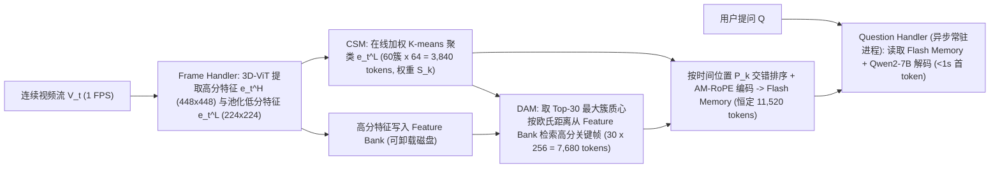

# Flash-VStream

**Flash-VStream: Efficient Real-Time Understanding for Long Video Streams**（ICCV 2025 / arXiv:2506.23825v2，清华大学、北京交通大学 & 字节跳动）收录于 [Awesome Egocentric Vision](https://github.com/sun254667/awesome-egocentric-vision) **第 147/249** 篇，分组 **294 Real-time Streaming & Proactive Interaction**。本页基于论文全文完成结构化精读与核实（注：原文首页标注官方代码仓库为 `https://github.com/IVGSZ/Flash-VStream`，旧版索引链接曾指向 `yydlm/Flash-VStream`）。

## 一句话定义

**Flash-VStream** 是一种面向超长视频流的**双进程异步实时视频语言模型**，通过将视觉流编码与问答解码解耦，并共享固定容量（11,520 tokens）的层次化 **Flash Memory**（上下文摘要记忆 CSM + 细节增强记忆 DAM），在任意视频长度下实现 **< 1 秒**首 token 响应与高精度理解。

## 英文缩写速查

| 缩写 | 英文全称 | 简要说明 |
|------|----------|----------|
| CSM | Context Synopsis Memory | 上下文摘要记忆，在线 K-means 聚类低分帧特征（$60\times 64=3,840$ tokens）以汇总长程时序与信息密度分布 |
| DAM | Detail Augmentation Memory | 细节增强记忆，从特征库检索最大 CSM 簇对应的高分关键帧（$30\times 256=7,680$ tokens）保留空间细节 |
| AM-RoPE | Adaptive Multimodal Rotary Position Embedding | 自适应多模态旋转位置编码，为聚簇摘要与高分关键帧分配时间序对齐的 3D 位置索引 |
| $N_{V\text{tokens}}$ | Number of Visual Tokens | 推理时输入 LLM 的视觉 token 总预算（7B 模型在单 A100 上实现 <1s 实时响应的临界上限为 12,000） |
| VLM / MLLM | Vision-Language Model / Multimodal LLM | 视觉–语言模型 / 多模态大语言模型（本文基于 `Qwen2-VL-7B` 初始化并 LoRA 微调） |

## 为什么重要

- **突破超长视频流推理的延迟与显存瓶颈**：作者在单张 A100 (BF16 + FlashAttention-2) 上实测表明，输入视觉 token 一旦超过 **12,000**（如 Qwen2-VL 的 24,576 或 LongVILA 的 50,176+），7B 模型首 token 响应延迟即突破 1 秒，无法满足实时人机/机器人交互要求；Flash-VStream 将在线视觉预算恒定锁定在 **11,520 tokens**，即便视频超过 1,000 帧也能稳定在 **< 1 秒**（约 0.65–0.90s）内应答。
- **仅用 9k 微调样本兼顾极高效率与顶级精度**：通过冻结视觉编码器并仅在 **9k** LLaVA-Video 子集上 LoRA 微调 1 个 epoch，在 **EgoSchema** 达到 **68.2%**、**Video-MME (w/o subs)** 达到 **61.2%**（节省 **53%** 视觉 token 的同时超越离线全量 Qwen2-VL），全面大幅领先同预算（11,520 tokens）在线基线 `Qwen2-VL-online†`。

## 核心信息

| 字段 | 内容 |
|------|------|
| 编号 | 147/249（Awesome Egocentric Vision） |
| 分组 | 294 Real-time Streaming & Proactive Interaction |
| 出处 | ICCV 2025（arXiv:2506.23825v2，2025-07-24） |
| 作者与机构 | Haoji Zhang*, Yiqin Wang*, Yansong Tang, Yong Liu, Jiashi Feng, Xiaojie Jin（清华大学、清华深圳国际研究生院、北京交通大学、字节跳动） |
| 模型配置 | 3D-ViT 视觉编码器 + Merger 投影层 + `Qwen2-7B`（初始化自 `Qwen2-VL-7B`），LoRA rank=64 / alpha=32，9k LLaVA-Video 微调 1 epoch |
| 记忆默认配比 | CSM：$N^{\text{CSM}}=60$ 簇（$224\times 224$，每帧 64 tokens = 3,840）；DAM：$N^{\text{DAM}}=30$ 关键帧（$448\times 448$，每帧 256 tokens = 7,680）；总计 **11,520 tokens** |
| 论文与官方代码 | <https://arxiv.org/abs/2506.23825> · <https://github.com/IVGSZ/Flash-VStream> · <https://github.com/yydlm/Flash-VStream> |

## 核心机制

1. **双进程异步解耦框架（Two-Process Asynchronous Framework）**
   - **Frame Handler（帧处理进程）**：按 1 FPS 持续读取视频流，对每帧 $V_t$ 分别提取高分辨率特征图 $e_t^H$（$448\times 448$，256 LLM tokens）与经过空间池化（$R_{\text{pool}}=4$，$224\times 224$，64 LLM tokens）的低分辨率特征图 $e_t^L$；持续更新共享的 **Flash Memory**，并将高分特征缓存至可卸载磁盘的 Feature Bank $E_t^H$。
   - **Question Handler（问答服务进程）**：常驻监听用户提问；一旦提问到达，直接零等待读取当前固定尺寸的 Flash Memory $M^F$ 并在 **< 1 秒**内解码输出首 token，完全不被前端编码耗时阻塞。
2. **Flash Memory 双层协同记忆模块**
   - **上下文摘要记忆（CSM）**：在特征空间中对低分辨率帧流执行在线加权 **K-means 聚类**（$K=N^{\text{CSM}}=60$），维护各簇质心 $M_k^{\text{CSM}}$ 及簇内帧数权重 $|S_k|$（隐式表征视频信息密度分布），以 1/3 token 预算压缩全局长时脉络。
   - **细节增强记忆（DAM）**：采用 **Feature-Centric Retrieval**（特征中心检索策略），选取权重 $|S_k|$ 排名前 $N^{\text{DAM}}=30$ 的最大聚类质心作为锚点，在低分空间按欧氏距离检索最邻近的关键帧索引 $f(k)$，并从 Feature Bank 调取对应帧的高分辨率特征 $e_{f(k)}^H$，以 2/3 token 预算补足 OCR 与细粒度空间感知。
3. **交错时序重组与自适应多模态位置编码（AM-RoPE）**
   - 将 CSM 与 DAM 按各自平均时间位置 $P_k^{\text{CSM}} = \frac{1}{|S_k|}\sum_{i\in S_k} i$ 与关键帧原始时刻 $P_k^{\text{DAM}} = f(k)$ 严格按时间顺序交错拼接：$M^F = \text{sort}(M^{\text{CSM}} \oplus M^{\text{DAM}})$。
   - **AM-RoPE** 将 3D 位置索引 $(n_t, n_h, n_w)$ 动态适配到压缩记忆上：CSM 使用平均时刻与原始空间坐标；DAM 对应空间坐标 $(x\times 2, y\times 2)$ 以匹配与低分图之间的 4 倍空间池化缩放比。

### 方法流程图

## 评测与指标

以下指标均来自原文表格（零样本多选评测，1 FPS）：

### 1. 五大主流长/综合视频基准对比（原文 Table 2 & Table 3）

| 模型 | 类型 | Max $N_{V\text{tokens}}$ | EgoSchema ↑ | MLVU dev ↑ | LVBench ↑ | MVBench ↑ | Video-MME (w/o subs) ↑ | Video-MME (w/ subs) ↑ |
|------|------|--------------------------|-------------|------------|-----------|-----------|------------------------|-----------------------|
| `MovieChat` | 离线 | 32 | 53.5 | – | 22.5 | – | 38.2 | – |
| `VideoLLaMA2` | 离线 | 9,216 | 51.7 | 48.5 | – | 54.6 | 47.9 | 50.3 |
| `LongVA` | 离线 | 18,432 | – | 56.3 | – | – | 52.6 | 54.3 |
| `LongVILA` | 离线 | 50,176 / 147,456 | 60.1 | – | – | – | 57.5 | 61.8 |
| `Kangaroo` | 离线 | 16,384 | 62.7 | 61.0 | 39.4 | – | 56.0 | 57.6 |
| `Qwen2-VL*`（官方复现） | 离线 | 24,576 | 64.8 | **66.0** | 41.4 | 65.1 | 61.1 | 65.9 |
| `Qwen2-VL-online†`（等预算限制） | 在线 | 11,520 | 64.0 | 62.9 | 39.8 | 63.3 | 59.4 | 65.1 |
| **Flash-VStream (Ours)** | **异步在线** | **11,520** | **68.2** (+4.2) | **66.3** (+3.4) | **42.0** (+2.2) | **65.4** (+2.1) | **61.2** (+1.8) | **67.0** (+1.9) |

> 注：在 Video-MME（无字幕）不同时长子集上（Table 3），Flash-VStream 的 Short / Middle / Long 分别为 **72.0 / 61.1 / 50.3**（有字幕为 **72.4 / 67.0 / 61.4**），以 **11,520** tokens（较 Qwen2-VL* 节省 **53%**）取得更优均分。

### 2. 核心消融与效率实验（原文 Tables 4–6, 8 & Figs. 4, 6）

- **CSM 与 DAM 组件消融（Table 4）**：全均匀采样（11,520 tokens）三基准均分仅 **62.3**；仅用 CSM（3,840 tokens）达 **63.6**；CSM + 均匀 DAM（11,520）达 **64.2**；完整 **CSM + Feature-Centric DAM** 达 **64.9**（EgoSchema 68.2 / MVBench 65.4 / Video-MME 61.2）。
- **CSM 聚类算法对比（Table 5，仅保留 CSM）**：`K-means`（EgoSchema **66.8** / MVBench **64.0** / Video-MME **60.1**）优于 `DBScan`（66.6 / 63.8 / 59.7）、`GMM`（65.8 / 59.6 / 59.5）、MovieChat 的 `Neighbor Merge`（65.0 / 63.7 / 59.4）与 `Uniform`（63.4 / 62.4 / 59.0）。
- **DAM 关键帧检索策略（Table 6）**：`Feature-Centric + Top-k largest`（68.2 / 65.4 / 61.2）优于 `Temporal-Centric`（67.8 / 64.4 / 60.8）、`Cosine Similarity`（66.5 / 64.1 / 60.2）与 `Top-k smallest`（67.6 / 63.9 / 59.6），且几乎追平保留全部 19,200 tokens 的上限（68.6 / 65.5 / 61.2）。
- **记忆预算配比（Fig. 4）**：固定总预算下，$R_{\text{CSM}} = S^{\text{CSM}}/(S^{\text{CSM}}+S^{\text{DAM}}) \approx 1/3$、池化比 $R_{\text{pool}}=4$ 达到 EgoSchema 与 MVBench 全局最优。
- **推理壁钟延迟（Fig. 6c）**：即使输入累计达 1,000 帧，Question Handler 响应仍稳定低于 **1s**；Frame Handler 在 1,000 帧时更新墙钟时间超 1s（会导致新帧入库略滞后，但不阻塞已有记忆上的提问应答）。

## 与其他工作对比

- **对比原生缓存压缩模型（MovieChat、ReKV、MC-ViT）**：MovieChat 采用无训练的相邻帧合并策略（Neighbor Merge），在长视频 EgoSchema 上落后 K-means 达 1.8%；Flash-VStream 以簇大小建模信息密度并二次按质心反查高分原帧，兼顾长程语义与空间细节。
- **对比同为主动流式交互模型（Dispider、StreamBridge）**：注意版本演进差异——早期版本的 Flash-VStream 未专门优化“无需提问时的主动说话触发时机（Proactive Output）”，因此在 StreamingBench PO（1.96）和 OVO-Bench 主动任务上显著低于后续专攻主动决策的 [Dispider](paper-sa-ego-146-dispider-enabling-video-llms-with-active-real-ti.md) 与 [StreamBridge](paper-sa-ego-150-streambridge-turning-your-offline-video-large-la.md)；Flash-VStream 的核心长板在于**极低首 token 延迟（<1s）的固定预算长流视觉记忆压缩**。更多对比见 [Awesome Egocentric Vision 技术地图](../overview/sun-awesome-ego-technology-map.md)。

## 常见误区或局限

1. **高密度文字编辑视频与镜头剧烈切换视频掉点（附录 F.1）**：失败案例分析（Figs. 13–14）指出，在密集文字演示或快速剪辑跳切的长视频中，K-means 基于出现频次簇大小的假设会低估短暂闪现的关键字幕/画面，导致漏检。
2. **被动问答响应而非主动发言触发**：Flash-VStream 的“实时”定义为收到用户问题后 **< 1 秒**内开始回答（被动 QA 低延迟）；它本身不包含独立的 `<ACT>` 或 `<TODO>` 主动触发头，因此在需要模型自主判断何时打断/说话的任务（如 StreamingBench PO）中需要外接决策模块。
3. **1,000+ 帧后视觉更新存在轻微滞后及外部 Feature Bank 磁盘开销（Fig. 6c & §3.3）**：虽然提问响应始终 <1s，但 Frame Handler 每帧需增量重聚类与磁盘检索，超 1,000 帧后单步记忆更新耗时突破 1 秒，且保留全量历史高分辨率特征依赖于可卸载磁盘存储。

## 结论

**Flash-VStream 通过“双进程异步架构 + CSM 全局聚类摘要（1/3）与 DAM 质心反查高分细节（2/3）”，成功在单卡 12k token 实时延迟红线内跑出了超越全量离线模型的长视频理解精度。**

- 在端侧/单卡部署长视频实时问答系统时，可将 **12,000 tokens** 作为 7B 模型维持 1s 响应的显存–算力警戒线，并通过 **CSM（1/3）+ DAM（2/3）** 的层次化双记忆分配替代简单均匀抽帧。
- 若业务场景偏向**自然长镜头**（如第一视角日常、机器人巡检、监控），`K-means` 聚类 + `Top-k largest` 欧氏距离特征中心检索可接近全帧上限；若面对**高频剪辑/密集 PPT 字幕视频**，则需避免单纯按簇大小分配高分名额，应辅以帧差突变或 OCR 显著性触发。
- 若还需模型“未问先答”的主动交互能力，可将 Flash-VStream 的 Flash Memory 作为视觉前端，与 [Dispider](paper-sa-ego-146-dispider-enabling-video-llms-with-active-real-ti.md) 或 [StreamBridge](paper-sa-ego-150-streambridge-turning-your-offline-video-large-la.md) 的轻量级主动激活器组合使用。

## 关联页面

- 列表实体：[Awesome Egocentric Vision](../entities/awesome-egocentric-vision.md)
- 技术地图：[Awesome Egocentric Vision 技术地图](../overview/sun-awesome-ego-technology-map.md)
- 方法/任务：[vla.md](../methods/vla.md)、[imitation-learning.md](../methods/imitation-learning.md)、[manipulation.md](../tasks/manipulation.md)、[teleoperation.md](../tasks/teleoperation.md)

## 参考来源

- [`sources/papers/sun_awesome_ego_noarxiv_147_flash-vstream-efficient-real-time-unders.md`](../../sources/papers/sun_awesome_ego_noarxiv_147_flash-vstream-efficient-real-time-unders.md) — 本条目策展摘录
- [`sources/papers/sun_awesome_ego_catalog.md`](../../sources/papers/sun_awesome_ego_catalog.md) — 列表总表
- [`sources/repos/awesome-egocentric-vision.md`](../../sources/repos/awesome-egocentric-vision.md)
- 论文：<https://github.com/yydlm/Flash-VStream>

## 推荐继续阅读

- [Awesome Egocentric Vision 仓库](https://github.com/sun254667/awesome-egocentric-vision)
- [Flash-VStream 官方仓库（原文链接）](https://github.com/IVGSZ/Flash-VStream)
- [arXiv:2506.23825 原文 PDF](https://arxiv.org/pdf/2506.23825)
- [索引原仓库入口](https://github.com/yydlm/Flash-VStream)
