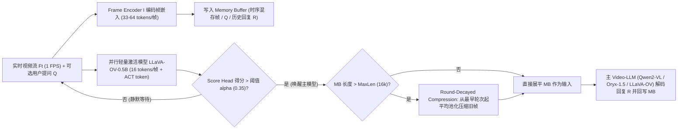

# StreamBridge

**StreamBridge: Turning Your Offline Video Large Language Model into a Proactive Streaming Assistant**（NeurIPS 2025 / arXiv:2505.05467v2，Apple & 复旦大学）收录于 [Awesome Egocentric Vision](https://github.com/sun254667/awesome-egocentric-vision) **第 150/249** 篇，分组 **294 Real-time Streaming & Proactive Interaction**。本页基于论文全文完成结构化精读与核实。

## 一句话定义

**StreamBridge** 是一种无需从头重训流式底座即可将预训练离线视频大模型（Video-LLM）转化为实时多轮且具备主动响应能力的流式助手的通用框架，核心由**轮次衰减记忆压缩缓冲器**、**即插即用解耦激活模型**以及交错指令集 **Stream-IT** 组成。

## 英文缩写速查

| 缩写 | 英文全称 | 简要说明 |
|------|----------|----------|
| Video-LLM | Video Large Language Model | 面向视频理解的大语言模型，通常包括视觉编码器、投影器与 LLM 底座 |
| MB | Memory Buffer | 生产者–消费者模式的流式记忆缓冲器，按时序追加帧嵌入、用户提问与历史回复 |
| ACT | Activation Model | 并行挂载的轻量外部多模态激活模型（默认 LLaVA-OV-0.5B），输出是否唤醒主模型的二值信号 |
| OOM | Out of Memory | 显存溢出；不压缩缓冲器在长视频流（如 2,048 帧）下会触发 OOM |
| DVC / SLC | Dense Video Captioning / Sequential Localization Captioning | ET-Bench 中用于评测主动触发时机与生成质量的流式子任务 |

## 为什么重要

- **保底通用能力，拒绝“专才退化”**：从头训练的流式模型（如 VideoLLM-online、早期 Flash-VStream）往往在常规离线基准和世界知识上明显退化；StreamBridge 复用成熟离线 Video-LLM（Qwen2-VL-7B、Oryx-1.5-7B、LLaVA-OV-7B）并完全解耦激活头，在实现流式领先的同时，在 VideoMME 等 7 个离线基准上保持持平甚至高达 **+6.7%–+10.2%** 的提升。
- **纠正流式基准的“伪流式”简化评测**：作者指出 OVO-Bench 与 Streaming-Bench 原先对离线模型采用“按每轮提问单独切片段、丢弃对话历史”的单轮离线折中评测；StreamBridge 以真正连续 **1 FPS 多轮流式**方式跑通评测，且改造后的 `Qwen2-VL-7B` 实时任务均分在 OVO-Bench（**71.30**）与 Streaming-Bench（**77.04**）上双双超越闭源旗舰 **GPT-4o** 与 **Gemini 1.5 Pro**。

## 核心信息

| 字段 | 内容 |
|------|------|
| 编号 | 150/249（Awesome Egocentric Vision） |
| 分组 | 294 Real-time Streaming & Proactive Interaction |
| 出处 | NeurIPS 2025（arXiv:2505.05467v2，2025-09-18） |
| 作者与机构 | Haibo Wang, Bo Feng, Zhengfeng Lai, Mingze Xu, Shiyu Li, Weifeng Ge, Afshin Dehghan, Meng Cao, Ping Huang（Apple, Fudan University） |
| 适配底座与激活器 | 主模型：`Qwen2-VL-7B` / `Oryx-1.5-7B` / `LLaVA-OV-7B`；激活模型：`LLaVA-OV-0.5B`（16 tokens/frame） |
| 数据集规模 | **Stream-IT**（含自建 **StreamingQA-120K** + 公开 DVC ~54k / Step ~22k / Grounded VQA ~69k）+ ~600K 离线通用数据 |
| 论文与项目页 | <https://streambridge-vlm.github.io/> · <https://arxiv.org/abs/2505.05467> |

## 核心机制

1. **生产者–消费者记忆缓冲与轮次衰减压缩（Memory Buffer & Round-Decayed Compression）**
   - **流式缓冲 `MB`**：帧编码器 $I(\cdot)$ 作为生产者按 **1 FPS** 持续编码新帧并写入 `MB`（经 $\times 4$ 下采样每帧约 33–64 tokens），同时按时间顺序混存用户提问 $Q$ 与主 LLM 生成的历史回答 $R$，形成完整跨轮次视频–文本交错序列。
   - **轮次衰减压缩 `COM(·)`**：每次触发主 LLM 生成前，若序列总长度超过预算 `MaxLen`（默认 **16,384** tokens），`COM(·)` **优先从最早的对话轮次开始**，对历史轮次的视觉 token 逐帧执行相邻平均池化（Average Pooling）合并，从而在保持近常数显存与推理延迟（避免 2,048 帧 OOM）的同时，几乎无损保留最新对话与最近帧的高保真细节。
2. **非侵入式即插即用激活模型（Plug-and-Play Activation Model）**
   - 不在主 Video-LLM 内部增加流式分类头或修改词表（规避概率修正问题与语言能力优化冲突），而是并行运行一个轻量外部 MLLM **ACT(·)**（`LLaVA-OV-0.5B`，视觉 token 激进池化为 **16 tokens/frame**，仅用 LoRA + 投影层 + 打分头微调 5 个 epoch）。
   - 将语言头替换为二分类 **Score Head**，每帧后附加可学习 `<ACT>` token；训练时基于约 **180k** 个跨 5 类任务（DVC、Step Recognition、Temporal Action Detection、Grounded VQA、TVG）样本，将每段目标事件末尾动态采样的 $P\%$（$0\%\text{--}50\%$）帧设为正样本，其余为静默负样本；推理时仅当得分高于阈值 $\alpha$（默认 **0.35**）才唤醒主 Video-LLM 解码。
3. **Stream-IT 与 StreamingQA-120K 交错指令数据构造**
   - 将 ActivityNet、YouCook2、EgoTimeQA、QAEgo4D 等公开时间戳数据重整为 `<Q><V1><A1><V2><A2>...` 主动式交错流。
   - 针对真实长程多轮数据稀缺问题，从 WebVid-10M、Panda-70M、InternVid-10M 过滤 128 万条 ~12s 短片，利用中间帧语义相似度按贪心链式算法迭代串联成平均 **>150s**（约 10 段）的连贯长视频，用 **GPT-4o** 生成涵盖 8 类推理能力的 QA 对（**StreamingQA-120K**），并施加 **Random QA Drop（$P_{\text{drop}}=0.55$）** 与 **QA Interval Shift（$P_{\text{shift}}=0.1$）** 防止模型过拟合固定问答位置。

### 方法流程图

## 评测与指标

以下数值均来自原文表格（主模型经 StreamBridge 框架改造并联合 Stream-IT 微调）：

### 1. 多轮实时流式基准（原文 Table 1 & Tables 10–11，1 FPS）

| 模型 / 方案 | 评测模式 | OVO-Bench Real-Time Avg ↑ | OVO-Bench Overall Avg ↑ | Streaming-Bench Real-Time Avg ↑ | Streaming-Bench Overall Avg ↑ |
|-------------|----------|---------------------------|-------------------------|---------------------------------|-------------------------------|
| `Gemini 1.5 Pro` (1 FPS) | 闭源离线单轮 | 69.32 | 63.00 | 75.69 | 67.07 |
| `GPT-4o` (64 帧) | 闭源离线单轮 | 64.46 | 59.54 | 73.28 | 60.15 |
| `Flash-VStream-7B` | 开源流式单轮 | 28.37 | 33.61 | 23.23 | 24.04 |
| `VideoLLM-Online-8B` (2 FPS) | 开源流式单轮 | 20.79 | – | 35.99 | 32.48 |
| `Dispider` (7B) | 开源流式单轮 | 54.55 | 41.78 | 67.63 | 53.12 |
| `Oryx-1.5-7B` + StreamBridge (+Stream-IT) | **多轮真流式** | 59.25 → **71.17** (+11.92) | 43.44 → **63.21** | 70.59 → **74.79** | 53.76 → **54.79** |
| `LLaVA-OV-7B` + StreamBridge (+Stream-IT) | **多轮真流式** | 61.64 → **69.93** (+8.29) | 48.13 → **63.22** | 68.39 → **70.92** | 50.96 → **51.73** |
| **`Qwen2-VL-7B` + StreamBridge (+Stream-IT)** | **多轮真流式** | 63.35 → **71.30** (+7.95) | 55.72 → **62.57** | 72.01 → **77.04** (+5.03) | 55.09 → **55.39** |

### 2. 传统离线基准非退化验证（原文 Table 2，微调前后对比）

| 底座模型（7B） | MVBench ↑ | PerceptionTest ↑ | TempCompass ↑ | EgoSchema ↑ | LongVideoBench ↑ | MLVU ↑ | VideoMME (w/o subs) ↑ |
|----------------|-----------|------------------|---------------|-------------|------------------|--------|-----------------------|
| `Oryx-1.5-7B` → **+StreamBridge** | 67.6 → **68.0** | 70.0 → **71.0** | 58.8 → **69.0** (+10.2) | 61.2 | 56.3 → **58.9** | 67.5 → **71.4** | 58.8 → **65.5** (+6.7) |
| `LLaVA-OV-7B` → **+StreamBridge** | 56.7 → **59.4** | 57.1 → **63.9** (+6.8) | 64.8 → **67.7** | 60.1 → **67.0** (+6.9) | 56.3 → 54.3 | 64.7 → **68.2** | 58.2 → **61.2** (+3.0) |
| `Qwen2-VL-7B` → **+StreamBridge** | 67.0 → 64.4 | 62.3 → **69.9** (+7.6) | 67.9 → **71.1** | 66.7 → **66.9** | 59.1 | 69.6 | 63.3 → **64.4** (+1.1) |

### 3. ET-Bench 主动激活能力与关键消融（原文 Tables 3–6）

- **ET-Bench 主动模式（Table 3）**：共享同一激活模型时，三个底座共享 TVG $F_1$ **34.3** 与 TAL $F_1$ **24.3**；`Qwen2-VL‡` 在生成类任务 DVC $F_1$ / Sim 达 **38.3 / 25.1**、SLC $F_1$ / Sim 达 **22.6 / 17.1**，均高于 Dispider（DVC 33.8 / 18.9，SLC 18.8 / 12.4）与 VideoLLM-Online（24.0 / 13.4，9.9 / 10.1）。
- **压缩策略对比（Table 4）**：`Round-Decayed`（OVO **71.30** / Streaming **77.04** / DVC Sim **25.1**）全面优于 `Round-Uniform`（69.91 / 74.18 / 23.8）和直接截断 `Truncation`（68.88 / 72.79 / 22.1）。
- **记忆预算 `MaxLen` 权衡（Table 6）**：流式任务 OVO-Bench 在 `16k` 达峰值 **71.30**（32k 微降至 71.16），而离线长视频 VideoMME 随预算从 4k（61.7）持续升至 32k（64.7），故默认取 **16k** 兼顾双端。
- **数据集消融（Table 5）**：去掉 `StreamingQA-120K` 后 OVO-Bench 从 71.30 跌至 67.67、Streaming-Bench 从 77.04 跌至 72.42；仅训 `Stream-IT` 而不配 `LLaVA-178K` 会使离线 MVBench/VideoMME 显著下降（64.4 → 58.8 / 59.0）。

## 与其他工作对比

- **对比原生一体式流式模型（VideoLLM-online、MMDuet、ViSpeak）**：原生模型将触发预测耦合进主 LLM 或损失函数中，往往导致与常规语言生成目标冲突（如概率修正问题）；StreamBridge 采用完全外挂的 **0.5B 独立激活器**，主 LLM 仅专注内容理解，实现“零架构修改”跨底座迁移。
- **对比同为解耦架构的 Dispider**：Dispider 使用 Qwen2-1.5B + Qwen2-7B 专有双阶段训练，重点针对单次多跳检索；StreamBridge 更强调**即插即用赋能既有离线生态**与**多轮对话历史衰减压缩**，且在 StreamingBench 实时理解（77.04 vs 67.63）与 OVO-Bench 实时理解（71.30 vs 54.55）上优势显著。
- **对比缓存检索流式方法（ReKV、StreamChat）**：ReKV 仅面向被动提问做 KV 缓存检索，无法主动判断说话时机；StreamBridge 同时覆盖被动多轮与主动触发。更多同组对比见 [Awesome Egocentric Vision 技术地图](../overview/sun-awesome-ego-technology-map.md)。

## 常见误区或局限

1. **“无需重训（without retraining）”的准确边界**：虽可在不训练状态下直接套用记忆缓冲改造离线模型（如 `Qwen2-VL†` 在 OVO-Bench 即可从 55.98 升至 63.35），但要达到最佳多轮交错适应与超越 GPT-4o 的性能，**仍需**对主模型在 `Stream-IT + LLaVA-178K` 上微调 1 epoch，并单独用 180k 时序数据微调 0.5B 激活器；此外非交错预训练底座（如 `LLaVA-OV`）不微调直接套用会出现轻微掉点（64.02 → 61.64）。
2. **合成拼接长视频的域偏移风险（附录 G Limitations）**：`StreamingQA-120K` 通过语义相似短视频拼接与 GPT-4o 合成生成，与现实中长镜头连续演变的自然事件流仍有分布差异。
3. **当前仅限低帧率纯视觉输入（附录 G）**：实验固定在 **1 FPS** 抽帧（离线长视频超 256s 时均匀采样 256 帧），尚未支持高帧率动作高频变化感知及实时音频流（Omni-Source 板块与未加 StreamBridge 相比并无明显优势）。

## 结论

**StreamBridge 验证了“轮次衰减记忆缓冲 + 独立轻量激活器 + 交错多轮指令微调（Stream-IT）”是一条低侵入、高保真地将离线 Video-LLM 升级为主动流式助手的通用工程路线。**

- 选型底座模型时，**预训练阶段包含丰富图文/视频交错序列的模型**（如 `Qwen2-VL`、`Oryx-1.5`）天生更适配多轮流式上下文，直接挂载 StreamBridge 即获正增益。
- 部署流式长上下文时，采用 **从最早轮次优先平均池化的轮次衰减压缩（`MaxLen=16k`）** 能在显存恒定、不 OOM 的前提下最大程度保护近期推理精度。
- 若需调节助手“话多话少”，直接调整外部 `0.5B` 激活模型的阈值 $\alpha$（默认 0.35）即可灵活权衡召回与误报，无需重训主模型；混入离线通用指令数据（如 600K 离线库）则是防止流式微调损伤世界知识的必要条件。

## 关联页面

- 列表实体：[Awesome Egocentric Vision](../entities/awesome-egocentric-vision.md)
- 技术地图：[Awesome Egocentric Vision 技术地图](../overview/sun-awesome-ego-technology-map.md)
- 方法/任务：[vla.md](../methods/vla.md)、[imitation-learning.md](../methods/imitation-learning.md)、[manipulation.md](../tasks/manipulation.md)、[teleoperation.md](../tasks/teleoperation.md)

## 参考来源

- [`sources/papers/sun_awesome_ego_noarxiv_150_streambridge-turning-your-offline-video.md`](../../sources/papers/sun_awesome_ego_noarxiv_150_streambridge-turning-your-offline-video.md) — 本条目策展摘录
- [`sources/papers/sun_awesome_ego_catalog.md`](../../sources/papers/sun_awesome_ego_catalog.md) — 列表总表
- [`sources/repos/awesome-egocentric-vision.md`](../../sources/repos/awesome-egocentric-vision.md)
- 论文：<https://streambridge-vlm.github.io/>

## 推荐继续阅读

- [Awesome Egocentric Vision 仓库](https://github.com/sun254667/awesome-egocentric-vision)
- [StreamBridge 项目主页](https://streambridge-vlm.github.io/)
- [arXiv:2505.05467 原文 PDF](https://arxiv.org/pdf/2505.05467)
