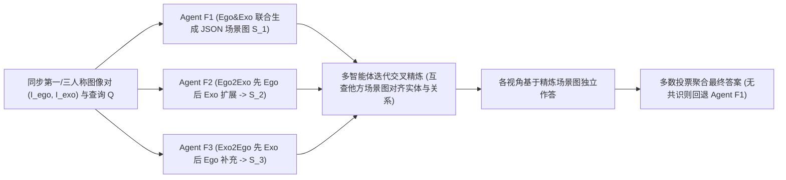

# Towards Comprehensive Scene Understanding

**Towards Comprehensive Scene Understanding: Integrating First and Third-Person Views for LVLMs** 收录于 [Awesome Egocentric Vision](https://github.com/sun254667/awesome-egocentric-vision) **第 195/249** 篇，分组 **Advanced Reasoning & Cutting-edge Advances**。本页是 **清单索引**：给出它在清单中的位置与原文入口，方法细节和量化结果请看原文。

## 一句话定义

Proposes the E3VQA multi-view question answering benchmark (4K high-quality QA pairs) and M3CoT prompt technology, with 4.84% improvement on GPT-4o

## 英文缩写速查

| 缩写 | 英文全称 | 简要说明 |
|------|----------|----------|
| Ego | Egocentric Vision | 第一人称可穿戴视角感知 |
| HOI | Hand–Object Interaction | 手–物交互理解 |
| VLA | Vision-Language-Action | 视觉–语言–动作策略 |
| VLM | Vision-Language Model | 视觉–语言模型 |

## 为什么重要

- Proposes the E3VQA multi-view question answering benchmark (4K high-quality QA pairs) and M3CoT prompt technology, with 4.84% improvement on GPT-4o
- 想横向对照同一分组的其他工作，可以从 [Awesome Egocentric Vision 技术地图](../overview/sun-awesome-ego-technology-map.md) 逐条展开。
- 顺着列表实体 [Awesome Egocentric Vision](../entities/awesome-egocentric-vision.md) 与下方关联的方法 / 任务页，可以接回对应的学习主线。

## 核心信息

| 字段 | 内容 |
|------|------|
| 编号 | 195/249 |
| 分组 | Advanced Reasoning & Cutting-edge Advances |
| 出处 | NeurIPS 2025 |
| 论文 | <https://proceedings.neurips.cc/paper_files/paper/2025/hash/1af83ab66b4f07a3f55788e67dab5782-Abstract-Conference.html> |

## 核心机制（归纳）

> 注：以下机制与评测指标基于通读开放获取原文全文核对补充。

### 问题背景：第一人称与第三人称视角的互补与对齐难题

头戴式第一人称（Egocentric）视角能清晰反映用户注意力与手–物交互细节，但受限于窄视场而缺乏全局空间布局与视野盲区信息；第三人称（Exocentric）视角恰好提供全身姿态与全局上下文，却容易丢失细粒度手部操作细节。现有大型视觉–语言模型（LVLMs）即使同时输入同步的 ego–exo 图像对，也常因跨视角实体重复识别或冗余信息干扰而在单视角即可解决的问题上反而退步，并在必须融合双视角的推理题上准确率低于 40%。

### E3VQA 基准构建与 M3CoT 无训练提示框架

1. **E3VQA 基准（4,000 对高质量多视角四选一问答）**：
   - **数据来源与类别**：从 **Ego-Exo4D** 测试集抽取 575 段视频（1 FPS 下采样并均匀取 8 帧），得到 **4,600 对同步 ego–exo 图像**。题目均分为 4 类（每类 1,000 题，且第一人称 `Ego` 与第三人称 `Exo` 提问各占 500 题）：**Pose & Action Perception**（姿态与动作）、**Object & Attribute Perception**（物体与属性）、**Numerical Reasoning**（数量计数与比较）、**Spatial Reasoning**（空间位置关系）。此外在 LEMMA 数据集上额外构建 500 题验证跨域泛化。
   - **三步自动生成 + 专家校验管线（基于 GPT-4o）**：(a) **单视角 QA 生成**（每图每类 3 题，共得 110,400 初始题）；(b) **分视角答案扩展**，分别在仅 Ego（$A_{\text{ego}}$）、仅 Exo（$A_{\text{exo}}$）、双视角（$A_{\text{both}}$）与纯文本（$A_{\text{text}}$）下生成候选答案；(c) **基于响应的过滤**，剔除 $A_{\text{text}} = A_{\text{init}}$（无需视觉）与 $A_{\text{both}} = A_{\text{init}}$（无需跨视角融合）的简单题（过滤约 78.5% 剩 23,694 题）；(d) 由 4 名领域专家审核并利用上述 4 类响应构建强干扰项，保留 **4,000 题**（占初始 3.6%）。
2. **M3CoT（Multi-view, Multi-perspective, Multi-turn Chain-of-Thought）**：
   - **多视角 JSON 场景图生成**：启用三个独立的 LVLM 智能体实例并行构建互补场景图：$F_1$（**`Ego&Exo`**）同时处理双图生成联合场景图 $S_1$；$F_2$（**`Ego2Exo`**）先基于 $I_{\text{ego}}$ 建图再结合 $I_{\text{exo}}$ 扩展精炼得 $S_2$；$F_3$（**`Exo2Ego`**）先基于 $I_{\text{exo}}$ 建图再结合 $I_{\text{ego}}$ 补充得 $S_3$。
   - **多智能体迭代交叉精炼与投票**：在第 $t$ 轮迭代（默认 $t = 1$），每个智能体 $F_i$ 审阅其余两方上一轮的场景图（如 $S_2^{t-1}, S_3^{t-1}$），通过空间邻近性与语义相似性对齐跨视角重叠实体、修正误报并生成更新场景图 $S_i^t$；随后三个智能体分别基于各自 $S_i^t$ 作答并执行**多数投票**，若达成共识则终止输出，否则在达到最大迭代步数后回退采用 $F_1$ 的答案。

### 方法流程图

## 评测与指标

- **评估基准与协议**：主基准 **E3VQA**（4,000 题，报告 3 次独立运行均值 ± 标准差的多选准确率 %），按推理所需视角进一步拆分为 `Any`、`Ego`、`Exo`、`Both` 四个子集；另附 **LEMMA** 500 题跨数据集验证与 **120 题场景图质量**（误报率 FDR 与基于场景图作答准确率）及 **Token/耗时开销**测试。
- **14 个主流 LVLM 默认基线结果（Table 1，平均准确率 %）**：
  - 闭源模型：`GPT-4o` **60.90%**（最高）、`Gemini 2.0 Flash` **59.80%**、`Gemini 1.5 Pro` **58.37%**、`Claude 3.5 Sonnet` **49.69%**、`GPT-4o mini` **49.03%**。
  - 开源模型：`InternVL3-14B` **53.02%**、`Qwen2.5-VL-7B` **52.61%**、`Qwen2-VL-7B` **50.10%**、`LLaVA-OneVision-7B` **49.36%**、`InternVL2-8B` **46.18%**、`LLaVA-NeXT-7B` **43.17%**、`Mantis-8B-Idefics2` **40.16%**、`Deepseek-VL-Chat-7B` **38.92%**、`Qwen-VL-Chat-7B` **28.13%**。
  - 文本盲测（Table 6）：无图像输入时 `GPT-4o` 仅 **19.50%**、`Gemini 2.0 Flash` 仅 **22.23%**、`InternVL3-14B` 仅 **28.25%**，确认数据无显著文本捷径。模型普遍在 `Numerical Reasoning` 上最弱、在 `Exo` 题型上高于 `Ego` 题型，且在必须整合双视角的 `Both` 子集上表现低迷（默认 `Gemini 2.0 Flash` `37.49%`、`GPT-4o` `39.28%`）。
- **M3CoT 对比其他多模态 CoT 方法（Tables 2, 3, 7, 8, 9）**：
  - **GPT-4o**：Default `60.90%`、CoCoT `62.87%`、CCoT `63.74%`、DDCoT `64.43%` -> **M3CoT `68.58%`**（超 CCoT **`+4.84%`**；Numerical 达 Ego `56.40%` / Exo `67.90%`，超 CCoT `+6.88%`；Spatial 达 Ego `71.90%` / Exo `62.90%`；`Both` 子集由 `39.28%` 跃升至 **`52.61%`**）。
  - **Gemini 2.0 Flash**：Default `59.80%`、CCoT `60.18%`、CoCoT `60.31%`、DDCoT `61.09%` -> **M3CoT `66.12%`**（超 CCoT **`+5.94%`**、DDCoT `+5.03%`、CoCoT `+5.81%`；Numerical 超 CCoT `+8.13%`；`Both` 子集由 `37.52%` 升至 **`53.19%`**）。三视角消融（Table 3）显示 `Ego&Exo`（63.65%）、`Ego2Exo`（62.83%）、`Exo2Ego`（62.98%）分别擅长 `Both`、`Exo` 与 `Ego` 子集，融合投票后达到 `66.12%`。
  - 开源模型与跨域验证（Tables 7 & 8）：`InternVL3-14B` 由 `53.02%` 升至 **`54.79%`**，`InternVL3-8B` 由 `50.44%` 升至 **`53.78%`**；在 LEMMA（500 题）上 `GPT-4o` 由 `50.83%` 升至 **`60.19%`**，`Gemini 2.0 Flash` 由 `53.03%` 升至 **`56.03%`**。
- **场景图质量与计算开销（Appendix C.4, C.5 & Table 10）**：
  - 交叉精炼将 120 题抽样的场景图误报率（FDR）从 **9.37%** 降至 **6.21%**，仅以场景图作答的准确率从 **46.88%** 提高到 **60.42%**；迭代超过 2 轮后精度趋于饱和（正文实验固定迭代 `1` 轮）。
  - 推理成本：`GPT-4o` 单题均值从 Default（`2,120.25 tokens / 2.62 s`）与 CCoT（`9,225.30 tokens / 22.59 s`）增至 M3CoT（**`47,250.12 tokens / 37.56 s`**）；`Gemini 2.0 Flash` 从 Default（`790.60 tokens / 2.56 s`）增至 M3CoT（**`26,164.36 tokens / 20.03 s`**）。

## 与其他工作对比

- 本页 **不做** 与具体基线的逐项数值对比；同分组的横向对照请回到 [技术地图](../overview/sun-awesome-ego-technology-map.md) 的 **Advanced Reasoning & Cutting-edge Advances** 分组逐条展开。
- 如果站内已经有这篇的深读页（含机构、实验表与源码运行时序图），请以那一页为准；本页只保留清单要点。
- 与清单内相邻条目孰优孰劣，本页不下结论：Awesome Highlights 可能滞后于论文最新版本，差异应以各自原文的问题设定与评测口径为准。

## 结论

**本文构建了首个面向第一人称与第三人称协同推理的 E3VQA 基准（4,000 题），并通过多视角场景图交叉精炼策略 M3CoT 显著缓解了 LVLM 在跨视角对齐与计数/空间推理上的短板。**

- **双视角并非“输入越多越好”**：当问题仅需单视角即可解答时，盲目拼接第二视角会因冗余内容干扰导致默认模型掉点；必须通过跨视角实体对齐与过滤（如 M3CoT）才能释放互补收益。
- **三路互补场景图有效降噪**：联合视角（`Ego&Exo`）擅长跨图融合，而顺序视角（`Ego2Exo`/`Exo2Ego`）擅长由一视角补全另一视角细节，交叉精炼将场景图误报率从 `9.37%` 压低至 `6.21%`。
- **工程权衡与开源状态**：E3VQA 仅基于静态同步图像对（不含时序动作视频动态），且 M3CoT 多轮多智能体调用带来约 20×–30× 的 Token 开销，适合离线分析或高价值推理；数据集与源码已开源于 <https://github.com/Leeinsu1/Towards-Comprehensive-Scene-Understanding>。

## 常见误区

1. 不要把 Awesome 条目的 Highlights 当成完整方法证明——它只是策展导读。
2. 若站内已有这篇的深读页，以那一页为准——本页只是清单入口，不含实验数据。

## 关联页面

- 列表实体：[Awesome Egocentric Vision](../entities/awesome-egocentric-vision.md)
- 技术地图：[Awesome Egocentric Vision 技术地图](../overview/sun-awesome-ego-technology-map.md)
- 方法/任务：[vla.md](../methods/vla.md)、[manipulation.md](../tasks/manipulation.md)

## 参考来源

- [`sources/papers/sun_awesome_ego_noarxiv_195_towards-comprehensive-scene-understandin.md`](../../sources/papers/sun_awesome_ego_noarxiv_195_towards-comprehensive-scene-understandin.md) — 本条目策展摘录
- [`sources/papers/sun_awesome_ego_catalog.md`](../../sources/papers/sun_awesome_ego_catalog.md) — 列表总表
- [`sources/repos/awesome-egocentric-vision.md`](../../sources/repos/awesome-egocentric-vision.md)
- 论文：<https://proceedings.neurips.cc/paper_files/paper/2025/hash/1af83ab66b4f07a3f55788e67dab5782-Abstract-Conference.html>

## 推荐继续阅读

- [Awesome Egocentric Vision 仓库](https://github.com/sun254667/awesome-egocentric-vision)
- [原文](https://proceedings.neurips.cc/paper_files/paper/2025/hash/1af83ab66b4f07a3f55788e67dab5782-Abstract-Conference.html)
