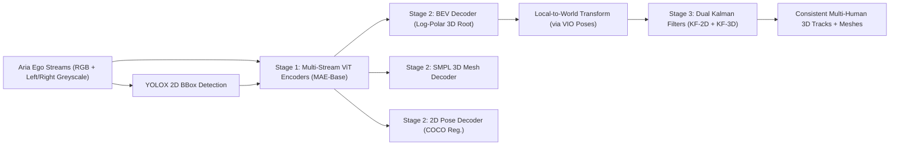

# Ego-Humans

**EgoHumans: An Egocentric 3D Multi-Human Benchmark**（ICCV 2023）由卡内基梅隆大学与 Meta Reality Labs 团队（Rawal Khirodkar、Aayush Bansal、Lingni Ma、Richard Newcombe、Minh Vo、Kris Kitani）提出，收录于 [Awesome Egocentric Vision](https://github.com/sun254667/awesome-egocentric-vision) **第 207/249** 篇，分组 **Human Pose & Mesh Recovery**。本文搭建了一套可移动的异构多视角采集与半自动 3D 标注系统，构建了首个面向室内外非编排动态多人活动的第一视角 3D 基准 **EgoHumans**，并提出了融合三目视觉与全局 3D 空间关联的追踪器 **EgoFormer**。

## 一句话定义

**EgoHumans / EgoFormer** 构建了包含 12.5 万张第一视角 RGB 图像与 41 万多人实例 3D 姿态/SMPL 网格标注的野外多视角基准，并提出在全局世界坐标系下结合立体流（RGB + 左右灰度）BEV 深度推理与双卡尔曼滤波的多人 3D 追踪框架。

## 英文缩写速查

| 缩写 | 英文全称 | 简要说明 |
|------|----------|----------|
| VIO | Visual-Inertial Odometry | 视觉惯性里程计，用于在剧烈头部运动下恢复穿戴相机的外参轨迹 |
| BEV | Bird's Eye View | 鸟瞰图，EgoFormer 对数极坐标热力图用于预测行人在局部相机系下的 3D 根位置 |
| SMPL | Skinned Multi-Person Linear Model | 参数化人体三维网格模型，用于表示全身姿态与体型 |
| IDF1 | Identification F1 Score | 身份 F1 分数，衡量多目标跨帧身份关联的一致性（本文主指标） |
| MOTA | Multiple Object Tracking Accuracy | 多目标跟踪准确率，侧重检测框精度与综合跟踪误差 |
| HOTA | Higher Order Tracking Accuracy | 高阶跟踪准确率，兼顾检测定位与长程身份关联 |

## 为什么重要

- **打破“单人 + 室内实验室”桎梏**：以往第一视角 3D 人体基准（如 Mo2Cap2、You2Me、HPS、EgoBody）多局限于室内 1–2 人与慢速运动；EgoHumans 在无视觉标记（markerless）条件下采集了击剑、网球、羽毛球、排球、篮球、追逐（tagging）与搭积木等高速对抗与严重遮挡场景。
- **揭示 2D 追踪器在第一视角下的失效**：头部快速转动与频繁遮挡导致基于 2D 检测框或短程外观的追踪器频繁发生身份切换（ID switches）；将人物 3D 根位置映射回 VIO 提供的静态全局世界坐标系进行关联，能大幅降低身份跳变。
- 可顺着 [Awesome Egocentric Vision 技术地图](../overview/sun-awesome-ego-technology-map.md) 与 [Awesome Egocentric Vision](../entities/awesome-egocentric-vision.md) 横向对比人体网格恢复方法，并支撑 [遥操作](../tasks/teleoperation.md) 与人机协作中的 3D 人类状态感知。

## 核心信息

| 字段 | 内容 |
|------|------|
| 作者与单位 | Rawal Khirodkar, Aayush Bansal, Lingni Ma, Richard Newcombe, Minh Vo, Kris Kitani（CMU, Meta Reality Labs） |
| 编号与分组 | 207/249 · Human Pose & Mesh Recovery |
| 出处 | ICCV 2023 |
| 论文入口 | <https://openaccess.thecvf.com/content/ICCV2023/html/Ego-Humans_An_Ego-Centric_3D_Multi-Human_Benchmark_ICCV_2023_paper.html> |
| 官方项目页 | <https://rawalkhirodkar.github.io/egohumans> |

## 核心机制（归纳）

1. **EgoHumans 多视角采集与半自动 3D 真值管线**：
   - **异构传感器阵列**：每个序列由 2–4 名佩戴 **Meta Aria 眼镜**（1408×1408 RGB + 两路 480×640 灰度立体相机）的受试者与 8–15 台固定 **GoPro 辅助相机**（3840×2160）以 20 FPS 同步录制，覆盖 6 个场景（3 室内、3 室外）、7 个序列、20 名受试者，共 **125k 第一视角 RGB 图像**、250k 灰度图像、446k 辅助视角图像与 **410k 可见 2D 人体实例**（按无重叠场景划分为 **77,260 训练 / 47,740 测试**）。
   - **世界坐标对齐与真值重建**：通过 VIO 获取单眼镜轨迹，再经 Procrustes 对齐与 SfM 统一全部相机到同一世界坐标系；从眼镜位置生成 3D 圆柱候选并重投影获取初始身份 ID 与检测框（Faster R-CNN + 人工精修），用 HRNet-WholeBody 提取 2D 关键点（17 节点）经 RANSAC 多视角三角化与全局时空先验优化（肢长恒定、左右对称、时序平滑 $L_{temporal}$），最后用 CLIFF 初始化并三阶段拟合 SMPL 参数 $\theta = [\theta_{pose}, \theta_{shape}, \theta_{global}]$。
2. **EgoFormer 三阶段端到端多人 3D 追踪架构**：
   - **Stage 1（多流特征提取）**：以 MAE-Base 初始化的 ViT 编码器（输入 $256 \times 192$，patch 下采样 $d=16$）并行编码三路眼镜图像（RGB 与左右灰度拼接成 3 通道，扩展视场角至 $150^\circ$）得到 $F_{rgb}, F_{left}, F_{right}$，同时利用 YOLOX 检测框生成二值掩码特征 $F_{bbox}$ 与裁剪实例特征 $F_{instance}$。
   - **Stage 2（三路轻量解码）**：由反卷积 + BN 解码器输出三项预测：① 对数极坐标 $(\rho, \phi)$ 鸟瞰图（**BEV**）热力图，定位目标在局部相机系下的 3D 根位置；② **3D SMPL** 姿态与形状参数；③ **2D 姿态**（结合 COCO 数据联合正则化训练，210 epochs，8×A6000）。
   - **Stage 3（世界坐标双卡尔曼追踪）**：借助 VIO 相机外参将预测 3D 根坐标转换至全局世界坐标系，联合 `KF-2D`（$[u,v,s,r,\dot{u},\dot{v},\dot{s}]$）与 `KF-3D`（$[x,y,z,\dot{x},\dot{y},\dot{z}]$）的加权 2D IoU + 3D 欧氏距离代价值完成 ByteTrack 风格跨帧关联。

### 方法流程图

## 评测与指标

- **数据集 3D 标注精度（表 3，与 Kaarta Stencil 激光雷达点云双向 Chamfer 距离）**：4 个辅助相机时误差为 10.4 cm，8 个时降至 8.3 cm，12 个辅助相机配全损失函数达到 **5.8 cm**；若去掉时序平滑项 $L_{temporal}$ 误差升至 7.9 cm，说明时序一致性是最关键的几何正则项。
- **EgoHumans 测试集多人追踪对比（表 2 与表 4，统一采用 ByteTrack 同款 YOLOX 检测框）**：

| 设置 | 追踪方法 | IDF1 (%) ↑ | HOTA (%) ↑ | MOTA (%) ↑ | IDs (身份切换) ↓ |
|---|---|---|---|---|---|
| 公开预训练基线（表 2） | SORT / DeepSORT | 25.2 / 38.3 | — | 20.3 / 22.7 | 7,996 / 6,087 |
| 公开预训练基线（表 2） | QDTrack / OCSORT | 45.5 / 46.4 | — | 43.8 / 54.6 | 1,074 / 3,486 |
| 公开预训练基线（表 2） | PHALP / ByteTrack | 40.1 / 49.7 | — | 52.9 / 59.5 | 1,750 / 2,696 |
| 零训练 3D 基线（表 2） | SimpleBaseline（MiDaS + KF-3D） | 60.9 | — | 59.1 | 1,203 |
| 端到端多流模型（表 2/4） | **EgoFormer (Ours)** | **63.1** | **48.1** | **59.8** | **741** |
| EgoHumans 微调基线（表 4） | OCSORT / ByteTrack（微调后） | 47.2 / 51.5 | 37.9 / 40.6 | 56.1 / 59.7 | 2,430 / 1,203 |

- **组件与视角消融（表 5）**：仅用 RGB（$\text{FOV}=110^\circ$）时 IDF1 58.1%、HOTA 40.5%、IDs 2,139；加入单侧灰度（$\text{FOV}=130^\circ$）升至 IDF1 61.6%；三目全系统（$\text{FOV}=150^\circ$）达到 **IDF1 63.1%、HOTA 48.1%、IDs 741**。若移除 COCO 2D 姿态解码器，IDF1 骤降至 56.8%、IDs 飙升至 2,877，证明 2D 姿态正则对跨场景泛化不可或缺。

## 与其他工作对比

- **对比 2D 多目标追踪（ByteTrack、OCSORT、DeepSORT）**：即便在 EgoHumans 训练集上微调后，ByteTrack 的 IDF1 也仅从 49.7% 升至 51.5%（IDs 1,203），仍受限于 2D 图像平面无法处理剧烈 ego 相机运动；EgoFormer 通过全局 3D 根位置关联将 IDF1 提升至 **63.1%**（表 2 较 ByteTrack 提升 +13.4 pp），并将身份切换压低至 **741 次**。
- **对比已有 3D 追踪（PHALP）**：PHALP 在相机坐标系预测 3D 位置并假设慢速/静止相机，面对穿戴设备快速转动时 IDF1 仅 40.1%；甚至不需在 EgoHumans 上训练的 `SimpleBaseline`（MiDaS 深度 + VIO 世界坐标 KF-3D）都能达到 60.9% IDF1，印证了“全局世界坐标关联”这一核心洞察。
- 同分组工作请参考 [Awesome Egocentric Vision 技术地图](../overview/sun-awesome-ego-technology-map.md)。

## 结论

**EgoHumans 揭示并填补了户外动态多人第一视角 3D 感知的数据空白，而 EgoFormer 证明“在 VIO 世界坐标系下结合广角立体特征进行 3D 根位置追踪”能从根本上缓解第一视角身份切换。**

1. **第一视角追踪必须跳出 2D 图像平面** — 即使只用现成单目深度（MiDaS）转入 VIO 世界系做 3D 卡尔曼滤波（SimpleBaseline），IDF1 就能从 ByteTrack 的 49.7% 跃升至 60.9%。
2. **立体灰度的广角视场（150°）直接减少身份跳变** — 引入 Aria 左右灰度相机后，IDs 从纯 RGB（110°）的 2,139 次大幅降至 741 次。
3. **2D 姿态辅助监督决定跨场景泛化** — 去掉 COCO 2D 姿态解码器会使 IDF1 跌至 56.8%、IDs 反弹至 2,877，仅靠 3D 标注不足以稳健泛化。
4. **半自动多视图建库需要多相机与时序约束** — 12 路辅助相机配合时序平滑可将网格 Chamfer 误差压到 5.8 cm，但仍存在野外便携性与精度之间的工程权衡。

## 常见误区或局限

1. **野外精度低于室内有线动捕棚**：论文第 6 节明确指出，EgoHumans 为实现室外非编排便携采集，牺牲了一定 3D 关键点定位精度（Chamfer 距离 5.8 cm），受限于无线相机时间同步与标定误差。
2. **推理期依赖 VIO 位姿与外部 2D 检测器**：EgoFormer 的全局 3D 关联假设可获取可靠的 VIO 相机外参，且 MOTA（59.8%）受制于上游 YOLOX 的 2D 检测召回与精度（与 ByteTrack 的 59.5% 基本持平）。
3. **跨论文数字对齐注意**：摘要中提及超越此前追踪器 13.6% IDF1，而表 2 实测 ByteTrack 为 49.7%、EgoFormer 为 63.1%（差值 13.4 个百分点），引用具体对比时应以表 2/表 4 口径为准。

## 关联页面

- 列表实体：[Awesome Egocentric Vision](../entities/awesome-egocentric-vision.md)
- 技术地图：[Awesome Egocentric Vision 技术地图](../overview/sun-awesome-ego-technology-map.md)
- 方法/任务：[vla.md](../methods/vla.md)、[imitation-learning.md](../methods/imitation-learning.md)、[manipulation.md](../tasks/manipulation.md)、[teleoperation.md](../tasks/teleoperation.md)

## 参考来源

- [`sources/papers/sun_awesome_ego_noarxiv_207_ego-humans-an-ego-centric-3d-multi-human.md`](../../sources/papers/sun_awesome_ego_noarxiv_207_ego-humans-an-ego-centric-3d-multi-human.md) — 本条目策展摘录
- [`sources/papers/sun_awesome_ego_catalog.md`](../../sources/papers/sun_awesome_ego_catalog.md) — 列表总表
- [`sources/repos/awesome-egocentric-vision.md`](../../sources/repos/awesome-egocentric-vision.md)
- 论文：<https://openaccess.thecvf.com/content/ICCV2023/html/Ego-Humans_An_Ego-Centric_3D_Multi-Human_Benchmark_ICCV_2023_paper.html>

## 推荐继续阅读

- [Awesome Egocentric Vision 仓库](https://github.com/sun254667/awesome-egocentric-vision)
- [原文](https://openaccess.thecvf.com/content/ICCV2023/html/Ego-Humans_An_Ego-Centric_3D_Multi-Human_Benchmark_ICCV_2023_paper.html)
