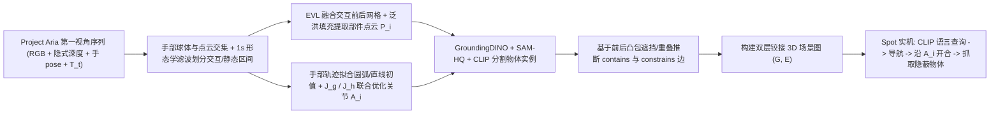

# Pandora: Articulated 3D Scene Graphs from Egocentric Vision

**Pandora: Articulated 3D Scene Graphs from Egocentric Vision**（BMVC 2025，MIT LIDS & Meta Reality Labs）收录于 [Awesome Egocentric Vision](https://github.com/sun254667/awesome-egocentric-vision) **第 215/249** 篇，分组 **Human Pose & Mesh Recovery**。本页基于 BMVC 2025 论文全文完成结构化精读与核实。

## 一句话定义

**Pandora** 通过人类佩戴 Project Aria 智能眼镜在日常场景中自然开关门/抽屉所产生的第一视角 RGB-D、相机位姿与手部轨迹数据，自动估计移动部件点云与运动学关节参数，构建编码 `constrains` 与 `contains` 关系的双层铰接 3D 场景图，并直接赋能四足机械臂机器人执行隐蔽物体检索。

## 英文缩写速查

| 缩写 | 英文全称 | 简要说明 |
|------|----------|----------|
| 3D SG | 3D Scene Graph | 三维场景图，以层次化节点与边表征场景几何、物体语义及空间关系 |
| EVL | Egocentric Voxel Lifting | 预训练第一视角体素提升模型，用于在静态区间融合交互前后的场景网格 |
| CLIP | Contrastive Language-Image Pretraining | 对比语言–图像预训练特征，标注静态物体节点并支持机器人自然语言查询检索 |
| SAM-HQ | High-Quality Segment Anything Model | 高质量分割模型，与 GroundingDINO 配合提取物体实例分割掩码 |
| DoF | Degree of Freedom | 自由度，本文建模 1-DoF 平移（Prismatic）与旋转（Revolute）铰接副 |

## 为什么重要

- **突破机器人自身构型对建图的限制**：传统机器人建图受限于载体视角与操作能力（如四足机器人难以自行探索并打开所有高柜/抽屉），导致建出的场景图对隐蔽空间存在盲区；让人类佩戴轻量级第一视角设备先完成自然交互探索，可直接将“如何打开物体及内部有什么”的运动学与容器知识迁移给任意下游机器人。
- **把“局部部件运动学”与“物体–容器逻辑关系”统一进动态 3D 场景图**：既有 Hydra 主要面向静态场景，Khronos 仅跟踪质心平移而忽略铰接部件与从属物体约束；Pandora 同时恢复几何网格、关节轴/支点及被包含/被约束物体的状态演化。

## 核心信息

| 字段 | 内容 |
|------|------|
| 编号 | 215/249（Awesome Egocentric Vision） |
| 分组 | Human Pose & Mesh Recovery |
| 出处 | BMVC 2025 |
| 作者与机构 | Alan Yu, Yun Chang, Christopher Xie, Luca Carlone（MIT LIDS, Meta Reality Labs） |
| 传感器输入 | Project Aria 眼镜序列 $S_t = (H_t, I_t, D_t, T_t)$：3D 手部位置、RGB 图像、隐式估计深度、$SE(3)$ 相机位姿 |
| 论文 | <https://bmvc2025.bmva.org/proceedings/548/> |
| PDF | <https://bmva-archive.org.uk/bmvc/2025/assets/papers/Paper_548/paper.pdf> |

## 核心机制

1. **双层铰接 3D 场景图表示 $(G, \mathcal{E})$**
   - **Geometric Layer**：由背景 3D 体素网格与交互提取出的动态部件/受约束物体点云 $P_i$ 组成。
   - **Object Layer**：节点分为**铰接部件**（带关节参数 $A_i$：类型 $\tau \in \{\text{Prismatic}, \text{Revolute}\}$、轴向 $u$ 及旋转支点 $x$）与**静态物体**（带 CLIP 特征）；边编码父铰接部件对子物体的 **`constrains`**（随父部件刚性运动，如冰箱门搁架上的瓶罐、抽屉内餐具）与 **`contains`**（仅被遮挡容纳而不随动，如柜门后的盘子）关系。
   - **事件映射 $\mathcal{E}$**：记录 $(A_i, t) \mapsto \theta_t$（平移米数或旋转弧度），并通过 `constrains` 边向外传播动态物体的实时位姿。
2. **第一视角交互切分、关节估计与重访状态更新**
   - **关键帧切分**：以半径 $R_{\text{hand}}$ 的手部球体与反投影深度点云 $D_t$ 相交点数超过阈值 $\tau$ 判定接触二值序列 $b_t$，经 1 秒形态学开闭滤波平滑后划分出交互区间 $\mathcal{I}$ 与静态区间 $\mathcal{K}$。
   - **新物体发现与关节优化**：利用预训练 **EVL** 在交互前后静态区间融合网格 $M_{\text{before}}, M_{\text{after}}$，从交互末手部位置 $H_{t_e}$ 在 $M_{\text{after}}$ 上做泛洪填充（触及 $M_{\text{before}}$ 即止）剥离部件点云 $P_i$；对交互期手部轨迹 $\mathcal{H}$ 分别拟合直线与圆弧，以残差最小者初始化关节类型与初值 $(A_{i,0}, \theta_{t0})$，再最小化单向 Chamfer 几何一致性损失 $J_g$、手部轨迹一致性损失 $J_h$ 及初值正则项求解精确 $(A_i, \theta_t)$。
   - **重访物体更新**：若起始手球与已建档部件点云交并比例超过阈值 $\epsilon$，则沿用既有 $A_i$ 并基于锚点手位姿迭代更新部件点云与状态 $\theta_t'$。
3. **物体–容器关系推断与机器人实机检索**
   - 沿用 RoboEXP 感知流程（GroundingDINO + SAM-HQ + CLIP）处理静态区间帧；对新发现的铰接部件，分别沿 $P_{i,\text{before}}$ 凸包遮挡射线筛出 **`contains`** 子物体，按 $P_{i,\text{after}}$ 凸包重叠筛出 **`constrains`** 子物体并锁定静态边、修剪被旧位姿占用的体素。
   - **Spot 实机任务**：给定自然语言查询 $L$，通过 CLIP 余弦相似度检索目标节点，分解为四步执行：① 导航至父物体节点 → ② 抓取把手 → ③ 沿估计关节参数 $A_i$ 开关门/抽屉 → ④ 抓取目标物体质心。

### 方法流程图

## 评测与指标

### 1. 关节参数估计精度对比（原文 Table 1，Blender 仿真环境）

轴向误差以角度（°）计，旋转支点误差以物体部件包围盒对角线长度归一化（均越低越好）：

| 方法 | 输入模态 | Prismatic Axis ↓ | Revolute Axis ↓ | Revolute Pivot ↓ |
|------|----------|------------------|-----------------|------------------|
| `Articulate Anything` | RGB 序列 | **0.00°** | **0.00°** | 0.22 |
| `Ditto` | 交互前后双点云 | 10.82° | 1.26° | 0.26 |
| `Hands-Only`（仅手轨迹，$w_g=w_p=0$） | 手部序列 | 0.02° | 15.14° | 0.63 |
| **Pandora（本文完整方法）** | **第一视角序列** | 0.19° | **0.62°** | **0.004** |

> 注：原文解释 `Articulate Anything` 借助 VLM 语义先验与网格对齐机制在轴向误差上表现特殊（细节分析见作者附录 D），而 Pandora 的旋转支点误差（**0.004**）远低于所有基线两个数量级。

### 2. 仿真场景 3D 场景图重建（原文 Table 2，Precision / Recall / F1 %，使用真值实例分割消除检测歧义）

| 场景 | 方法 | Mesh Recovery (P/R/F1) ↑ | Static Objects (P/R/F1) ↑ | Dynamic Objects (P/R/F1) ↑ | Object Relationships (P/R/F1) ↑ |
|------|------|--------------------------|---------------------------|----------------------------|---------------------------------|
| Kitchen | `Hydra` | 88.3 / **50.6** / 64.3 | 75.0 / 62.1 / 68.0 | – | – |
| Kitchen | `Khronos` | 92.7 / **50.6** / **65.4** | 66.7 / 46.7 / 54.9 | 16.8 / 6.9 / 9.8 | – |
| Kitchen | `NoArt`（无铰接几何） | 98.5 / 46.0 / 63.0 | 57.1 / **93.3** / 70.9 | – | 30.7 / 50.0 / 41.2 |
| Kitchen | **Pandora（本文）** | **98.6** / 46.0 / 62.7 | **75.0** / 90.0 / **81.8** | **100.0 / 91.7 / 95.7** | **100.0 / 100.0 / 100.0** |
| Bedroom | `Hydra` | 90.1 / **68.8** / 78.0 | **86.7** / 60.5 / 71.2 | – | – |
| Bedroom | `Khronos` | **98.2** / 68.3 / **80.6** | 42.6 / 60.5 / 50.0 | 1.1 / 0.7 / 0.8 | – |
| Bedroom | `NoArt`（无铰接几何） | 98.1 / 66.2 / 79.0 | 61.5 / **93.0** / 74.1 | – | 41.0 / 60.0 / 48.7 |
| Bedroom | **Pandora（本文）** | 98.1 / 66.2 / 79.0 | 72.7 / **93.0** / **81.6** | **93.5 / 84.1 / 88.5** | **87.5 / 93.3 / 90.3** |

### 3. 真实厨房 Project Aria 数据集与下游检索（原文 Table 3）

| 真实场景 | Prism. Axis ↓ | Revol. Axis ↓ | Revol. Pivot ↓ | 隐蔽物体检索准确率（Retrieval Acc）↑ |
|----------|---------------|---------------|----------------|--------------------------------------|
| Kitchen A | 3.76° | 3.01° | 0.10 | **5/6** |
| Kitchen B | 2.77° | 4.30° | 0.12 | **5/6** |

## 与其他工作对比

- **对比实时 3D 场景图 SLAM（Hydra、Khronos）**：Hydra 面向静态环境；Khronos 仅追踪刚体物体质心短期/长期位移，面对柜门、抽屉等局部部件运动及随动内含物（Kitchen 动态物体 F1 仅 9.8%，Bedroom 仅 0.8%）几乎失效；Pandora 通过 `constrains` 边显式耦合父部件运动学，动态物体 F1 提升至 **95.7%**（Kitchen）与 **88.5%**（Bedroom）。
- **对比基于双点云或视觉–语言先验的关节估计（Ditto、Articulate Anything）**：Ditto 依赖人工交互前后分割好的双点云（平移轴误差 10.82°）；Pandora 直接从自然第一视角视频与手部交互轨迹联合优化几何与运动学，旋转支点误差降至 0.004。相关研究见 [Awesome Egocentric Vision 技术地图](../overview/sun-awesome-ego-technology-map.md)。

## 常见误区或局限

1. **严格依赖对新发现铰接部件的完整观测（§3, §5 Limitations）**：方法假设首次交互时用户拍摄到完整物体部件；若仅部分可见，几何误差项 $J_g$ 会误导关节轴与支点估计，真实厨房中导致隐蔽物漏检的最常见原因也正是部件几何估计不准。
2. **仅建模单层 `contains` 与受限动态物体假设**：第 4.2 节明确未支持多层嵌套容器（nested containers），且第 5 节指出当前仅追踪受铰接父部件约束（`constrains`）的动态物体，尚未涵盖任意独立移动物体（如桌面被人类搬走的杯子）。
3. **受第一视角手部追踪与无深度传感器精度影响**：Project Aria 本身无硬件深度传感器（需隐式深度估计），且真实场景手部关键点偶发漂移会放大轴角误差（仿真 Revolute Axis 0.62° 升至真实 Kitchen A/B 的 3.01°–4.30°）。

## 结论

**Pandora 验证了利用人类第一视角自然探索视频恢复物体铰接运动学与容器–内容物关系的可行性，为低自由度移动操作机器人提供了免自身探索的先验动态 3D 场景图。**

- 建图阶段将“谁去探索开门/拉抽屉”与“谁去执行取物”解耦，可显著降低复杂家居环境下移动操作机器人的前端探索与交互失败成本。
- 几何一致项 $J_g$ 与手部轨迹一致项 $J_h$ 的联合优化明显优于纯手部轨迹拟合（`Hands-Only` 旋转轴误差 15.14° → Pandora **0.62°**），但采集阶段仍需尽量保证首次开启部件时的完整视野覆盖。
- 面向后续工程化落地，可将 VLM 语义先验（应对局部遮挡）与独立移动物体跟踪（如 Khronos）并入 Pandora 的双层图结构，以突破单层嵌套容器与静态背景假设。

## 关联页面

- 列表实体：[Awesome Egocentric Vision](../entities/awesome-egocentric-vision.md)
- 技术地图：[Awesome Egocentric Vision 技术地图](../overview/sun-awesome-ego-technology-map.md)
- 方法/任务：[vla.md](../methods/vla.md)、[imitation-learning.md](../methods/imitation-learning.md)、[manipulation.md](../tasks/manipulation.md)、[teleoperation.md](../tasks/teleoperation.md)

## 参考来源

- [`sources/papers/sun_awesome_ego_noarxiv_215_pandora-articulated-3d-scene-graphs-from.md`](../../sources/papers/sun_awesome_ego_noarxiv_215_pandora-articulated-3d-scene-graphs-from.md) — 本条目策展摘录
- [`sources/papers/sun_awesome_ego_catalog.md`](../../sources/papers/sun_awesome_ego_catalog.md) — 列表总表
- [`sources/repos/awesome-egocentric-vision.md`](../../sources/repos/awesome-egocentric-vision.md)
- 论文：<https://bmvc2025.bmva.org/proceedings/548/>

## 推荐继续阅读

- [Awesome Egocentric Vision 仓库](https://github.com/sun254667/awesome-egocentric-vision)
- [BMVC 2025 原文 PDF](https://bmva-archive.org.uk/bmvc/2025/assets/papers/Paper_548/paper.pdf)
- [BMVC 2025 会议页](https://bmvc2025.bmva.org/proceedings/548/)
