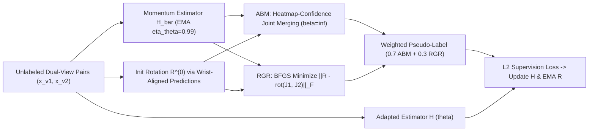

# Single-to-Dual-View Adaptation for Egocentric 3D Hand Pose Estimation

**Single-to-Dual-View Adaptation for Egocentric 3D Hand Pose Estimation**（CVPR 2024）由东京大学团队（Ruicong Liu、Takehiko Ohkawa、Mingfang Zhang、Yoichi Sato）提出，收录于 [Awesome Egocentric Vision](https://github.com/sun254667/awesome-egocentric-vision) **第 218/249** 篇，分组 **Human Pose & Mesh Recovery**。针对多视角训练标注昂贵且测试相机布局必须与训练一致的痛点，本文提出了无监督单视角到双视角手部姿态自适应框架 **S2DHand**。

## 一句话定义

**S2DHand** 是一种无需多视角标注与相机内外参的无监督（且无源域数据依赖）自适应框架，利用跨视角一致性（ABM）与相机间旋转变换不变性（RGR）生成互补伪标签，将单视角预训练 3D 手部姿态估计器迁移至任意双目相机配置。

## 英文缩写速查

| 缩写 | 英文全称 | 简要说明 |
|------|----------|----------|
| S2DHand | Single-to-Dual-View Adaptation for Egocentric 3D Hand Pose Estimation | 本文提出的无监督单视角向双视角手部姿态自适应框架 |
| ABM | Attention-Based Merging | 基于 2D 热力图峰值置信度的跨视角融合伪标签模块 |
| RGR | Rotation-Guided Refinement | 基于双相机相对旋转不变性的 BFGS 优化伪标签模块 |
| MPJPE | Mean Per Joint Position Error | 平均每关节位置误差（mm），以手腕根节点对齐的 3D 关节评估指标 |
| Mono-M / Dual-M | Monocular / Dual-view MPJPE | 分别指双视角各自单目预测的平均误差与旋转对齐融合后的双目预测误差 |

## 为什么重要

- **摆脱多视角标注与固定相机参数束缚**：消费级头显（如 Apple Vision Pro、Meta Quest 等）普遍搭载多颗位置各异的第一视角相机，但传统多视角融合方法既依赖昂贵的多目 3D 标注，又在相机布局变动后即告失效。S2DHand 仅需单视角预训练模型与无标注双目图像对（约 1,000 对即可收敛）即可快速重适配新相机位姿。
- **支持源域无关（Source-Free）跨数据集迁移**：即便源域是纯合成数据集（如 Rendered Handpose + GANerated Hands），自适应过程中也无需回访源域图像，更契合终端隐私与轻量部署需求。
- 可结合 [Awesome Egocentric Vision 技术地图](../overview/sun-awesome-ego-technology-map.md)、[模仿学习](../methods/imitation-learning.md)、[灵巧操作](../tasks/manipulation.md) 与 [遥操作](../tasks/teleoperation.md) 理解多目第一视角手部追踪在动作采集中的价值。

## 核心信息

| 字段 | 内容 |
|------|------|
| 作者与单位 | Ruicong Liu, Takehiko Ohkawa, Mingfang Zhang, Yoichi Sato（The University of Tokyo） |
| 编号与分组 | 218/249 · Human Pose & Mesh Recovery |
| 出处 | CVPR 2024 |
| 论文入口 | <https://openaccess.thecvf.com/content_CVPR2024/html/Single-to-Dual-View_Adaptation_for_Egocentric_3D_Hand_Pose_Estimation_CVPR_2024_paper.html> |
| 官方项目与源码 | <https://github.com/ut-vision/S2DHand>（论文摘要公布；当前页面未运行源码分析） |

## 核心机制（归纳）

给定单视角预训练手部姿态估计器 $H(\cdot|\theta)$（采用 DetNet 骨干，输出 21 个 3D 关节与 $32 \times 32$ 2D 热力图）及无标注双视角图像对 $D = \{x_i^{v1}, x_i^{v2}\}_{i=1}^N$：

1. **未知外参下的旋转矩阵初始化与动量更新**：
   - 由于手部姿态评估以手腕为根节点对齐，无需估计相机平移向量，仅需 $3 \times 3$ 相对旋转矩阵 $R$。利用初始模型预测通过 Kabsch 旋转求解并做旋转矩阵平均初始化：$R^{(0)} = \frac{1}{N}\sum_{i=1}^N \text{rot}(J_i^{v1}, J_i^{v2})$。
   - 构建动态估计器 $H(\cdot|\theta)$ 与动量教师 $\overline{H}(\cdot|\overline{\theta})$（参数 EMA 更新 $\eta_\theta = 0.99$），同时在每批迭代中对 $R$ 做慢速 EMA 更新（$\eta_R = 0.999$），训练损失为 $\mathcal{L} = \|J^{v1} - \hat{y}^{v1}\|_2 + \|J^{v2} - \hat{y}^{v2}\|_2$。
2. **双立体约束互补伪标签生成**：
   - **注意力跨视角融合（ABM，利用跨视角一致性 $R\overline{J}^{v1} = \overline{J}^{v2}$）**：作者观察到 2D 热力图峰值越大则对应关节 3D 预测越准，由此构造关节级注意力权重 $w_j^v = \frac{\beta^{\max(\overline{h}_j^v)}}{\sum_{v \in \{v1,v2\}} \beta^{\max(\overline{h}_j^v)}}$（实验取 $\beta = \infty$，即逐关节硬选热力图置信度更高视角的预测），合并得 $\hat{y}_{abm}^{v2} = w^{v1} R \overline{J}^{v1} + w^{v2} \overline{J}^{v2}$（$v1$ 同理）。ABM 在基础预测较准（误差 $< 60\text{ mm}$）时效果显著。
   - **旋转引导优化（RGR，利用刚体相机间相对旋转不变性）**：固定双目头显任意样本对估计出的 $\text{rot}(\overline{J}^{v1}, \overline{J}^{v2})$ 理论上应恒等于全局 $R$。当局部视角极端导致初始预测失真（误差 $\ge 60\text{ mm}$）时，RGR 通过 BFGS 求解 $\arg\min_{\overline{J}^{v1}, \overline{J}^{v2}} \|R - \text{rot}(\overline{J}^{v1}, \overline{J}^{v2})\|_F$ 生成修正伪标签 $\hat{y}_{rgr}$。
   - **加权互补融合**：最终伪标签为 $\hat{y} = \alpha \hat{y}_{abm} + (1-\alpha)\hat{y}_{rgr}$（最优超参 $\alpha = 0.7$）。推理时共享权重的适应后模型对双视图分别预测后取对齐平均作为最终输出。

### 方法流程图

## 评测与指标

实验在 **AssemblyHands ($D_{ah}$)**（包含 Headset1 与 Headset2 两套 4 目 AR 头显，各构成 6 组不同角度的双目对；412K 训练 / 62K 测试）上开展，跨数据集设置以合成数据集 **$D_{syn}$**（Rendered Handpose 44K + GANerated Hands 330K）作为源域：

| 实验设定 | 方法 | Headset1 Mono-M (mm) ↓ | Headset1 Dual-M (mm) ↓ | Headset2 Mono-M (mm) ↓ | Headset2 Dual-M (mm) ↓ |
|---|---|---|---|---|---|
| 域内自适应 ($D_{ah} \to D_{ah}$，6 对均值，表 2) | Pre-trained Baseline | 24.96 | 22.67 | 25.72 | 23.75 |
| 域内自适应 ($D_{ah} \to D_{ah}$，6 对均值，表 2) | **S2DHand (Ours)** | **20.16 (▼19.2%)** | **19.98 (▼11.9%)** | **21.67 (▼15.7%)** | **21.25 (▼10.5%)** |
| 跨数据集 ($D_{syn} \to D_{ah}$，表 3) | Source Only（无适应） | 56.18 | 50.59 | 58.74 | 54.72 |
| 跨数据集 ($D_{syn} \to D_{ah}$，表 3) | ADDA / DAGEN（需源域） | 56.90 / 55.37 | 48.48 / 49.72 | 57.87 / 57.62 | 51.39 / 53.17 |
| 跨数据集 ($D_{syn} \to D_{ah}$，表 3) | RegDA（需源域） | 51.41 | 47.85 | 54.75 | 51.50 |
| 跨数据集 ($D_{syn} \to D_{ah}$，表 3) | SFDAHPE（源域无关） | 54.06 | 49.11 | 57.22 | 53.39 |
| 跨数据集 ($D_{syn} \to D_{ah}$，表 3) | **S2DHand (Ours，源域无关)** | **48.44 (▼13.8%)** | **45.92 (▼9.2%)** | **53.11 (▼9.6%)** | **50.37 (▼7.9%)** |
| 跨数据集有监督上界（表 3） | Fine-tune*（用目标标注） | 45.03 | 38.11 | 47.75 | 42.19 |

- **逐相机对与模块消融（表 2、表 4）**：在视野差距较大的 `cam 1, 2` 上，域内 Mono-M 降幅高达 **27.9%**（43.00→31.01 mm）。表 4 消融显示（Headset1 Mono-M / Dual-M）：Baseline 24.96 / 22.67 → 仅 ABM 20.81 / 20.54 → 仅 RGR 21.89 / 21.33 → **ABM+RGR 20.16 / 19.98 mm**，证明两者互补。
- **互补区间与收敛样本量（图 7–8、表 5）**：当预测误差 $< 60\text{ mm}$ 时 RGR 增益有限，而在 $\ge 60\text{ mm}$ 的高误差区间 RGR 显著压低伪标签误差；无标注图像对数量在 $N \ge 1000$ 时基本收敛；超参取 $\alpha = 0.7$、$\beta = \infty$ 最优（$\beta = 1$ 等价于简单平均，Mono-M 退化至 21.02 / 22.77 mm）。

## 与其他工作对比

- **对比有监督多视角方法（如 UmeTrack、MVHM）**：传统多目方法依赖标注多视角真值且锁定训练相机外参；S2DHand 仅需单视角预训练与无标注双目数据，对任意 6 组双目组合均可自适应。
- **对比无监督域适应基线（SFDAHPE、RegDA、DAGEN、ADDA）**：现有姿态域适应方法（如 RegDA、SFDAHPE）仅利用单视角约束（如生物力学约束），无法利用双目立体几何；S2DHand 在相同 DetNet 骨干下不仅保持源域无关（Source-Free），且跨数据集误差显著低于需访问源域数据的 RegDA（Headset1 Mono-M 48.44 vs 51.41 mm）。
- 同分组工作请参考 [Awesome Egocentric Vision 技术地图](../overview/sun-awesome-ego-technology-map.md)。

## 结论

**S2DHand 证明：即使完全不知道双目相机内外参且没有多视角真值，仅靠单视角热力图置信度融合（ABM）与相机间旋转不变性约束（RGR）的互补伪标签，也能将单目手部姿态模型稳健升级为双目自适应模型。**

1. **逐关节硬置信度选择优于简单双目平均** — $\beta = \infty$（选择热力图峰值更高的单视角关节作为伪标签）在所有配置下优于 $\beta = 1$（简单平均）与 $\beta = e$（Softmax 加权）。
2. **ABM 与 RGR 覆盖不同误差区间** — 预测较准（$< 60\text{ mm}$）靠 ABM 合并好视角，极端遮挡/视角（$\ge 60\text{ mm}$）靠 RGR 旋转几何约束拉回合理姿态。
3. **仅需约 1,000 对无标注图像即可完成新布局适配** — 在头显摄像头位置变动时，无需重新采集标注数据即可低成本重适配。
4. **源域无关更利于落地** — 无需访问原始合成训练集 $D_{syn}$ 即超过需源域数据的 RegDA/DAGEN，减小部署耦合。

## 常见误区或局限

1. **受限于初始单目预测质量**：论文第 5.3 节指出，在跨数据集 `cam 1, 2` 上由于 Baseline 初始误差过大（67.93 / 70.32 mm），初始估计的旋转矩阵 $R^{(0)}$ 精度不足，导致自适应增益骤降至 0.3%–6.6%。
2. **假设双目相对位姿固定**：RGR 依赖两台相机相对旋转 $R$ 恒定的假设；若两路相机是非刚性连接或使用中发生相对位移，需重新运行自适应流程。
3. **腕部对齐评测，不恢复相机间全局平移**：方法在手腕相对坐标系下工作（刻意回避平移向量估计），因此不能直接用于需要双目全局深度标定的场景；且全篇仅在 DetNet 骨干与单手设定下验证。

## 关联页面

- 列表实体：[Awesome Egocentric Vision](../entities/awesome-egocentric-vision.md)
- 技术地图：[Awesome Egocentric Vision 技术地图](../overview/sun-awesome-ego-technology-map.md)
- 方法/任务：[vla.md](../methods/vla.md)、[imitation-learning.md](../methods/imitation-learning.md)、[manipulation.md](../tasks/manipulation.md)、[teleoperation.md](../tasks/teleoperation.md)

## 参考来源

- [`sources/papers/sun_awesome_ego_noarxiv_218_single-to-dual-view-adaptation-for-egoce.md`](../../sources/papers/sun_awesome_ego_noarxiv_218_single-to-dual-view-adaptation-for-egoce.md) — 本条目策展摘录
- [`sources/papers/sun_awesome_ego_catalog.md`](../../sources/papers/sun_awesome_ego_catalog.md) — 列表总表
- [`sources/repos/awesome-egocentric-vision.md`](../../sources/repos/awesome-egocentric-vision.md)
- 论文：<https://openaccess.thecvf.com/content_CVPR2024/html/Single-to-Dual-View_Adaptation_for_Egocentric_3D_Hand_Pose_Estimation_CVPR_2024_paper.html>

## 推荐继续阅读

- [Awesome Egocentric Vision 仓库](https://github.com/sun254667/awesome-egocentric-vision)
- [原文](https://openaccess.thecvf.com/content_CVPR2024/html/Single-to-Dual-View_Adaptation_for_Egocentric_3D_Hand_Pose_Estimation_CVPR_2024_paper.html)
