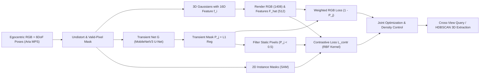

# EgoLifter

**EgoLifter: Open-World 3D Segmentation for Egocentric Perception**（Qiao Gu, Zhaoyang Lv, Duncan Frost, Simon Green, Julian Straub, Chris Sweeney，University of Toronto & Meta Reality Labs，ECCV 2024，[arXiv:2403.18118v2](https://arxiv.org/abs/2403.18118)）收录于 [Awesome Egocentric Vision](https://github.com/sun254667/awesome-egocentric-vision) **第 238/249** 篇，分组 **Scene Reconstruction & Egocentric SLAM**。本页基于论文全文完成精读与数据核实。

## 一句话定义

一种面向自然、非扫描式动态第一视角视频的开放世界 3D 实例分割与静态场景重建系统，通过**给 3D 高斯附加可微实例特征 + 对比学习提升 SAM 2D 掩码 + 瞬态概率预测网络过滤动态干扰**，无需任何 3D 人工标注即可将第一视角环境拆解为可查询、可提取的 3D 物体高斯集合。

## 英文缩写速查

| 缩写 | 英文全称 | 简要说明 |
|------|----------|----------|
| 3DGS | 3D Gaussian Splatting | 3D 高斯泼溅，本文用于场景几何、外观与实例特征的显式可微表征 |
| SAM | Segment Anything Model | 2D 开放世界图像分割基础模型，提供无类别词表的实例掩码弱监督 |
| ADT / AEA | Aria Digital Twin / Aria Everyday Activities | 基于 Project Aria 眼镜采集的第一视角 3D 感知基准与日常活动长视频数据集 |
| HDBSCAN | Hierarchical Density-Based Spatial Clustering of Applications with Noise | 层次密度聚类算法，用于在特征空间将 3D 高斯无监督拆解为独立物体 |
| mIoU / PSNR | mean Intersection over Union / Peak Signal-to-Noise Ratio | 分别评估开放世界实例分割精度与新视角图像渲染质量 |

## 为什么重要

- **解决第一视角日常视频“非刻意扫描 + 高频动态遮挡”难题**：佩戴设备（如 Project Aria）录制的日常活动既没有充分环绕多视角覆盖，又包含大量人体与手–物交互运动；直接跑静态 3DGS 会产生大量“鬼影浮标（floaters）”并污染语义特征。
- **摆脱封闭类别词表与脆弱的跨帧追踪器**：无需固定物体分类体系，也不像 Gaussian Grouping 依赖易断链的 2D 视频目标追踪器，仅靠单帧内 SAM 掩码对比学习即可自动完成多视角 3D 一致性关联。
- **支撑可穿戴 AR/VR 与具身数据资产提取**：支持点击跨视角查询、全局 HDBSCAN 物体提取与 3D 场景编辑（如移除桌面物体恢复背景），且在 AEA 单地点长达 2.3 小时（170K 帧）的跨时段多录制拼接上仍可稳定运行，可衔接 [VLA 方法页](../methods/vla.md) 与 [遥操作任务页](../tasks/teleoperation.md)。

## 核心信息

| 字段 | 内容 |
|------|------|
| 编号 | 238/249 |
| 分组 | Scene Reconstruction & Egocentric SLAM |
| 出处 | ECCV 2024 (arXiv:2403.18118v2) |
| 作者与机构 | Qiao Gu（University of Toronto / Meta Reality Labs）；Zhaoyang Lv, Duncan Frost, Simon Green, Julian Straub, Chris Sweeney（Meta Reality Labs） |
| 论文与项目 | <https://link.springer.com/chapter/10.1007/978-3-031-72912-6_22> · <https://arxiv.org/abs/2403.18118> · <https://egolifter.github.io/> |

## 核心机制

给定带 6DoF 位姿轨迹（由 Project Aria MPS 提供）的去畸变第一视角 RGB 图像序列 $\{I_j, \theta_j\}_{j=1}^M$，EgoLifter 联合优化场景重建与 3D 实例特征场（§3）：

1. **带特征渲染的 3D 高斯与相机成像模型（§3.1、Appendix A2.1）**
   - 每个 3D 高斯扩展为 $\Theta_i = \{p_i, s_i, q_i, \alpha_i, c_i, f_i\}$，其中 $f_i \in \mathbb{R}^{16}$ 为实例特征向量。
   - **双分辨率前向与成像建模**：RGB 以 `1408 × 1408` 渲染，特征图 $\hat{F}_j$ 以 `512 × 512` 渲染（匹配 SAM 掩码分辨率），两者视图空间梯度累加共同驱动高斯分裂/剪枝；为匹配 Aria 鱼眼相机物理特性，成像模型 $f(\cdot)$ 将暗角（vignetting）与有效像素掩码施加到渲染图像再算损失，避免边缘暗角诱发浮标。

2. **基于对比学习的 2D-to-3D 实例特征提升（§3.2）**
   - 利用 SAM 从每帧提取互不关联的 2D 实例掩码 $M_j$（重叠掩码按图层覆盖转为逐像素 one-hot 标签）。
   - 受 Contrastive Lift 启发，在像素采样集 $U$（每帧 $|U| \le 4096$）上计算单帧监督对比损失 $\mathcal{L}_{\text{contr}}$（式 2）：同一掩码内像素特征经高斯 RBF 核 $\text{sim}(f_1, f_2; \gamma) = \exp(-\gamma \|f_1 - f_2\|_2^2)$（$\gamma = 0.01$）拉近、不同掩码推远，无需任何跨帧实例 ID 匹配即可隐式形成多视角一致的 3D 实例特征。

3. **无监督瞬态预测网络与动态过滤（§3.3）**
   - 采用带预训练 MobileNet-v3 主干的轻量 U-Net $G(I_j)$（输入缩至 `224 × 224` 后双线性插值回原图），无需动态标签即可预测像素级瞬态概率图 $P_j \in [0,1]^{H\times W}$。
   - **双重引导**：一是对光度 MSE 损失按 $(1 - P_j[u])$ 加权（式 3 $\mathcal{L}_{\text{RGB-w}}$）并施加 L1 稀疏正则 $\mathcal{L}_{\text{reg}}(P_j) = \sum |p|$ 防止全图退化为瞬态；二是仅在满足 $P_j[u] < \delta = 0.5$ 的静态像素上采样 $U$ 计算对比损失。总损失为 $\mathcal{L} = \lambda_1 \mathcal{L}_{\text{RGB-w}} + \lambda_2 \mathcal{L}_{\text{contr}} + \lambda_3 \mathcal{L}_{\text{reg}}$（$\lambda_1=1, \lambda_2=0.1, \lambda_3=0.01$）。

4. **开放世界分割与下游应用（§3.4）**
   - **查询式（Query-based）**：单视图或多视图点击采样特征均值，按欧氏距离阈值切分 2D 掩码或筛选 3D 高斯拟合 3D 边界框。
   - **聚类式（Clustering-based）**：对 3D 高斯特征运行 HDBSCAN，自动将整场拆分为可独立渲染、增删或编辑的 3D 物体资产。

### 方法流程图

## 评测与指标

作者基于 **Aria Digital Twin（ADT）** 精选 16 条日常活动序列构建了首个动态第一视角开放世界 3D 分割定量基准（划分 `seen` 与 `novel` 新视角子集，表 1、表 2、表 A.2），并在非第一视角静态基准（MipNeRF 360、Replica）上补充验证（表 A.3、表 A.4）：

| 评测维度与方法（ADT 新视角 Novel Subset） | In-view mIoU (Static / Dynamic / All) ↑ | Cross-view mIoU (Static / Dynamic / All) ↑ | PSNR (Static / Dynamic / All) ↑ | 3D 静态检测 mIoU（表 2）↑ |
|---|---|---|---|---|
| **SAM [22]**（2D 图像单帧提示） | 54.51 / 32.77 / 50.69 | 不支持跨视角 | — | — |
| **Gaussian Grouping [61]**（视频追踪关联） | 35.68 / 30.76 / 34.81 | 23.79 / 11.33 / 21.58 | 21.29 / 14.99 / 19.97 | 7.48 |
| **EgoLifter-Static**（关闭瞬态网络） | 55.67 / **39.61** / 52.86 | 51.29 / 18.67 / 45.49 | 21.37 / 15.32 / 20.16 | 21.10 |
| **EgoLifter-Deform**（动态形变 3DGS） | 54.23 / 38.62 / 51.49 | 51.10 / 18.02 / 45.22 | 21.16 / **15.39** / 19.93 | 20.58 |
| **EgoLifter (Ours)** | **58.15** / 37.74 / **54.57** | **55.27** / **19.14** / **48.84** | **22.14** / 14.37 / **20.28** | **23.11** |

- **对比 NeRF 基线（表 A.2）**：ADT 全部像素新视角 PSNR 上，EgoLifter（`20.28`）大幅超越自带 per-image 外观嵌入的 Nerfacto（`17.22`）。
- **静态标准基准（表 A.3、A.4）**：关闭瞬态分支的 `EgoLifter-Static` 在 MipNeRF 360 上取得 `27.26` PSNR（与原版 3DGS `27.21` 持平），在 Replica 多视角掩码传播上达到 `82.1` mIoU（接近同期 NeRF 方案 OmniSeg3D `84.4` 与 SA3D `83.0`）。
- **算力与推理速度（Appendix A2.3，A100 40GB）**：单条 ADT 序列训练约 **130 分钟**（原版 3DGS 约 100 分钟）；推理渲染 `1408 × 1408` RGB + 实例特征可达 **~103 fps**（仅 RGB 约 **158 fps**）。

## 与现有工作的对比

- **对比 Gaussian Grouping [61]**：两者均在 3DGS 上嵌入特征实现开放世界分割，但 Gaussian Grouping 依赖 2D 视频目标追踪器关联跨帧掩码并采用分类损失，既无法应对第一视角剧烈晃动与频繁进出视野（Cross-view 静态 mIoU 暴跌至 `23.79`，3D 检测仅 `7.48`），又未处理动态人体/交互物体；EgoLifter 改用对比损失 + 瞬态过滤，3D 检测提升至 `23.11`。
- **对比动态形变 3DGS（EgoLifter-Deform [60]）**：传统动态 3DGS 依赖多台静态相机大基线观测，在仅单/少数窄基线可穿戴视角下难以稳定追踪快速运动的物体，反而在 `EgoLifter-Deform` 中产生更多浮标（PSNR `19.93` vs `20.28`，Cross-view mIoU `45.22` vs `48.84`）。
- **对比 2D 基础模型（SAM）与隐式 NeRF（OmniSeg3D / Nerfacto）**：SAM 无法直接跨视角传播提示或提取 3D 物体；3DGS 架构使 EgoLifter 兼具实时特征渲染（103 fps）与显式 3D 资产编辑能力。同分组方法见 [Awesome Egocentric Vision 技术地图](../overview/sun-awesome-ego-technology-map.md)。

## 常见误区或局限

1. **只重建并优化“静态世界”，故意舍弃动态物体**：由于瞬态预测网络会屏蔽运动物体，EgoLifter 在动态物体新视角重建（PSNR `14.37` vs `EgoLifter-Static` `15.32`）与 In-view 动态分割（`37.74` vs `39.61`）上略低于不剔除动态的变体，不适合需要高保真重构运动目标本身的场景。
2. **高反光/过曝区域易被误判为“瞬态”**：论文 §5 与 Fig. 3 指出，AEA 数据集中的过曝窗户等从 LDR 图像难以重建的区域会被瞬态网络打上高概率并过滤掉。
3. **重度依赖上游 SAM 掩码质量与单尺度合并**：若 SAM 在特定视角或小物体上稳定漏检，3D 中也无法分割；此外，实验把 SAM 重叠多尺度掩码简单覆盖成单层 one-hot 标签，未实现层次化（物体–部件）3D 分割。
4. **头部剧烈运动模糊与隐私风险**：可穿戴相机快移带来的运动模糊仍会导致重建发糊（Appendix A4）；在真实日常环境数字化 3D 物体亦带来隐私与数字产权考量。

## 结论

**《EgoLifter》证明：在自然动态第一视角视频里，与其硬用窄基线动态 3DGS 追踪快速运动物体，不如用轻量的无监督瞬态网络把动态干扰从静态重建与对比特征学习中剥离出去，从而以 103 fps 实时渲染和零 3D 标注实现高质量静态开放世界 3D 分割。**

1. **用对比学习替代跨帧追踪做多视角掩码关联** — 面对第一视角频繁遮挡与切镜，帧内 SAM 掩码对比损失比显式视频追踪稳健得多（Cross-view 静态 mIoU `55.27` vs `23.79`）。
2. **瞬态过滤同时救了几何渲染与语义特征** — 去除瞬态干扰不仅减少 RGB 鬼影浮标，更直接让 3D 实例检测 mIoU 从 `21.10` 提升至 `23.11`。
3. **鱼眼相机必须把暗角和有效区写入可微成像模型** — 否则 3DGS 会用虚假浮标强行拟合镜头边缘暗角，严重破坏几何与特征纯净度。
4. **需要动态目标完整 4D 重建时请勿照搬** — 本方法的设计取舍是牺牲动态前景以换取静态场景资产的干净分解与跨小时长序列可扩展性。

## 关联页面

- 列表实体：[Awesome Egocentric Vision](../entities/awesome-egocentric-vision.md)
- 技术地图：[Awesome Egocentric Vision 技术地图](../overview/sun-awesome-ego-technology-map.md)
- 方法/任务：[vla.md](../methods/vla.md)、[imitation-learning.md](../methods/imitation-learning.md)、[manipulation.md](../tasks/manipulation.md)、[teleoperation.md](../tasks/teleoperation.md)

## 参考来源

- [`sources/papers/sun_awesome_ego_noarxiv_238_egolifter-open-world-3d-segmentation-for.md`](../../sources/papers/sun_awesome_ego_noarxiv_238_egolifter-open-world-3d-segmentation-for.md) — 本条目策展摘录
- [`sources/papers/sun_awesome_ego_catalog.md`](../../sources/papers/sun_awesome_ego_catalog.md) — 列表总表
- [`sources/repos/awesome-egocentric-vision.md`](../../sources/repos/awesome-egocentric-vision.md)
- 论文：<https://link.springer.com/chapter/10.1007/978-3-031-72912-6_22> · <https://arxiv.org/abs/2403.18118>

## 推荐继续阅读

- [Awesome Egocentric Vision 仓库](https://github.com/sun254667/awesome-egocentric-vision)
- [原文（arXiv）](https://arxiv.org/abs/2403.18118)
- [项目主页](https://egolifter.github.io/)
