# EgoSG

**EgoSG: Learning 3D Scene Graphs from Egocentric RGB-D Sequences**（Chaoyi Zhang, Xitong Yang, Ji Hou, Weidong Cai, Kris Kitani, Fu-Jen Chu，University of Sydney & FAIR at Meta & Meta GenAI，CVPR Workshop 2024, pp. 2535–2545）收录于 [Awesome Egocentric Vision](https://github.com/sun254667/awesome-egocentric-vision) **第 239/249** 篇，分组 **Scene Reconstruction & Egocentric SLAM**。本页基于论文全文完成精读与数据核实。

## 一句话定义

一种**无需三维场景重建与相机位姿（Reconstruction-Free & Unposed）**的第一视角 3D 场景图预测（3DSGP）框架，直接从无位姿 RGB-D 视频序列通过「逐帧局部图推理（$GR_{\text{local}}$）$\to$ 跨帧实例关联 $\to$ 视频级全局图推理（$GR_{\text{global}}$）」联合识别物体类别及其三维结构语义关系。

## 英文缩写速查

| 缩写 | 英文全称 | 简要说明 |
|------|----------|----------|
| EgoSG | Egocentric Scene Graph | 本文提出的免重建第一视角 3D 场景图预测框架与表征 |
| 3DSGP | 3D Scene Graph Prediction | 在给定局部化物体条件下的三维物体类别与关系预测任务 |
| CAIM | Class-Agnostic Instance Mask | 类无关实例掩码；在 4D 序列中含逐帧点到实例索引与跨帧实例关联索引 |
| $GR_{\text{local}}$ / $GR_{\text{global}}$ | Local / Global Graph Reasoning | 分别在单帧局部上下文与整段视频全局上下文上执行的 TripletGCN 图消息传递 |
| R@k / mR@k | Recall@k / mean Recall@k | Top-k 准确率与类平均 Top-k 召回率，用于评估物体、谓词与关系三元组识别 |

## 为什么重要

- **摆脱 SLAM 与精确 IMU 相机位姿依赖**：传统 3DSGP（如 3DSSG、SGFusion）要求先用高精度相机位姿和法向做完整三维点云重建或增量 SLAM 建图；但在算力/功耗受限的可穿戴智能眼镜或手机端，SLAM 位姿漂移会导致SGFusion 性能急剧崩塌（Relationship R@1 从 `60.27` 跌至 `0.04`）。
- **证明无位姿 4D 视频序列本身蕴含充分 3D 关系线索**：即使完全不做三维重建、甚至仅用单目 RGB 配合 MiDaS 估计深度或纯图像编码器，EgoSG 仍能在 3RScan 上显著超越依赖完整扫描的 3DSSG。
- **即插即用的无参边特征构建**：提出的分组 `node2edge` 聚合器无需额外可学习参数即可同时保留对称与非对称节点差异信息，可衔接 [VLA 方法页](../methods/vla.md) 与 [遥操作任务页](../tasks/teleoperation.md) 的场景结构化记忆。

## 核心信息

| 字段 | 内容 |
|------|------|
| 编号 | 239/249 |
| 分组 | Scene Reconstruction & Egocentric SLAM |
| 出处 | CVPR Workshop 2024 (pp. 2535–2545) |
| 作者与机构 | Chaoyi Zhang, Weidong Cai（University of Sydney）；Xitong Yang, Kris Kitani, Fu-Jen Chu（FAIR at Meta）；Ji Hou（Meta GenAI） |
| 论文 | <https://openaccess.thecvf.com/content/CVPR2024/html/EgoSG_Learning_3D_Scene_Graphs_from_Egocentric_RGB-D_Sequences_CVPR_2024_paper.html> |

## 核心机制

给定长度为 $T$ 的无位姿第一视角 RGB-D 序列（训练采样 20 帧片段、每帧随机采样 8192 点）及类无关实例掩码 CAIM（提供逐帧点到实例指示 $I_{p2i}^t \in \mathbb{R}^{N_t \times m_t}$ 与跨帧到视频关联 $I_{f2v} \in \mathbb{R}^{M \times Q}$），EgoSG 按四步完成推理（§3）：

1. **逐帧相机投影与局部感知（Ego-view Perception，§3.2）**
   - 用默认针孔相机模型逐帧将未标定位姿的 RGB-D 转为 4D 局部点云序列 $[P_1, P_2, \dots, P_T]$（$P_t$ 含 xyz 与 RGB，无需法向或相机外参）。
   - 点云编码器 $F_{\text{enc}}$（默认 PointNet，亦可切换为 PointNet++ 或纯 2D 图像编码器如 SwinV2-T）提取逐点 256 维特征 $f_{\text{point}}^t$，按 $I_{p2i}^t$ 经对称池化 $g(\cdot)$ 聚合为单帧实例特征 $f_{\text{inst.}}^t \in \mathbb{R}^{m_t \times 256}$。

2. **帧级局部图推理（$GR_{\text{local}}$，§3.2）**
   - 将 $f_{\text{inst.}}^t$ 作为帧级节点 $N_{\text{frame}}^t$，利用 `node2edge` 构造帧内边特征 $E_{\text{frame}}^t$，送入两层 TripletGCN 进行节点–边联合消息传递，输出细化后的帧级实例节点 $N_{\text{frame}}^{t'}$。
   - 论文刻意**不对**中间帧级图施加帧级监督，仅保留视频级监督，使网络学会把帧内局部空间线索传递到跨帧全局关系推理中。

3. **跨帧节点关联与视频级全局图推理（$GR_{\text{global}}$，§3.2）**
   - 将所有帧的细化节点拼接为 $N_{\text{frames}} \in \mathbb{R}^{M \times 256}$（$M = \sum_{t=1}^T m_t$），依据跨帧关联矩阵 $I_{f2v}$ 对同一视频物体做对称池化 $g(\cdot)$ 得到视频级物体表征 $N_{\text{video}} \in \mathbb{R}^{Q \times 256}$。
   - 再次通过 `node2edge` 生成全局边特征 $E_{\text{video}}$，经另一组两层 TripletGCN 联合优化 $N'_{\text{video}}$ 与 $E'_{\text{video}}$（可预测单帧从未同时出现过的跨帧 3D 关系），最后由两支 MLP 分别预测物体类别与多标签谓词关系。

4. **无参分组 `node2edge` 聚合器（§3.3）**
   - 借鉴分组卷积思想，将源节点 $N^{\text{src}}$ 与目标节点 $N^{\text{dst}}$ 的特征沿通道均匀切分为 $G$ 组（实验选用 $G=3$，对应 `diff`、`max`、`avg` 三种算子），逐组应用 $\text{aggr}_i(N_i^{\text{src}}, N_i^{\text{dst}})$ 后拼接，零新增参数即输出维度对齐的定向边特征（$d_{\text{edge}} = d_{\text{node}} = 256$）。总损失 $L_{\text{total}} = L_{\text{obj}} + L_{\text{rel}}$ 采用类别加权交叉熵解决长尾不平衡（§3.4）。

### 方法流程图

```mermaid
flowchart LR
    SEQ["Unposed RGB-D Sequence (T frames)"] --> PC["4D Partial Point Clouds (P_1..P_T, Pinhole)"]
    PC --> ENC["Point Encoder F_enc + Pooling g(I_p2i)"]
    ENC --> NF["Per-Frame Instance Nodes (N_frame)"]
    NF --> GRL["Local Graph Reasoning GR_local (node2edge + 2-layer TripletGCN)"]
    GRL --> ASSOC["Cross-Frame Node Association (I_f2v Pooling)"]
    ASSOC --> NV["Video-Level Object Nodes (N_video)"]
    NV --> GRG["Global Graph Reasoning GR_global (node2edge + 2-layer TripletGCN)"]
    GRG --> HEADS["Two MLP Heads (Object + Multi-Label Predicate)"]
    HEADS --> SG["3D Scene Graph G = (N, E)"]
```

## 评测与指标

实验在带 3DSSG 场景图标注的 **3RScan** 数据集上进行（20 类 NYUv2 物体 + 7 类常用关系谓词，§4）：

| 方法与输入模态（PointNet 骨干，给定 CAIM，表 1） | 免重建 (R-free) | 需 GT 位姿 / 深度 / 法向 | Object R@1 / R@3 ↑ | Predicate R@1 / R@2 ↑ | Relationship R@1 / R@3 ↑ |
|---|---|---|---|---|---|
| **3DSSG [40]**（完整 3D 重建扫描） | ✗ | ✓ / ✓ / ✓ | 59.37 / 84.87 | 81.02 / **97.58** | 45.86 / 62.48 |
| **SGFusion [44] w/ 估计位姿**（SLAM 序列） | ✗ | ✗ / ✓ / ✓ | 24.37 / 41.03 | 53.44 / 81.31 | 0.04 / 14.75 |
| **SGFusion [44] w/ GT 位姿**（SLAM 序列） | ✗ | ✓ / ✓ / ✓ | **77.81** / — | **89.19** / — | 60.27 / — |
| **EgoSG-point（无位姿 RGB-D，Ours）** | ✓ | ✗ / ✓ / ✗ | **69.00** / **89.86** | **76.18** / **87.21** | **91.58** / **97.27** |
| **EgoSG-point w/ MiDaS 估计深度（无位姿 RGB）** | ✓ | ✗ / ✗ / ✗ | 61.42 / — | 72.34 / — | 89.32 / — |

- **不同感知骨干对比（表 2、表 5）**：点云骨干全面优于纯 2D 图像骨干且参数更少——PointNet（0.5M 参数）Obj/Pred R@1 达 `69.00 / 76.18`，PointNet++（6.4M）达 `73.02 / 76.65`，CSC 预训练 PointNet++* 进一步升至 **`74.65 / 77.69`**；纯图像骨干最优为 SwinV2-T（28.7M，Obj/Pred/Rel R@1 为 `41.48 / 70.97 / 84.23`），表明深度提供的 3D 几何先验对物体与关系识别至关重要。
- **结构消融（表 3、表 4，更具挑战性的 NYU40 mR@1）**：
  - 推理模块（表 3）：无推理基线 `33.92` Obj / `28.40` Pred $\to$ 仅加 $GR_{\text{local}}$ 跃升至 `42.29 / 38.53` $\to$ 双模块 $GR_{\text{local}} + GR_{\text{global}}$ 达 **`42.66 / 38.40`**，验证帧内局部图推理有效弥补了全局 3D 扫描缺失。
  - 分组 `node2edge`（表 4）：$G=3$（`diff + max + avg`）分组聚合取得 `39.60` Obj / `38.13` Pred，优于非分组加 MLP 映射版本（`33.93 / 32.68`）。
- **放宽 GT 跨帧关联（表 6，EgoVRD R@50）**：使用 GT 检测 + GT 关联时为 `19.4`；改用推理期估计关联时，层次聚类为 `4.5`、成对相似度匹配为 `6.3`。

## 与现有工作的对比

- **对比离线扫描方案（3DSSG [40]）**：3DSSG 需预先重构完整 3D 点云及法向，而 EgoSG 直接消费无位姿 RGB-D 序列即可在 Object R@1（`69.00` vs `59.37`）与 Relationship R@1（`91.58` vs `45.86`）上反超 3DSSG。
- **对比增量 SLAM 建图方案（SGFusion [44]）**：SGFusion 依赖内置 SLAM 位姿与法向，当去掉 GT 位姿改用 SLAM 估计位姿时其性能崩溃（Object `24.37`，Relationship `0.04`）；EgoSG-point 完全不依赖位姿与 SLAM，相对其估计位姿版本取得 **+44.63 Object R@1** 与 **+22.74 Predicate R@1**。
- **对比纯 2D 序列方法**：同一框架下切换为 MiDaS 单目估计深度（Rel R@1 `89.32`）或 SwinV2-T 图像编码器（Rel R@1 `84.23`）仍可运行且超越基于重建的基线在无深度时的完全失效。同分组工作见 [Awesome Egocentric Vision 技术地图](../overview/sun-awesome-ego-technology-map.md)。

## 常见误区或局限

1. **主实验仍依赖真值类无关实例掩码（GT CAIM）**：基准评测假设逐帧实例分割 $I_{p2i}^t$ 与跨帧物体关联 $I_{f2v}$ 已知；一旦放宽跨帧关联为聚类/相似度估计，EgoVRD R@50 即从 `19.4` 骤降至 `4.5–6.3`（表 6），而端到端联合检测+关联+建图（3DSGGen in the wild）在文中仍留作开放问题（`N/A`）。
2. **在有精确真值位姿时单项指标仍有差距**：若设备确实具备高质量 GT 位姿与法向输入，SGFusion（w/ GT pose）在单物体 R@1（`77.81` vs `69.00`）和谓词 R@1（`89.19` vs `76.18`）上依然高于 PointNet 版 EgoSG-point（不过 Relationship 三元组指标 EgoSG 显著更高）。
3. **未集成注意力消息传递与大规模真实穿戴长视频评测**：为保持基准纯粹性，本文未加入 Twinning Attention 等图注意力机制；实验基于 3RScan 的 20 帧采样子序列（训练 8× V100 16GB），尚未在真实长时程可穿戴数据集（如 Ego4D / Aria）上端到端评测开放词表场景图生成。

## 结论

**《EgoSG》证明了“先做完整 SLAM 三维重建再预测场景图”并非必经之路：只要把局部 2D/点云帧先做帧内图推理（$GR_{\text{local}}$），再做跨帧节点聚合并在视频级全局图（$GR_{\text{global}}$）上推理，无位姿 RGB-D 序列就足以超越依赖脆弱 SLAM 位姿的重建式基线。**

1. **无位姿设备优先采用“帧内局部图 + 跨帧节点聚合”范式** — 在缺失精准 IMU/SLAM 时，硬做三维重建会把位姿漂移误差放大到下游关系预测（SGFusion 跌至 `0.04` Rel R@1），免重建序列图推理反而更稳。
2. **$GR_{\text{local}}$ 是免重建路线成立的关键杠杆** — 仅在单帧局部图上做无直接监督的 TripletGCN 消息传递，就把 NYU40 物体 mR@1 从 `33.92` 推高到 `42.29`。
3. **深度先验不可轻易丢弃，实在没有可用单目估计兜底** — 点云编码器（0.5M PointNet，Obj `69.00`）远胜 28.7M SwinV2-T（`41.48`）；若只有 RGB，接入 MiDaS 估计深度即可把 Obj R@1 拉回 `61.42`。
4. **参数零开销的分组 `node2edge` 值得复用** — 按通道分组并行计算 `diff / max / avg` 比单个聚合器加 MLP 映射更高效且谓词精度更高（`38.13` vs `32.68`）。

## 关联页面

- 列表实体：[Awesome Egocentric Vision](../entities/awesome-egocentric-vision.md)
- 技术地图：[Awesome Egocentric Vision 技术地图](../overview/sun-awesome-ego-technology-map.md)
- 方法/任务：[vla.md](../methods/vla.md)、[imitation-learning.md](../methods/imitation-learning.md)、[manipulation.md](../tasks/manipulation.md)、[teleoperation.md](../tasks/teleoperation.md)

## 参考来源

- [`sources/papers/sun_awesome_ego_noarxiv_239_egosg-learning-3d-scene-graphs-from-egoc.md`](../../sources/papers/sun_awesome_ego_noarxiv_239_egosg-learning-3d-scene-graphs-from-egoc.md) — 本条目策展摘录
- [`sources/papers/sun_awesome_ego_catalog.md`](../../sources/papers/sun_awesome_ego_catalog.md) — 列表总表
- [`sources/repos/awesome-egocentric-vision.md`](../../sources/repos/awesome-egocentric-vision.md)
- 论文：<https://openaccess.thecvf.com/content/CVPR2024/html/EgoSG_Learning_3D_Scene_Graphs_from_Egocentric_RGB-D_Sequences_CVPR_2024_paper.html>

## 推荐继续阅读

- [Awesome Egocentric Vision 仓库](https://github.com/sun254667/awesome-egocentric-vision)
- [原文（CVF Open Access）](https://openaccess.thecvf.com/content/CVPR2024/html/EgoSG_Learning_3D_Scene_Graphs_from_Egocentric_RGB-D_Sequences_CVPR_2024_paper.html)
