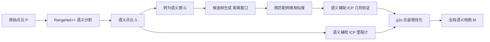

# SA-LOAM：语义辅助的激光 SLAM 与回环（arXiv:2106.11516）

**SA-LOAM**（*SA-LOAM: Semantic-aided LiDAR SLAM with Loop Closure*，Lin Li 等，浙江大学与华为诺亚方舟实验室，[arXiv:2106.11516](https://arxiv.org/abs/2106.11516)）。下文数字与章节号均指 arXiv v1 PDF；"作者自述"与"本页判断"分开标注。会议名 ICRA 2021 来自任务说明，PDF 正文未标。

## 一句话定义

**在开源 FLOAM（LOAM 的快速重实现）之上，用点云语义标签改造配准（分组匹配、分类下采样、平面约束），并集成"语义图 + 图匹配网络"的回环检测与位姿图优化，输出全局一致的语义地图（摘要、III-A）。**

## 英文缩写速查

| 缩写 | 英文全称 | 简要说明 |
|------|----------|----------|
| SLAM | Simultaneous Localization And Mapping | 同时定位与建图 |
| LOAM | LiDAR Odometry And Mapping | 边缘 / 平面特征的激光里程计与建图 |
| FLOAM | Fast LOAM | 本文所用的开源基线实现（引言、IV-A） |
| ICP | Iterative Closest Point | 迭代最近点配准 |
| ATE | Absolute Trajectory Error | 绝对轨迹误差，单位 m（表 III、IV） |
| RPE | Relative Pose Error | 相对位姿误差，KITTI 为 deg/100m 与 %（表 II） |
| g2o | General Graph Optimization | 位姿图优化库（III-C） |
| SUMA / SUMA++ | Surfel-based Mapping (++ 加语义) | 对比的面元 SLAM（II-A） |

## 为什么重要

- 作者问题（引言）：多数基于 LOAM 的改进缺少实用回环模块，无法消除累计误差；且只在低层几何基元上工作，难以支持"停在杆 / 树旁"这类高层指令。
- 作者主张：同时在里程计与回环两处用语义，而前人（SLOAM、SUMA++）主要只在配准中用（III-A）。
- 本页判断：它是"几何 LiDAR SLAM + 现成语义分割"的典型后融合路线，对需要语义地图的机器人有参考价值；但对机器人强化学习的关系是间接的（状态估计 / 建图模块），见下文局限。

## 核心机制

流程对应图 2 与 III-A。

### 语义辅助 ICP（III-B）

1. **按语义分组匹配：** 边缘子图、平面子图按标签 l 取同标签点，避免跨类错误匹配（受 SE-NDT [22] 启发）。
2. **语义下采样：** 不同类别用不同采样率，替代统一体素滤波，以保留小物体（图 3）。
3. **平面约束：** 地面平面法向应竖直、建筑平面法向应水平，不满足的拟合平面丢弃。
4. **残差（式 2）：** 边到线、点到面距离各乘语义权重 w_l。**注意：实验里 w_l 对各类取相同值**（IV-A），所以该权重在实验中并未起差异化作用，作者表示将来想找自动设权方法。

### 语义图回环（III-C）

- 候选生成（式 5）：σ 为里程计漂移率常数，δd 在 [δmin, δmax] 内随行驶距离变化；超过 Ncandi=64 个时随机抽样（作者认为比取最近帧合理）。
- 相似度：沿用前作 [16]，每帧最多 100 个节点（xyz+语义标签），语义图随位姿存入图地图复用；ζ=0.95 过滤，取最高 Nloop=5 个。
- 几何验证：对候选附近子图再做语义辅助 ICP，损失（式 2）大于 δr=100 则判假阳性。
- 优化：g2o 位姿图，误差为式 6。

## 实验与评测

| 数据集 | 指标 | 结果（均为论文自报） |
|--------|------|------|
| KITTI 00-10（表 II） | 平均 RPE 旋转 / 平移 | FLOAM 0.49/1.27；Ours-ODOM 0.31/0.76；Ours-LOOP 0.28/0.76；SUMA++ 0.28/0.94；LOAM 平移 0.84（引自原文） |
| KITTI 含回环 7 序列（表 III） | 平均 ATE (m) | ISC-LOAM 2.52；SUMA 7.59；SUMA++ 2.76；Ours-ODOM 3.49；Ours-LOOP 2.34 |
| Ford Campus 01-02（表 IV） | 平均 ATE (m) | FLOAM 4.62；ISC-LOAM 6.34；SUMA 40.05；SUMA++ 33.75；Ours-ODOM 5.18；Ours-LOOP 4.16 |

- 作者自述：回环使 ATE 相对里程计平均降低 32.9%（00 号 80.7%、05 号 75.3%，表 III）；回环主要降低旋转误差、对平移误差影响小（IV-B）；KITTI 上在 00、02、05、08 等长序列优于 SUMA++（IV-B）；Ford 上只有 Ours-LOOP 正确闭合回环（图 6，IV-C）。
- 本页核对：按表 III 逐序列读，Ours-LOOP 在 00、02、07 三个序列最小，05、06、09 为 SUMA++ 或 SUMA 更小，08 号 SUMA 最小（2.09 对 3.24）；因此"多数序列最小"（IV-B 原话 "smaller ATE on most sequences"）按表数字并不成立，成立的是 7 序列平均值最小（2.34）。表 II 中 Ours-LOOP 平均旋转误差与 SUMA++ 相同（0.28），平移更低。
- Ford 上 ODOM 平均 ATE（5.18）劣于 FLOAM（4.62），Ours-LOOP（4.16）才超过；说明语义 ICP 本身在跨数据集时并无稳定增益（本页判断，基于表 IV）。

## 与其他工作对比

| 工作 | 关注点 | 与本文的区别 |
|------|--------|--------------|
| 本文 SA-LOAM | 语义同时用于 LOAM 类里程计（语义辅助 ICP）与回环（语义图匹配） | 在 FLOAM 之上后融合 RangeNet++ 语义，纯 LiDAR |
| [LOAM](./paper-loam-lidar-odometry-and-mapping.md) / [A-LOAM](./paper-a-loam.md) | 边缘 / 平面特征的几何里程计与建图 | 无语义、无回环；表 II 中 LOAM 平均平移误差 0.84%（引自原文），本文 0.76% |
| [SuMa++](./paper-suma-plus-plus.md) | 面元地图 + 语义投影 ICP，剔除动态物体 | 语义主要用于配准；KITTI 7 序列平均 ATE 2.76 m 对本文 2.34 m（表 III），Ford 上 33.75 m 对 4.16 m（表 IV） |
| [Scan Context](./paper-scan-context.md) | 无语义的极坐标全局描述子做地点识别 | 纯几何回环；对照基线 ISC-LOAM 用强度版 Scan Context，表 III 平均 ATE 2.52 m |

## 结论

**SA-LOAM 说明在 LOAM 类几何前端上后接现成语义分割、并把语义同时用于配准与回环，可以降低长序列的绝对轨迹误差，但增益主要来自回环模块。**

1. 语义辅助 ICP 使 KITTI 平均 RPE 从 FLOAM 的 0.49/1.27 降到 0.31/0.76（表 II）。
2. 语义图回环使 ATE 相对里程计平均降低 32.9%，7 序列平均 2.34 m 为最低（表 III），但并非多数序列都最优。
3. Ford Campus 上只有 Ours-LOOP（4.16 m）优于 FLOAM（4.62 m），语义里程计本身（5.18 m）并无稳定增益（表 IV）。
4. 局限：无模块消融、语义权重取等值、未报告运行时间，语义模型与 KITTI 评测同源，泛化证据只有 Ford 两条序列。

## 工程实践

- 运行环境（IV-A）：i7-9750H、16GB、GTX1080；语义分割与图匹配网络均为 PyTorch 实现，需 GPU；RangeNet++ 预训练模型取自 SemanticKITTI，保留 12 类。
- 参数见表 I，作者称未穷尽调参。
- 论文**未报告运行时间或实时性数据**，也未给出自家代码链接；官方开源状态本页未核实。
- 若迁移到新传感器，需先验证分割质量（Ford 上分割明显变差，图 7）。

## 局限

作者自述：

- w_l 实验中取等值，自动设权留作未来工作（IV-A）。
- Ford 上语义分割明显差于 KITTI，会影响后续性能（IV-C）；所有方法参数在 KITTI 上调，Ford 上普遍变差（IV-C）。
- 未穷尽参数选择（IV-A）。

本页看到的未验证之处：

- 没有消融实验：语义分组匹配、语义下采样、平面约束三者各自贡献未拆开，只有 ODOM / LOOP 两档对比。
- 基线是 FLOAM 而非原版 LOAM；LOAM 数字引自原论文且仅有平移误差（表 II 注），不是同机复现。
- 仅两个数据集且同一款 Velodyne HDL-64E；语义模型在 SemanticKITTI 上训练，KITTI 评测与训练数据同源，泛化结论仅来自 Ford 两条序列。
- 纯 LiDAR，无 IMU 紧耦合；未与 LIO-SAM、FAST-LIO 等紧耦合系统对比。
- 动态物体、语义误分割对回环假阳性的影响没有专门分析；验证阈值 δr=100 的选取依据未说明。
- 本篇是 SLAM 论文而非机器人强化学习论文，与 RL 的联系仅在于它可作为状态估计 / 建图前端。

## 关联页面

- [LeGO-LOAM](../entities/lego-loam.md)：论文相关工作所讨论的 LOAM 轻量化变体
- [LIO-SAM](../entities/lio-sam.md)：因子图紧耦合激光惯性方案，对照纯 LiDAR 路线
- [LVI-SAM](../entities/paper-lvi-sam.md)
- [FAST-LIO](../entities/fast-lio.md)
- [Cartographer](../entities/cartographer.md)
- [状态估计](../concepts/state-estimation.md)
- [LiDAR 感知](../concepts/lidar-sensing.md)
- [LiDAR SLAM / LIO / VIO 选型对比](../comparisons/lidar-slam-lio-vio-selection.md)
- [机器人感知栈选型闭环](../queries/robot-perception-stack-selection-loop.md)：语义分割输出如何进入建图与下游模块

## 参考来源

- [sa-loam_arxiv_2106_11516.md](../../sources/papers/sa-loam_arxiv_2106_11516.md)
- [arXiv:2106.11516](https://arxiv.org/abs/2106.11516)

## 推荐继续阅读

- 前作：Kong 等，Semantic graph based place recognition for 3D point clouds，[arXiv:2008.11459](https://arxiv.org/abs/2008.11459)
- [LiDAR SLAM / LIO / VIO 选型对比](../comparisons/lidar-slam-lio-vio-selection.md)
- [arXiv PDF](https://arxiv.org/pdf/2106.11516v1)
