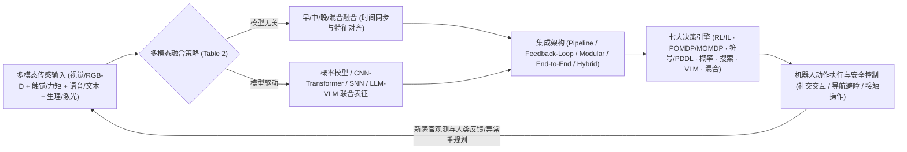

# Multimodal Perception-Driven Decision-Making for Human-Robot Interaction

**Multimodal Perception-Driven Decision-Making for Human-Robot Interaction: A Survey**（Wenzheng Zhao, Kruthika Gangaraju, Fengpei Yuan，Worcester Polytechnic Institute；*Frontiers in Robotics and AI*, Vol. 12, 2025-08-22，DOI: `10.3389/frobt.2025.1604472`）收录于 [Awesome Touch](https://github.com/sun254667/awesome-touch) **第 038/065** 篇，分组 **Surveys & Overviews**。本页基于论文全文完成精读与数据核实。

## 一句话定义

**Multimodal Perception-Driven Decision-Making for Human-Robot Interaction: A Survey** 是一篇严格遵循 **PRISMA** 流程的系统综述，系统梳理了 2004–2024 年间 66 篇融合视觉、语言、音频、触觉/力觉与生理信号驱动人机交互（HRI）机器人决策的代表性研究，构建了涵盖“传感器融合策略—集成系统架构—七大决策范式”的三层技术分类框架。

## 英文缩写速查

| 缩写 | 英文全称 | 简要说明 |
|------|----------|----------|
| MPDDM | Multimodal Perception-Driven Decision-Making | 多模态感知驱动决策，本文核心研究范式 |
| HRI / HRC | Human-Robot Interaction / Collaboration | 人机交互与人机协作（覆盖社交、导航、工业与通用规划） |
| PRISMA | Preferred Reporting Items for Systematic Reviews and Meta-Analyses | 系统综述与荟萃分析标准检索筛选流程 |
| POMDP / MOMDP | Partially / Mixed Observability Markov Decision Process | 部分可观测与混合可观测马尔可夫决策过程 |
| VLM / VLA | Vision-Language Model / Vision-Language-Action | 视觉-语言大模型与视觉-语言-动作策略模型 |

## 为什么重要

- **跨领域打通感知与决策闭环**：既有 HRI 综述多局限于单一工业制造场景或单模态（如纯视觉、纯对话管理），本文横跨医疗助老、社会导航、工业装配与通用任务规划四大域，重点剖析“多模态融合表征如何真正转化为决策输入与动作重规划”。
- **提供面向工程选型的体系化对照表**：从早/中/晚/混合与基于模型融合的算力-鲁棒性权衡（Table 2），到流水线、反馈环、模块化、端到端与混合架构的适用边界（§3.4），再到 66 篇研究的逐篇传感器/融合/决策拆解（Table 3），便于系统级方案选型。
- **锚定具身触觉与多模态协同痛点**：阐明视听触跨模态互补在非结构化人机近距接触中的核心价值，并点明传感器时间对齐（如振动淹没触觉、拥挤噪声遮蔽语音）与闭环失败恢复等工程瓶颈。

## 核心信息

| 字段 | 内容 |
|------|------|
| 编号 | 038/065 |
| 分组 | Surveys & Overviews |
| 出处 | Frontiers in Robotics and AI, Vol. 12 (2025-08-22) |
| 作者与机构 | Wenzheng Zhao, Kruthika Gangaraju, Fengpei Yuan（Department of Robotics Engineering, WPI） |
| DOI / 论文 | DOI: `10.3389/frobt.2025.1604472` · <https://www.frontiersin.org/journals/robotics-and-ai/articles/10.3389/frobt.2025.1604472/pdf> |

## 核心机制

1. **多模态数据融合策略分类（§3.3, Table 2）**
   - **模型无关融合（Model-Agnostic）**：包括**早期融合**（原始数据级对齐拼接，能学底层跨模态关联但抗噪差）、**中期融合**（各模态先独立提特征再权重/拼接/注意力对齐，如 RGB 框与 LiDAR 深度对齐）、**晚期融合**（决策级投票/平均/置信度加权，对单传感器失效最鲁棒但丢失早期交互）与**混合融合**（如信号+特征+符号多层融合用于柔顺避障与抓取，Dean-Leon et al., 2017）。
   - **模型驱动融合（Model-Based）**：通过概率图模型/POMDP 信念更新、脉冲神经网络（SNN/LIF 神经元）、CNN/Transformer 交叉注意力、图网络（GraphNet / 知识图谱）及大模型（GIT / GPT-4V / CLIP）联合学习最优融合权重。

2. **五类感知–决策集成架构（§3.4, Fig. 2）**
   - **流水线架构（Pipeline）**：多模态并行预处理并在协调层时间同步拼接（如 80 ms / 12.5 Hz 基准对齐激光雷达、Kinect RGB-D 与麦克风阵列），适合低延迟响应。
   - **反馈环架构（Feedback-Loop）**：决策输出反向调节感知探索（如 **MEAL** 框架用 POMDP 迭代选择“看/抓/摇”探索动作并在线更新物体属性信念）。
   - **模块化架构（Modular）**：基于 ROS topic/service 拆分感知、力触觉、运动规划与高层决策节点，易升级但存在模块通信协调开销。
   - **端到端架构（End-to-End）**：统一模型直出动作或技能序列（如微调 Mistral 7B 融合人类指令、视觉观测与动作可行性分数并支持人类纠错）。
   - **混合架构（Hybrid）**：结合并行通道与自上而下反馈（如仿脑 DPU 并行流水线 + SNN 高层自上而下约束底层识别）。

3. **七大决策方法论体系（§3.5, Table 3）**
   - 涵盖：**学习驱动范式**（监督学习、RL、模仿学习）、**数学规划建模**（MDP/POMDP/MOMDP/博弈论）、**符号与逻辑规划**（规则库、STRIPS/HTN、知识图谱、ASP/PDDL）、**概率推断**（贝叶斯网络、HMM/CHMM、EKF、因子图）、**搜索规划**（A*/D*/MCTS/CORPP）、**生成式 AI 决策**（LLM/VLM 零少样本规划与 GAIL）以及**混合范式**（如 `VLM + PDDL` 实现开集世界失败状态更新与重规划）。

### 方法流程图

## 评测与指标

作为遵循 **PRISMA** 规范的系统综述，本文的量化筛选漏斗、代表性实证收益与四域特征汇总如下：

1. **PRISMA 文献检索与筛选漏斗（§2.1, Fig. 1，2004–2024）**
   - 检索覆盖 7 大数据库（Google Scholar **502**、ACM DL **43**、SpringerLink **30**、ScienceDirect **30**、Scopus **3**、Web of Science **2**、IEEE Xplore **1**），去重后剩余 **511 篇**；摘要初筛排除 **233 篇**（非英文或缺少三要素），**278 篇**进入全文资格审查，最终纳入 **66 篇**含完整技术细节与实证案例的研究（Table 3 全量拆解）。

2. **综述实证与系统设计核心量化基准（§3.2–3.4）**

| 维度 / 案例 | 对比对象 / 配置 | 原文记录量化指标与结果 |
|---|---|---|
| 跨模态感知增益（Zhang et al., 2021） | 音频 + 触觉 + 视觉 vs 纯视觉探索 | 物体属性描述准确率提升 **50%**（§3.2.2） |
| 异构传感器实时同步（Vaufreydaz et al., 2016） | 12.5 Hz 激光（270° FOV）+ 30 Hz RGB-D + 8 Hz 麦阵 | 统一对齐至 **80 ms（12.5 Hz）** 基线特征拼接（§3.4.1） |
| 肌肉/生理信号同步（Zhou & Wachs, 2019） | EEG + EMG + 姿态 + 声学特征 | **20 Hz** 频率同步列拼接，实现早期意图预测（Table 3） |
| 四大应用域对比（Table 1） | 社交助老 / 移动导航 / 工业协作 / 通用规划 | 归纳各自鲁棒性收益及文化差异、算力负载、遮挡与隐私等制约 |

## 与其他工作对比

- **对比窄域/单模态 HRI 综述**：Wang & Feng (2024)、Duan et al. (2024)、Bonci et al. (2021) 主要聚焦智能制造，Robinson et al. (2023) 侧重视觉，Reimann et al. (2024) 侧重对话管理；本文横跨四大应用场景且强耦合“融合”与“决策”两环。
- **对比具身 VLA / 触觉专题工作**：本文为上层综述框架，具体的纯视觉–触觉–语言–动作（VTLA）端到端模型与高分辨率视触觉传感器硬件实现可回看 [Awesome Touch 技术地图](../overview/sun-awesome-touch-technology-map.md) 与 [vla.md](../methods/vla.md)。

## 常见误区或局限

1. **计算复杂度与实时性难以兼得（§4.1.1）**：随着视觉、点云、语音与触觉并发接入，深度融合网络极易压垮机载算力，许多系统被迫在状态表征精度与帧率间妥协；引入混合可观测 `POMDP/MOMDP` 后，大状态空间求解复杂度进一步剧增。
2. **近距交互中的物理噪声耦合**：机械运动振动易淹没力/触觉通道信号，人群环境声学重叠会干扰语音意图识别，强反光与动态照明同样会破坏 RGB-D 与 LiDAR 标定对齐。
3. **跨人群、跨文化与长期部署退化（§4.1.2–4.1.3）**：社会与助老机器人对用户年龄、认知能力与文化习惯（如手势、社交距离）极度敏感，实验室调优的多模态系统跨场景即失效，且在线持续学习易受灾难性遗忘与漂移困扰。
4. **“黑箱”融合削弱人机信任（§4.2.2）**：端到端深度学习与大模型决策虽精度高，但缺乏故障归因透明度；未来需结合思维链（CoT）、动作失败语义解释与实时人工纠错回路。

## 结论

**《Multimodal Perception-Driven Decision-Making for Human-Robot Interaction: A Survey》通过 PRISMA 筛选 20 年间 66 篇核心研究，系统建立了“6 模态—5 融合—5 架构—7 决策”的 MPDDM 知识图谱，指出多模态感知向可信人机决策演进的关键瓶颈已从“堆砌传感器”转向实时对齐、长程自适应与可解释闭环重规划。**

- **依据故障模式选择融合阶段而非盲目端到端**：单传感器易失灵或噪声异质时优先采用中期特征对齐或晚期置信度融合；仅在算力充足且有高质同步数据时考虑端到端/模型驱动注意力融合。
- **面向工业与接触丰富场景优先采用模块化或反馈环架构**：利用 POMDP/MOMDP 主动探索循环或力-位混合反馈弥补视觉遮挡（如 MEAL 框架），并保留安全急停与局部重规划旁路。
- **大模型与符号规划混合（`VLM + PDDL`）是兼顾泛化与可解释的务实路线**：用 VLM 处理开集语义理解与异常状态更新，用符号规划器保证前置约束与可审计动作序列。
- **系统落地必须前置考虑时间戳同步、隐私合规与持续微调**：硬件层做好异构频率对齐与标定漂移自检，应用层针对医疗/家庭隐私及跨用户习惯差异设计低遗忘在线适应机制。

## 关联页面

- 列表实体：[Awesome Touch](../entities/awesome-touch.md)
- 技术地图：[Awesome Touch 技术地图](../overview/sun-awesome-touch-technology-map.md)
- 方法/任务：[vla.md](../methods/vla.md)、[manipulation.md](../tasks/manipulation.md)

## 参考来源

- [`sources/papers/sun_awesome_touch_noarxiv_038_multimodal-perception-driven-decision-ma.md`](../../sources/papers/sun_awesome_touch_noarxiv_038_multimodal-perception-driven-decision-ma.md) — 本条目策展摘录
- [`sources/papers/sun_awesome_touch_catalog.md`](../../sources/papers/sun_awesome_touch_catalog.md) — 列表总表
- [`sources/repos/awesome-touch.md`](../../sources/repos/awesome-touch.md)
- 论文：<https://www.frontiersin.org/journals/robotics-and-ai/articles/10.3389/frobt.2025.1604472/pdf>

## 推荐继续阅读

- [Awesome Touch 仓库](https://github.com/sun254667/awesome-touch)
- [原文（Frontiers in Robotics and AI, 2025）](https://www.frontiersin.org/journals/robotics-and-ai/articles/10.3389/frobt.2025.1604472/pdf)
