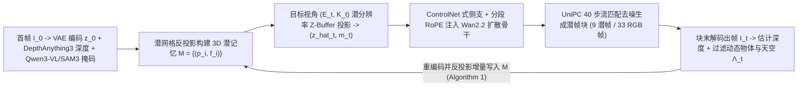

# Latent Spatial Memory for Video World Models (Mirage)

**Latent Spatial Memory for Video World Models**（系统名 **LSM-World**，arXiv:2606.09828v2；浙江大学、微软亚洲研究院、阿德莱德大学、莫纳什大学）收录于 [Awesome World Models](https://github.com/sun254667/awesome-world-models) **第 004/571** 篇，分组 **101 Memory Mechanisms**。本页基于论文全文完成精读与数据核实。

## 一句话定义

**Latent Spatial Memory（LSM-World）** 是一种直接在视频扩散骨干原生 **VAE 潜空间**中构建、投影读出并按块更新持久 3D 空间记忆的架构：以世界坐标与潜向量对 $\mathcal{M} = \{(p_i, f_i)\}$ 替代 RGB 点云缓存，彻底省去每步条件化时的全分辨率光栅化渲染与 VAE 重编码往返，实现高几何一致性的长程相机可控视频生成。

## 英文缩写速查

| 缩写 | 英文全称 | 简要说明 |
|------|----------|----------|
| LSM | Latent Spatial Memory | 潜空间 3D 持久记忆缓存 $\mathcal{M} = \{(p_i, f_i)\}$ |
| VAE | Variational Autoencoder | 变分自编码器；Wan2.2 压缩率为 $4 \times 16 \times 16$（空间步幅 $s=16$，通道 $C=48$） |
| RoPE | Rotary Positional Embedding | 分段感知旋转位置编码，区分噪声目标帧、干净前序帧与参考帧 |
| LoRA | Low-Rank Adaptation | 低秩微调适配器（阶段二 rank=32，$\alpha=32$），用于轻量对齐潜记忆条件 |
| PSNR / LPIPS | Peak Signal-to-Noise Ratio / Learned Perceptual Image Patch Similarity | 新视角合成与闭环重访重建质量评价指标 |

## 为什么重要

- **打破 RGB 点云记忆的“双瓶颈”**：在 257 帧推演剖析中，传统 RGB 点云方案每步“全分辨率光栅化 + VAE 编码”占去单步开销的 **98% 以上**，且像素空间往返会因 VAE 重建误差和分布偏移丢失语义与纹理细节。
- **天然在原生潜流形内对齐条件**：潜空间读出张量 $\hat{z}_t$ 与骨干网络直接对齐，缓存空间占用按空间步幅平方缩放（缩减比例 $s^2 \cdot 3/C$），随推演时长增加始终维持极低显存与读出耗时。
- **即插即用适配大型视频生成骨干**：通过“冻结骨干练侧支 + 冻结侧支练 LoRA”的两阶段流匹配微调，在不破坏 `Wan2.2-TI2V-5B` 外观与运动先验的前提下赋予其长程闭环 3D 记忆。

## 核心信息

| 字段 | 内容 |
|------|------|
| 编号 | 004/571 |
| 分组 | 101 Memory Mechanisms |
| 出处 | arXiv:2606.09828v2 (2026-06 / v2 2026-08) |
| 作者与机构 | Weijie Wang, Haoyu Zhao, Yifan Yang, Feng Chen, Yefei He, Zicheng Duan, Donny Y. Chen, Yuqing Yang, Zeyu Zhang, Bohan Zhuang（ZJU / MSR / Adelaide / Monash） |
| 论文与项目 | <https://github.com/microsoft/LatentSpatialMemory> · <https://arxiv.org/abs/2606.09828> · 项目页 `aka.ms/latent-spatial-memory` |

## 核心机制

1. **潜空间记忆初始化与针孔反投影构建（§4.2, Appendix A）**
   - 将空间记忆定义为带潜特征的 3D 点集 $\mathcal{M} = \{(p_i, f_i) \mid p_i \in \mathbb{R}^3, f_i \in \mathbb{R}^C\}$（Eq. 3）。
   - 对初始帧 $I_0$ 用 VAE 编码得 $z_0 = \mathcal{E}(I_0) \in \mathbb{R}^{C \times h \times w}$，同时由 **DepthAnything 3** 预测度量深度 $D$ 并双线性下采样至潜网格 $h \times w$（对比最近邻/面积/中值池化，双线性空洞率最低 **42.53%**，Table 5），内参同步缩放为 $K^\ell = \operatorname{diag}(w/W, h/H, 1)K$（Eq. 7），逐潜格 $(u,v)$ 反投影为世界坐标 $p_{uv} = \pi^{-1}(u, v, D(u,v); K^\ell, E)$ 并绑定对应潜 token $F_{uv} = z[:, v, u]$（Eq. 4 & 8）。

2. **潜分辨率 Z-Buffer 投影读出与侧支注入（§4.3）**
   - 对目标视角 $(E_t, K_t)$，将 $\mathcal{M}$ 直接投影到目标潜分辨率网格 $\pi^\ell(q_i)$，对正深度候选集 $\Omega_t(u, v)$ 取最前端点：
     $$i_t(u, v) = \arg\min_{i \in \Omega_t(u,v)} [E_t p_i]_z, \qquad \hat{z}_t(u, v) = F_{i_t(u,v)}$$
   - 空单元置零并生成二值可见性掩码 $m_t \in \{0, 1\}^{h \times w}$ 区分“未观测空洞”与“零特征表面”。读取复杂度从 RGB 的 $\Theta(N\log N + HW) + \Theta(\Phi_E(H,W))$ 降为 $\Theta(N\log N + hw)$。
   - 将 $(\hat{z}_t, m_t)$ 拼接送入镜像 `Wan2.2` VACE 模块的 **ControlNet 式侧支**注入扩散骨干（`Wan2.2-TI2V-5B`，每块 9 个潜帧 $44 \times 80$，对应 $704 \times 1280$ 分辨率 33 帧 RGB，块间重叠 1 帧），并利用分段感知 RoPE 区分噪声目标帧、干净前序帧与参考帧。

3. **动态过滤与两阶段流匹配训练（§4.4–4.5, Algorithm 1）**
   - **块级自回归记忆更新**：每生成一块后仅解码一次出帧 $I_t$，经 DepthAnything 3 估计深度，并用 **Qwen3-VL-2B** 实体提取 + **SAM3** 生成前景动态物体与天空掩码 $\Lambda_t$ 并剔除之（防止移动目标污染静态 3D 缓存），再重编码反投影追加 $\mathcal{M} \leftarrow \mathcal{M} \cup \{(p_{uv}, F_{uv})\}_{(u,v)\in\Lambda_t}$（Eq. 6）。
   - **两阶段训练（RealEstate10K + ViPE 标注，32 × A100，全局 batch=64）**：Stage 1 冻结骨干与 VAE 仅训侧支（lr $10^{-5}$）；Stage 2 冻结侧支并微调注意力层 rank-32 LoRA（lr $10^{-4}$），均采用 Flow Matching 目标。推理使用 UniPC 采样器 40 步（无 CFG）。

### 方法流程图

## 评测与指标

1. **WorldScore 世界生成综合基准（Table 1）**

| 方法 | Average Score ↑ | Static Score ↑ | Dynamic Score ↑ | 3D Cons ↑ | Photo Cons ↑ | Camera Ctrl ↑ |
|---|---|---|---|---|---|---|
| WonderJourney（3D 缓存） | 54.19 | 63.75 | 44.63 | 80.60 | 79.03 | 84.60 |
| WonderWorld（3D 缓存） | 61.79 | 72.69 | 50.88 | 86.87 | 85.56 | 92.98 |
| FlashWorld（3D 缓存） | 60.23 | 70.85 | 49.60 | 85.87 | 86.72 | 84.43 |
| CogVideoX-I2V（无缓存） | 60.64 | 62.15 | 59.12 | 86.21 | 88.12 | 38.27 |
| Spatia（RGB 3D 缓存） | 69.73 | 72.63 | 66.82 | 86.40 | 89.10 | 75.66 |
| **LSM-World (Ours)** | **70.36** | **73.60** | **67.11** | **92.21** | **93.95** | **96.91** |

2. **RealEstate10K 新视角合成与闭环重访一致率（Table 2）**

| 方法 | NVS PSNR ↑ | NVS SSIM ↑ | NVS LPIPS ↓ | Closed-Loop $\text{PSNR}_C$ ↑ | Closed-Loop $\text{SSIM}_C$ ↑ | Closed-Loop $\text{LPIPS}_C$ ↓ |
|---|---|---|---|---|---|---|
| ViewCrafter | 15.78 | 0.580 | 0.396 | 14.79 | 0.481 | 0.365 |
| Voyager | 17.79 | 0.636 | 0.297 | 17.66 | 0.540 | 0.380 |
| Spatia | **18.58** | 0.646 | 0.254 | 19.38 | 0.579 | **0.213** |
| **LSM-World (Ours)** | 18.38 | **0.779** | **0.250** | **20.05** | **0.825** | 0.228 |

3. **单卡 H100 效率、消融与盲测用户研究（Fig. 6, Table 3–4, Fig. 8）**
   - **推理效率与显存**：匹配推演长度下端到端视频生成提速达 **10.57×**，3D 缓存峰值显存降低 **55×**；首块建图后每帧缓存读取耗时稳定在 **0.25 s/frame**（RGB 基线达 2.87–7.63 s/frame），5 个 Chunk 内缓存显存仅由 **0.46 MiB 增至 2.25 MiB**（对比 Spatia/Gen3C/VMem 的 43.8–98.4 MiB）。
   - **关键消融（Table 3 & 4）**：换用 RGB 点云缓存平均分从 **70.36** 降至 **67.71**；将潜特征上采样至像素级反投影暴跌至 **60.85**；关闭动态物体过滤降至 **61.20**（3D 一致性 92.21 → 80.88）；取消两阶段训练直接联合微调降至 **63.18**。更换深度估计器时保持稳健（DepthAnything 3: `70.36` vs MapAnything: `69.66` vs UniDepth: `69.13`）。
   - **人类盲测（30 场景 × 25 评委，0–5 分）**：在 5 项维度全部第一——场景重访一致性 **4.6**、相机跟随 **4.3**、外观保真 **4.1**、时间平滑 **4.3**、总体质量 **4.2**。

## 与其他工作对比

- **对比 RGB 空间记忆系统（Spatia / Voyager / WonderWorld / Gen3C）**：RGB 方案必须在每一步采样中光栅化稠密点云并再走一遍 VAE 编码，导致 98% 以上时间浪费在空间往返且丢失高频潜特征；LSM-World 把高频读出完全留在潜空间，仅在每 33 帧 Chunk 末尾解码并更新一次记忆。
- **对比视角记忆模型（VMem / SEVA）**：不依赖像素视角插值或 surfel 像素渲染，在 RealEstate10K 上显著超越 SEVA（PSNR 13.07）与 VMem（PSNR 14.62），且支持长程任意重访闭环。同分组记忆机制对比详见 [Awesome World Models 技术地图](../overview/sun-awesome-wm-technology-map.md)。

## 常见误区或局限

1. **刻意排除动态前景的静态刚体假设（§6）**：为防止过时运动物体残影污染 3D 缓存，更新阶段通过 `Qwen3-VL + SAM3` 过滤了移动物体与天空，这意味着**以高频动态交互为主的场景难以从潜记忆中持久保持动态实体状态**。
2. **并非完全零像素操作**：虽然每步条件读出全在潜空间，但为运行基于图像的深度估计器与实体分割器，每个 Chunk 生成结束时仍需执行一次 VAE 解码与重编码来增量写入 $\mathcal{M}$（只不过成本按 Chunk 均摊）。
3. **重度依赖下采样深度质量策略**：表 5 表明深度图下采样方式对遮挡空洞率影响明显（双线性 42.53% 虽低于面积池化 53.72%，但仍在边缘存在 40%+ 未命中空洞），仍需可见性掩码 $m_t$ 引导侧支补全。

## 结论

**《Latent Spatial Memory for Video World Models（LSM-World）》通过将 3D 场景缓存彻底迁移至视频扩散模型的 VAE 潜空间并配以 ControlNet 式侧支与动态过滤，以 10.57× 的提速与 55× 的显存降幅超越 RGB 点云记忆方案，在 WorldScore（70.36）和 RealEstate10K 闭环重访中树立了长程 3D 一致世界模型的新标杆。**

- **长程视频世界模型应坚持“在生成器的原生潜空间建记忆”**：避免像素空间渲染-重编码不仅加速一个数量级，而且显著保留语义/纹理特征（Table 3 提升 +2.65 平均分）。
- **几何对齐应下采样深度而非上采样潜特征**：将潜特征强行插值回像素空间再反投影会破坏预训练分布（Avg 70.36 → 60.85），正确路径是将深度与内参按 VAE 步幅 $s$ 缩放到潜网格。
- **动态掩码过滤与两阶段解耦训练缺一不可**：缺少动态过滤会导致 3D 一致性大幅下滑（-11.33），而直接联调骨干与未成熟侧支会损伤生成先验（-7.18）。
- **面向具身操作与动态交互的后续演进方向**：当前动态实体被过滤在持久记忆之外，未来需将可变形/可移动物体的瞬时轨迹或潜状态槽位（Object-centric slots）纳入跨 Chunk 记忆。

## 关联页面

- 列表实体：[Awesome World Models](../entities/awesome-world-models.md)
- 技术地图：[Awesome World Models 技术地图](../overview/sun-awesome-wm-technology-map.md)
- 方法/任务：[generative-world-models.md](../methods/generative-world-models.md)、[manipulation.md](../tasks/manipulation.md)

## 参考来源

- [`sources/papers/sun_awesome_wm_noarxiv_004_latent-spatial-memory-for-video-world-mo.md`](../../sources/papers/sun_awesome_wm_noarxiv_004_latent-spatial-memory-for-video-world-mo.md) — 本条目策展摘录
- [`sources/papers/sun_awesome_wm_catalog.md`](../../sources/papers/sun_awesome_wm_catalog.md) — 列表总表
- [`sources/repos/awesome-world-models.md`](../../sources/repos/awesome-world-models.md)
- 论文：<https://github.com/microsoft/LatentSpatialMemory>

## 推荐继续阅读

- [Awesome World Models 仓库](https://github.com/sun254667/awesome-world-models)
- [官方代码与项目仓库](https://github.com/microsoft/LatentSpatialMemory)
