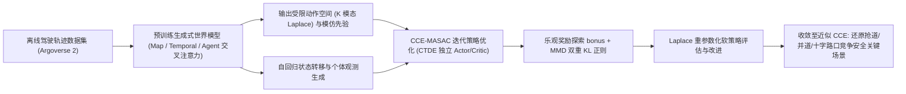

# MARL-CCE

**MARL-CCE: Modelling Competitive Behaviors in Autonomous Driving Under Generative World Model**（ECCV 2024，香港中文大学（深圳）& 曼彻斯特大学）收录于 [Awesome World Models](https://github.com/sun254667/awesome-world-models) **第 457/571** 篇，分组 **82 Autonomous Driving**。本页基于 ECCV 2024 正文 18 页论文完成结构化精读与核实。

## 一句话定义

**MARL-CCE** 在离线自动驾驶轨迹数据上预训练多模态生成式世界模型以构建闭合受限动作空间与环境动力学，并提出 **CCE-MASAC** 算法联合乐观价值更新与磁镜像下降（MMD），求解多车一般和马尔可夫博弈的粗糙相关均衡（CCE）以仿真长尾安全关键竞争行为。

## 英文缩写速查

| 缩写 | 英文全称 | 简要说明 |
|------|----------|----------|
| CCE | Coarse Correlated Equilibrium | 粗糙相关均衡，允许智能体策略依赖共享历史而产生相关性，比纳什均衡更易收敛 |
| GS-MG | General-Sum Markov Game | 一般和马尔可夫博弈，各交通参与者拥有各自独立奖励函数而非零和或全合作 |
| Dec-POMDP | Decentralized Partially Observable Markov Decision Process | 去中心化部分可观测马尔可夫决策过程，刻画局部观测与多车交互 |
| MMD | Magnetic Mirror Descent | 磁镜像下降，通过 Bregman 散度（负熵下为 KL）同时约束策略靠近模仿策略与上一轮策略 |
| CTDE | Centralized Training with Decentralized Execution | 集中式训练、分布式执行的多智能体强化学习架构 |

## 为什么重要

- **纯模仿学习交通仿真器缺乏长尾博弈反事实响应**：基于离线数据集的模仿学习擅长复现常规驾驶，但对紧急制动、强行加塞、逆行避险等分布尾部（OoD / 长尾）安全关键交互缺乏闭环反应；现有单车对抗扰动又忽略了周边车辆对自车动作的动态博弈响应。
- **用 CCE 替代 NE 解决一般和连续驾驶博弈的可解性难题**：纳什均衡（NE）要求各智能体策略严格独立且在多均衡一般和博弈中难以收敛；CCE 允许策略条件化于全员交互历史，既贴合人类司机依据他车历史行为决策的直觉，又具备更宽松的存在性与收敛保证。

## 核心信息

| 字段 | 内容 |
|------|------|
| 编号 | 457/571（Awesome World Models） |
| 分组 | 82 Autonomous Driving |
| 出处 | ECCV 2024（pp. 1–18） |
| 作者与机构 | Guanren Qiao, Guorui Quan, Rongxiao Qu, Guiliang Liu（香港中文大学（深圳）、曼彻斯特大学） |
| 论文 | <https://www.ecva.net/papers/eccv_2024/papers_ECCV/papers/05085.pdf> |
| 代码/项目 | <https://github.com/qiaoguanren/MARL-CCE> |

## 核心机制

1. **Dec-POMDP 与一般和马尔可夫博弈形式化（GS-MGs）**
   - 将多车交互建模为 $(\mathcal{S}, \{\Omega_i, A_i, O_i, r_i\}_{i=1}^I, p_T, \gamma, \mu_0)$：动作空间为步长 $\Delta t$ 内的相对位移 $(\Delta x, \Delta y)$，各车拥有个体奖励 $r_i$（以最短时间到达目标为主），策略依赖联合历史 $h_t = \{(o_{i,\iota}, a_{i,\iota})\}_{\iota=0,i=1}^{t-1,I}$，目标是同时满足 $\epsilon$-近似 CCE（低可利用度 exploitability）与人类驾驶行为保真度（$D_f(\hat{\pi}, \pi^o) \le \xi$）。
2. **基于多模态交叉注意力的生成式世界模型**
   - **上下文感知转移模型**：Map Encoder 编码静态地图 $\zeta$ 为 $z^c$，Agent-to-Map Cross Attention 将地图融合进各车近期轨迹，拼接时间窗口 $W$ 内的历史特征更新潜状态 $s_{t+1}$（每步将输出的相对位移与速度重算锚点转换为绝对坐标系输入下一步）。
   - **受限候选动作预测器（Mixture of Laplace Policies）**：依次通过 Agent-to-Temporal Cross Attention 与 Agent-to-Agent Cross Attention 融合时序与周车时空交互，由 $K$ 个候选策略 MLP 预测拉普拉斯分布参数 $(\mu_{i,t}^k, b_{i,t}^k)$ 及模态权重 $\omega_i^k$，形成受限策略空间 $\Pi_i^c$ 与模仿先验 $\pi_i^o$；监督目标由最优模态负对数似然 `bestmode_loss` 与模态分类 `cls_loss` 组成。
   - **个体观测模型**：通过 $o_{i,t} = f_i^{\text{MLP}}(z_{i,t}^A)$ 将世界模型状态映射为智能体局部观测。
3. **CCE-MASAC：乐观 Bellman 更新 + 磁镜像下降（MMD）**
   - 在世界模型提供的闭环轨迹缓冲区 $B$ 中，按 CTDE 为每个智能体独立参数化双 Critic（$\phi, \hat{\phi}$）和 Laplace 重参数化 Actor（$\theta$）。
   - **乐观价值函数**：在奖励中加入反比于状态访问密度 $m(s)$ 的探索奖励 $\alpha_t(s) = c / m(s)$，即 $r_i^{\text{opti}} = r_i + \alpha_t(s)$，将离散 CCE-V-Learning 扩展至连续驾驶空间。
   - **磁镜像下降（MMD）正则**：取负熵镜像映射将 Bregman 散度化简为时间因果 KL 散度：一方面以 $\eta_1 D_{\text{KL}}(\pi_{i,t} \| \pi_{i,t}^o)$ 锚定世界模型模仿策略 $\pi^o$ 保持人类驾驶风格保真度，另一方面以 $\frac{1}{\eta_2} D_{\text{KL}}(\pi_{i,t} \| \pi_{i,t}^{j-1})$ 稳定跨迭代更新；化简后等价于最大因果熵目标（带对数先验加权软 Bellman 备份），并通过均匀噪声重参数化 $a = \mu - b\,\text{sgn}(\epsilon)\ln(1 - |\epsilon|)$ 实现可微策略梯度更新。

### 方法流程图

## 评测与指标

本文在 **Argoverse 2** 中选取 4 个未参与预训练的保留（hold-out）高竞争交通场景进行评测，每组实验使用 **3 个随机种子**，核心指标为**可利用度（CCE-gap）**$\sum_{s\in\tau}[V_{0,i}^{\dagger,\pi_{-i}}(s) - V_{0,i}^\pi(s)]$（越低越接近均衡）与**折扣累积奖励（Discounted Cumulative Rewards）**。

| 评测维度 | 对比基线 | 18 页主论文核实结论（注：精确 CCE-gap 数值表 Table 2 位于外部附录 Appendix F，主 PDF 未收录） |
|----------|----------|---------------------------------------------------------------------------------------------|
| 4 类 Argoverse 2 高竞争测试场景 | - | 1) 逆行车辆对峙（Wrong-way driving）；2) 四向车道交叉口（Four-lane intersection）；3) T 型路口密集并道（T-junction merging）；4) 密集四向交叉口（Dense-lane intersection） |
| 均衡收敛（CCE-gap ↓，Fig. 3） | `QCNext` / `GameFormer`（监督轨迹预测） | 仅模仿真值轨迹未建模多车竞争反应，CCE-gap 显著偏高 |
| 均衡收敛（CCE-gap ↓，Fig. 3） | `MAPPO` | 训练过程不稳定，难以收敛到有效 CCE |
| 均衡收敛（CCE-gap ↓，Fig. 3） | `MASAC` | 表现优于模仿基线与 MAPPO，但缺少乐观探索与 MMD 约束，CCE-gap 仍高于 **CCE-MASAC** |
| 均衡收敛（CCE-gap ↓，Fig. 3） | **CCE-MASAC（本文）** | 在全部 4 个场景及各受控智能体上收敛最快且取得最低 CCE-gap |
| 世界模型闭环控制效用（§5.2，Fig. 4） | 单智能体 `SAC` vs `QCNet` vs `CCE-MASAC` | 世界模型内部训练的单智能体 `SAC` 累积奖励高于直接模仿 `QCNet`；而多智能体 `CCE-MASAC` 单车累积奖励低于单智能体 `SAC`，反映自利多车竞争导致拥堵与占道/激进并道等真实博弈折中 |

## 与其他工作对比

- **对比层次博弈预测器（GameFormer）与多车联合预测（QCNet / QCNext）**：监督式轨迹预测聚焦开环贴合人类历史均值，在遇到对手超分布对抗策略时可利用度大；CCE-MASAC 在学到的世界模型中显式进行多智能体强化学习闭环博弈。
- **对比无正则 MARL（MAPPO / MASAC）**：引入模仿先验 $\pi^o$ 的磁正则（$\eta_1 D_{\text{KL}}$）既抑制了高维连续驾驶策略偏离真实道路行为（保证保真度），又借助乐观贝尔曼与前代锚定提升了多车一般和博弈收敛稳定性。同分组工作可参见 [Awesome World Models 技术地图](../overview/sun-awesome-wm-technology-map.md) 与 [基于模型的强化学习](../methods/model-based-rl.md)。

## 常见误区或局限

1. **未显式建模硬安全/运动学约束（§5.4）**：CCE-MASAC 当前仅依赖奖励与模仿 KL 锚定，未在算法层加入碰撞、速度或安全距离硬约束，智能体在极端竞争下可能发生违规或碰撞而无法体现合规避险行为。
2. **仅聚焦纯竞争博弈，忽略合作与礼让行为（§5.4）**：当前将各车设定为严格自利的一般和个体奖励，难以刻画真实交通中并道让行、协作通行等混合合作–竞争（mixed cooperative-competitive）场景。
3. **18 页主会议 PDF 不含附录 A–F 细则**：正文中引用的 CCE-gap 数值总表（Table 2 in Appendix F）、超参数配置（Appendix B）及最佳响应 $\pi_i^\dagger$ 构造细节（Appendix A）位于单独的补充材料中，复现时需结合官方代码仓库 <https://github.com/qiaoguanren/MARL-CCE> 核对配置。

## 结论

**MARL-CCE 证明在基于离线驾驶数据预训练的多模态生成式世界模型之上，结合乐观探索与磁镜像下降（MMD）求解一般和马尔可夫博弈 CCE，可有效仿真高度互动的自动驾驶长尾竞争场景。**

- 构建闭环对抗交通仿真器时，采用“受限多模态 Laplace 策略空间 + 磁正则锚定人类模仿先验 $\pi^o$”可在博弈激进性与驾驶真实性之间取得可控平衡。
- 在一般和连续交通博弈中，以依赖历史交互的 **CCE** 替代严格独立的 **NE**，结合 CTDE 独立 Actor/Critic 参数化能显著改善收敛稳定性。
- 若直接将该框架用于安全边界压力测试，应在奖励或策略层额外引入速度/安全距离约束与合作礼让项，避免纯粹自利策略产生非现实死锁或碰撞。

## 关联页面

- 列表实体：[Awesome World Models](../entities/awesome-world-models.md)
- 技术地图：[Awesome World Models 技术地图](../overview/sun-awesome-wm-technology-map.md)
- 方法/任务：[generative-world-models.md](../methods/generative-world-models.md)、[model-based-rl.md](../methods/model-based-rl.md)、[manipulation.md](../tasks/manipulation.md)

## 参考来源

- [`sources/papers/sun_awesome_wm_noarxiv_457_marl-cce-modelling-competitive-behaviors.md`](../../sources/papers/sun_awesome_wm_noarxiv_457_marl-cce-modelling-competitive-behaviors.md) — 本条目策展摘录
- [`sources/papers/sun_awesome_wm_catalog.md`](../../sources/papers/sun_awesome_wm_catalog.md) — 列表总表
- [`sources/repos/awesome-world-models.md`](../../sources/repos/awesome-world-models.md)
- 论文：<https://www.ecva.net/papers/eccv_2024/papers_ECCV/papers/05085.pdf>

## 推荐继续阅读

- [Awesome World Models 仓库](https://github.com/sun254667/awesome-world-models)
- [MARL-CCE 官方代码仓库](https://github.com/qiaoguanren/MARL-CCE)
- [ECCV 2024 论文原文 PDF](https://www.ecva.net/papers/eccv_2024/papers_ECCV/papers/05085.pdf)
