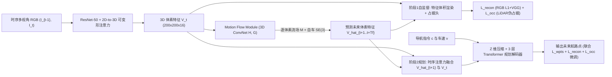

# NeMo

**NeMo: Neural Volumetric World Models for Autonomous Driving**（Boston University：Zanming Huang*, Jimuyang Zhang*, Eshed Ohn-Bar，发表于 **ECCV 2024**）收录于 [Awesome World Models](https://github.com/sun254667/awesome-world-models) **第 463/571** 篇，分组 **82 Autonomous Driving**。本页基于 ECCV 2024 论文全文补全神经体素世界表征、运动流自监督预训练与闭环规划评测。

## 一句话定义

NeMo 是一种基于 3D 神经体素（Volumetric）表征的端到端自动驾驶世界模型与规划框架，无需人工 BEV 语义分割标注，仅靠神经体积渲染图像重建、LiDAR 伪占据预测和「自车 SE(3) + 逐体素运动流」时空一致性实现自监督预训练，并通过时序注意力融合预测的未来体素特征完成轨迹规划。

## 英文缩写速查

| 缩写 | 英文全称 | 简要说明 |
|------|----------|----------|
| NeMo | Neural Volumetric World Models | 本文框架：基于 3D 神经体素渲染与运动流的自动驾驶世界模型与规划器 |
| BEV | Bird's-Eye View | 鸟瞰图二维平面表征（本文将其扩展为保留高度维的 3D 体素网格 $200\times 200\times 16$） |
| DS / RC | Driving Score / Route Completion | CARLA 闭环仿真标准指标：驾驶综合得分与路线完成率 |
| IR / OP | Image Reconstruction / Occupancy Prediction | 本文第一阶段两项自监督预训练任务：神经渲染 RGB 重建与占据预测 |
| WM / WAM | World Model / World Action Model | 环境前向预测模型与世界-动作耦合模型（关联分类主线） |
| MBRL | Model-Based Reinforcement Learning | 基于模型的强化学习（站内关联方法页） |

## 为什么重要

- 传统端到端驾驶模型（如 UniAD、VAD）通常高度压缩至 2D BEV 平面，丢失了悬空物体、不平整路面和细微 3D 遮挡几何，且往往依赖昂贵的 BEV 语义分割真值作为辅助监督。
- 早期自监督 3D 渲染/视图合成方法大多假设静态世界（仅做刚体相机变换），在充满移动车辆和行人的开放道路场景下会违反多帧一致性约束。
- NeMo 将**2D-to-3D 可变形特征提升**、**体素运动流解耦动态物体**与**可微特征体积渲染**结合，在不依赖任何人工 BEV 分割标注的条件下，在 nuScenes 开环与 CARLA 闭环基准上分别实现超过 18% 与显著幅度的新高。
- 可顺着 [Awesome World Models 技术地图](../overview/sun-awesome-wm-technology-map.md) 与 [Awesome World Models](../entities/awesome-world-models.md) 对照同组自动驾驶世界模型。

## 核心信息

| 字段 | 内容 |
|------|------|
| 编号 / 分组 | 463/571 · 82 Autonomous Driving |
| 作者与机构 | Zanming Huang*, Jimuyang Zhang*, Eshed Ohn-Bar（Boston University） |
| 出处 | ECCV 2024 |
| 论文链接 | <https://www.ecva.net/papers/eccv_2024/papers_ECCV/papers/02571.pdf> |

## 核心机制

NeMo 采用「**两阶段训练**」（第一阶段自监督 3D 体素场景学习，第二阶段时序注意力体素规划微调）：

1. **2D-to-3D 可变形体素特征编码（Volumetric Feature Encoding）**：
   - 使用 **ResNet-50** 提取 $n=6$ 路环视相机图像特征，通过 3D 可变形交叉注意力（将 3D 体素坐标 $\mathbf{z}$ 用相机内外参投影到 2D 图像参考点 $\mathcal{T}(\mathbf{z})$）构建 3D 体素特征体 $V_t \in \mathbb{R}^{X\times Y\times Z\times D}$。
   - 空间覆盖范围 **$50\text{ m} \times 50\text{ m} \times 8\text{ m}$**，体素分辨率 $0.5\text{ m}$（特征网格尺寸 **$200\times 200\times 16$**，4× NVIDIA A6000 上每阶段训练 10 epochs，AdamW，lr=$2\times 10^{-4}$，weight decay $10^{-2}$）。
2. **运动流模块（Motion Flow Module）**：
   - 将当前帧与历史帧体素特征拼接送入两组 3D 卷积网络 $H, G$，分别预测**逐体素 3D 运动流场** $M_{t\to t+n} \in \mathbb{R}^{X\times Y\times Z\times 3}$（处理动态交通参与者）与**自车刚体 $SE(3)$ 变换** $S_{t\to t+n} = (R, t)$。
   - 按 $\hat{\mathbf{z}} = R(\mathbf{z} + \mathbf{f}) + t$ 将当前体素特征 $V_t$ 变换到未来时刻 $\hat{V}_{t+1\dots t+T_f}$，兼顾动态物体与自车运动。
3. **特征神经体积渲染与双自监督损失（Neural Volumetric Rendering）**：
   - MLP 占据解码器 $f_{\text{occ}}$ 预测体素占据概率 $\tilde{\mathbf{p}}_t[\mathbf{z}]$；沿相机射线采样 $N$ 个点，先对体素特征做体渲染累积 $\tilde{V}_{t,\mathbf{x}} = \sum_{i=1}^N \prod_{j=1}^{i-1}(1-\tilde{\mathbf{p}}_t[\mathbf{x}_j])\tilde{\mathbf{p}}_t[\mathbf{x}_i]V_t[\mathbf{x}_i]$，再由 $f_{\text{recon}}$ 解码 RGB 像素颜色。
   - 预训练损失：图像重建损失 $\mathcal{L}_{\text{recon}}$（$L_1$ + VGG-16 感知损失）+ 占据预测损失 $\mathcal{L}_{\text{occ}} = \lambda_{\text{scal}}\mathcal{L}_{\text{scal}} + \lambda_{\text{BCE}}\mathcal{L}_{\text{BCE}}$（以体素化 LiDAR 点云作伪标签，$\lambda_{\text{scal}}=10, \lambda_{\text{BCE}}=1$）。
4. **时序注意力体素规划器（Temporal Attention Volumetric Planner）**：
   - 微调阶段由 $I_{t-1}, I_t$ 预测未来体素特征 $\hat{V}_{t+1}$，经自注意力计算体素级注意力矩阵 $A \in \mathbb{R}^{X\times Y\times Z\times D}$ 并与当前体素 $V_t$ 相乘融合得到 $V_F$；
   - 沿高度维 $Z$ 压缩投影至 $X\times Y\times 256$，将导航指令嵌入、自车速度嵌入与可学习规划查询送入 3 层 Transformer 解码器回归未来航路点，以 $\mathcal{L}_{\text{plan}} = \lambda_{\text{wpts}}\mathcal{L}_{\text{wpts}} + \lambda_{\text{recon}}\mathcal{L}_{\text{recon}} + \lambda_{\text{occ}}\mathcal{L}_{\text{occ}}$（权重 $1.0, 0.5, 0.5$）联合微调。

### 方法流程图

## 实验与评测

1. **nuScenes 开环端到端规划评测（Section 4.2, Table 1）**：
   - **完整 NeMo** 取得平均 L2 误差 **0.84 m**（1s `0.39` / 2s `0.74` / 3s `1.39`）与平均碰撞率 **0.30%**（1s `0.00%` / 2s `0.09%` / 3s `0.82%`），全面优于 UniAD（L2 Avg `1.03 m` / 碰撞 `0.31%`）、BEVFormer w/ Pre-train（`1.02 m` / `0.50%`）和 VAD\*（`1.07 m` / `0.38%`），相对从头训练的 `NeMo (Scratch)`（`1.02 m` / `0.59%`）L2 误差降低 **17.6%**、碰撞率几乎减半。
2. **CARLA 闭环仿真评测（Town05 Short & Long, Table 2，测试时仅用相机）**：
   - **Town05 Short**：`NeMo` 达到 Driving Score (DS) **75.87**、Route Completion (RC) **90.12**（`NeMo Scratch` 为 `70.42` / `83.01`；对比基线 VAD-Base `64.29` / `87.26`，TransFuser `54.52` / `78.41`，ST-P3 `55.14` / `86.74`）。
   - **Town05 Long**：`NeMo` 达到 DS **42.57**、RC **80.98**（`NeMo Scratch` 为 `34.23` / `71.32`；对比 VAD-Base `30.31` / `75.20`，TransFuser `33.15` / `56.36`）。预训练在长程闭环上使 DS 相对 Scratch 额外提升 **24.4%**。
3. **关键模块消融（Section 4.3, Table 1 & Table 3）**：
   - **时序融合方式**：在 Base 模型上加入**时序注意力**融合未来体素特征，平均 L2 从 `1.00 m` 降至 **`0.91 m`**（-9%），平均碰撞率从 `0.54%` 降至 **`0.35%`**（-35%，3s 碰撞率 `1.24% → 0.87%`）；而简单拼接特征（Temporal Concat）退化至 `0.94 m` / `0.38%`。
   - **微调阶段保留辅助损失**：在规划微调中继续保留 $\mathcal{L}_{\text{recon}} + \mathcal{L}_{\text{occ}}$，使平均 L2 进一步降低 **7.7%**、平均碰撞率降低 **14.3%**。
   - **预训练三要素（Table 3）**：无预训练基线 `0.58%` 碰撞率；单独只用图像重建（IR）虽微调 L2 为 `1.04 m`、碰撞率 `0.61%`，而加上占据预测（OP）降至 `0.57%`，再结合运动流模块（IR+OP+Flow）达最优 `1.00 m` / `0.54%`（相对仅 OP+Flow 碰撞率再降 16.9%）。

## 与其他工作对比

| 方法 | 空间表征 | 是否需 BEV 分割真值 | nuScenes L2 Avg / 碰撞率 | CARLA Town05 Short DS / RC | CARLA Town05 Long DS / RC |
|------|---------|-------------------|------------------------|--------------------------|--------------------------|
| **NeMo (Ours)** | 3D 神经体素 (200×200×16) | 否（RGB+LiDAR 自监督） | **0.84 m** / **0.30%** | **75.87** / **90.12** | **42.57** / 80.98 |
| NeMo (Scratch) | 3D 神经体素 | 否 | 1.02 m / 0.59% | 70.42 / 83.01 | 34.23 / 71.32 |
| VAD-Base / VAD\* | 2D 矢量化 BEV | 是（地图/语义） | 1.07 m / 0.38% | 64.29 / 87.26 | 30.31 / 75.20 |
| UniAD | 2D BEV 查询 | 是（检测/跟踪/地图） | 1.03 m / 0.31% | — | — |
| ST-P3 | 2D 时空 BEV | 是 | 2.11 m / 0.71% | 55.14 / 86.74 | 11.45 / **83.15** |
| TransFuser | 图像+LiDAR 融合 | 需传感器输入 | — | 54.52 / 78.41 | 33.15 / 56.36 |

## 结论

**NeMo 证明了在无需人工 BEV 分割真值的前提下，以「可变形 3D 体素编码 + 动态运动流 + 特征神经体积渲染」做自监督预训练，并用时序注意力在体素空间融合未来特征，能同时显著提升自动驾驶的开环轨迹精度与闭环抗碰撞能力。**

1. **3D 体素表达优于平面 BEV** — 即使不经过自监督预训练，`NeMo (Scratch)` 在 CARLA Town05 Short/Long 的闭环驾驶得分（70.42 / 34.23）也已经优于使用特权分割监督的 VAD-Base（64.29 / 30.31）。
2. **动态场景不能只靠刚体 $SE(3)$ 变换** — 引入逐体素 3D 运动流场解耦他车/行人运动与自车位姿变化，将平均碰撞率再压低 6.9%。
3. **未来特征必须用注意力融合且微调期不能丢弃重构损失** — 简单拼接未来体素会劣化长程规划，而微调期保留 $\mathcal{L}_{\text{recon}}+\mathcal{L}_{\text{occ}}$ 能稳住运动流预测精度，使最终碰撞率再降 14.3%。
4. **占据监督奠基几何、图像重建压低碰撞** — 单独 RGB 重建难以收敛出准确几何，但与占据预测及运动流联合后可令碰撞率额外下降 16.9%。

## 常见误区或局限

1. **体素网格显存与计算随分辨率立方增长**：作者在局限中指出，稠密 3D 体素表达存在固有的内存与计算立方级膨胀权衡，后续可结合稀疏体素或八叉树表示优化。
2. **体渲染监督存在射线伪影（Ray Artifacts）**：在 PCA 可视化中（Fig. 3），由于基于神经渲染监督固有的深度模糊性（Ill-posed depth ambiguity），体素特征中会出现沿相机射线分布的条纹伪影，可能对精细定位产生不利影响。
3. **训练期仍需 LiDAR 点云生成伪占据标签**：虽然测试时为纯相机输入且不需要人工 3D/BEV 语义标注，但第一阶段（及微调辅助损失）的 $\mathcal{L}_{\text{occ}}$ 仍依赖采集端 LiDAR 点云体素化生成伪占据真值。
4. **开源与代码入口未在原文列明**：ECCV 2024 论文 PDF 正文与参考文献中未提供 GitHub 仓库链接，复现前需留意作者团队主页更新。

## 关联页面

- 列表实体：[Awesome World Models](../entities/awesome-world-models.md)
- 技术地图：[Awesome World Models 技术地图](../overview/sun-awesome-wm-technology-map.md)
- 方法/任务：[generative-world-models.md](../methods/generative-world-models.md)、[model-based-rl.md](../methods/model-based-rl.md)、[manipulation.md](../tasks/manipulation.md)

## 参考来源

- [`sources/papers/sun_awesome_wm_noarxiv_463_nemo-neural-volumetric-world-models-for.md`](../../sources/papers/sun_awesome_wm_noarxiv_463_nemo-neural-volumetric-world-models-for.md) — 本条目策展摘录
- [`sources/papers/sun_awesome_wm_catalog.md`](../../sources/papers/sun_awesome_wm_catalog.md) — 列表总表
- [`sources/repos/awesome-world-models.md`](../../sources/repos/awesome-world-models.md)
- 论文：<https://www.ecva.net/papers/eccv_2024/papers_ECCV/papers/02571.pdf>

## 推荐继续阅读

- [Awesome World Models 仓库](https://github.com/sun254667/awesome-world-models)
- [原文](https://www.ecva.net/papers/eccv_2024/papers_ECCV/papers/02571.pdf)
