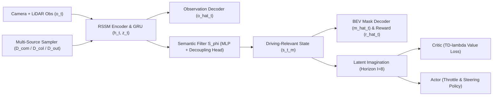

# SEM2

**SEM2: Enhance Sample Efficiency and Robustness of End-to-End Urban Autonomous Driving via Semantic Masked World Model**（Zeyu Gao, Yao Mu, Chen Chen, Jingliang Duan, Ping Luo, Yanfeng Lu, Shengbo Eben Li，中科院自动化所 / 香港大学 / 清华大学 / 北京科技大学，IEEE Trans. 2024，[arXiv:2210.04017v4](https://arxiv.org/abs/2210.04017)）收录于 [Awesome World Models](https://github.com/sun254667/awesome-world-models) **第 480/571** 篇，分组 **82 Autonomous Driving**。本页基于论文全文完成精读与数据核实。

## 一句话定义

一种面向城市端到端自动驾驶的**语义掩码循环世界模型（SEMantic Masked recurrent world model）**，通过在 RSSM 潜状态与策略之间插入显式**语义滤波器**抽取纯驾驶相关潜特征、并搭配**自适应多源采样器**混合常见驾驶与碰撞/越线边界样本，同时提升样本效率、视觉抗扰鲁棒性与极端工况应对能力。

## 英文缩写速查

| 缩写 | 英文全称 | 简要说明 |
|------|----------|----------|
| SEM2 | SEMantic Masked recurrent world model | 本文提出的语义掩码循环世界模型框架 |
| RSSM | Recurrent State-Space Model | 含确定性路径 $h_t$（GRU）与随机离散路径 $z_t$ 的循环潜空间状态模型 |
| BEV | Bird's-Eye View | 鸟瞰图视角；本文语义掩码 $m_t$ 在 BEV 下编码道路、路径、周车与自车状态 |
| CTE | Cross-Track Error | 横向偏离误差；超过 2 m 判定为越线（Outlane）边界案例 |
| MBRL | Model-Based Reinforcement Learning | 基于学习环境动力学潜想象（Latent Imagination）的强化学习 |

## 为什么重要

- **点破“世界模型重编码无关纹理”对自动驾驶的危害**：传统端到端世界模型（如 DreamerV2 / LVM）把前视相机与雷达原始观测无差别压缩进潜状态，导致天空、高楼、暴雨、光影等大量驾驶无关信息直接污染策略输入，样本效率低且天气/噪声一变就性能大跌。
- **验证“仅加掩码重建头不够，必须显式隔离过滤特征”**：消融实验表明，在 DreamerV2 上直接附带 BEV 掩码重建头只能增加可解释性而几乎不提升收益；只有通过语义滤波器强制让奖励预测与 Actor-Critic **只看**过滤后的 $s_t^m$，才带来样本效率与视觉鲁棒性跃升。
- **解决自动驾驶回放池长尾分布失衡**：城市数据绝大部分是平稳直行，转弯、越线和濒临碰撞样本极少，自适应多源采样器在不引发过度保守的前提下显著压低交叉口碰撞率与越线率，可对照 [生成式世界模型](../methods/generative-world-models.md) 与 [基于模型的强化学习](../methods/model-based-rl.md)。

## 核心信息

| 字段 | 内容 |
|------|------|
| 编号 | 480/571 |
| 分组 | 82 Autonomous Driving |
| 出处 | IEEE Trans. 2024 (arXiv:2210.04017v4) |
| 作者与机构 | Zeyu Gao, Yanfeng Lu（CASIA / UCAS）；Yao Mu, Ping Luo（HKU）；Chen Chen, Shengbo Eben Li（清华大学）；Jingliang Duan（北京科技大学） |
| 论文 | <https://ieeexplore.ieee.org/abstract/document/10538211/> · <https://arxiv.org/abs/2210.04017> |

## 核心机制

SEM2 将原始传感器观测 $o_t$（128×128×3 前视 110° FOV 相机 + 64 线 50 m 激光雷达点云图像）与驾驶相关状态分离建模（§IV–V）：

1. **带语义滤波器的循环世界模型（§IV-A–C）**
   - **RSSM 主干**：由循环模型（GRU，$h_t \in \mathbb{R}^{2048}$）、表征编码器（5 层 CNN + MLP 输出 32×32 离散 one-hot 分类随机变量 $z_t$）与转移预测器 $p_\phi(\hat{z}_t | h_t)$ 组成；观测预测器 $p_\phi(\hat{o}_t | h_t, z_t)$ 从完整未过滤状态重建原始相机/雷达图像。
   - **语义滤波器 $S_\phi(s_t^m | h_t, z_t)$**：由 2 层 1024 维 MLP 与解耦输出头（全连接层输出确定性 $h_t^m$ + one-hot 分类头输出随机 $z_t^m$）组成，专门滤除天气、天空与背景建筑等无关维度。
   - **重建分离约束**：仅有过滤特征 $s_t^m = \{h_t^m, z_t^m\}$ 被送入**掩码预测器** $p_\phi(\hat{m}_t | s_t^m)$（重建含道路地图、目标路由、周车与自车状态的 128×128×3 BEV 语义掩码）、**自车状态向量** $\hat{e}_t$ 与**奖励预测器** $p_\phi(\hat{r}_t | s_t^m)$，并通过变分下界目标（式 3：观测损失 + 掩码损失 + 奖励损失 + KL 散度）联合优化。

2. **自适应多源数据采样器（§IV-D、Algorithm 1 & 2）**
   - 将经验回放池拆分为三类：普通池 $D_{\text{com}}$、碰撞池 $D_{\text{col}}$、越线池 $D_{\text{out}}$（CTE $> 2\text{ m}$）；异常终止回合末尾 $4 \times L = 64$ 步轨迹按终止原因存入对应边界池。
   - 训练初期 $P_{\text{com}} = 1$ 以先学会基础行驶；每隔 $t_{\text{eval}} = 20{,}000$ 步评测 30 回合记录成功率 $r_{\text{suc}}$、碰撞率 $r_{\text{col}}$ 与越线率 $r_{\text{out}}$，动态更新角例采样概率 $P_{\text{cor}} = r_{\text{suc}} \times P_{\text{cor}}^{\max}$（上限 $P_{\text{cor}}^{\max} = 0.5$）、$P_{\text{com}} = 1 - P_{\text{cor}}$，并按 $r_{\text{col}} : r_{\text{out}}$ 比例分配 $P_{\text{col}}$ 与 $P_{\text{out}}$。

3. **潜空间想象 Actor-Critic 行为学习（§V）**
   - 从真实后验出发，冻结世界模型参数 $\phi$，仅利用语义过滤特征 $\hat{s}_t^m$ 在潜空间向前想象 $I = 8$ 步（$\gamma = 0.99$）。
   - Critic（5 层 400 维 ELU MLP）以 TD($\lambda$)（$\lambda = 0.95$，式 5）拟合价值；随机 Actor（5 层 400 维 ELU MLP）结合策略熵正则（$\eta = 1\times 10^{-4}$，式 6）通过直通梯度最大化期望回报，输出油门与转向控制（10 Hz）。

### 方法流程图

## 评测与指标

实验在 **CARLA Town 3**（含隧道、交叉口、环岛、弯道与掉头弯，10 Hz 同步仿真，训练 300,000 步、3 个随机种子均值，每 20,000 步评测 30 回合；驾驶指标在最高分权重下评测 100 回合）上完成（Table I–IV）：

| 场景与算法 | 成功率 ↑ | 碰撞率 ↓ | 越线率 ↓ | 未完成率 ↓ | 平均行驶距离 ↑ |
|---|---|---|---|---|---|
| **随机路段（Table I，500 步，回报 > 300 为成功）** | | | | | |
| SAC（无模型基线） | 18.0 ± 1.0% | **8.0 ± 1.0%** | 33.0 ± 3.0% | 41.0 ± 3.0% | 55.5 ± 4.2 m |
| DreamerV2（带掩码预测头公平对照） | 51.0 ± 2.9% | 29.0 ± 5.9% | 19.3 ± 3.9% | 0.7 ± 0.5% | 209.1 ± 10.5 m |
| SEM2 w/o multi-source（消融多源采样） | 64.7 ± 2.9% | 26.3 ± 1.3% | 8.0 ± 2.9% | 1.0 ± 1.0% | 234.4 ± 19.0 m |
| **SEM2（完整框架）** | **79.7 ± 2.6%** | 14.3 ± 3.3% | **5.3 ± 0.5%** | **0.3 ± 0.5%** | **243.5 ± 3.2 m** |
| **指定复杂交叉口（Table II）** | | | | | |
| DreamerV2 | 71.0 ± 5.7% | 29.0 ± 5.7% | 0.0 ± 0.0% | 0.0 ± 0.0% | 55.5 ± 2.7 m |
| SEM2 w/o multi-source | 90.3 ± 4.1% | 9.7 ± 4.1% | 0.0 ± 0.0% | 0.0 ± 0.0% | 67.8 ± 1.6 m |
| **SEM2（完整框架）** | **96.7 ± 1.7%** | **3.3 ± 1.7%** | 0.0 ± 0.0% | 0.0 ± 0.0% | **70.8 ± 0.3 m** |

- **跨天气与 0.1 概率椒盐噪声鲁棒性（Table III，平均回报）**：仅在晴朗正午（Clear Noon）训练后零样本迁移至恶劣天气 + 相机椒盐噪声（$p=0.1$）：
  - SAC：`534.9` $\to$ 暴雨正午 `436.8 (-18.3%)` / 湿滑日落 `461.1 (-13.8%)`
  - DreamerV2：`1655.9` $\to$ `1435.1 (-13.3%)` / `1390.4 (-16.0%)`
  - SEM2 w/o multi-source：`2017.1` $\to$ `2081.1 (+3.9%)` / `2098.2 (+4.9%)`
  - **SEM2**：**`2719.1`** $\to$ **`2757.6 (+1.4%)`** / **`2775.9 (+2.1%)`**；特征热力图绝对差值（Fig. 10）显示 SEM2 的 $s_t^m$ 对极端雨夜噪声几乎不变，而 DreamerV2 潜状态剧烈抖动。
- **暴雨+噪声叠加制动效率衰减测试（Table IV，制动效率 100% $\to$ 70%）**：SEM2 回报仅微降 `-2.1%`（`2757.6` $\to$ `2700.9`），而 SEM2 w/o multi-source 下滑 `-14.0%`（`2081.1` $\to$ `1790.5`）。
- **关键消融结论（Fig. 11–12）**：对比 DreamerV2 带/不带掩码预测器曲线几乎重合，验证提升来自**语义滤波器**而非掩码重建损失本身；离散 `One-hot` 随机表征显著优于连续 `Gaussian`；自适应多源比例与 25%/50% 固定比例均优于 0% 无多源，但 75% 固定角例因正常样本不足导致性能回落。

## 与现有工作的对比

- **对比无模型强化学习（SAC [22]）**：SAC 在 30 万步交互内几乎只会直行，随机路段成功率仅 `18.0%`、平均行驶仅 `55.5 m`（且无法通过复杂交叉口），而 SEM2 通过潜空间想象达到 `79.7%` 与 `243.5 m`。
- **对比同超参潜世界模型（DreamerV2 [17]）**：即使给 DreamerV2 配上同款 BEV 掩码重建头，因决策直接输入未过滤的 $(h_t, z_t)$，其在随机路段、交叉口与暴雨噪声下的表现均显著落后于 SEM2（随机成功率 `51.0%` vs `79.7%`，暴雨回报 `1435.1` vs `2757.6`）。同分组世界模型方法见 [Awesome World Models 技术地图](../overview/sun-awesome-wm-technology-map.md)。

## 常见误区或局限

1. **语义滤波器无法单独解决动力学/物理参数偏移**：论文在 §VII-D 明确指出，语义滤波器刻意过滤掉了天气信息，因此**不会**天然增强对物理动力学变化（如雨天制动效率衰减 30%）的鲁棒性；Table IV 证明制动衰减下的安全跟车距离保持主要靠**多源边界数据训练**而非语义滤波器。
2. **训练期依赖仿真器提供的真值 BEV 语义掩码 $m_t$**：虽然推理阶段仅需前视相机与雷达、不依赖真值掩码，但训练语义滤波器需要 CARLA 直接提供 BEV 道路/障碍物真值掩码，真实车端训练需额外高质量 BEV 感知伪真值。
3. **验证局限于 CARLA Town 3 单一城镇仿真**：所有实验均在 CARLA Town 3 同步仿真环境中进行，尚未在真实无人车或跨城市多地图泛化中验证。

## 结论

**《SEM2》用对照消融证明：世界模型里仅加一个辅助语义重建头并不能保护策略免受无关视觉杂波干扰，必须通过「显式语义滤波器隔离决策特征 + 自适应多源角例回放」双管齐下，才能同时拉高样本效率、视觉抗噪性与复杂交叉口安全通过率。**

1. **决策表征与原始重建表征必须解耦** — 观测解码器保留完整 $(h_t, z_t)$ 消化图像杂波，而策略与奖励头只接语义滤波后的 $s_t^m$，这是暴雨椒盐噪声下性能零退化的核心原因。
2. **离散 One-hot 潜变量更利于基于世界模型的驾驶控制** — 同等结构下离散分类随机变量比连续高斯分布收敛更快、样本效率更高（Fig. 11）。
3. **边界案例采样比例要动态渐进且设上限（$P_{\text{cor}}^{\max} = 0.5$）** — 初期先学正常行驶，随成功率爬升再按碰撞/越线比例注入角例；若盲目拉高至 75% 会挤占正常驾驶分布导致回报下滑（Fig. 12）。
4. **视觉鲁棒 $\ne$ 动力学鲁棒** — 当遇到路面湿滑或制动衰减等动力学变化时，仍须依靠覆盖濒危工况的多源数据训练来保证安全车距（Table IV）。

## 关联页面

- 列表实体：[Awesome World Models](../entities/awesome-world-models.md)
- 技术地图：[Awesome World Models 技术地图](../overview/sun-awesome-wm-technology-map.md)
- 方法/任务：[generative-world-models.md](../methods/generative-world-models.md)、[model-based-rl.md](../methods/model-based-rl.md)、[manipulation.md](../tasks/manipulation.md)、[locomotion.md](../tasks/locomotion.md)

## 参考来源

- [`sources/papers/sun_awesome_wm_noarxiv_480_sem2-enhance-sample-efficiency-and-robus.md`](../../sources/papers/sun_awesome_wm_noarxiv_480_sem2-enhance-sample-efficiency-and-robus.md) — 本条目策展摘录
- [`sources/papers/sun_awesome_wm_catalog.md`](../../sources/papers/sun_awesome_wm_catalog.md) — 列表总表
- [`sources/repos/awesome-world-models.md`](../../sources/repos/awesome-world-models.md)
- 论文：<https://ieeexplore.ieee.org/abstract/document/10538211/> · <https://arxiv.org/abs/2210.04017>

## 推荐继续阅读

- [Awesome World Models 仓库](https://github.com/sun254667/awesome-world-models)
- [原文（IEEE Xplore）](https://ieeexplore.ieee.org/abstract/document/10538211/)
- [原文（arXiv）](https://arxiv.org/abs/2210.04017)
