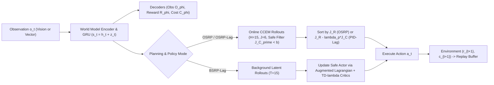

# SafeDreamer

**SafeDreamer: Safe Reinforcement Learning with World Models**（Weidong Huang, Jiaming Ji, Chunhe Xia, Borong Zhang, Yaodong Yang，北京大学人工智能研究院 & 北京航空航天大学网络空间安全学院，ICLR 2024）收录于 [Awesome World Models](https://github.com/sun254667/awesome-world-models) **第 482/571** 篇，分组 **82 Autonomous Driving**。本页基于论文全文完成精读与数据核实。

## 一句话定义

一种将**世界模型安全–奖励规划（在线 CCEM 规划与后台想象规划）**和**拉格朗日约束优化（PID / Augmented Lagrangian）**统一进 DreamerV3 框架的安全强化学习（SafeRL）算法族，能够在**低维状态与纯视觉像素输入**条件下同时获得高任务回报与接近零代价（nearly zero-cost）的收敛表现。

## 英文缩写速查

| 缩写 | 英文全称 | 简要说明 |
|------|----------|----------|
| SafeRL / CMDP | Safe Reinforcement Learning / Constrained Markov Decision Process | 带代价函数与代价阈值约束的安全强化学习形式化框架 |
| OSRP / OSRP-Lag | Online Safety-Reward Planning (+ PID Lagrangian) | 决策时在世界模型内用 CCEM 在线规划安全轨迹的变体（含长期 PID 拉格朗日惩罚） |
| BSRP-Lag | Background Safety-Reward Planning (+ Augmented Lagrangian) | 在世界模型后台想象轨迹上通过增广拉格朗日训练安全 Actor 的实时变体 |
| CCEM | Constrained Cross-Entropy Method | 带代价阈值过滤与精英集重采样的约束交叉熵轨迹优化方法 |
| LAMBDA / Safe SLAC | Safe Model-based RL Baselines | 分别基于 DreamerV1+贝叶斯拉格朗日 与 SLAC+拉格朗日的视觉安全 RL 对比基线 |

## 为什么重要

- **突破纯视觉 SafeRL 难以在低阈值下达到近零违规的瓶颈**：传统无模型 SafeRL（CPO、PPO-Lag、TRPO-Lag、Sauté）在低维且紧代价预算（`cost limit = 2.0`）下已极难兼顾高回报与安全，更难以直接处理纯图像输入；既有安全世界模型（LAMBDA、Safe SLAC）受限于 DreamerV1 数值稳定性或缺少规划，在纯视觉任务仍残留较高代价。
- **给出「在线规划」与「后台策略规划」两条互补工程路径**：OSRP/OSRP-Lag 适合动态障碍高频避障场景，BSRP-Lag 免去测试期在线采样耗时、更适合实时控制与需要长时程灵巧交互（如推箱）的任务。
- **全面开源与复现资产**：官方仓库 <https://github.com/PKU-Alignment/SafeDreamer> 公开了训练/评测代码与 80+ 模型检查点，覆盖 Safety-Gymnasium、MetaDrive 与 Gymnasium（Car-Racing / FormulaOne），可衔接 [生成式世界模型](../methods/generative-world-models.md) 与 [基于模型的强化学习](../methods/model-based-rl.md)。

## 核心信息

| 字段 | 内容 |
|------|------|
| 编号 | 482/571 |
| 分组 | 82 Autonomous Driving |
| 出处 | ICLR 2024 |
| 作者与机构 | Weidong Huang, Jiaming Ji, Chunhe Xia, Borong Zhang, Yaodong Yang（Peking University / Beihang University） |
| 论文 | <https://openreview.net/forum?id=tsE5HLYtYg> |
| 官方项目与源码 | <https://github.com/PKU-Alignment/SafeDreamer>（论文摘要与复现声明已开源代码与 80+ checkpoints；当前页面未核读仓库源码） |

## 核心机制

SafeDreamer 将 CMDP（$\max J_\phi^R(\pi_\theta)\ \text{s.t.}\ J_\phi^C(\pi_\theta) \le b$）嵌入扩展版 DreamerV3 世界模型中（§4–5）：

1. **安全感知的世界模型与离散双热（Twohot）Critic（§4.1、§5、Appendix A.2）**
   - **世界模型组件**：包含观测编码器 $E_\phi(z_t | h_t, o_t)$、GRU 序列模型 $S_\phi(h_{t-1}, z_{t-1}, a_{t-1})$（48×48 离散潜变量 $z_t$）、观测解码器 $O_\phi$、奖励解码器 $R_\phi$ 与显式**代价解码器** $C_\phi(\hat{c}_t | s_t)$；通过 KL 平衡正则与未来预测损失（$\alpha_q=0.1, \alpha_p=0.5$）加三路重构损失（式 9）训练。
   - **稀疏代价回归稳定性**：针对环境中安全代价稀疏且分布异质的问题，奖励 Critic $V_\psi^r$ 与代价 Critic $V_\psi^c$ 均采用 **symlog 平滑 + twohot 编码离散回归**（式 11）拟合 TD($\lambda$) 回报 $R^\lambda(s_t)$ 与 $C^\lambda(s_t)$（$\lambda_r=\lambda_c=0.95, \gamma=0.997$）。

2. **SafeDreamer (OSRP) 与 SafeDreamer (OSRP-Lag)：在线安全–奖励规划（§4.2–4.3、Algorithm 1）**
   - 每个决策步从当前潜状态 $s_t$ 出发，使用 **CCEM** 迭代 $J=6$ 轮（视界 $H=15$）：并行采样 $N_{\pi_N}=500$ 条高斯动作轨迹与 $N_{\pi_\theta}=M\cdot N_{\pi_N}$ 条奖励驱动 Actor 引导轨迹（$M=0.05$ 或 $0.0$）。
   - 用 $J_\phi^{C'} = (J_\phi^{C,H}/H)L$ 筛选满足 $J_\phi^{C'} < b$ 的安全轨迹集 $A_s$：若 $|A_s| < N_s$，直接按 $-J_\phi^{C'}$ 排序选最安全轨迹；若 $|A_s| \ge N_s$，**OSRP** 按 $J_\phi^R$ 排序，而 **OSRP-Lag** 引入每回合按经验代价更新的 **PID 拉格朗日乘子** $\lambda_p$（Algorithm 3），按 $J_\phi^R - \lambda_p J_\phi^C$ 排序以兼顾超出规划视界 $H$ 的长期风险。

3. **SafeDreamer (BSRP-Lag)：后台安全–奖励规划（§4.3、Eq. 7–8）**
   - 为消除在线 CCEM 推理延迟，利用世界模型在后台展开 $T=15$ 步潜想象轨迹，采用**增广拉格朗日（Augmented Lagrangian）**目标（式 7–8）联合更新安全 Actor $\pi_\theta$ 与乘子 $\lambda_p$，测试期直接由安全 Actor 一步输出动作。
   - **代价阈值设定（Appendix A.2）**：视觉任务设 $b=2.0$（避免成本预测器微弱正误差导致全轨迹被判定不安全而无法收敛），低维向量任务通过观测重构评估代价并可设 $b=0$。

### 方法流程图

## 评测与指标

实验在 **Safety-Gymnasium**（5 个纯视觉任务 2M 步 + 2 个低维向量任务，5 个随机种子，紧代价预算 $b=2.0$）、**MetaDrive**（4M 步）、**Car-Racing**（64×64×3 RGB）与 **FormulaOne Level 1**（64×64×3 RGB）上完成（§6、Appendix C）：

| 基准与任务 | 对比方法 | 核心安全与任务指标 | 关键观察 |
|---|---|---|---|
| **Safety-Gymnasium 5 个纯视觉任务（Fig. 3–4）** | **SafeDreamer (BSRP-Lag / OSRP / OSRP-Lag)** vs LAMBDA / Safe SLAC / DreamerV3 / MPC:sim | **BSRP-Lag 代价相对 LAMBDA 降低 94.3%**，并在收敛期达到接近零代价；Goal1 与 Push1 上回报追平无安全约束的 DreamerV3 | Safe SLAC 因模型误差陷入代价瓶颈；MPC:sim 无长期代价 Critic 在高动态 Button1 上难以保安全 |
| **Safety-Gymnasium 低维向量（Goal1 / CarGoal1，Fig. 5）** | **SafeDreamer (OSRP)** vs CPO / PPO-Lag / TRPO-Lag / Sauté / MBPPO-Lag | 同时取得最高回报与最低（近零）平均回合代价与训练期代价率 $\rho_c$ | 无模型算法难以兼顾高回报与近零代价；MBPPO-Lag 代价降到低位后回报停滞 |
| **MetaDrive 自动驾驶（Table 7，10 次测试）** | **SafeDreamer (BSRP-Lag)** vs PPO-Reward Shaping | 到达率 **`1.0 ± 0.0`** vs `0.72 ± 0.1`；回合代价 **`2.2 ± 0.1`** vs `14.1 ± 6.2` | 学会在前方密集车流时停车等待，待车流疏通后再前进 |
| **Car-Racing 防侧滑（Table 8）** | **SafeDreamer (BSRP-Lag)** vs DreamerV3 | 回报 `763.1 ± 1.34` vs `775.1 ± 0.56`；回合代价 **`0.04 ± 0.01`** vs `580.1 ± 2.35` | 约 0.2M 步内即收敛至近零侧滑代价 |
| **FormulaOne Level 1（Table 9）** | **SafeDreamer (BSRP-Lag)** vs DreamerV3 | 回报 `25.3 ± 0.51` vs `32.2 ± 1.22`；回合代价 **`0.43 ± 0.08`** vs `56.36 ± 2.32` | 复杂第一视角视觉赛道中在 1.5M 步后达近零避障代价 |

- **三变体场景适配规律（§6 Discussion）**：
  - `SafetyPointButton1`（动态移动障碍 Gremlins）：**OSRP 回报高于 BSRP-Lag**，因在线规划能实时预测动态障碍轨迹变化；
  - `SafetyPointPush1`（需将头部楔入箱体凹槽推动的灵巧操作）：**BSRP-Lag 收敛至最优策略，而 OSRP/OSRP-Lag 难以搜出**，受限于有限规划视界与轨迹采样数；
  - `SafetyPointGoal2`（高密度障碍）：**OSRP-Lag 比 OSRP 更保守**，因为代价 Critic 计入了视界 $H$ 之外的长期潜在风险。
- **世界模型配置消融（Appendix C.5，Fig. 21–26）**：去掉观测重构损失会导致代价完全无法下降（Fig. 24）；增大离散潜状态维度 $z_t$（`48×48` > `32×32` > `16×16`）显著压低最终代价（Fig. 23）；提高不安全交互的代价损失权重（`Cost Weight` 10 / 30 / 50 vs 1.0）可缓解正负代价样本失衡并加速安全收敛（Fig. 25–26）。

## 与现有工作的对比

- **对比无模型安全 RL（CPO、PPO-Lag、TRPO-Lag、Sauté）**：无模型方法缺乏动力学模型，在低样本预算和 `b=2.0` 紧阈值下常出现“要么违规、要么原地不动拿不到回报”的退化；SafeDreamer 借助 DreamerV3 世界模型在训练早期即展现安全探索并同时适用于视觉输入。
- **对比既有安全世界模型（LAMBDA [As et al.]、Safe SLAC [Hogewind et al.]）**：Safe SLAC 仅将拉格朗日引入潜表征强化学习而不做世界模型规划；LAMBDA 基于 DreamerV1，在低维任务表现欠佳且缺少自适应数值稳定（symlog/twohot）与在线规划对齐；SafeDreamer 统一了在线规划（OSRP/OSRP-Lag）与后台规划（BSRP-Lag），视觉代价相比 LAMBDA 再降 **94.3%**。同分组方法见 [Awesome World Models 技术地图](../overview/sun-awesome-wm-technology-map.md)。

## 常见误区或局限

1. **逐任务从零在线训练，跨任务零成本迁移尚未解决**：作者在 §7 坦承，SafeDreamer 仍需针对每个独立任务从头训练世界模型，因此训练初始阶段仍会产生一定累计安全代价；利用多任务离线数据预训练世界模型是后续方向。
2. **视觉任务无法把规划阈值直接设为严格 0**：Appendix A.2 解释，由于学习到的代价模型和代价 Critic 在安全状态下仍会有微小的正预测误差，若视觉任务设 $b=0$ 会使在线规划判死所有轨迹而过于保守，因此实测采用 $b=2.0$ 作为经验阈值来逼近零代价收敛。
3. **OSRP 与 BSRP-Lag 各有明显短板**：OSRP 依赖多轮 CCEM 滚动推演，计算开销大、难满足高频实时控制，且在需要长周期灵巧策略的任务（如 Push1）上容易漏搜；BSRP-Lag 则对强动态突发障碍的即时反应略逊于在线规划。
4. **实验全部在仿真环境完成**：所有验证均基于 Safety-Gymnasium（MuJoCo）、MetaDrive 与 Box2D，尚未报告真实物理机器人或实车部署。

## 结论

**《SafeDreamer》证明：只要先把世界模型的表征与稀疏代价预测稳定下来（DreamerV3 + 观测重构 + symlog/twohot 代价 Critic），再根据任务动态性选择「在线 CCEM 规划」或「后台增广拉格朗日规划」，就能首次在纯视觉安全强化学习上把终期违规代价压到接近于零。**

1. **视觉 SafeRL 的安全上限首先卡在世界模型视觉重构质量** — 去掉观测重构损失或缩小随机潜状态（`16×16` vs `48×48`）会直接让代价降不下去，不要为了省算力砍掉重建头。
2. **动态障碍高频避让用 OSRP/OSRP-Lag，实时部署或灵巧多步操作用 BSRP-Lag** — 在线规划看重实时滚动避险，后台策略学习更擅长发现长周期灵巧动作（如 Push1）且推理无需重采样。
3. **视觉规划的代价阈值别死卡 $b=0$** — 考虑代价模型的微弱正估计噪声，设小正阈值（如 $b=2.0$）配拉格朗日惩罚才能既收敛到近零真实代价、又不把全部候选轨迹卡死。
4. **稀疏代价训练可适当上调不安全样本权重** — `Cost Weight` 取 10–50 能明显缓解安全样本占多数造成的梯度淹没，加速前期避险收敛。

## 关联页面

- 列表实体：[Awesome World Models](../entities/awesome-world-models.md)
- 技术地图：[Awesome World Models 技术地图](../overview/sun-awesome-wm-technology-map.md)
- 方法/任务：[generative-world-models.md](../methods/generative-world-models.md)、[model-based-rl.md](../methods/model-based-rl.md)、[manipulation.md](../tasks/manipulation.md)、[locomotion.md](../tasks/locomotion.md)

## 参考来源

- [`sources/papers/sun_awesome_wm_noarxiv_482_safedreamer-safe-reinforcement-learning.md`](../../sources/papers/sun_awesome_wm_noarxiv_482_safedreamer-safe-reinforcement-learning.md) — 本条目策展摘录
- [`sources/papers/sun_awesome_wm_catalog.md`](../../sources/papers/sun_awesome_wm_catalog.md) — 列表总表
- [`sources/repos/awesome-world-models.md`](../../sources/repos/awesome-world-models.md)
- 论文：<https://openreview.net/forum?id=tsE5HLYtYg>
- 代码：<https://github.com/PKU-Alignment/SafeDreamer>

## 推荐继续阅读

- [Awesome World Models 仓库](https://github.com/sun254667/awesome-world-models)
- [原文（OpenReview）](https://openreview.net/forum?id=tsE5HLYtYg)
- [官方代码仓库（PKU-Alignment/SafeDreamer）](https://github.com/PKU-Alignment/SafeDreamer)
