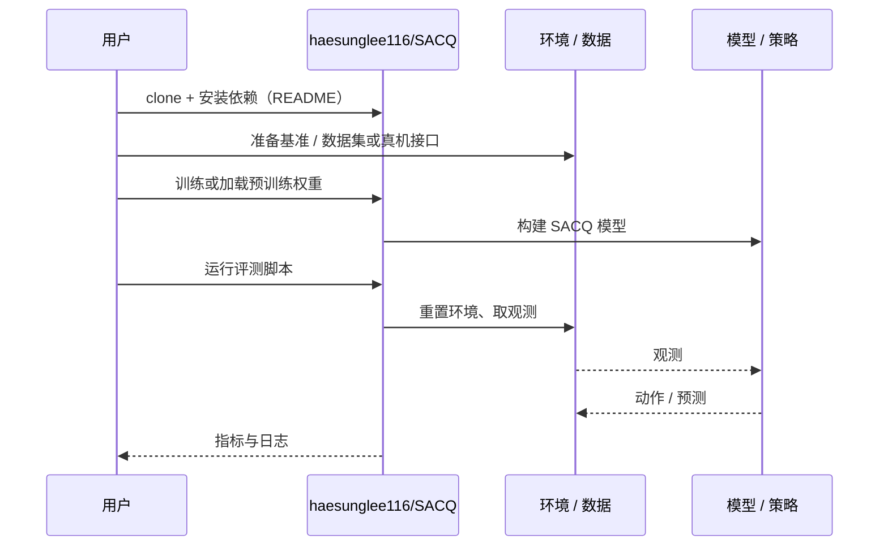

# SACQ（arXiv:2610.41408）

**SACQ**（*SACQ: Structure-Aware Codebook Quantization for Ultra-Low-Bit Vision-Language-Action Models*，[arXiv:2610.41408](https://arxiv.org/abs/2610.41408)，[项目页](https://haesunglee116.github.io/SACQ_page/)，[代码](https://github.com/haesunglee116/SACQ)）来自 [具身智能小站 2026-11-03 盘点](../../sources/blogs/wechat_embodied_station_49_papers_sacq_action_aware_quantization_2026-11-03.md)，属「策略学习与部署」组。

## 一句话定义

**把视觉语言动作模型部署到有限内存的平台，不能只追求更低位宽：量化误差最终会变成动作偏差。**

## 英文缩写速查

| 缩写 | 英文全称 | 简要说明 |
|------|----------|----------|
| SACQ | SACQ: Structure-Aware Codebook Quantization for Ultra-Low-Bit Vision-Language-Action Models | 本文方法 / 基准的简称 |
| VLA | Vision-Language-Action | 视觉–语言–动作策略 |

## 为什么重要

- 低比特压缩要对齐最终动作。SACQ 将下游计算结构与最终动作误差纳入压缩流程，提供了同时检查模型存储、位宽口径和闭环成功率的方法，适合做部署方案评估。
- 开源结论：**已开源**（步骤 2.5，2026-11-03）。仓库可达（git ls-remote）。项目页 HTTP 200。
- 同期同组工作见 [动作感知量化、失败定位与可验证自主：具身智能小站 11-03 期 49 篇阅读坐标](../overview/embodied-station-2026-11-03-49-papers-technology-map.md)。

## 核心机制

| 项 | 内容 |
|----|------|
| **arXiv** | [2610.41408](https://arxiv.org/abs/2610.41408) |
| **开源** | **已开源** |
| **要点** | 把视觉语言动作模型部署到有限内存的平台，不能只追求更低位宽：量化误差最终会变成动作偏差。 |
| **文内指标** | 公众号转述：表 1 中 GR00T N1.7 在四个 LIBERO 套件平均成功率 93.85%（BF16 为 94.10%）；1.50 位仅指语言与动作候选层，模型内存 1.175 GB，并非全部参数均为该位宽；方法为结构感知码本、动作敏感度位宽分配与两阶段校准，把不同投影层的下游作用引入码本拟合。 |

## 源码运行时序图

以下为按仓库入口（`haesunglee116/SACQ`）推断的通用运行链路；入库日仅核实仓库可达，未逐文件阅读，具体脚本名以 README 为准。

## 实验与评测

- 公众号转述：表 1 中 GR00T N1.7 在四个 LIBERO 套件平均成功率 93.85%（BF16 为 94.10%）；1.50 位仅指语言与动作候选层，模型内存 1.175 GB，并非全部参数均为该位宽；方法为结构感知码本、动作敏感度位宽分配与两阶段校准，把不同投影层的下游作用引入码本拟合。
- **读法：** 本页为索引级摘要，依据公众号转述的官方摘要与仓库信息整理；逐项数字与 baseline 以原文 PDF 为准。

## 与其他工作对比

- 横向索引见 [动作感知量化、失败定位与可验证自主：具身智能小站 11-03 期 49 篇阅读坐标](../overview/embodied-station-2026-11-03-49-papers-technology-map.md)；同 arXiv 不重复造页。

## 结论

**低比特压缩要对齐最终动作：把不同投影层的下游作用引入码本拟合，并按最终动作敏感度决定压缩预算，使存储优化直接关联策略输出。**

1. 开源边界：**已开源** — 仓库可达（git ls-remote）。项目页 HTTP 200。
2. 核心机制：把视觉语言动作模型部署到有限内存的平台，不能只追求更低位宽：量化误差最终会变成动作偏差。
3. 复现与选型前核对任务协议、硬件与基准口径，勿直接横比公众号摘录数字。

## 关联页面

- [vla](../methods/vla.md)
- [imitation-learning](../methods/imitation-learning.md)
- [reinforcement-learning](../methods/reinforcement-learning.md)
- [sim2real](../concepts/sim2real.md)
- [embodied-station-2026-11-03-49-papers-technology-map](../overview/embodied-station-2026-11-03-49-papers-technology-map.md)

## 参考来源

- [sacq_arxiv_2610_41408.md](../../sources/papers/sacq_arxiv_2610_41408.md)
- [wechat_embodied_station_49_papers_sacq_action_aware_quantization_2026-11-03.md](../../sources/blogs/wechat_embodied_station_49_papers_sacq_action_aware_quantization_2026-11-03.md)
- [arXiv:2610.41408](https://arxiv.org/abs/2610.41408)

## 推荐继续阅读

- [arXiv PDF](https://arxiv.org/pdf/2610.41408)
- [项目页](https://haesunglee116.github.io/SACQ_page/)
- [https://github.com/haesunglee116/SACQ](https://github.com/haesunglee116/SACQ)
