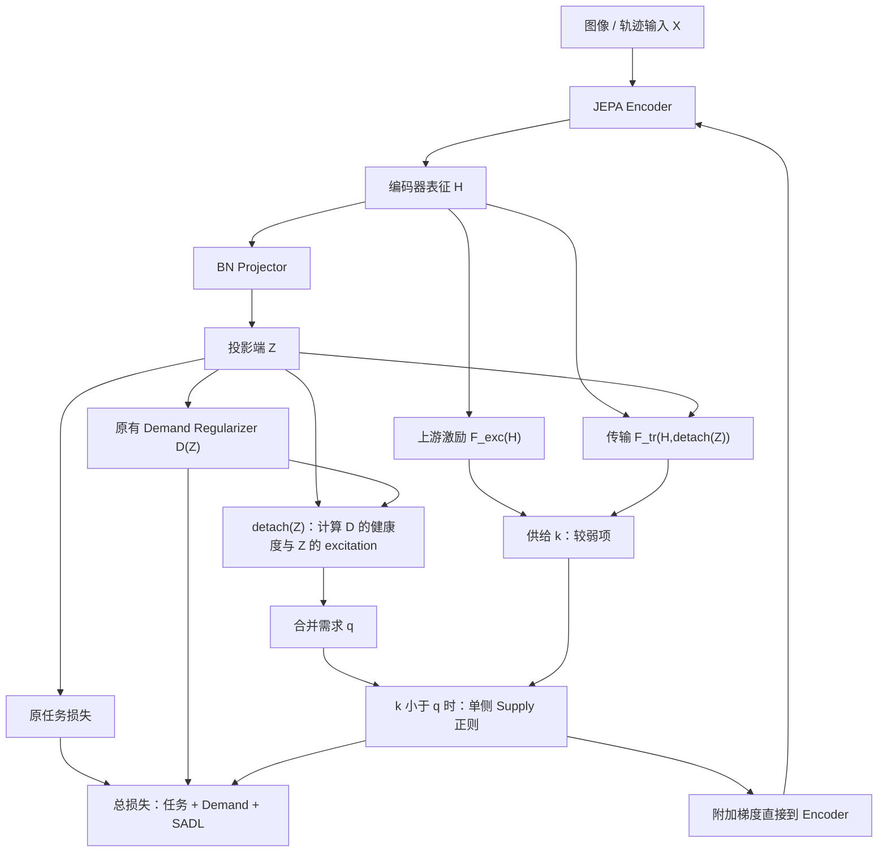
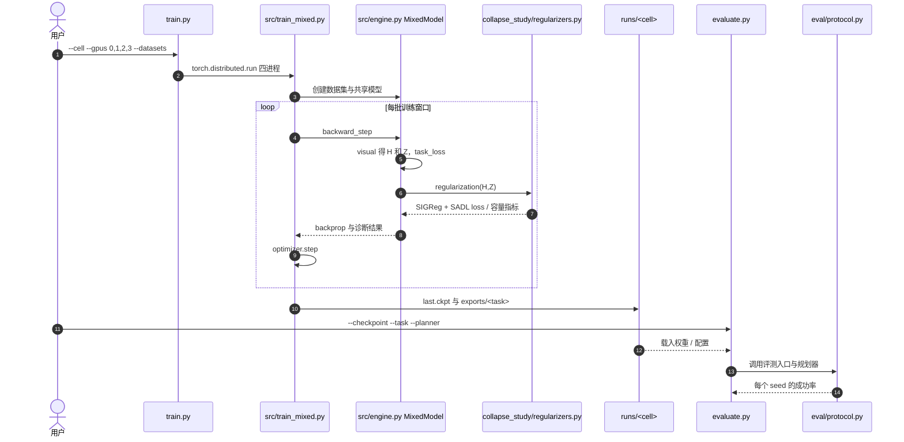

# SADL: On the Demand-Supply Geometry of Representation Collapse｜表征坍塌的供需几何

## 一句话定义

**SADL（Supply And Demand Loss）** 是一种 JEPA 表征训练正则：既测量投影端 Z 对表征变化的需求，也测量编码器 H 的变化激励及其向 Z 的传输供给，只在供给不足时对 H 添加纠正梯度；不替换原有任务损失、投影端正则或推理架构。[原文 arXiv:2611.21596v1](https://arxiv.org/html/2611.21596v1)，2026 年 11 月 16 日。

## 英文缩写速查

| 缩写 | 英文全称 | 简要说明 |
|---|---|---|
| SADL | Supply And Demand Loss | 需求和供给匹配的单侧训练损失 |
| JEPA | Joint-Embedding Predictive Architecture | 以嵌入空间预测为基础的自监督架构 |
| BN | Batch Normalization | 带 BN 投影器可能隐藏 H 的公共均值坍塌 |
| CCA | Canonical Correlation Analysis | 用于测量 H→Z 的二阶相关传输 |
| SIGReg | Sigmoid/Characteristic-Function Regularization | 原有的投影端分布正则之一 |
| CEM | Cross-Entropy Method | LeWM 评测中的候选动作搜索方法 |

## 为什么重要

- **输出健康不代表输入健康：** 在论文的 JEPA 中，编码器 H 初始化时样本间变化仅占总能量约 0.01%，其余主要是共享方向；带 BN 的 projector 消除均值，使经 Z 计算的任务损失与正则无法约束那条方向。
- **对应机器人世界模型风险：** H 退化会让不同状态的表示难区分；只看 Z 的协方差或 SIGReg 值会高估训练状况。
- **低侵入性改进：** SADL 是训练时的附加正则，没有额外可训练网络/参数，能叠加于多种 Demand Regularizer。

## 核心信息

| 项 | 一手来源结果 |
|---|---|
| 作者 | Junhan Sun, Yigui Feng, Mingzhe Liu, Haoyan Xu, Lei Ye, Ziqi Han, Hanru Bai, Yanzhao Zhang, Hao Zhao, Guofeng Zhang |
| 机构 | 浙江大学 CAD&CG 国家重点实验室、RoboParty Lab、阿里巴巴集团、清华大学 AIR、InSpatio |
| 论文 | arXiv:2611.21596v1，2026 年预印本 |
| 目标模型 | JEPA 编码器 H → BN projector → Z；LeWM、INTACT |
| 控制实验 | PushT / Cube / Reacher / TwoRoom，单任务和联合四任务 |
| 其他实验 | ImageNet-LT / Galaxy10 / CIFAR-10 / Imagenette 等图像任务 |
| 开源 | [项目主页](https://zju3dv.github.io/SADL/)、[官方代码](https://github.com/zju3dv/SADL)、[权重/数据](https://huggingface.co/DavidSunok/SADL) |

## 核心原理

### 表征失效的两种供给短板

1. **Excitation**：H 的不同样本是否真正产生变化。F_exc 使用样本协方差与**未中心化总能量**归一化的 log-det，同时感知“公共均值太大”与“变化挤在少数谱方向”。
2. **Transmission**：H 中的差异能否传到 Z。F_tr 采用正则化 CCA 的相关谱，检查对齐样本的二阶传输；属于有限样本代理量，**不是**非线性网络的精确互信息。
3. **Demand**：Z 需要的健康度既来自原有 D(Z)，也来自已实现的 Z 样本变化，需求应随训练自适应而非一味要求 H 满秩。

### 供需匹配的目标

对同一批对齐样本，定义 H=Encoder(X)，Z=Projector(H)，sg 为 stop-gradient：

- q_reg=clip(1−D(sg(Z))/D(0),0,1)，q_exc=F_exc(sg(Z))；
- 需求 **q=sqrt(q_reg×q_exc)**；
- 供给 **k=min(F_exc(H),F_tr(H,sg(Z)))**；
- 单侧供给项 **S=[log((q+ε)/(k+ε))]_+²**；
- 总目标 **L=L_task+λ_D D(Z)+λ_S S(H,sg(Z))**。

当 k≥q 时供给项为零；否则沿 Encoder/H 更新。Z 在 SADL 支路被 detach，故附加 S 不直接向 Projector 梯度传递，而原任务损失与 D(Z) 仍正常训练。论文附录说明精确完全常数化 H 存在一阶梯度退化点，所以“近坍塌可修复”不意味着“任何坍塌都必可恢复”。

## 流程总览

这是论文 §3 的训练期信号流，不是机器人真机执行控制图。

## 源码运行时序图

根据[官方静态代码审阅](../../sources/repos/sadl-zju3dv.md)：train.py → src/train_mixed.py → src/engine.py / MixedModel 与 collapse_study 正则 → checkpoint；evaluate.py 经 eval/protocol.py 调度评测。

图仅反映已核对源码职责，**未运行训练、推理或真机**。

## 工程实践

| 环节 | 核实的官方说明 |
|---|---|
| 安装 | Python 3.10 与 CUDA PyTorch；pip install -r requirements.txt |
| 数据 | 4 份 HDF5 和 datasets.json；tools/prepare_datasets.py |
| 训练 | train.py --cell INTACT_4T_S3072 --gpus 0,1,2,3 --datasets datasets.json |
| 资源 | 官方指南单机 4 GPU、global batch 256 个 8 帧窗口 |
| 正则实现 | CanonicalCapacityMatching(SIGReg(...), mode=reference_excitation_free_energy)，H/Z 容量统计为 FP32 |
| 示例权重 | SIGReg 0.015、SADL 0.01（训练指南配置，不可与论文不同实验表的系数混用） |
| 评测 | evaluate.py；INTACT direct/guarded_a，LeWM cem；默认 3 个 seeds 每个 100 episodes |
| 本次验证 | 静态源码核对；未下载权重、未运行 GPU 训练和评测 |

## 实验与评测

| 实验/统计口径 | 原有 Demand 正则 | 加 SADL |
|---|---:|---:|
| LeWM/INTACT 多设置十 seed 坍塌诊断（摘要） | 50% | 0% |
| 单任务训练、LeWM、SIGReg、epoch 1、四任务宏成功率（Table 4） | 45.25±6.50% | 72.19±0.97% |
| 单任务训练、INTACT、SIGReg、epoch 1、四任务宏成功率（Table 4） | 58.64±8.14% | 95.33±0.44% |

- 摘要报告：单 epoch 的 H 有效秩为对应基线 **3.4–6.4 倍**，潜在预测误差降为 **1/20–1/303**；必须用同一 baseline 和 epoch 对照。
- 官网展示多个 Demand Regularizer 下 INTACT **超过 95%** 的搜索免除控制成功率，以及四个图像任务的表征稳定性、收敛速度改善。
- 注意十种子坍塌诊断与三训练种子的 Table 4 成功率属于不同统计条件；未从作者结果推断跨平台真机成功率。

## 结论

**SADL 的贡献是让 Encoder 的有效变化“供给”满足投影端真正形成的“需求”，而不是仅让 Z 的输出损失好看。**

1. 监控 H 与 Z 的有效秩、样本余弦相似度和样本变化能量比例，不能只看 Z 的正则损失。
2. 对带 BN projector 的 JEPA，直接检验共享均值方向可能存在的上游坍塌。
3. 分开检测 excitation 与 transmission；供给短板可能在 Encoder 或 Projector。
4. 通过 stop-gradient 和 one-sided 门控，让附加项仅在需要时更新 Encoder。
5. 匹配 Attention 后端、seed、训练 epoch 和 Direct/CEM 规划设置再讨论效果。
6. 将公开代码视为可复现起点，不将论文的 benchmark 成功率等同真实机器人安全性能。

## 与其他工作对比

- [INTACT](./paper-intact.md)：它提供目标到动作的零搜索控制接口；SADL 只改其 JEPA 表征训练约束，不替换动作预测器。
- [LeWM](./paper-lewm.md)：它以潜空间动态和 CEM 规划为基线；SADL 影响前向表征健康度而不是新规划器。
- [LeJEPA](./paper-lejepa.md)：同属 JEPA 表征学习/正则谱系；SADL 特别针对 H→Z 接口的供需短板。
- [生成式世界模型](../methods/generative-world-models.md)：该工作既不合成 RGB 视频也不直接产生机器人关节控制输出。

## 局限与风险

- 训练与评测来自作者指定的 LeWM/INTACT 四任务及图像数据；不能外推到所有数据分布或真机安全。
- F_tr 的正则化 CCA 是二阶容量代理，样本量、ridge、数值精度和 BN 统计会影响结果。
- 对严格完全坍塌的 H 存在一阶梯度退化，不承诺无条件恢复。
- 开源模型训练依赖 4 GPU；附加统计有训练计算成本，不能说端到端零开销。
- **阅读状态：** 已核对正文核心方法、实验及代码关键路径；论文附录尚未逐节通读，暂保持 Draft，健康度不虚报满分。

## 关联页面

- [INTACT](./paper-intact.md)
- [LeWM](./paper-lewm.md)
- [LeJEPA](./paper-lejepa.md)
- [WAM 纵深路线](../../roadmap/depth-wam.md)

## 参考来源

- [论文原文核对笔记](../../sources/papers/sadl-arxiv-2611-21596.md)
- [项目主页核查归档](../../sources/sites/sadl-project-page.md)
- [官方源码与运行入口审阅](../../sources/repos/sadl-zju3dv.md)

## 推荐继续阅读

- [论文 HTML（含附录）](https://arxiv.org/html/2611.21596v1)
- [官方 Github 源码](https://github.com/zju3dv/SADL)
- [官方 TRAINING 指南](https://github.com/zju3dv/SADL/blob/main/docs/TRAINING.md)
- [官方公开权重与数据](https://huggingface.co/DavidSunok/SADL)
