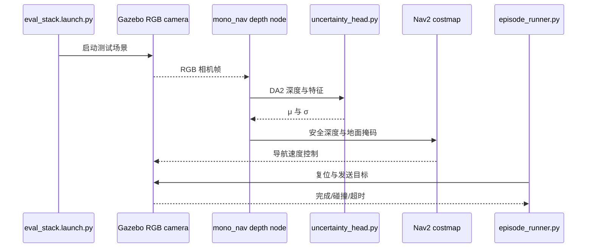

# From Depth to Safe Depth: Uncertainty-Aware Monocular Perception for Mobile Robot Navigation｜不确定性校准单目深度导航

## 一句话定义

Safe Depth 在冻结的 Depth Anything V2 上预测偏差与不确定性，将保守距离 d·exp(μ−kσ) 提供给 Nav2。

## 英文缩写速查

| 缩写 | 英文全称 | 简要说明 |
|---|---|---|
| Nav2 | Navigation 2 | 本研究涉及的Nav2术语 |
| DA2 | Depth Anything V2 | 本研究涉及的DA2术语 |
| NLL | Negative Log Likelihood | 本研究涉及的NLL术语 |

## 为什么重要

从 RGB 获得单目深度，并用小型 0.58M 参数头估计对数偏差 μ 和方差尺度 σ。

## 核心原理与方法

1. 从 RGB 获得单目深度，并用小型 0.58M 参数头估计对数偏差 μ 和方差尺度 σ。
2. 留出世界做保形标定求 k，形成偏向障碍物一侧的安全深度界。
3. 由 Nav2 消费安全深度并据不确定性判断可通行地面。

## 流程总览

> 根据论文方法与作者公开资料重绘，非作者原图。

## 实验与评测

论文摘要称 120 次配对仿真中碰撞率 63%→3%、导航成功率 37%→70%，未在真机复测。

上述结果均为作者报告或用户附件转载，**不是本次复测**。

## 结论

**Safe Depth 在冻结的 Depth Anything V2 上预测偏差与不确定性，将保守距离 d·exp(μ−kσ) 提供给 Nav2。**

1. 从 RGB 获得单目深度，并用小型 0.58M 参数头估计对数偏差 μ 和方差尺度 σ。
2. 留出世界做保形标定求 k，形成偏向障碍物一侧的安全深度界。
3. 仿真中采用真值里程计，跨地图/相机/材质的校准失配与真机可靠性仍需验证。

## 与其他工作对比

比较本文与相关基线时应在相同任务、数据、样本量、传感器和部署条件下评估；不能把论文中的单个数字解释为真实部署的通用进步。待全文表格核对后补足逐项量化对照。

## 源码运行时序图

按官方 README/启动入口绘制，尚未独立执行。

## 工程实践

- 对齐版本、传感器、动作/观测空间和评测预算后再尝试复现。
- 正式应用应增加跨分布扰动与任务安全边界检查；原文完整复现步骤待核对。
- 已通读原文方法、实验及附录；尚未独立运行代码。

## 局限与风险

仿真中采用真值里程计，跨地图/相机/材质的校准失配与真机可靠性仍需验证。

已核对论文正文与附录；源码运行和真实部署仍需独立验证。

## 全文核验补记

方法 §III：冻结 Depth Anything V2 ViT-S，加入 36 通道 mini U-Net（约 0.58M 参数）预测 log-depth 修正 μ 和不确定性 σ，使用 β-NLL β=0.5 训练。单侧保守深度 d_safe=d_DA2×exp(μ−kσ)，论文验证域使用 k=3.0（约 97.7% 单侧覆盖）；对地面使用不确定性辅助清理错误障碍。§IV–V：ROS 2 Humble + Gazebo Fortress、四个未见测试世界、120 个配对回合，原单目深度碰撞率 63%，Safe Depth 3%；成功率从 37% 到 70%，GT 深度约 93%；correction-only 60%、uniform margin 30%。**评测使用真值里程计，没有真机迁移**，所以不能当成形式化安全保证。

## 关联页面

- [zero-shot-object-navigation](../tasks/zero-shot-object-navigation.md)
- [safety-filter](../concepts/safety-filter.md)

## 参考来源

- [原论文及阅读进度](../../sources/papers/safe_depth_arxiv_2611_13769.md)
- [官方源码入口](../../sources/repos/safe-depth.md)
- [用户附件 13 篇原始资讯整理](../../sources/blogs/embodied-research-digest-2026-11-12.md)

## 推荐继续阅读

- [arXiv 原文](https://arxiv.org/abs/2611.13769)
- [官方源码](https://github.com/saeed5959/depth_safe_robot)
